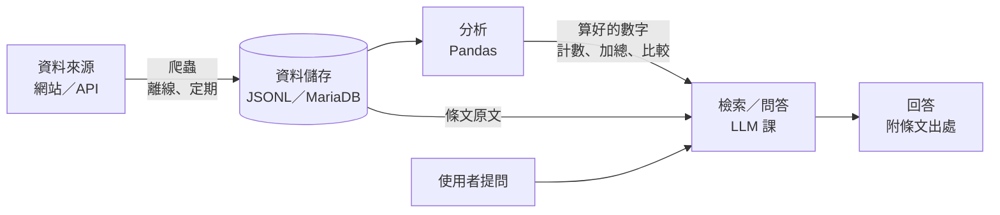
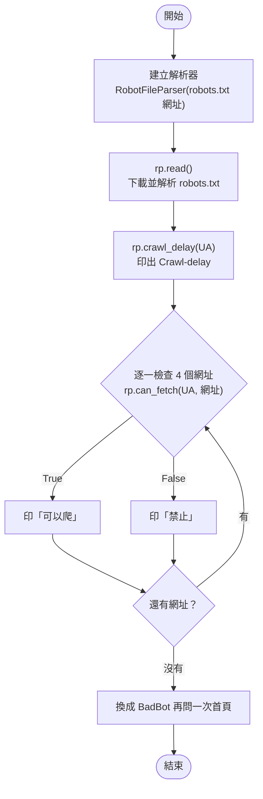

# 1. 01｜爬蟲在 AI 系統中的位置與合法界線

> **定位**：說明爬蟲在 AI 系統裡負責什麼，並在動手前判斷一個資料來源能不能爬、該怎麼取得。

## 學習目標

完成本節後，你應該能夠：

- 說出爬蟲在 AI 系統中是「離線資料供應者」，不是上線時即時去抓
- 讀懂 `robots.txt` 的 `User-agent`、`Disallow`、`Crawl-delay`
- 用 Python 的 `urllib.robotparser` 判斷某個網址能不能爬
- 依「官方 API → robots.txt → 服務條款 → 個資與著作權」的順序評估資料來源

## 範例程式碼

demo repo 的 [`01-legal/`](https://github.com/4-learn/python-web-crawler-demo/tree/main/01-legal) 資料夾，本節用到的程式（都在 **repo 根目錄** `python-web-crawler-demo/` 執行）：

| 檔案 | 講解段落 | 內容 | 執行指令 |
|---|---|---|---|
| [`01-legal/robots_check.py`](https://github.com/4-learn/python-web-crawler-demo/blob/main/01-legal/robots_check.py) | 5. 用程式判斷 | 用 robotparser 檢查練習站的 robots.txt | `python 01-legal/robots_check.py` |

- 練習站：<https://4-learn.github.io/crawler-playground/>

---

## 情境

你是 AI 團隊新來的資料工程師。團隊要做一個「勞動法規問答系統」：使用者問「加班費怎麼算？」，系統找出相關條文再回答。

主管交代第一件事：

> 「問答系統要用的條文，你負責準備。先告訴我資料從哪裡來、能不能爬，不要讓公司收到律師函。」

這三天你會從零開始，做出一條**可信、可驗證、可更新**的法規資料管線。今天第一步不是寫程式，而是確認「可以拿、怎麼拿」。

---

## 講解

### 1. 爬蟲在 AI 系統中的位置

問答系統回答問題時，**不會**每次都去法規網站即時抓資料。條文是事先準備好的：



- **爬蟲**：離線、定期執行，把外部資料整理成系統可用的格式。
- **分析**：LLM 不擅長算數字，計數、加總、平均常常算錯。所以先用 Pandas 把數字算好（例如「勞基法第三章有幾條」），再把結果交給 LLM。
- **問答**：LLM 拿到條文原文和算好的數字，負責解釋、回答，並附上條文出處。

這樣分工的好處：

| 如果上線時即時去爬 | 離線準備 |
|---|---|
| 網站一慢，系統就慢 | 回應速度穩定 |
| 網站改版，系統直接壞 | 爬蟲壞了，舊資料還能用，有時間修 |
| 每個使用者都打一次網站 | 只打一次，對網站友善 |
| 無法事先檢查資料對不對 | 可以先驗證、再上線 |

所以這門課的重點不只是「抓得到」，還有**抓得對、說得出來源、能重新抓**。

### 2. 能不能爬？四個問題

拿到一個資料來源，依序問：

1. **有沒有官方 API 或開放資料？** 有就用，不必爬網頁。
2. **robots.txt 怎麼說？** 網站告訴爬蟲「哪裡不要來、多久來一次」。
3. **服務條款怎麼說？** 有些網站明文禁止自動化蒐集。
4. **資料本身有沒有問題？** 是否含個資、是否受著作權保護。

#### 法規條文可以用嗎？

可以。依《著作權法》第 9 條，**憲法、法律、命令或公文**不得為著作權的標的。所以法規條文本身沒有著作權問題。

但「能用資料」不等於「能用任何方式抓」。下面看一個真實例子。

### 3. 讀 robots.txt

robots.txt 放在網站根目錄，例如 `https://law.moj.gov.tw/robots.txt`：

```text
User-agent: *
Disallow: /
```

- `User-agent: *`：規則適用所有爬蟲
- `Disallow: /`：根目錄以下全部不要爬

全國法規資料庫**不希望**任何爬蟲爬它的網頁。那條文要從哪裡來？同一個網站提供官方開放資料：

```text
https://law.moj.gov.tw/api/Ch/Law/JSON    ← 全部法律，ZIP 內含 JSON
https://law.moj.gov.tw/api/Ch/Order/JSON  ← 全部命令
```

這就是第一個問題的答案：**先找 API**。第 03 節會實際下載。

### 4. 練習站的 robots.txt

本課的練習站是用全國法規資料庫的開放資料做成的，專門給大家練習：

```text
User-agent: *
Crawl-delay: 1
Disallow: /crawler-playground/v1/admin/
Disallow: /crawler-playground/v2/admin/

User-agent: BadBot
Disallow: /
```

| 指令 | 意思 |
|---|---|
| `User-agent: *` | 以下規則給所有爬蟲 |
| `Crawl-delay: 1` | 兩次請求間隔至少 1 秒 |
| `Disallow: .../admin/` | 後台路徑不要爬 |
| `User-agent: BadBot` + `Disallow: /` | 名叫 BadBot 的爬蟲什麼都不能爬 |

:::info
robots.txt 規定要放在網域根目錄。練習站架在 GitHub Pages 的子路徑，所以本課約定：以「練習站首頁 + `robots.txt`」為準。
:::

robots.txt 是**君子協定**，技術上擋不住你；但違反它，網站可以封鎖你的 IP，嚴重時可能涉及法律責任。上課時老師的教室版練習站會記錄誰爬了禁止路徑。

### 5. 用程式判斷

Python 內建 `urllib.robotparser`，不用安裝套件：

<!-- flow-chart -->
**流程圖**



<!-- fn-table -->
| 函式名稱 | 說明 | 官方文件連結 |
|---|---|---|
| `RobotFileParser(url)` | 建立 robots.txt 解析器，`url` 是 robots.txt 的網址 | [文件](https://docs.python.org/3/library/urllib.robotparser.html#urllib.robotparser.RobotFileParser) |
| `rp.read()` | 下載並解析 robots.txt。遇到 429 等 4xx 會當成「全部允許」（見第 06 節） | [文件](https://docs.python.org/3/library/urllib.robotparser.html#urllib.robotparser.RobotFileParser.read) |
| `rp.crawl_delay(user_agent)` | robots.txt 的 `Crawl-delay` 秒數；沒寫就是 `None` | [文件](https://docs.python.org/3/library/urllib.robotparser.html#urllib.robotparser.RobotFileParser.crawl_delay) |
| `rp.can_fetch(user_agent, url)` | 這個 User-Agent 可不可以抓這個網址，回傳 True／False | [文件](https://docs.python.org/3/library/urllib.robotparser.html#urllib.robotparser.RobotFileParser.can_fetch) |

```python
import urllib.robotparser

BASE = "https://4-learn.github.io/crawler-playground/"
USER_AGENT = "course-crawler/1.0 (demo)"

rp = urllib.robotparser.RobotFileParser(BASE + "robots.txt")
rp.read()

print("Crawl-delay:", rp.crawl_delay(USER_AGENT))
for path in ["v1/laws/", "v1/api/laws.json", "v1/admin/", "v2/admin/"]:
    ok = rp.can_fetch(USER_AGENT, BASE + path)
    print(f"{'可以爬' if ok else '禁止  '}  {BASE + path}")

print("BadBot 可以爬首頁嗎？", rp.can_fetch("BadBot", BASE))
```

<!-- run-box -->
:::info
**▶ 怎麼執行**　程式在 demo repo 的 [`01-legal/robots_check.py`](https://github.com/4-learn/python-web-crawler-demo/blob/main/01-legal/robots_check.py)。在 **repo 根目錄**（`python-web-crawler-demo/`）執行：
第一次用 demo repo？先照 [README](https://github.com/4-learn/python-web-crawler-demo#環境) 完成 `git clone`、建立 `.venv`、`pip install -r requirements.txt`。
```bash
cd ~/python-web-crawler-demo     # 換成你 clone 的位置
source .venv/bin/activate
python 01-legal/robots_check.py
```
:::

執行結果：

```text
Crawl-delay: 1
可以爬  https://4-learn.github.io/crawler-playground/v1/laws/
可以爬  https://4-learn.github.io/crawler-playground/v1/api/laws.json
禁止    https://4-learn.github.io/crawler-playground/v1/admin/
禁止    https://4-learn.github.io/crawler-playground/v2/admin/
BadBot 可以爬首頁嗎？ False
```

第 06 節會把這段檢查放進每一次請求之前。

### 6. 練習站導覽

打開 <https://4-learn.github.io/crawler-playground/>，接下來三天會用到這些關卡：

| 關卡 | 內容 | 節次 |
|---|---|---|
| 1 | 靜態法規列表、分頁、條文詳細頁 | 04、05 |
| 2 | JSON API | 03 |
| 3 | JavaScript 動態載入 | 07–09 |
| 4 | 無限捲動 | 10 |
| 5 | 會員登入 | 10 |
| 6 | 禮貌與速率限制 | 06 |
| 7 | 網站改版（v2） | 15 |

練習站有 9 部勞動法規、749 條。條文來自全國法規資料庫開放資料，**v2 有刻意修改的虛構內容**，不具法律效力。

---

## Workshop

### 題目

填寫下表。打開每個網站的 `robots.txt`（網址＋`/robots.txt`），必要時查看服務條款或開放資料平台：

| 網站 | robots.txt 重點 | 能不能爬 | 理由／替代管道 |
|---|---|---|---|
| 爬蟲練習站 | | | |
| 全國法規資料庫 `law.moj.gov.tw` | | | |
| 勞動部 `www.mol.gov.tw` | | | |
| 任選一個社群平台 | | | |

再執行 demo 的 `robots_check.py`，把 `User-Agent` 改成 `BadBot`，觀察結果有什麼不同。

### 預期輸出

練習站一列應類似：

```text
爬蟲練習站 | Disallow v1/admin/、v2/admin/；Crawl-delay: 1 | 可以，避開 admin、每秒最多 1 次 | 本課練習用
```

改成 `BadBot` 後，所有網址都應顯示「禁止」。

### 解答

- [解答](https://github.com/4-learn/python-web-crawler-workshop/tree/master/2026/01)
