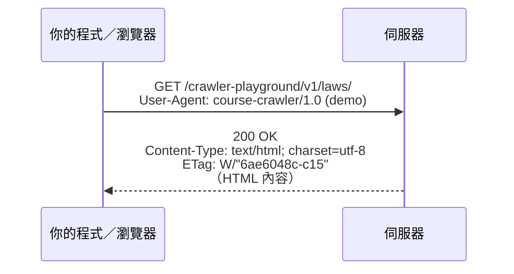
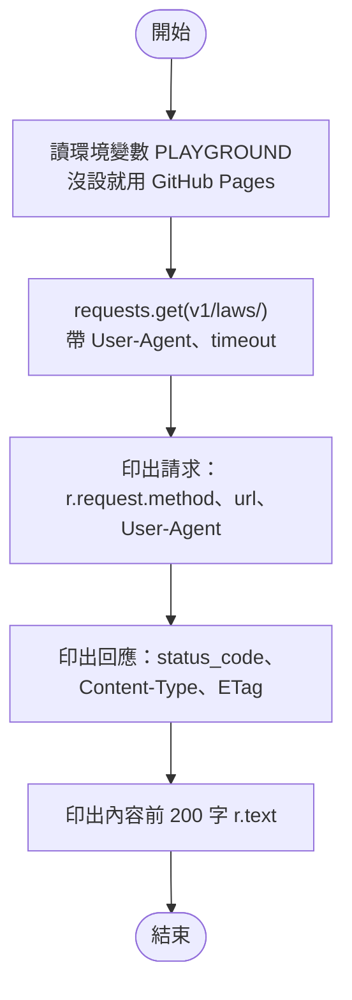
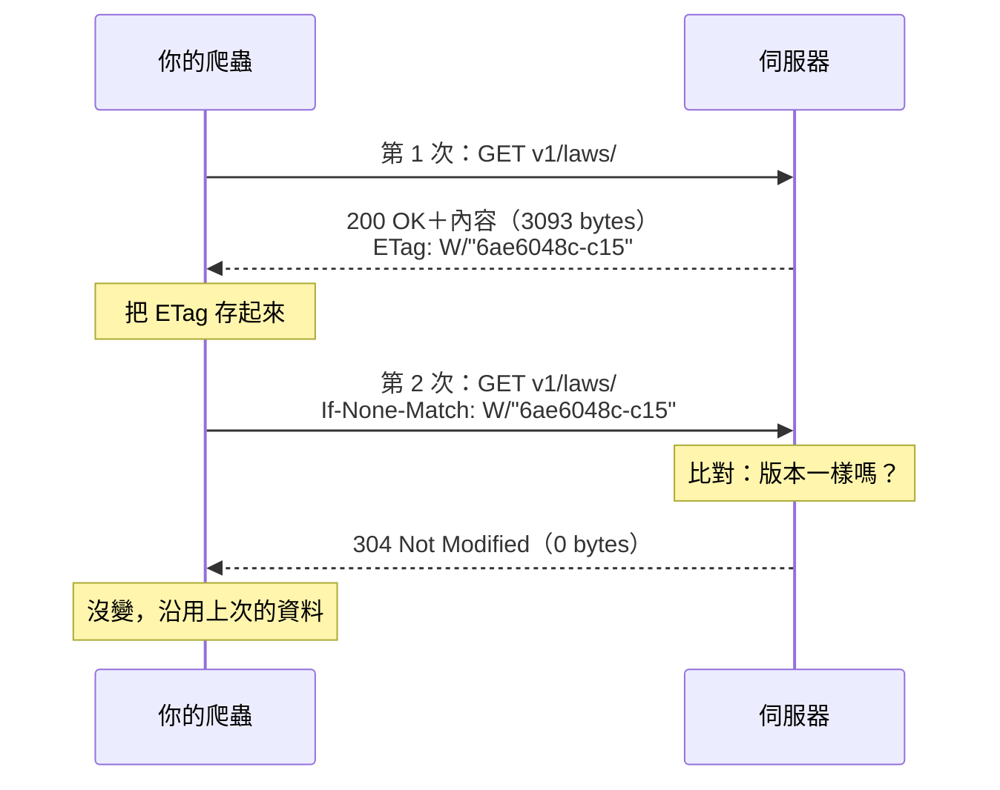
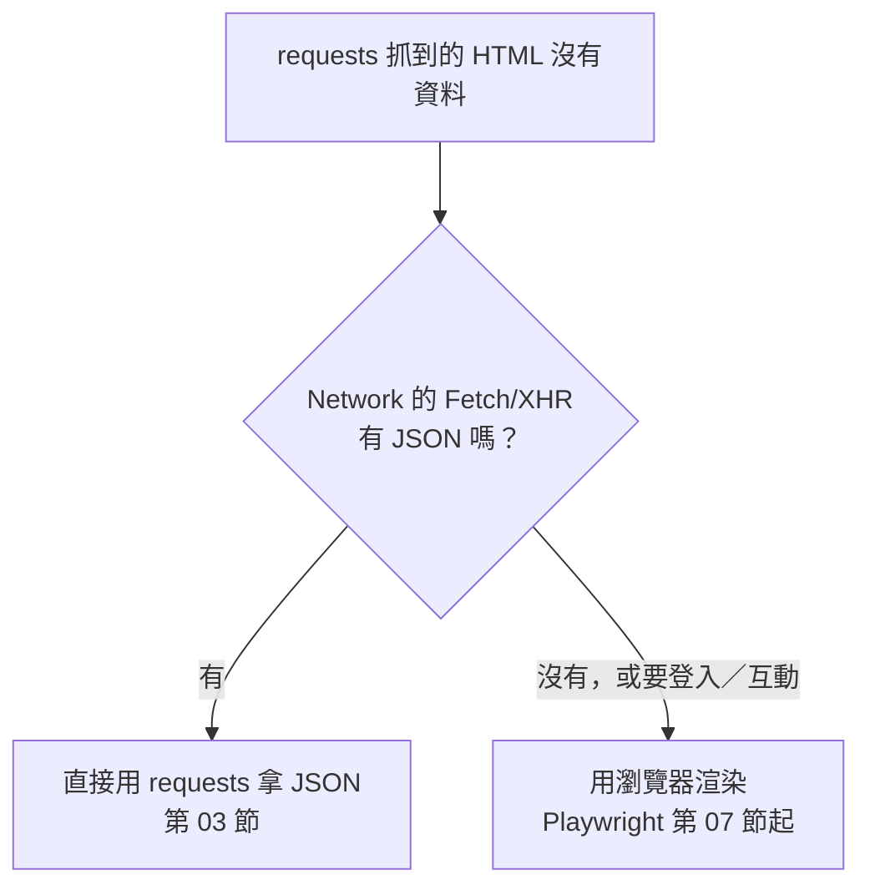

# 02｜HTTP 與 DevTools：看懂一次請求

> **定位**：拆開一次 HTTP 請求，看懂 method、URL、status code、header、cookie，並用 DevTools 的 Network 分頁找出網頁背後真正的資料來源。

## 學習目標

完成本節後，你應該能夠：

- 說出一次 HTTP 請求與回應由哪些部分組成
- 看到 200、301／302、304、401、403、404、429 時，知道發生了什麼、程式該怎麼反應
- 用 `requests` 印出請求與回應的 header，理解 `User-Agent`、`Content-Type`、`ETag`、`Cookie`
- 用 DevTools Network 分頁的 Fetch/XHR、Doc 篩選，找出頁面呼叫的 JSON 網址

## 範例程式碼

demo repo 的 [`02-http/`](https://github.com/4-learn/python-web-crawler-demo/tree/main/02-http) 資料夾，本節用到的程式（都在 **repo 根目錄** `python-web-crawler-demo/` 執行）：

| 檔案 | 講解段落 | 內容 | 執行指令 |
|---|---|---|---|
| [`02-http/inspect_request.py`](https://github.com/4-learn/python-web-crawler-demo/blob/main/02-http/inspect_request.py) | 2–3 | 印出請求與回應的重點；觸發 301、404、304 | `python 02-http/inspect_request.py` |
| [`02-http/cookie_check.py`](https://github.com/4-learn/python-web-crawler-demo/blob/main/02-http/cookie_check.py) | 4. Cookie | 沒帶／有帶 cookie 的差別（要對教室版執行才看得到 401） | `python 02-http/cookie_check.py` |
| [`02-http/dynamic_html.py`](https://github.com/4-learn/python-web-crawler-demo/blob/main/02-http/dynamic_html.py) | 6. 為什麼要先看 Network | 用 requests 抓關卡 3，HTML 裡沒有條文 | `python 02-http/dynamic_html.py` |

- 練習站：<https://4-learn.github.io/crawler-playground/>（關卡 3：`v1/dynamic/`）

---

## 情境

你是 AI 團隊的資料工程師。上一節你已經確認：全國法規資料庫的網頁不能爬，但有官方開放資料；練習站可以爬，只要避開 `admin/`、每秒最多 1 次。

主管接著問：

> 「之後你寫的爬蟲如果抓不到資料，我不要聽『它就是壞了』。你要能說出是哪一個請求、回了什麼狀態碼、為什麼。」

爬蟲做的事，其實就是**代替瀏覽器發出 HTTP 請求**。看懂一次請求，你才知道該抓哪個網址、為什麼會失敗，也才會在下一節發現：很多網頁背後早就有現成的 JSON 可以拿。

---

## 講解

### 1. 一次請求長什麼樣子

你在瀏覽器輸入網址、按下 Enter，瀏覽器會送出一段文字給伺服器，伺服器再回一段文字：



| 部分 | 在請求（Request） | 在回應（Response） |
|---|---|---|
| 第一行 | **method** ＋ **URL**，如 `GET /v1/laws/` | **status code**，如 `200 OK` |
| header | 我是誰（`User-Agent`）、我有什麼（`Cookie`）、我已經有哪一版（`If-None-Match`） | 內容是什麼格式（`Content-Type`）、這一版的指紋（`ETag`）、要我去哪裡（`Location`）、多久後再來（`Retry-After`） |
| body | GET 通常沒有；POST 送表單或 JSON | HTML、JSON、圖片… |

爬蟲常用的 method 只有兩個：

- **GET**：拿資料。網址相同、拿到的內容通常相同，可以放心重試。
- **POST**：送資料，例如登入表單。重送可能造成重複動作，重試前要想清楚。

### 2. 用 requests 看一次請求

demo 的 `inspect_request.py` 把請求和回應的重點都印出來：

<!-- flow-chart -->
**流程圖**



<!-- fn-table -->
| 函式名稱 | 說明 | 官方文件連結 |
|---|---|---|
| `os.environ.get(name, 預設)` | 讀環境變數，沒有就用預設值；用來切換練習站網址、放帳密 | [文件](https://docs.python.org/3/library/os.html#os.environ) |
| `requests.get(url, headers=, timeout=)` | 送出 GET 請求，回傳 `Response`；`headers` 放 User-Agent 等標頭，`timeout` 是最多等幾秒，沒設可能永遠卡住 | [文件](https://requests.readthedocs.io/en/latest/api/#requests.get) |
| `r.request` | 這次實際送出的請求（`PreparedRequest`），可看 `.method`、`.url`、`.headers` | [文件](https://requests.readthedocs.io/en/latest/api/#requests.PreparedRequest) |
| `r.status_code` | HTTP 狀態碼（整數），例如 200、404、429 | [文件](https://requests.readthedocs.io/en/latest/api/#requests.Response.status_code) |
| `r.reason` | 狀態碼的文字說明，例如 `OK`、`Not Found` | [文件](https://requests.readthedocs.io/en/latest/api/#requests.Response.reason) |
| `r.headers.get(name)` | 取回應標頭；不分大小寫，沒有這個標頭就回傳 `None` | [文件](https://requests.readthedocs.io/en/latest/api/#requests.Response.headers) |
| `r.text` | 回應內容解碼成字串；編碼依 `r.encoding` | [文件](https://requests.readthedocs.io/en/latest/api/#requests.Response.text) |

```python
import os

import requests

BASE = os.environ.get("PLAYGROUND", "https://4-learn.github.io/crawler-playground/")
HEADERS = {"User-Agent": "course-crawler/1.0 (demo)"}

r = requests.get(BASE + "v1/laws/", headers=HEADERS, timeout=10)
print("請求：", r.request.method, r.request.url)
print("請求 header User-Agent：", r.request.headers["User-Agent"])
print("狀態碼：", r.status_code, r.reason)
print("Content-Type：", r.headers.get("Content-Type"))
print("ETag：", r.headers.get("ETag"))
print("內容前 200 字：")
print(r.text[:200])

print("\n--- 幾個常見的狀態碼 ---")
for path in ["v1/laws", "v1/no-such-page.html"]:
    r = requests.get(BASE + path, headers=HEADERS, timeout=10, allow_redirects=False)
    print(r.status_code, BASE + path, "→", r.headers.get("Location", ""))

# 304：帶上次拿到的 ETag，問伺服器「內容有變嗎？」
first = requests.get(BASE + "v1/laws/", headers=HEADERS, timeout=10)
etag = first.headers.get("ETag")
second = requests.get(BASE + "v1/laws/", headers={**HEADERS, "If-None-Match": etag}, timeout=10)
print(second.status_code, "If-None-Match", etag, "→ 內容長度", len(second.content))
```

<!-- run-box -->
:::info
**▶ 怎麼執行**　程式在 demo repo 的 [`02-http/inspect_request.py`](https://github.com/4-learn/python-web-crawler-demo/blob/main/02-http/inspect_request.py)。在 **repo 根目錄**（`python-web-crawler-demo/`）執行：
```bash
python 02-http/inspect_request.py
```
:::

執行結果（前半段）：

<sub>📄 來源：執行 [`02-http/inspect_request.py`](https://github.com/4-learn/python-web-crawler-demo/blob/main/02-http/inspect_request.py) 的輸出（前半段；ETag 為 2026-11-02 實測，網站重新部署後會變）</sub>

```text
請求： GET https://4-learn.github.io/crawler-playground/v1/laws/
請求 header User-Agent： course-crawler/1.0 (demo)
狀態碼： 200 OK
Content-Type： text/html; charset=utf-8
ETag： W/"6ae6048c-c15"
內容前 200 字：
<!DOCTYPE html>
<html lang="zh-Hant">
<head>
<meta charset="utf-8">
<meta name="viewport" content="width=device-width, initial-scale=1">
<title>勞動法規列表｜爬蟲練習站</title>
<link rel="stylesheet" href="../../
```

幾個要注意的地方：

- `r.request` 是**你送出去的**，`r.headers` 是**伺服器回來的**，不要搞混。
- `User-Agent` 是自我介紹。不設的話，requests 會送 `python-requests/2.34.2`（版本號依你安裝的 requests 而定），網站管理者看不出你是誰；寫上「誰的爬蟲、怎麼聯絡」是基本禮貌，也是第 06 節的要求。
- `timeout=10` 一定要加。requests **預設沒有 timeout**，對方不回應時程式會一直卡住。

:::warning
`Content-Type` 裡的 `charset=utf-8` 告訴 requests 怎麼把位元組轉成文字。老師的教室版伺服器只回 `text/html`、沒有 charset，同一支程式在教室版會印出「`ååæ³è¦å表`」這種亂碼（實測教室版 `r.encoding` 是 `ISO-8859-1`）。所以第 04 節起，抓 HTML 後都會加一行 `r.encoding = "utf-8"`。
:::

### 3. 常見的 status code

狀態碼是伺服器給你的「一句話結論」。百位數決定大方向：2xx 成功、3xx 去別處、4xx 你的問題、5xx 伺服器的問題。

| 狀態碼 | 意思 | 爬蟲該怎麼做 |
|---|---|---|
| 200 OK | 成功 | 解析內容 |
| 301／302 | 網址搬家了，看 `Location` header | requests 預設會自動跟過去；要觀察就加 `allow_redirects=False` |
| 304 Not Modified | 你手上那一版沒變 | 沿用舊資料，不必重新解析（第 15 節增量更新） |
| 401 Unauthorized | 沒登入 | 先登入、帶 cookie（第 10 節） |
| 403 Forbidden | 登入了也不給看，或你被封鎖了 | **停下來**，不要換方法硬闖 |
| 404 Not Found | 沒有這個網址 | 檢查網址；分頁爬到底常會遇到 |
| 429 Too Many Requests | 太快了 | 依 `Retry-After` 等待後重試（第 06 節） |
| 5xx | 伺服器出錯 | 等一下再試，次數要有上限 |

#### ETag 與 If-None-Match：問伺服器「內容有變嗎？」

上面的 304 要靠兩個 header 一問一答才會出現：

| header | 誰送的 | 意思 | 練習站的例子 |
|---|---|---|---|
| [`ETag`](https://developer.mozilla.org/zh-TW/docs/Web/HTTP/Reference/Headers/ETag) | 伺服器 → 你（回應） | 這份內容的**版本編號**。內容一改，編號就換 | `W/"6ae6048c-c15"` |
| [`If-None-Match`](https://developer.mozilla.org/zh-TW/docs/Web/HTTP/Reference/Headers/If-None-Match) | 你 → 伺服器（請求） | 「我手上是這個版本；**如果版本不一樣**，再給我內容」 | 把上次拿到的 `ETag` 原樣放進來 |

ETag 長得像亂碼，但你不需要看懂它，**原樣存起來、下次原樣送回去**就好。開頭的 `W/` 代表「弱 ETag」（weak）：內容意思相同就算同一版，不保證每個位元組都一樣。



伺服器比對兩個版本編號後只有兩種結果：

| 你送的 `If-None-Match` | 伺服器回 | 內容 |
|---|---|---|
| 和目前的 `ETag` 一樣 | **304 Not Modified** | 不傳（0 bytes），沿用你手上的 |
| 不一樣（或你沒送） | **200 OK** | 傳完整內容（3093 bytes），附上新的 `ETag` |

實測：把 `If-None-Match` 改成一個錯的值 `W/"00000000-000"`，伺服器就回 200 和完整內容。

為什麼爬蟲要在意：法規不會天天改，每天重抓 749 條大多是白工。帶 `If-None-Match` 問一下，沒變就跳過，**省流量、省時間，對網站也友善**。第 15 節會把它做成每天執行的增量更新。

demo 後半段實際觸發 301、404 與 304：

<!-- fn-table -->
| 函式名稱 | 說明 | 官方文件連結 |
|---|---|---|
| `allow_redirects=False` | 不要自動跟著 301／302 走，才看得到轉址本身 | [文件](https://requests.readthedocs.io/en/latest/user/quickstart/#redirection-and-history) |
| `r.content` | 回應內容的原始 bytes；下載 ZIP、圖片時用這個 | [文件](https://requests.readthedocs.io/en/latest/api/#requests.Response.content) |

這是第 2 段 `inspect_request.py` 的後半段（完整程式見第 2 段），執行結果的後半段：

<sub>📄 來源：執行 [`02-http/inspect_request.py`](https://github.com/4-learn/python-web-crawler-demo/blob/main/02-http/inspect_request.py) 的輸出（後半段）</sub>

```text
--- 幾個常見的狀態碼 ---
301 https://4-learn.github.io/crawler-playground/v1/laws → https://4-learn.github.io/crawler-playground/v1/laws/
404 https://4-learn.github.io/crawler-playground/v1/no-such-page.html → 
304 If-None-Match W/"6ae6048c-c15" → 內容長度 0
```

- `v1/laws`（少了結尾 `/`）被 301 導向 `v1/laws/`。網址差一個斜線就是不同資源。
- 304 的內容長度是 0：伺服器只說「沒變」，不再傳一次。對要每天更新的法規資料管線來說，這能省下大量流量。

### 4. Cookie：伺服器怎麼記得你

HTTP 本身**不記得**上一次請求。網站要「記住你登入了」，靠的是 cookie：登入成功時伺服器回 `Set-Cookie`，之後瀏覽器每次請求都帶 `Cookie` header。

教室版練習站的會員 API 會檢查 cookie，可以直接看到差別（以下為對教室版執行的結果）：

<!-- fn-table -->
| 函式名稱 | 說明 | 官方文件連結 |
|---|---|---|
| `cookies=` | 請求時帶上 cookie（dict），伺服器靠它認得你是誰 | [文件](https://requests.readthedocs.io/en/latest/user/quickstart/#cookies) |

```python
import os

import requests

BASE = os.environ.get("PLAYGROUND", "https://4-learn.github.io/crawler-playground/")

url = BASE + "v1/api/members/notices.json"
r = requests.get(url, timeout=10)
print("沒帶 cookie：", r.status_code, r.text.strip())
r = requests.get(url, cookies={"pg_session": "demo-session-token"}, timeout=10)
print("帶 cookie：", r.status_code, r.headers["Content-Type"])
print("請求 header Cookie：", r.request.headers["Cookie"])
```

<!-- run-box -->
:::info
**▶ 怎麼執行**　程式在 demo repo 的 [`02-http/cookie_check.py`](https://github.com/4-learn/python-web-crawler-demo/blob/main/02-http/cookie_check.py)。要對**教室版**執行才看得到 401（教室版怎麼開，見〈[練習站原始碼與教室版伺服器](https://hackmd.io/@yillkid/B1ILf8kpze)〉）。在 **repo 根目錄**（`python-web-crawler-demo/`）執行：
```bash
export PLAYGROUND=http://老師IP:8000/
python 02-http/cookie_check.py
```
:::

對教室版執行的結果：

<sub>📄 來源：對教室版執行 [`02-http/cookie_check.py`](https://github.com/4-learn/python-web-crawler-demo/blob/main/02-http/cookie_check.py) 的輸出</sub>

```text
沒帶 cookie： 401 401 Unauthorized：請先登入會員。
帶 cookie： 200 application/json
請求 header Cookie： pg_session=demo-session-token
```

:::info
沒設 `PLAYGROUND`、對 GitHub Pages 版執行的話，**兩次都是 200**：GitHub Pages 只是放檔案的地方，不會檢查 cookie。這也說明了一件事：保護資料要靠**伺服器**檢查，不能只靠網頁上的 JavaScript（第 10 節）。
:::

這裡的 cookie 值是練習站刻意公開的示範值。真實網站的 cookie 等同你的登入身分，**不要貼到程式碼、截圖或作業裡**。第 10 節會用 Playwright 正式處理登入。

### 5. DevTools Network 分頁

`requests` 只能看到你自己送的請求。一個網頁打開時，瀏覽器其實會送出好幾十個請求：HTML、CSS、JavaScript、圖片，還有**資料**。DevTools 讓你全部看見。

操作步驟（Chrome／Edge／Firefox 都類似）：

1. 打開頁面，按 `F12`（或右鍵 →「檢查」），切到 **Network** 分頁。
2. 勾選 **Keep log**（換頁時不清空；舊版 Chrome 叫 **Preserve log**，是同一個選項）、**Disable cache**（避免看到快取的 304）。
3. 按 `F5` 重新整理。**DevTools 只記錄打開之後的請求**，忘了重新整理是最常見的「怎麼什麼都沒有」。
4. 用上方的篩選按鈕縮小範圍：

| 篩選 | 會看到 | 什麼時候用 |
|---|---|---|
| **Doc** | 網址列那一頁的 HTML | 確認 requests 拿到的原始碼長怎樣 |
| **Fetch/XHR** | JavaScript 在背景呼叫的請求，通常是 JSON | **找 API 的第一站** |
| JS／CSS／Img | 程式、樣式、圖片 | 爬蟲通常不需要 |

5. 點任一列，右側有幾個分頁：

| 分頁 | 看什麼 |
|---|---|
| Headers | Request URL、Request Method、Status Code、request／response headers |
| Payload | POST 送出的表單或 JSON |
| Preview／Response | 回應內容；JSON 會排成可展開的樹 |
| Timing | 花多久（判斷是不是對方很慢） |

:::info
在某一列按右鍵 → **Copy → Copy as cURL**，可以得到一行完整的指令，貼到終端機就能重現這個請求。拿來和自己的 requests 程式比對 header，很好用。
:::

### 6. 為什麼要先看 Network

打開練習站關卡 3（`v1/dynamic/`），用 requests 抓它的 HTML，看看條文在不在裡面：

```python
import os

import requests

BASE = os.environ.get("PLAYGROUND", "https://4-learn.github.io/crawler-playground/")
HEADERS = {"User-Agent": "course-crawler/1.0 (demo)"}

r = requests.get(BASE + "v1/dynamic/", headers=HEADERS, timeout=10)
r.encoding = "utf-8"
for line in r.text.splitlines():
    if "law-select" in line or 'id="app"' in line:   # 只挑出關鍵的兩行
        print(line.strip())
print("HTML 裡有『第 1 條』嗎？", "第 1 條" in r.text)
```

<!-- run-box -->
:::info
**▶ 怎麼執行**　程式在 demo repo 的 [`02-http/dynamic_html.py`](https://github.com/4-learn/python-web-crawler-demo/blob/main/02-http/dynamic_html.py)。在 **repo 根目錄**（`python-web-crawler-demo/`）執行：
```bash
python 02-http/dynamic_html.py
```
:::

執行結果：

<sub>📄 來源：執行 [`02-http/dynamic_html.py`](https://github.com/4-learn/python-web-crawler-demo/blob/main/02-http/dynamic_html.py) 的輸出</sub>

```text
<label>選擇法規：<select id="law-select"><option value="">載入中…</option></select></label>
<div id="app" class="loading">載入中…</div>
HTML 裡有『第 1 條』嗎？ False
```

條文不在 HTML 裡。它們是 JavaScript 在頁面打開後才去拿、才畫上去的。這時有兩條路：



先看 Network 再決定工具，可以省下很多力氣：JSON 已經是整理好的結構化資料，不必解析 HTML，也不必開瀏覽器。這就是第 01 節「先找 API」在技術上的做法。

---

## Workshop

### 題目

**課堂題**（只用瀏覽器）：

1. 用瀏覽器打開練習站關卡 3：<https://4-learn.github.io/crawler-playground/v1/dynamic/>
2. 打開 DevTools → Network，勾選 Keep log（舊版 Chrome 叫 Preserve log）、Disable cache，篩選 **Fetch/XHR**，重新整理。
3. 記錄頁面呼叫了哪些 JSON 網址，以及每一個的 Method、Status Code、Content-Type。
4. 點開任一個條文 JSON 的 Preview，找出「下一頁在哪裡」的欄位；最後一頁這個欄位是什麼值？

**延伸題**：

5. 把下拉選單切到「職業安全衛生法」，觀察多了哪些請求。
6. 在其中一個請求按右鍵 → **Copy → Copy as cURL**，貼到終端機執行，確認拿到一樣的 JSON。
7. 用一句話回答：這些資料需要開瀏覽器才拿得到嗎？

### 預期輸出

課堂題：重新整理後，Fetch/XHR 應有 6 個請求，全部是 `GET`、`200`、`application/json; charset=utf-8`：

```text
v1/api/laws.json                      ← 下拉選單的 9 部法規
v1/api/laws/N0030001/page-1.json      ← 勞動基準法，每頁 20 條
v1/api/laws/N0030001/page-2.json
v1/api/laws/N0030001/page-3.json
v1/api/laws/N0030001/page-4.json
v1/api/laws/N0030001/page-5.json      ← 頁面顯示「勞動基準法（98 條）」
```

條文 JSON 的 `next` 欄位指向下一頁（如 `"page-2.json"`），最後一頁為 `null`。

延伸題：切到「職業安全衛生法」後多出 4 個請求：

```text
v1/api/laws/N0060001/page-1.json
v1/api/laws/N0060001/page-2.json
v1/api/laws/N0060001/page-3.json
v1/api/laws/N0060001/page-4.json      ← 頁面顯示「職業安全衛生法（61 條）」
```

結論：資料來自公開的 JSON，用 requests 直接取得即可，不必開瀏覽器。下一節就來做這件事。

### 解答

- [解答](https://github.com/4-learn/python-web-crawler-workshop/tree/master/2026/02)
