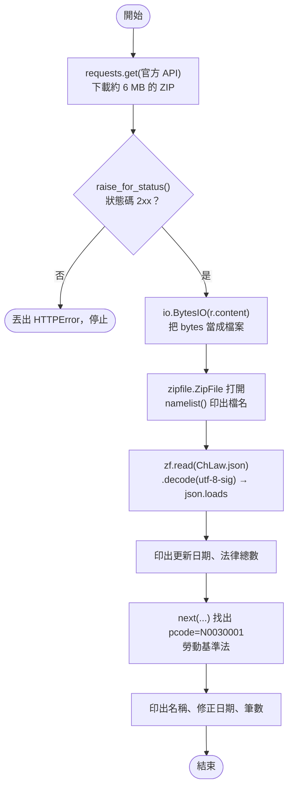
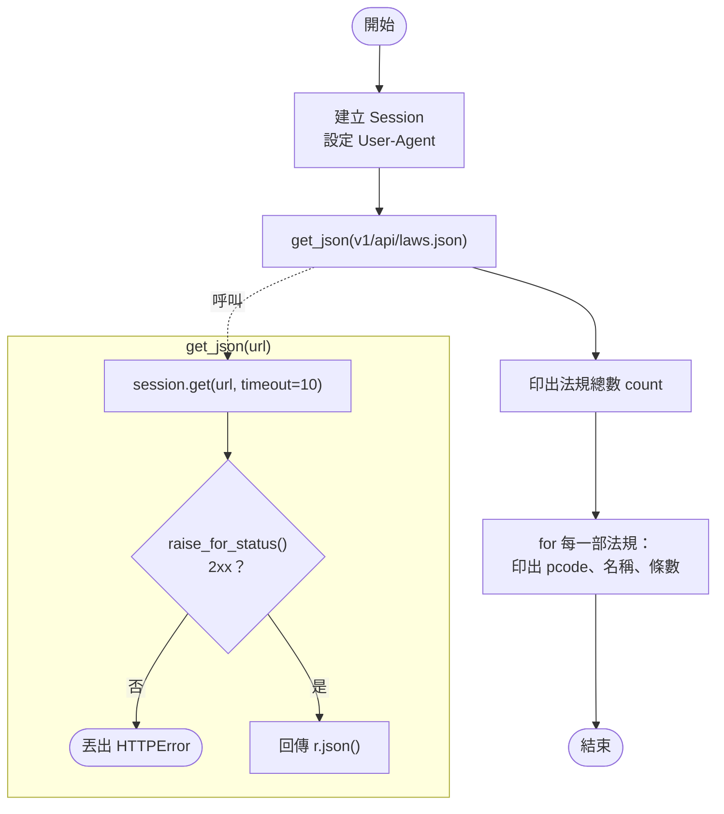
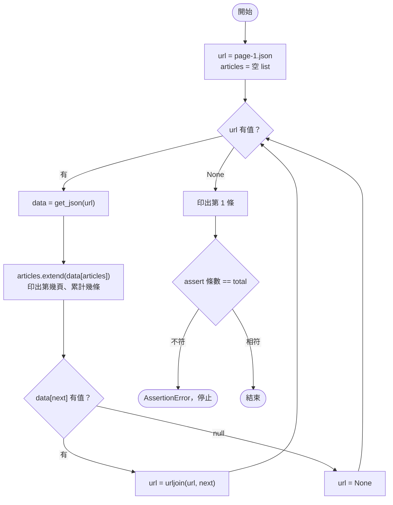

# 03｜先找 API：用 requests 取得 JSON

> **定位**：遇到資料來源，先找官方 API 或開放資料；用 `requests` 取得 JSON、跟著 `next` 欄位走完分頁，並設定好 timeout 與 User-Agent。

## 學習目標

完成本節後，你應該能夠：

- 說出「能用 API 就不要爬 HTML」的理由
- 用 `requests.get` 搭配 `timeout`、`raise_for_status()`、`.json()` 取得資料
- 用 `requests.Session` 統一設定 User-Agent、重複使用連線
- 用 `while` 迴圈跟著 `next` 欄位走完分頁，並用 `total` 驗證筆數
- 說明全國法規資料庫官方開放資料（ZIP 內含 JSON）的結構與使用方式

## 範例程式碼

- [demo：03-api](https://github.com/4-learn/python-web-crawler-demo/tree/main/03-api)
- 練習站：<https://4-learn.github.io/crawler-playground/>（關卡 2：`v1/api/`）

---

## 情境

你是 AI 團隊的資料工程師。上一節你在 DevTools 裡發現：練習站關卡 3 的條文，其實來自 `v1/api/laws/{pcode}/page-N.json` 這種 JSON。

主管看了你的筆記：

> 「既然有 JSON，就別去解析網頁了。先把『職業安全衛生法』整部拿下來，條數要對。順便告訴我，真實世界的法規資料要怎麼拿。」

今天你要寫第一支真正會取資料的程式，而且是最穩、最省力的那一種：直接拿 API。

---

## 講解

### 1. 為什麼先找 API

同一份條文，可以從 HTML 解析，也可以從 API 拿 JSON。比較一下：

| | 解析 HTML | 拿 JSON API |
|---|---|---|
| 資料格式 | 要自己從標籤裡挖 | 已經是欄位分明的結構 |
| 網站改版 | 版面一改，selector 就壞 | API 通常有版本號，較少變動 |
| 流量 | 連同版面、選單一起下載 | 只有資料 |
| 對網站的負擔 | 較大 | 較小，也是網站希望你用的管道 |
| 筆數驗證 | 要自己數 | 常附 `total`、`count` 可對照 |

找 API 的地方：

1. 網站有沒有「開發者」「開放資料」「API 文件」頁面。
2. 政府資料先查 [政府資料開放平臺](https://data.gov.tw/) 或該機關網站。
3. 打開 DevTools Network，篩選 Fetch/XHR（第 02 節）。

### 2. 真實世界：全國法規資料庫開放資料

第 01 節看過，`law.moj.gov.tw` 的 robots.txt 是 `Disallow: /`，網頁不能爬。但它提供官方 API（文件：<https://law.moj.gov.tw/api/swagger/docs/v1>）：

| 網址 | 內容 |
|---|---|
| `https://law.moj.gov.tw/api/Ch/Law/JSON` | 全部中文法律，ZIP 內含 JSON |
| `https://law.moj.gov.tw/api/Ch/Order/JSON` | 全部中文命令（如「營造安全衛生設施標準」） |

這個 API 不是「查一部給一部」，而是**一次給整包**，約 6 MB 的 ZIP。demo 的 `moj_open_data.py`：

<!-- flow-chart -->
**流程圖**



<!-- fn-table -->
| 函式名稱 | 說明 | 官方文件連結 |
|---|---|---|
| `r.raise_for_status()` | 狀態碼是 4xx／5xx 就丟出 `HTTPError`，避免把錯誤頁當資料 | [文件](https://requests.readthedocs.io/en/latest/api/#requests.Response.raise_for_status) |
| `r.content` | 回應內容的原始 bytes；下載 ZIP、圖片時用這個 | [文件](https://requests.readthedocs.io/en/latest/api/#requests.Response.content) |
| `io.BytesIO(bytes)` | 把記憶體裡的 bytes 包成「檔案」，不用先存到硬碟 | [文件](https://docs.python.org/3/library/io.html#io.BytesIO) |
| `zipfile.ZipFile(file)` | 開啟 ZIP 檔；可傳檔名或 bytes 檔案物件 | [文件](https://docs.python.org/3/library/zipfile.html#zipfile.ZipFile) |
| `zf.namelist()` | 列出 ZIP 裡的檔名 | [文件](https://docs.python.org/3/library/zipfile.html#zipfile.ZipFile.namelist) |
| `zf.read(name)` | 讀出 ZIP 裡某個檔案的 bytes | [文件](https://docs.python.org/3/library/zipfile.html#zipfile.ZipFile.read) |
| `bytes.decode("utf-8-sig")` | bytes 轉字串；`utf-8-sig` 會順便去掉開頭的 BOM | [文件](https://docs.python.org/3/library/stdtypes.html#bytes.decode) |
| `json.loads(s)` | JSON 字串 → Python dict／list | [文件](https://docs.python.org/3/library/json.html#json.loads) |
| `next(iterable)` | 取出第一個符合條件的項目，例如 `next(l for l in laws if ...)` | [文件](https://docs.python.org/3/library/functions.html#next) |

```python
import io
import json
import zipfile

import requests

API = "https://law.moj.gov.tw/api/Ch/Law/JSON"  # 文件：https://law.moj.gov.tw/api/swagger/docs/v1

r = requests.get(API, headers={"User-Agent": "course-crawler/1.0 (demo)"}, timeout=120)
r.raise_for_status()
with zipfile.ZipFile(io.BytesIO(r.content)) as zf:
    print("ZIP 內容：", zf.namelist())
    data = json.loads(zf.read("ChLaw.json").decode("utf-8-sig"))

print("資料更新日期：", data["UpdateDate"], "，共", len(data["Laws"]), "部法律")
law = next(l for l in data["Laws"] if l["LawURL"].endswith("pcode=N0030001"))
print(law["LawName"], law["LawModifiedDate"], len(law["LawArticles"]), "筆（含章節標題）")
```

<!-- run-box -->
:::info
**▶ 怎麼執行**　程式在 demo repo 的 [`03-api/moj_open_data.py`](https://github.com/4-learn/python-web-crawler-demo/blob/main/03-api/moj_open_data.py)。在 **repo 根目錄**（`python-web-crawler-demo/`）執行：
會下載約 6 MB；上課時老師示範一次就好，不要全班同時執行。
```bash
python 03-api/moj_open_data.py
```
:::

執行結果（2026-10-05）：

```text
ZIP 內容： ['ChLaw.json', 'schema.csv', 'manifest.csv']
資料更新日期： 2026/9/24 上午 12:00:00 ，共 1347 部法律
勞動基準法 20240731 110 筆（含章節標題）
```

#### 拆解這一行：`data = json.loads(zf.read("ChLaw.json").decode("utf-8-sig"))`

這一行**由內往外**做了三件事，每一步的結果交給外面那一層：

| 步驟 | 程式 | 做什麼 | 得到的型別 |
|---|---|---|---|
| ① | `zf.read("ChLaw.json")` | 從 ZIP 裡取出 `ChLaw.json` 的內容（約 26 MB） | `bytes`（一串位元組，還不是文字） |
| ② | `.decode("utf-8-sig")` | 用 UTF-8 把位元組轉成文字，並去掉開頭的 BOM | `str`（JSON 格式的文字） |
| ③ | `json.loads(...)` | 把 JSON 文字轉成 Python 的資料結構 | `dict`，有 `UpdateDate`、`Laws` 兩個鍵 |

拆成三行，意思完全一樣，比較好讀：

```python
raw = zf.read("ChLaw.json")        # ① bytes：b'\xef\xbb\xbf{\r\n  "UpdateDate": ...'
text = raw.decode("utf-8-sig")     # ② str：'{\r\n  "UpdateDate": ...'
data = json.loads(text)            # ③ dict：data["Laws"] 是全部法律的 list
```

**為什麼是 `utf-8-sig`，不是 `utf-8`？** 看 ① 的開頭：`\xef\xbb\xbf` 這三個位元組是 **BOM**（Byte Order Mark），有些 Windows 程式存 UTF-8 檔案時會在最前面加上它，畫面上看不到。`utf-8-sig` 會把它去掉；用 `utf-8` 則會留下來，`json.loads` 看到第一個字不是 `{` 就報錯：

```text
JSONDecodeError: Unexpected UTF-8 BOM (decode using utf-8-sig): line 1 column 1 (char 0)
```

錯誤訊息本身就提示了解法：`decode using utf-8-sig`。

**為什麼要先 `decode`？** `json.loads` 處理的是文字；ZIP 裡取出來的是位元組，要先決定「用哪種編碼讀成文字」，這一步交給你明確寫出來，才不會讀出亂碼。

<!-- run-box -->
:::info
**▶ 怎麼執行**　想自己看每一步，在 repo 根目錄開 `python` 互動模式，貼上 `moj_open_data.py` 的前 10 行（到 `with` 之前），再逐行貼上面三行，每行後面用 `type(...)` 或 `raw[:10]` 看看結果。會下載約 6 MB，做一次就好。
:::

幾個值得注意的細節：

- **`io.BytesIO(r.content)`**：在記憶體裡解壓縮，不必先存檔。
- **`utf-8-sig`**：這個 JSON 開頭有 BOM（一個看不見的標記字元），用一般的 `utf-8` 解碼，`json.loads` 會報錯。
- **`timeout=120`**：檔案大，給長一點；但仍然要設。
- 勞動基準法有 110 筆，不是 98 條。`LawArticles` 每筆有 `ArticleType`：`A` 是條文（98 筆）、`C` 是章節標題（12 筆，如「第 一 章 總則」）。**直接數筆數會數錯**，要先篩 `ArticleType == "A"`。

每部法律的欄位：

```text
LawLevel, LawName, LawURL, LawCategory, LawModifiedDate, LawEffectiveDate,
LawEffectiveNote, LawAbandonNote, LawHasEngVersion, EngLawName,
LawAttachements, LawHistories, LawForeword, LawArticles
```

pcode 沒有獨立欄位，藏在 `LawURL`（`https://law.moj.gov.tw/LawClass/LawAll.aspx?pcode=N0030001`）的最後。

:::warning
這支程式每次下載約 6 MB。**上課時老師示範一次即可，不要全班同時執行**；自己練習時也請下載一次就存檔重複使用。官方資料約每週更新，不需要每天抓。對別人的伺服器有禮貌，是資料工程師的基本功（第 06 節）。
:::

練習站的 9 部法規，就是從這包資料整理出來的。接下來的練習都用練習站，因為它能逐頁、逐部取得，適合練習分頁與驗證。

### 3. requests 取得 JSON 的四個基本動作

<!-- fn-table -->
| 函式名稱 | 說明 | 官方文件連結 |
|---|---|---|
| `requests.get(url, headers=, timeout=)` | 送出 GET 請求，回傳 `Response`；`headers` 放 User-Agent 等標頭，`timeout` 是最多等幾秒，沒設可能永遠卡住 | [文件](https://requests.readthedocs.io/en/latest/api/#requests.get) |
| `r.raise_for_status()` | 狀態碼是 4xx／5xx 就丟出 `HTTPError`，避免把錯誤頁當資料 | [文件](https://requests.readthedocs.io/en/latest/api/#requests.Response.raise_for_status) |
| `r.json()` | 把回應的 JSON 轉成 Python 的 dict／list | [文件](https://requests.readthedocs.io/en/latest/api/#requests.Response.json) |

```python
r = requests.get(url, headers={"User-Agent": "..."}, timeout=10)  # 1. 送請求
r.raise_for_status()                                               # 2. 不是 2xx 就丟例外
data = r.json()                                                    # 3. JSON → dict／list
```

<!-- run-box -->
:::info
**▶ 怎麼執行**　這是骨架說明，不是完整程式；完整版在下面的 `api_laws.py`。
:::

為什麼每一個都不能省：

| 動作 | 省略會怎樣 |
|---|---|
| `timeout=10` | 對方不回應時程式永遠卡住，排程跑到隔天還停在那裡 |
| `raise_for_status()` | 404、429 的錯誤頁也會被當成資料，`.json()` 才報出看不懂的錯 |
| `User-Agent` | 送出 `python-requests/2.34.2`，網站不知道你是誰，容易被一律封鎖 |

實際試一個不存在的 pcode：

<!-- fn-table -->
| 函式名稱 | 說明 | 官方文件連結 |
|---|---|---|
| `r.status_code` | HTTP 狀態碼（整數），例如 200、404、429 | [文件](https://requests.readthedocs.io/en/latest/api/#requests.Response.status_code) |
| `r.raise_for_status()` | 狀態碼是 4xx／5xx 就丟出 `HTTPError`，避免把錯誤頁當資料 | [文件](https://requests.readthedocs.io/en/latest/api/#requests.Response.raise_for_status) |

```python
r = requests.get(BASE + "v1/api/laws/N9999999/page-1.json", headers=HEADERS, timeout=10)
print(r.status_code)
r.raise_for_status()
```

<!-- run-box -->
:::info
**▶ 怎麼執行**　可以在 `python` 互動模式裡試：先 `import requests`，設定 `BASE = "https://4-learn.github.io/crawler-playground/"`、`HEADERS = {"User-Agent": "course-crawler/1.0 (demo)"}`，再貼上這三行。
:::

```text
404
HTTPError: 404 Client Error: Not Found for url: https://4-learn.github.io/crawler-playground/v1/api/laws/N9999999/page-1.json
```

錯誤訊息直接告訴你哪個網址、什麼狀態碼，比在後面解析時才壞掉好查得多。

### 4. Session：同一組設定、重複使用連線

要連續打同一個網站很多次時，用 `requests.Session`：

<!-- fn-table -->
| 函式名稱 | 說明 | 官方文件連結 |
|---|---|---|
| `requests.Session()` | 建立一個會重用連線、共用 headers／cookie 的工作階段，連續打同一網站更快 | [文件](https://requests.readthedocs.io/en/latest/api/#requests.Session) |
| `session.headers` | 這個 Session 每次請求都會帶的標頭（dict），設一次 User-Agent 就好 | [文件](https://requests.readthedocs.io/en/latest/api/#requests.Session.headers) |

```python
session = requests.Session()
session.headers["User-Agent"] = "course-crawler/1.0 (demo)"
```

<!-- run-box -->
:::info
**▶ 怎麼執行**　這兩行是下面 `api_laws.py` 的開頭。
:::

- **header 只設一次**，之後每次 `session.get()` 都會帶上。
- **重複使用 TCP 連線**，不必每次重新握手，速度快、對伺服器負擔也小。
- **自動保存 cookie**，登入後的請求會自動帶上（第 02 節）。

### 5. 練習站 API：法規清單

練習站的 API 有兩種：

| 網址 | 內容 |
|---|---|
| `v1/api/laws.json` | `{version, count, laws: [{pcode, name, modified_date, article_count}]}` |
| `v1/api/laws/{pcode}/page-N.json` | `{version, pcode, name, page, total_pages, total, next, articles: [...]}` |

demo 的 `api_laws.py` 前半段：

<!-- flow-chart -->
**流程圖**



<!-- fn-table -->
| 函式名稱 | 說明 | 官方文件連結 |
|---|---|---|
| `session.get(url, timeout=)` | 用 Session 送 GET，用法同 `requests.get` | [文件](https://requests.readthedocs.io/en/latest/api/#requests.Session.get) |
| `r.json()` | 把回應的 JSON 轉成 Python 的 dict／list | [文件](https://requests.readthedocs.io/en/latest/api/#requests.Response.json) |

```python
BASE = os.environ.get("PLAYGROUND", "https://4-learn.github.io/crawler-playground/")
session = requests.Session()
session.headers["User-Agent"] = "course-crawler/1.0 (demo)"


def get_json(url: str) -> dict:
    r = session.get(url, timeout=10)
    r.raise_for_status()
    return r.json()


laws = get_json(BASE + "v1/api/laws.json")
print(f"共 {laws['count']} 部法規")
for law in laws["laws"]:
    print(f"  {law['pcode']}  {law['name']}（{law['article_count']} 條）")
```

<!-- run-box -->
:::info
**▶ 怎麼執行**　程式在 demo repo 的 [`03-api/api_laws.py`](https://github.com/4-learn/python-web-crawler-demo/blob/main/03-api/api_laws.py)。在 **repo 根目錄**（`python-web-crawler-demo/`）執行：
```bash
python 03-api/api_laws.py
```
:::

```text
共 9 部法規
  N0030001  勞動基準法（98 條）
  N0030014  性別平等工作法（50 條）
  N0030020  勞工退休金條例（69 條）
  N0060001  職業安全衛生法（61 條）
  N0090001  就業服務法（85 條）
  N0020007  勞資爭議處理法（67 條）
  N0020012  大量解僱勞工保護法（21 條）
  N0050031  勞工職業災害保險及保護法（109 條）
  N0060014  營造安全衛生設施標準（189 條）
```

把三個動作包成 `get_json()`，之後每個請求都不會忘記 timeout 和錯誤檢查。

### 6. 跟著 next 走完分頁

一部法規的條文分成好幾頁，每頁 20 條。先看第 1 頁長什麼樣子（在 `python` 互動模式貼上）：

```python
import requests
data = requests.get("https://4-learn.github.io/crawler-playground/v1/api/laws/N0030001/page-1.json", timeout=10).json()
articles = data.pop("articles")   # 把條文拿出來另外放，data 只剩外層欄位
print(data)
print(len(articles), "條")
```

```text
{'version': 1, 'pcode': 'N0030001', 'name': '勞動基準法', 'page': 1, 'total_pages': 5, 'total': 98, 'next': 'page-2.json'}
20 條
```

| 函式名稱 | 說明 | 官方文件連結 |
|---|---|---|
| `dict.pop(key)` | 從 dict **取出**這個鍵的值並回傳，同時把這個鍵從 dict 刪掉 | [文件](https://docs.python.org/3/library/stdtypes.html#dict.pop) |

`pop` 一次做兩件事：

| | `data.pop("articles")` 之前 | 之後 |
|---|---|---|
| `data` 的鍵 | `version`、`pcode`、`name`、`page`、`total_pages`、`total`、`next`、`articles` | 少了 `articles` |
| 回傳值 | — | 那 20 條條文的 list，存進 `articles` |

這裡用它，是因為 20 條條文全部印出來會洗掉整個畫面，看不到上面那幾個欄位。只是想「看」而不想改動 `data`，也可以寫 `{k: v for k, v in data.items() if k != "articles"}`；但這是實際寫爬蟲時不會用到的寫法，知道 `pop` 就夠了。

:::warning
在互動模式只打 `data.pop("articles")`、不存進變數，`>>>` 會把回傳值（20 條條文）整串印出來。所以要寫成 `articles = data.pop("articles")`。
:::

每一條的欄位：`slug`、`article_no`、`chapter`、`section`、`content`。

最後一頁的 `next` 是 `null`（Python 讀進來是 `None`）。所以迴圈的寫法是：**有 next 就繼續，沒有就停**：

<!-- flow-chart -->
**流程圖**



<!-- fn-table -->
| 函式名稱 | 說明 | 官方文件連結 |
|---|---|---|
| `urljoin(base, url)` | 把相對網址（`N0030001/`、`page-2.html`）接成絕對網址；`../` 也會正確處理 | [文件](https://docs.python.org/3/library/urllib.parse.html#urllib.parse.urljoin) |
| `assert 條件, 訊息` | 條件不成立就丟出 `AssertionError` 並停止；用來把「應該要對」寫成檢查 | [文件](https://docs.python.org/3/reference/simple_stmts.html#assert) |

```python
pcode = "N0030001"  # 勞動基準法
url = BASE + f"v1/api/laws/{pcode}/page-1.json"
articles = []
while url:
    data = get_json(url)
    articles.extend(data["articles"])
    print(f"第 {data['page']} / {data['total_pages']} 頁，累計 {len(articles)} 條")
    url = urljoin(url, data["next"]) if data["next"] else None

print(articles[0]["article_no"], articles[0]["content"][:40], "…")
assert len(articles) == data["total"]
```

<!-- run-box -->
:::info
**▶ 怎麼執行**　這段是同一支程式的後半段節錄自 [`03-api/api_laws.py`](https://github.com/4-learn/python-web-crawler-demo/blob/main/03-api/api_laws.py)，不是完整程式。要執行請跑整支（在 repo 根目錄）：
```bash
python 03-api/api_laws.py
```
:::

```text
第 1 / 5 頁，累計 20 條
第 2 / 5 頁，累計 40 條
第 3 / 5 頁，累計 60 條
第 4 / 5 頁，累計 80 條
第 5 / 5 頁，累計 98 條
第 1 條 為規定勞動條件最低標準，保障勞工權益，加強勞雇關係，促進社會與經濟發展，特制定本 …
```

為什麼這樣寫：

- **`next` 是相對網址**（`page-2.json`），要用 `urljoin(目前網址, next)` 組成完整網址。自己用字串拼接，很容易漏掉或多一層路徑。
- **跟著 `next` 走，而不是 `for n in range(1, 6)`**：寫死頁數，法規一修正、多一頁就會漏抓，而且不會報錯。
- **最後用 `assert` 對照 `total`**：API 自己說有 98 條，你就應該拿到 98 條。這是第 14 節「驗證」的第一步，也是 AI 團隊敢用這份資料的理由。

---

## Workshop

### 題目

用練習站 API 取得「職業安全衛生法」的全部條文：

1. 從 `v1/api/laws.json` 用**法規名稱**找出它的 pcode（不要直接寫死 pcode）。
2. 從 `page-1.json` 開始，跟著 `next` 走完所有分頁。
3. 使用 `Session`、設定 User-Agent 與 timeout，每次請求都檢查狀態碼。
4. 印出 pcode、法規名稱、條數，以及第一條和最後一條的條號。
5. 用 `assert` 確認條數與 API 的 `total` 相同，且為 61。

### 預期輸出

```text
N0060001 職業安全衛生法 61 條
第一條： 第 1 條 為防止職業災害，保障工作者安全及健康，特
最後一條： 第 55 條
```

想一想：條數是 61，最後一條卻是「第 55 條」，為什麼？（提示：看看有沒有「第 15-1 條」這類條號。也因為這樣，第 05 節之後的 JSONL 會保留 `slug` 欄位當作每一條的識別碼。）

### 解答

- [解答](https://github.com/4-learn/python-web-crawler-workshop/tree/master/2026/03)
