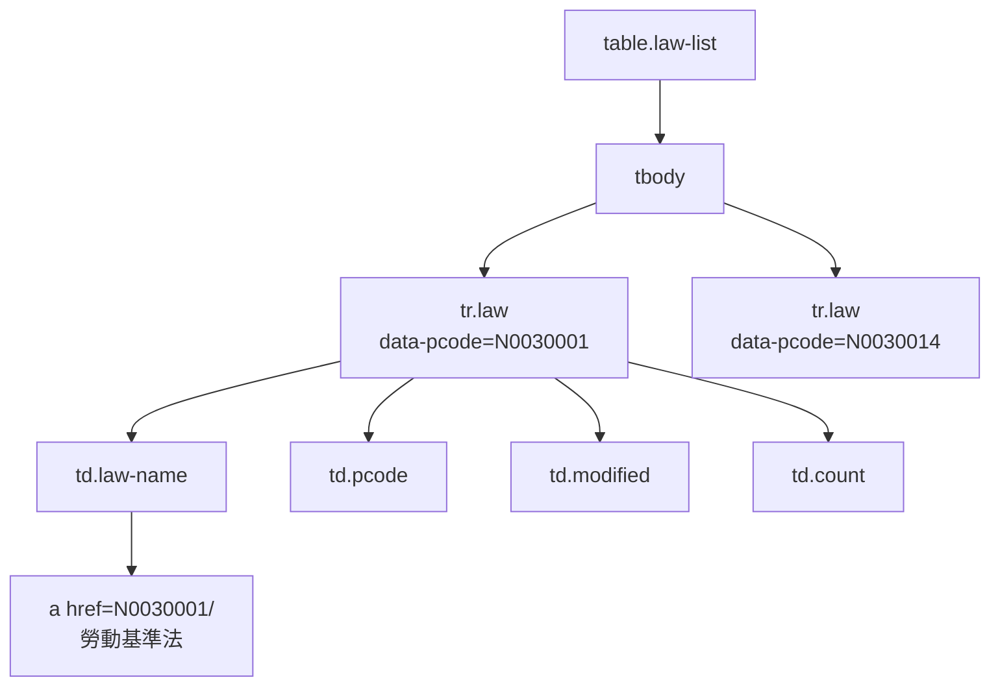
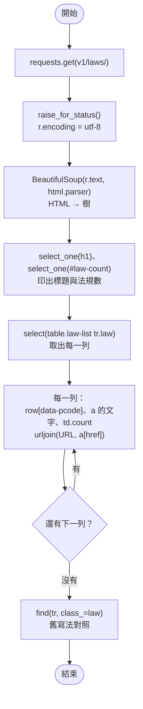
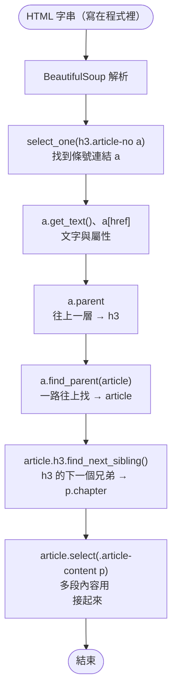

# 04｜BeautifulSoup：CSS selector 與 DOM

> **定位**：沒有 API 時，用 BeautifulSoup 把 HTML 變成一棵樹，以 CSS selector 精準取出需要的資料。

## 學習目標

完成本節後，你應該能夠：

- 說明 HTML 是一棵 DOM 樹，元素之間有父子、兄弟關係
- 寫出 tag、class、id、屬性、子孫等 CSS selector，並用 `select`／`select_one` 取出元素
- 用 `get_text(strip=True)` 取文字、用 `["href"]`／`["data-*"]` 取屬性，並用 `urljoin` 把相對網址轉成絕對網址
- 在 DevTools 中找到元素並驗證自己的 selector
- 看得懂舊程式中的 `find`／`find_all`，知道它們和 `select` 的對應

## 範例程式碼

- [demo：04-bs4](https://github.com/4-learn/python-web-crawler-demo/tree/main/04-bs4)
- 練習站：<https://4-learn.github.io/crawler-playground/v1/laws/>（關卡 1：法規列表）

---

## 情境

你是 AI 團隊的資料工程師。上一節用 API 拿到了「職業安全衛生法」61 條，主管很滿意，但接著提醒：

> 「不是每個網站都會給你 API。很多政府機關、公司內部系統只有網頁。你得會從 HTML 裡把資料挖出來，而且挖得準。」

練習站關卡 1 是一個「只有網頁」的版本：法規列表、條文頁都是純 HTML。今天先處理列表頁，取出 9 部法規的基本資料，下一節再一頁頁往下爬條文。

---

## 講解

### 1. HTML 是一棵樹

瀏覽器拿到 HTML 後，會把它解析成一棵樹（DOM，Document Object Model）。練習站法規列表的一列長這樣（在瀏覽器打開 [`v1/laws/`](https://4-learn.github.io/crawler-playground/v1/laws/)，對表格按右鍵 →「檢查」就看得到；或在 `python` 互動模式執行 `print(soup.select_one("tr.law"))`，`soup` 的建法見下方 `law_list.py`）：

```html
<tr class="law" data-pcode="N0030001">
  <td class="law-name"><a href="N0030001/">勞動基準法</a></td>
  <td class="pcode">N0030001</td>
  <td class="modified">20240731</td>
  <td class="count">98</td>
</tr>
```

這一列 `<tr>` 放在 `<table class="law-list">` 的 `<tbody>` 裡面，共 9 列（完整的 HTML 見第 3 段）。

畫成樹：



為什麼要用「樹」來想：

- 一個 `<td class="count">` 單獨看沒有意義，要知道它**在哪一列底下**，才知道是哪部法規的條文數。
- 所以正確的做法是**先找到每一列（`tr.law`），再在這一列裡面找欄位**，而不是把整頁的 `td.count` 和整頁的 `a` 分別抓出來再對齊。後者只要有一列缺欄位，整張表就錯位了。

### 2. BeautifulSoup 的兩個主角：soup 與 Tag

`BeautifulSoup(html, "html.parser")` 把一整份 HTML 文字變成一棵可以查詢的樹。之後你會一直碰到兩種東西：

| 東西 | 是什麼 | 怎麼來的 |
|---|---|---|
| **soup**（`BeautifulSoup` 物件） | **整份** HTML 的樹，從最外層的 `<html>` 開始 | `soup = BeautifulSoup(r.text, "html.parser")` |
| **Tag**（`bs4.element.Tag` 物件） | 樹上的**一個元素**，例如一個 `<tr>`、一個 `<a>` | `soup.select_one(...)`，或 `soup.select(...)` 裡的每一個 |

soup 本身也是一種 Tag（最外層那個），所以 Tag 能做的事，soup 都能做。

一個 Tag 身上有這些東西：

<!-- fn-table -->
| 函式名稱 | 說明 | 官方文件連結 |
|---|---|---|
| `BeautifulSoup(html, "html.parser")` | 把 HTML 字串解析成一棵樹（soup）；`html.parser` 是 Python 內建解析器 | [文件](https://www.crummy.com/software/BeautifulSoup/bs4/doc/#making-the-soup) |
| `tag.name` | 標籤名稱，例如 `"tr"`、`"a"` | [文件](https://www.crummy.com/software/BeautifulSoup/bs4/doc/#Tag.name) |
| `tag.attrs` | 全部屬性，是一個 dict | [文件](https://www.crummy.com/software/BeautifulSoup/bs4/doc/#Tag.attrs) |
| `tag["屬性"]` | 取一個屬性的值；沒有這個屬性會 `KeyError` | [文件](https://www.crummy.com/software/BeautifulSoup/bs4/doc/#Tag.attrs) |
| `tag.get("屬性")` | 取一個屬性的值；沒有就回 `None`，不會出錯 | [文件](https://www.crummy.com/software/BeautifulSoup/bs4/doc/#Tag.attrs) |
| `tag.get_text(strip=True)` | 元素裡面的所有文字；`strip=True` 去掉前後空白與換行 | [文件](https://www.crummy.com/software/BeautifulSoup/bs4/doc/#get-text) |
| `tag.select(css)`／`tag.select_one(css)` | 在**這個元素裡面**再往下找 | [文件](https://www.crummy.com/software/BeautifulSoup/bs4/doc/#css-selectors-through-the-css-property) |

```python
soup = BeautifulSoup(r.text, "html.parser")

print(type(soup))
print(soup.title)
print(soup.title.get_text())

row = soup.select_one("tr.law")
print(type(row))
print(row.name)                       # 標籤名
print(row.attrs)                      # 全部屬性（dict）
print(row["data-pcode"], row.get("class"), row.get("no-such"))
link = row.select_one("a")            # Tag 也能再往裡面找
print(link)
print(link.get_text(), link["href"])

rows = soup.select("tr.law")
print(type(rows), len(rows), type(rows[0]))
```

<!-- run-box -->
:::info
**▶ 怎麼執行**　程式在 demo repo 的 [`04-bs4/soup_basics.py`](https://github.com/4-learn/python-web-crawler-demo/blob/main/04-bs4/soup_basics.py)。在 **repo 根目錄**（`python-web-crawler-demo/`）執行：
```bash
python 04-bs4/soup_basics.py
```
:::

```text
<class 'bs4.BeautifulSoup'>
<title>勞動法規列表｜爬蟲練習站</title>
勞動法規列表｜爬蟲練習站
<class 'bs4.element.Tag'>
tr
{'class': ['law'], 'data-pcode': 'N0030001'}
N0030001 ['law'] None
<a href="N0030001/">勞動基準法</a>
勞動基準法 N0030001/
<class 'bs4.element.ResultSet'> 9 <class 'bs4.element.Tag'>
```

對照第 1 段那一列 HTML 看：

| 程式 | 拿到什麼 | 對到 HTML 的哪裡 |
|---|---|---|
| `row.name` | `tr` | **`<tr`** `class="law" …>` |
| `row.attrs` | `{'class': ['law'], 'data-pcode': 'N0030001'}` | `<tr` **`class="law" data-pcode="N0030001"`**`>` |
| `row["data-pcode"]` | `N0030001` | `data-pcode=`**`"N0030001"`** |
| `row.get("no-such")` | `None` | 沒有這個屬性，但不會出錯 |
| `link.get_text()` | `勞動基準法` | `<a …>`**`勞動基準法`**`</a>` |
| `link["href"]` | `N0030001/` | `<a href=`**`"N0030001/"`**`>` |

三個容易搞混的地方：

- **`class` 是 list**（`['law']`），因為一個元素可以有好幾個 class，例如 `class="law active"` 會是 `['law', 'active']`。
- **`select` 回傳的是一串 Tag**（`ResultSet`，用起來就像 list），要用 `for` 或 `[0]` 拿出單一個 Tag，才能 `.get_text()`；對整串呼叫會出錯。
- **`get_text()` 會連 HTML 原始碼裡的換行、縮排一起拿**。`strip=True` 才會去掉：

```text
<td>
    勞動基準法
</td>

get_text()            → '\n    勞動基準法\n'
get_text(strip=True)  → '勞動基準法'
```

### 3. CSS selector：用寫 CSS 的方式找元素

CSS selector 原本是用來告訴瀏覽器「這個樣式套在哪些元素上」，拿來找資料剛好也很好用：

:::info
這節 Workshop 只會用到其中四種：`tr.law`、`td.law-name a`、`#law-count`，以及用 `["data-pcode"]` 取屬性。其他寫法先有印象，遇到時回來查就好。
:::

| 寫法 | 意思 | 會選到 HTML 裡的哪一段（粗體是被選中的元素） | 練習站有幾個 |
|---|---|---|---|
| `h1` | **標籤名**：所有 `<h1>` | **`<h1>`**`勞動法規列表`**`</h1>`** | 1 |
| `.count` | **class**：`class="count"` 的元素（`.` 開頭） | `<td` **`class="count"`**`>98</td>` | 9 |
| `td.count` | 標籤＋class：是 `<td>`、**而且** class 是 count | **`<td`** **`class="count"`**`>98</td>` | 9 |
| `#law-count` | **id**：`id="law-count"` 的元素（`#` 開頭，整頁唯一） | `<span` **`id="law-count"`**`>9</span>` | 1 |
| `tr[data-pcode]` | **有某個屬性**：`<tr>` 上有 `data-pcode` 這個屬性就算 | `<tr class="law"` **`data-pcode`**`="N0030001">…</tr>` | 9 |
| `tr[data-pcode="N0030001"]` | **屬性等於某值**：`data-pcode` 剛好是 `N0030001` | `<tr class="law"` **`data-pcode="N0030001"`**`>…勞動基準法…</tr>` | 1 |
| `table.law-list tr.law` | **子孫**（中間用空白）：`table.law-list` 裡面的 `tr.law`，不論隔幾層 | `<table class="law-list">`…`<tbody>`**`<tr class="law" …>`**`…</tr>` | 9 |
| `td.law-name > a` | **直接子元素**（中間用 `>`）：只隔一層 | `<td class="law-name">`**`<a href="N0030001/">勞動基準法</a>`**`</td>` | 9 |
| `h3.article-no a` | 組合：`h3.article-no` 裡面的 `<a>` | `<h3 class="article-no">`**`<a href="articles/1.html">第 1 條</a>`**`</h3>` | 每頁 20（法規條文頁，第 05 節） |

對照練習站法規列表的原始 HTML（節錄第一列）看，每個 selector 都是在描述「這一段」：

```html
<h1>勞動法規列表</h1>
<p>共 <span id="law-count">9</span> 部法規。點選法規名稱查看條文。</p>
<table class="law-list">
  <tbody>
    <tr class="law" data-pcode="N0030001">
      <td class="law-name"><a href="N0030001/">勞動基準法</a></td>
      <td class="pcode">N0030001</td>
      <td class="modified">20240731</td>
      <td class="count">98</td>
    </tr>
    …（共 9 列）
  </tbody>
</table>
```

- `data-pcode="N0030001"` 寫在 `<tr …>` 這個**開始標籤裡面**，是 `<tr>` 的屬性；`[...]` 就是在比對標籤上的屬性。
- `class` 和 `id` 也是屬性，只是太常用，所以有 `.` 和 `#` 的簡寫：`.count` 等於 `[class~="count"]`，`#law-count` 等於 `[id="law-count"]`。

BeautifulSoup 只需要記兩個方法：

| 方法 | 回傳 | 找不到時 |
|---|---|---|
| `soup.select("selector")` | 全部符合的元素（list） | 空 list `[]` |
| `soup.select_one("selector")` | 第一個符合的元素 | `None` |

:::info
在 DevTools 的 **Elements** 分頁按 `Ctrl+F`，可以直接輸入 CSS selector，它會告訴你「1 of 9」之類的結果。先在這裡試對了，再寫進程式。右鍵 → Copy → Copy selector 也能產生 selector，但通常很長、很脆弱（例如 `tbody > tr:nth-child(3) > td:nth-child(2)`），最好自己改寫成用 class 或屬性的版本。
:::

### 4. 第一支 BeautifulSoup 程式

demo 的 `law_list.py`：

<!-- flow-chart -->
**流程圖**



<!-- fn-table -->
| 函式名稱 | 說明 | 官方文件連結 |
|---|---|---|
| `r.encoding` | 解碼 `r.text` 用的編碼；伺服器沒說 charset 時要自己設 `"utf-8"`，否則中文亂碼 | [文件](https://requests.readthedocs.io/en/latest/api/#requests.Response.encoding) |
| `BeautifulSoup(html, "html.parser")` | 把 HTML 字串解析成一棵樹（soup）；`html.parser` 是 Python 內建解析器 | [文件](https://www.crummy.com/software/BeautifulSoup/bs4/doc/#making-the-soup) |
| `soup.select_one(css)` | 找**第一個**符合的元素；找不到回傳 `None` | [文件](https://www.crummy.com/software/BeautifulSoup/bs4/doc/#css-selectors-through-the-css-property) |
| `soup.select(css)` | 用 CSS selector 找出**全部**符合的元素，回傳 list；找不到是空 list | [文件](https://www.crummy.com/software/BeautifulSoup/bs4/doc/#css-selectors-through-the-css-property) |
| `tag.get_text(strip=True)` | 取出元素內所有文字；`strip=True` 去掉前後空白 | [文件](https://www.crummy.com/software/BeautifulSoup/bs4/doc/#get-text) |
| `tag["屬性"]` | 取屬性值，例如 `a["href"]`、`row["data-pcode"]`；沒有這個屬性會 KeyError | [文件](https://www.crummy.com/software/BeautifulSoup/bs4/doc/#Tag.attrs) |
| `urljoin(base, url)` | 把相對網址（`N0030001/`、`page-2.html`）接成絕對網址；`../` 也會正確處理 | [文件](https://docs.python.org/3/library/urllib.parse.html#urllib.parse.urljoin) |

```python
import os
from urllib.parse import urljoin

import requests
from bs4 import BeautifulSoup

BASE = os.environ.get("PLAYGROUND", "https://4-learn.github.io/crawler-playground/")
URL = BASE + "v1/laws/"

r = requests.get(URL, headers={"User-Agent": "course-crawler/1.0 (demo)"}, timeout=10)
r.raise_for_status()
r.encoding = "utf-8"
soup = BeautifulSoup(r.text, "html.parser")

# 1. 標籤、class、id
print("頁面標題：", soup.select_one("h1").get_text(strip=True))
print("法規數量（頁面上寫的）：", soup.select_one("#law-count").get_text())

# 2. 每一列：tr.law；屬性用 ["data-pcode"]
for row in soup.select("table.law-list tr.law"):
    link = row.select_one("td.law-name a")
    print(
        row["data-pcode"],
        link.get_text(strip=True),
        row.select_one("td.count").get_text(),
        urljoin(URL, link["href"]),  # 相對網址 → 絕對網址
    )
```

<!-- run-box -->
:::info
**▶ 怎麼執行**　程式在 demo repo 的 [`04-bs4/law_list.py`](https://github.com/4-learn/python-web-crawler-demo/blob/main/04-bs4/law_list.py)。在 **repo 根目錄**（`python-web-crawler-demo/`）執行：
```bash
python 04-bs4/law_list.py
```
:::

執行結果：

```text
頁面標題： 勞動法規列表
法規數量（頁面上寫的）： 9
N0030001 勞動基準法 98 https://4-learn.github.io/crawler-playground/v1/laws/N0030001/
N0030014 性別平等工作法 50 https://4-learn.github.io/crawler-playground/v1/laws/N0030014/
N0030020 勞工退休金條例 69 https://4-learn.github.io/crawler-playground/v1/laws/N0030020/
N0060001 職業安全衛生法 61 https://4-learn.github.io/crawler-playground/v1/laws/N0060001/
N0090001 就業服務法 85 https://4-learn.github.io/crawler-playground/v1/laws/N0090001/
N0020007 勞資爭議處理法 67 https://4-learn.github.io/crawler-playground/v1/laws/N0020007/
N0020012 大量解僱勞工保護法 21 https://4-learn.github.io/crawler-playground/v1/laws/N0020012/
N0050031 勞工職業災害保險及保護法 109 https://4-learn.github.io/crawler-playground/v1/laws/N0050031/
N0060014 營造安全衛生設施標準 189 https://4-learn.github.io/crawler-playground/v1/laws/N0060014/
```

逐行看重點：

- **`r.encoding = "utf-8"`**：不靠伺服器猜編碼。教室版沒送 charset，少了這行中文會變亂碼（第 02 節）。
- **`"html.parser"`**：Python 內建的解析器，不用另外安裝。
- **`row.select_one(...)`**：在「這一列」裡面找，不是在整頁找。這就是第 1 段說的「先找列、再找欄」。
- **`get_text(strip=True)`**：去掉前後空白與換行（第 2 段有例子）。這一頁的 `<td>` 剛好沒有多餘空白，但很多網站的 HTML 為了排版會縮排，養成習慣加上 `strip=True`。
- **`row["data-pcode"]`**：屬性用中括號取，像 dict。屬性不存在會丟 `KeyError`；不確定有沒有時用 `row.get("data-pcode")`，會回 `None`。

### 5. 相對網址與 urljoin

連結的 `href` 是 `N0030001/`，這是**相對網址**：相對於目前頁面 `v1/laws/` 的位置。

<!-- fn-table -->
| 函式名稱 | 說明 | 官方文件連結 |
|---|---|---|
| `urljoin(base, url)` | 把相對網址（`N0030001/`、`page-2.html`）接成絕對網址；`../` 也會正確處理 | [文件](https://docs.python.org/3/library/urllib.parse.html#urllib.parse.urljoin) |

```python
urljoin("https://4-learn.github.io/crawler-playground/v1/laws/", "N0030001/")
# → https://4-learn.github.io/crawler-playground/v1/laws/N0030001/
```

<!-- run-box -->
:::info
**▶ 怎麼執行**　在 `python` 互動模式裡試：先 `from urllib.parse import urljoin`，再貼上這行。
:::

為什麼不自己用字串相加：`href` 可能是 `N0030001/`、`/crawler-playground/v1/laws/N0030001/`、`../laws/N0030001/`，甚至是完整網址。`urljoin` 依瀏覽器的規則處理所有情況；自己拼接幾乎一定會在某一種寫法上出錯。

存資料時一律存**絕對網址**。第 16 節的 `source_url` 欄位就是讓下游（MariaDB、問答系統）能回頭查到原文，相對網址離開了這一頁就沒有意義。

### 6. 在樹上走動（進階）

> 這節 Workshop 和第 05 節的主程式都用不到；遇到「目標元素沒有好認的 class」時再回來看。只有一件事第 05 節會用到：一條條文有好幾段時，用 `"\n".join(...)` 接起來。

:::spoiler 展開

有時候目標元素沒有好認的 class，要從旁邊好找的元素「走過去」。demo 的 `dom_walk.py` 用一小段條文頁的 HTML 示範：

<!-- flow-chart -->
**流程圖**



<!-- fn-table -->
| 函式名稱 | 說明 | 官方文件連結 |
|---|---|---|
| `tag.get_text(strip=True)` | 取出元素內所有文字；`strip=True` 去掉前後空白 | [文件](https://www.crummy.com/software/BeautifulSoup/bs4/doc/#get-text) |
| `tag["屬性"]` | 取屬性值，例如 `a["href"]`、`row["data-pcode"]`；沒有這個屬性會 KeyError | [文件](https://www.crummy.com/software/BeautifulSoup/bs4/doc/#Tag.attrs) |
| `tag.parent` | 往上一層：父元素 | [文件](https://www.crummy.com/software/BeautifulSoup/bs4/doc/#parent) |
| `tag.name` | 元素的標籤名稱，例如 `h3`、`a` | [文件](https://www.crummy.com/software/BeautifulSoup/bs4/doc/#Tag.name) |
| `tag.find_parent(name)` | 一路往上找，第一個符合的祖先元素 | [文件](https://www.crummy.com/software/BeautifulSoup/bs4/doc/#find-parents-and-find-parent) |
| `tag.h3` | 用標籤名稱當屬性：往下找第一個 `<h3>` | [文件](https://www.crummy.com/software/BeautifulSoup/bs4/doc/#navigating-using-tag-names) |
| `tag.find_next_sibling()` | 同一層的下一個元素（兄弟） | [文件](https://www.crummy.com/software/BeautifulSoup/bs4/doc/#find-next-siblings-and-find-next-sibling) |

```python
from bs4 import BeautifulSoup

html = """
<section class="articles">
  <article class="article" data-slug="1">
    <h3 class="article-no"><a href="articles/1.html">第 1 條</a></h3>
    <p class="chapter">第一章 總則</p>
    <div class="article-content"><p>第一段</p><p>第二段</p></div>
  </article>
</section>
"""
soup = BeautifulSoup(html, "html.parser")
a = soup.select_one("h3.article-no a")
print("文字：", a.get_text())
print("屬性 href：", a["href"])
print("父節點：", a.parent.name, a.parent["class"])
article = a.find_parent("article")
print("往上找 article：", article["data-slug"])
print("h3 的下一個兄弟元素：", article.h3.find_next_sibling().get_text())
paragraphs = [p.get_text() for p in article.select(".article-content p")]
print("多段內容用換行接起來：", "\n".join(paragraphs))
```

<!-- run-box -->
> **▶ 怎麼執行**　程式在 demo repo 的 [`04-bs4/dom_walk.py`](https://github.com/4-learn/python-web-crawler-demo/blob/main/04-bs4/dom_walk.py)。在 **repo 根目錄**（`python-web-crawler-demo/`）執行：
> 這支不連網路，HTML 寫在程式裡。
```bash
python 04-bs4/dom_walk.py
```

```text
文字： 第 1 條
屬性 href： articles/1.html
父節點： h3 ['article-no']
往上找 article： 1
h3 的下一個兄弟元素： 第一章 總則
多段內容用換行接起來： 第一段
第二段
```

| 方向 | 寫法 |
|---|---|
| 往上一層 | `.parent` |
| 往上找到某種祖先 | `.find_parent("article")` |
| 往下 | `.select(...)`、`.children` |
| 往旁邊 | `.find_next_sibling()`、`.find_previous_sibling()` |

兩個細節：

- `class` 屬性回傳的是 **list**（`['article-no']`），因為一個元素可以有多個 class。
- 一條條文可能有好幾項，每項是一個 `<p>`。用 `"\n".join(...)` 接起來，才能保留「第一項、第二項」的分段，和 API 的 `content` 格式一致（第 05 節會逐條比對）。
:::

### 7. find／find_all：舊寫法對照（進階）

> 網路上的舊教學、舊程式常用 `find`／`find_all`。本課統一用 `select`，看到 `find` 時知道是什麼意思即可。

:::spoiler 展開

網路上很多舊教學、舊程式用的是 `find`／`find_all`。它們做的事情一樣，只是寫法不同：

| select 寫法 | find 寫法 |
|---|---|
| `soup.select_one("tr.law")` | `soup.find("tr", class_="law")` |
| `soup.select("tr.law")` | `soup.find_all("tr", class_="law")` |
| `soup.select_one("#law-count")` | `soup.find(id="law-count")` |
| `soup.select("tr[data-pcode]")` | `soup.find_all("tr", attrs={"data-pcode": True})` |
| `soup.select("table.law-list tr.law a")` | 要寫好幾層 `find`／迴圈 |

demo 最後一行：

<!-- fn-table -->
| 函式名稱 | 說明 | 官方文件連結 |
|---|---|---|
| `soup.find(name, class_=)` | 舊式寫法：找第一個符合標籤與屬性的元素；`class` 是保留字，所以寫 `class_` | [文件](https://www.crummy.com/software/BeautifulSoup/bs4/doc/#find) |

```python
first = soup.find("tr", class_="law")
print("find 找到的第一列：", first.find("a").get_text())
```

<!-- run-box -->
> **▶ 怎麼執行**　這兩行是 `law_list.py` 的最後一段，節錄自 [`04-bs4/law_list.py`](https://github.com/4-learn/python-web-crawler-demo/blob/main/04-bs4/law_list.py)，不是完整程式。要執行請跑整支（在 repo 根目錄）：
```bash
python 04-bs4/law_list.py
```

```text
find 找到的第一列： 勞動基準法
```

本課統一用 `select`：一行 selector 就能描述「在哪裡底下的什麼」，而且和 DevTools、Playwright（第 08 節）用的是**同一套語法**，學一次用三個地方。看到 `find` 時知道是什麼意思即可。
:::

### 8. 找不到元素時

`select_one` 找不到會回 `None`，接著呼叫 `.get_text()` 就會出錯：

```python
table = soup.select_one("table.no-such-class")   # 故意寫錯 class
print("select_one 找不到：", table)
print(table.get_text())
```

<!-- run-box -->
:::info
**▶ 怎麼執行**　程式在 demo repo 的 [`04-bs4/not_found.py`](https://github.com/4-learn/python-web-crawler-demo/blob/main/04-bs4/not_found.py)。在 **repo 根目錄**（`python-web-crawler-demo/`）執行（最後出錯是預期結果）：
```bash
python 04-bs4/not_found.py
```
:::

```text
select_one 找不到： None
AttributeError: 'NoneType' object has no attribute 'get_text'
```

這通常代表三種情況之一：selector 寫錯、網站改版了（第 15 節）、或內容是 JavaScript 產生的、HTML 裡根本沒有（第 07 節）。遇到時，先用 `print(r.text[:500])` 看看你**實際拿到**的 HTML，不要只看瀏覽器畫面。

---

## Workshop

### 題目

從練習站法規列表 <https://4-learn.github.io/crawler-playground/v1/laws/> 取出 9 部法規的**名稱、pcode、條文數**。

**課堂題**（從 `04-bs4/law_list.py` 改起）：

1. 把 `law_list.py` 複製一份成 `my_law_list.py`（不要直接改 demo 檔）。
2. 迴圈裡改成印出 `名稱,pcode,條文數`，用逗號隔開，迴圈前先印一行標題 `name,pcode,count`。

**延伸題**（做完課堂題再做）：

3. 條文數用 `int(...)` 轉成數字，最後印出「合計 9 部、 749 條」。
4. 用 `assert` 確認取到的列數等於頁面上 `#law-count` 寫的數字。

### 預期輸出

```text
name,pcode,count
勞動基準法,N0030001,98
性別平等工作法,N0030014,50
勞工退休金條例,N0030020,69
職業安全衛生法,N0060001,61
就業服務法,N0090001,85
勞資爭議處理法,N0020007,67
大量解僱勞工保護法,N0020012,21
勞工職業災害保險及保護法,N0050031,109
營造安全衛生設施標準,N0060014,189
合計 9 部、 749 條
```

最後一行是延伸題的輸出。749 條會是總和 Workshop 的驗收數字。

### 解答

- [解答](https://github.com/4-learn/python-web-crawler-workshop/tree/master/2026/04)
