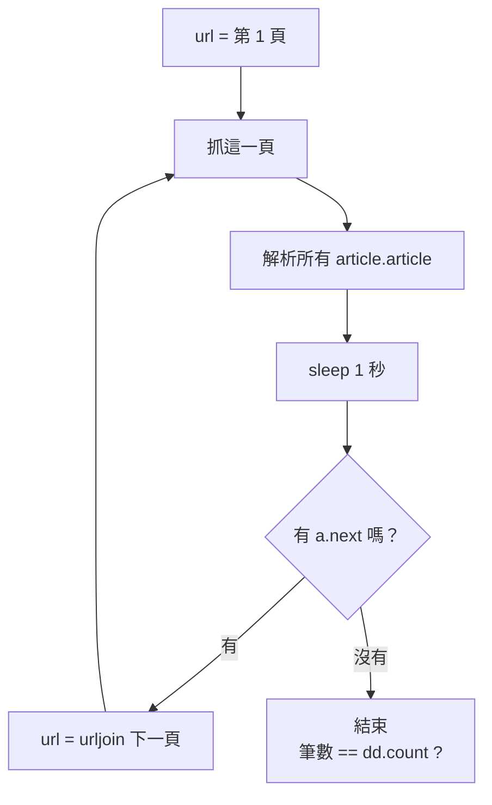
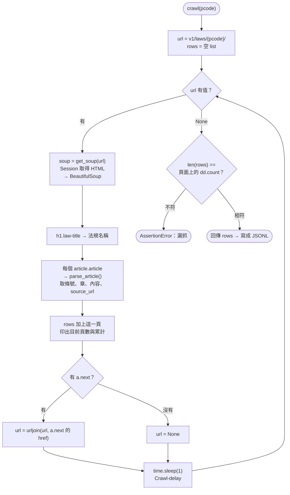

# 05｜跟著分頁走：列表、詳細頁與 JSONL

> **定位**：沿著「下一頁」連結爬完一部法規，把每一條存成 JSONL，並學會讀取頁面內建的 JSON-LD 結構化資料。

## 學習目標

完成本節後，你應該能夠：

- 寫出「抓一頁 → 解析 → 找下一頁 → 沒有就停」的迴圈，並說明終止條件
- 從列表頁的連結進入詳細頁，記下每筆資料的 `source_url`
- 說出 JSONL 相對於 CSV、單一 JSON 檔的好處，並用 Python 寫入、讀回
- 從 `<script type="application/ld+json">` 取出 JSON-LD
- 用頁面上的總數或 API 結果驗證爬到的筆數與內容

## 範例程式碼

demo repo 的 [`05-pagination/`](https://github.com/4-learn/python-web-crawler-demo/tree/main/05-pagination) 資料夾，本節用到的程式（都在 **repo 根目錄** `python-web-crawler-demo/` 執行）：

| 檔案 | 講解段落 | 內容 | 執行指令 |
|---|---|---|---|
| [`05-pagination/python_syntax.py`](https://github.com/4-learn/python-web-crawler-demo/blob/main/05-pagination/python_syntax.py) | 3. 這節會用到的 Python 語法 | dict、list comprehension、join、三元運算 | `python 05-pagination/python_syntax.py` |
| [`05-pagination/crawl_law.py`](https://github.com/4-learn/python-web-crawler-demo/blob/main/05-pagination/crawl_law.py) | 4. 爬完一部法規 | 跟著下一頁爬完、輸出 JSONL（Workshop 用這支） | `python 05-pagination/crawl_law.py N0060001` |
| [`05-pagination/json_ld.py`](https://github.com/4-learn/python-web-crawler-demo/blob/main/05-pagination/json_ld.py) | 6. 詳細頁與 JSON-LD（進階） | 取出詳細頁的 JSON-LD | `python 05-pagination/json_ld.py` |

- 練習站：<https://4-learn.github.io/crawler-playground/v1/laws/N0030001/>（關卡 1：分頁與詳細頁）

---

## 情境

你是 AI 團隊的資料工程師。上一節你從列表頁取出了 9 部法規、749 條的清單。現在要真的把條文拿下來。

負責問答系統的同事提出需求：

> 「每一條都給我一筆獨立的資料，要有法規名稱、條號、章節、內文，還有**原文網址**。使用者問完，系統要能附上『出處』讓他點回去看。檔案格式最好能一行一筆，我可以邊讀邊處理。」

這就是本節要做的：爬完一部法規的所有分頁，輸出成 JSONL。你還會拿上一節的 API 結果來檢查：HTML 爬到的跟 API 給的，是不是一模一樣。

---

## 講解

### 1. 分頁的結構

一部法規的條文分成很多頁，每頁 20 條：

| 頁 | 網址 |
|---|---|
| 第 1 頁 | `v1/laws/N0030001/`（即 `index.html`） |
| 第 2 頁 | `v1/laws/N0030001/page-2.html` |
| … | … |
| 第 5 頁 | `v1/laws/N0030001/page-5.html` |

每頁底下有分頁列。第 2 頁：

```html
<nav class="pagination"><a class="prev" rel="prev" href="index.html">上一頁</a><span class="current">第 2 / 5 頁</span><a class="next" rel="next" href="page-3.html">下一頁</a></nav>
```

最後一頁（第 5 頁）：

```html
<nav class="pagination"><a class="prev" rel="prev" href="page-4.html">上一頁</a><span class="current">第 5 / 5 頁</span></nav>
```

**最後一頁沒有 `a.next`**。這就是迴圈的終止條件，和第 03 節 API 的 `next: null` 是同一個概念。

每一條條文：

```html
<article class="article" id="a-18" data-slug="18">
  <h3 class="article-no"><a href="articles/18.html">第 18 條</a></h3>
  <p class="chapter">第二章 勞動契約</p>
  <div class="article-content">
    <p>有左列情形之一者，勞工不得向雇主請求加發預告期間工資及資遣費：</p>
    <p>一、依第十二條或第十五條規定終止勞動契約者。</p>
    <p>二、定期勞動契約期滿離職者。</p>
  </div>
</article>
```

#### `soup.select("article.article")` 是什麼意思？

`article.article` 是第 04 節的「標籤＋class」寫法，拆開看：

| 部分 | 意思 | 對到上面 HTML 的哪裡 |
|---|---|---|
| `article`（點前面） | **標籤名**是 `<article>` | **`<article`** `class="article" …>` |
| `.article`（點後面） | **class** 是 `article` | `<article` **`class="article"`** `…>` |
| 合起來 `article.article` | 是 `<article>` 標籤，**而且** class 是 `article` | 一整條條文 |

兩個 `article` 剛好同名，容易看成重複：前面是**標籤**、後面是 **class**。這是練習站的命名，換成別的網站可能是 `div.item`、`li.post`，規則一樣是「標籤.class」。

`select` 回傳**全部**符合的元素（一個 list），所以：

```python
articles = soup.select("article.article")   # 勞動基準法第 1 頁 → 20 個 <article>
print(len(articles))                         # 20
print(articles[0]["data-slug"])              # 1，第 1 條
```

每一個元素都還能繼續往裡面找，例如 `articles[0].select_one(".article-no a")` 就是第 1 條的條號連結。下面 `crawl_law.py` 的 `parse_article(el, …)` 做的就是這件事：`el` 是其中一條 `<article>`。

頁首還有法規資訊：`h1.law-title`（法規名稱）、`dl.law-meta dd.count`（條文數）。

### 2. 迴圈與終止條件



為什麼跟著連結走，而不是 `for n in range(1, 6)` 組網址：

- **不用事先知道有幾頁**：法規修正後多一頁，程式照樣爬完。
- **網址規則變了也不怕**：第 1 頁是 `index.html` 而不是 `page-1.html`，這種例外用組網址的方式很容易踩到。
- **不會打到不存在的頁**：組網址常常要「一直加到 404 為止」，那最後一個請求就是浪費。

終止條件一定要想清楚。沒寫好的話，最壞情況是**無窮迴圈**：一直打同一頁、對網站造成負擔，自己還不知道。

### 3. 這節會用到的 Python 語法

下一段的 `crawl_law.py` 會用到幾個之前沒教過的 Python 寫法。先用練習站的資料一個一個看：

| 寫法 | 意思 | 官方文件連結 |
|---|---|---|
| `{"鍵": 值, …}` | **dict**：用名稱存一筆資料的各個欄位 | [文件](https://docs.python.org/3/tutorial/datastructures.html#dictionaries) |
| `[X for el in 一串]` | **list comprehension**：對一串裡的每一個做 X，結果收成新的 list | [文件](https://docs.python.org/3/tutorial/datastructures.html#list-comprehensions) |
| `"\n".join(一串字)` | 用換行把一串文字接成一個字串 | [文件](https://docs.python.org/3/library/stdtypes.html#str.join) |
| `A if 條件 else B` | **三元運算**：條件成立用 A，不成立用 B | [文件](https://docs.python.org/3/reference/expressions.html#conditional-expressions) |
| `rows += [...]` | 把一串接到 `rows` 後面 | [文件](https://docs.python.org/3/library/stdtypes.html#mutable-sequence-types) |

```python
articles = soup.select("article.article")   # 勞動基準法第 1 頁的 20 條

# 1. dict
first = articles[0]
row = {
    "slug": first["data-slug"],
    "article_no": first.select_one(".article-no a").get_text(strip=True),
}
print(row)
print(row["article_no"])

# 2. list comprehension
numbers = [el.select_one(".article-no a").get_text(strip=True) for el in articles]
print(len(numbers), numbers[:3])

# 3. 用換行把多段接起來
paragraphs = [p.get_text() for p in first.select(".article-content p")]
print(paragraphs)
print("\n".join(paragraphs))

# 4. 三元運算
nxt = soup.select_one("a.next")
print(nxt["href"] if nxt else None)

# 5. rows += [...]
rows = []
rows += numbers[:2]
rows += numbers[2:4]
print(rows)
```

<!-- run-box -->
:::info
**▶ 怎麼執行**　程式在 demo repo 的 [`05-pagination/python_syntax.py`](https://github.com/4-learn/python-web-crawler-demo/blob/main/05-pagination/python_syntax.py)。在 **repo 根目錄**（`python-web-crawler-demo/`）執行：
```bash
python 05-pagination/python_syntax.py
```
:::

```text
--- 1. dict：用 {鍵: 值} 把一筆資料包起來 ---
{'slug': '1', 'article_no': '第 1 條'}
第 1 條
--- 2. list comprehension：[對每個做什麼 for 每個 in 一串] ---
20 ['第 1 條', '第 2 條', '第 3 條']
--- 3. 用換行把多段接起來："\n".join(...) ---
['為規定勞動條件最低標準，保障勞工權益，加強勞雇關係，促進社會與經濟發展，特制定本法；本法未規定者，適用其他法律之規定。', '雇主與勞工所訂勞動條件，不得低於本法所定之最低標準。']
為規定勞動條件最低標準，保障勞工權益，加強勞雇關係，促進社會與經濟發展，特制定本法；本法未規定者，適用其他法律之規定。
雇主與勞工所訂勞動條件，不得低於本法所定之最低標準。
--- 4. 三元運算：A if 條件 else B ---
page-2.html
--- 5. rows += [...]：把一串接到另一串後面 ---
['第 1 條', '第 2 條', '第 3 條', '第 4 條']
```

逐個說明：

- **dict**：`row["article_no"]` 用名稱取值，比 list 用 `[0]`、`[1]` 好讀。`crawl_law.py` 的每一條條文就是一個 dict，寫成 JSONL 時一個 dict 就是一行。
- **list comprehension** 等於下面這個迴圈的簡寫：

  ```python
  numbers = []
  for el in articles:
      numbers.append(el.select_one(".article-no a").get_text(strip=True))
  ```

- **`"\n".join(...)`**：第 1 條有兩段（兩個 `<p>`），接成一個字串、中間用換行隔開，才能保留分段。`crawl_law.py` 裡寫成 `"\n".join(p.get_text() for p in …)`，外面少了中括號，意思一樣。
- **三元運算**：第 1 頁有「下一頁」，所以印出 `page-2.html`；到了最後一頁 `nxt` 是 `None`，就會得到 `None`，迴圈因此停下來。
- **`rows +=`**：每爬一頁，就把這一頁的 20 條接到 `rows` 後面，最後 `rows` 就是整部法規。

`crawl_law.py` 裡還有兩個寫法，看到時知道意思就好：

- `def parse_article(el, page_url: str, …) -> dict:`：冒號後面的 `str`、箭頭後面的 `dict` 是**型別標註**，只是說明「這裡應該放字串」「會回傳 dict」，不影響執行。
- `if __name__ == "__main__":`：**程式從這裡開始執行**。上面的 `def` 只是定義函式，要到這裡才會真的呼叫 `crawl()`。

### 4. 爬完一部法規

demo 的 `crawl_law.py`：

<!-- flow-chart -->
**流程圖**



<!-- fn-table -->
| 函式名稱 | 說明 | 官方文件連結 |
|---|---|---|
| `requests.Session()` | 建立一個會重用連線、共用 headers／cookie 的工作階段，連續打同一網站更快 | [文件](https://requests.readthedocs.io/en/latest/api/#requests.Session) |
| `session.get(url, timeout=)` | 用 Session 送 GET，用法同 `requests.get` | [文件](https://requests.readthedocs.io/en/latest/api/#requests.Session.get) |
| `r.encoding` | 解碼 `r.text` 用的編碼；伺服器沒說 charset 時要自己設 `"utf-8"`，否則中文亂碼 | [文件](https://requests.readthedocs.io/en/latest/api/#requests.Response.encoding) |
| `soup.select_one(css)` | 找**第一個**符合的元素；找不到回傳 `None` | [文件](https://www.crummy.com/software/BeautifulSoup/bs4/doc/#css-selectors-through-the-css-property) |
| `soup.select(css)` | 用 CSS selector 找出**全部**符合的元素，回傳 list；找不到是空 list | [文件](https://www.crummy.com/software/BeautifulSoup/bs4/doc/#css-selectors-through-the-css-property) |
| `urljoin(base, url)` | 把相對網址（`N0030001/`、`page-2.html`）接成絕對網址；`../` 也會正確處理 | [文件](https://docs.python.org/3/library/urllib.parse.html#urllib.parse.urljoin) |
| `time.sleep(秒)` | 暫停幾秒；爬蟲用來控制速率 | [文件](https://docs.python.org/3/library/time.html#time.sleep) |
| `assert 條件, 訊息` | 條件不成立就丟出 `AssertionError` 並停止；用來把「應該要對」寫成檢查 | [文件](https://docs.python.org/3/reference/simple_stmts.html#assert) |

```python
BASE = os.environ.get("PLAYGROUND", "https://4-learn.github.io/crawler-playground/")
session = requests.Session()
session.headers["User-Agent"] = "course-crawler/1.0 (demo)"


def get_soup(url: str) -> BeautifulSoup:
    r = session.get(url, timeout=10)
    r.raise_for_status()
    r.encoding = "utf-8"
    return BeautifulSoup(r.text, "html.parser")


def parse_article(el, page_url: str, pcode: str, law_name: str) -> dict:
    link = el.select_one(".article-no a")
    return {
        "pcode": pcode,
        "law_name": law_name,
        "slug": el["data-slug"],
        "article_no": link.get_text(strip=True),
        "chapter": el.select_one(".chapter").get_text(strip=True),
        "content": "\n".join(p.get_text() for p in el.select(".article-content p")),
        "source_url": urljoin(page_url, link["href"]),
    }


def crawl(pcode: str) -> list[dict]:
    url = BASE + f"v1/laws/{pcode}/"
    rows = []
    while url:
        soup = get_soup(url)
        law_name = soup.select_one("h1.law-title").get_text(strip=True)
        rows += [parse_article(el, url, pcode, law_name) for el in soup.select("article.article")]
        print(soup.select_one(".pagination .current").get_text(), "累計", len(rows))
        nxt = soup.select_one("a.next")
        url = urljoin(url, nxt["href"]) if nxt else None  # 沒有「下一頁」就停
        time.sleep(1)  # robots.txt 的 Crawl-delay: 1
    expected = int(soup.select_one("dd.count").get_text())
    assert len(rows) == expected, f"只抓到 {len(rows)} 條，頁面寫 {expected} 條"
    return rows


if __name__ == "__main__":                          # 程式從這裡開始
    pcode = sys.argv[1] if len(sys.argv) > 1 else "N0060001"   # 指令後面的 pcode
    rows = crawl(pcode)
    os.makedirs("output", exist_ok=True)
    out = f"output/{pcode}.jsonl"
    with open(out, "w", encoding="utf-8") as f:
        for row in rows:
            f.write(json.dumps(row, ensure_ascii=False) + "\n")
    print(f"寫入 {out}，共 {len(rows)} 條")
```

<!-- run-box -->
:::info
**▶ 怎麼執行**　程式在 demo repo 的 [`05-pagination/crawl_law.py`](https://github.com/4-learn/python-web-crawler-demo/blob/main/05-pagination/crawl_law.py)。在 **repo 根目錄**（`python-web-crawler-demo/`）執行：
最後的 `N0060001` 是要爬的法規代碼（pcode），換成 `N0030001` 就是勞動基準法。結果寫到 `output/N0060001.jsonl`。
```bash
python 05-pagination/crawl_law.py N0060001
```
:::

執行結果（職業安全衛生法）：

```text
第 1 / 4 頁 累計 20
第 2 / 4 頁 累計 40
第 3 / 4 頁 累計 60
第 4 / 4 頁 累計 61
寫入 output/N0060001.jsonl，共 61 條
```

設計上的幾個重點：

- **把「解析一條」拆成 `parse_article()`**：之後網站改版（第 15 節），通常只要改這個函式。
- **`source_url` 指向詳細頁**，不是列表頁。`urljoin(page_url, link["href"])` 把 `articles/1.html` 轉成完整網址，下游可以直接點開。
- **`slug` 一定要存**：職業安全衛生法有「第 15-1 條」「第 22-1 條」等，條號不是連續整數；`slug`（如 `15-1`）才是每條穩定的識別碼，第 15 節比對新舊版本會用到。
- **`time.sleep(1)`**：遵守 robots.txt 的 `Crawl-delay: 1`。4 頁要多花 4 秒，但這是對網站的基本禮貌。第 06 節會把它做成通用元件。
- **最後的 `assert`**：頁面自己寫 61 條，你就該拿到 61 條。漏了最後一頁是爬蟲最常見的錯誤之一，這一行能立刻抓出來。

### 5. JSONL：一行一筆

JSONL（JSON Lines）就是**每一行是一個完整的 JSON 物件**：

<!-- fn-table -->
| 函式名稱 | 說明 | 官方文件連結 |
|---|---|---|
| `json.dumps(obj, ensure_ascii=False)` | Python 物件 → JSON 字串；`ensure_ascii=False` 讓中文保持原字，不變成 `\uXXXX` | [文件](https://docs.python.org/3/library/json.html#json.dumps) |

```python
with open(out, "w", encoding="utf-8") as f:
    for row in rows:
        f.write(json.dumps(row, ensure_ascii=False) + "\n")
```

<!-- run-box -->
:::info
**▶ 怎麼執行**　這段是 `crawl_law.py` 最後寫檔的部分，節錄自 [`05-pagination/crawl_law.py`](https://github.com/4-learn/python-web-crawler-demo/blob/main/05-pagination/crawl_law.py)，不是完整程式。要執行請跑整支（在 repo 根目錄）：
```bash
python 05-pagination/crawl_law.py N0060001
```
:::

檔案的第一行：

```text
{"pcode": "N0060001", "law_name": "職業安全衛生法", "slug": "1", "article_no": "第 1 條", "chapter": "第一章 總則", "content": "為防止職業災害，保障工作者安全及健康，特制定本法；其他法律有特別規定者，從其規定。", "source_url": "https://4-learn.github.io/crawler-playground/v1/laws/N0060001/articles/1.html"}
```

`ensure_ascii=False` 讓中文直接存成中文，而不是 `\u8077\u696d` 這種跳脫碼，人看得懂、檔案也比較小。

為什麼不用 CSV 或一個大 JSON 檔：

| | CSV | 單一 JSON 檔 | JSONL |
|---|---|---|---|
| 內文有換行、逗號 | 要小心跳脫，常出錯 | 沒問題 | 沒問題 |
| 巢狀欄位 | 不行 | 可以 | 可以 |
| 爬到一半當掉 | 已寫的還在 | **整個檔案壞掉**（少了結尾 `]`） | 已寫的每一行都還能用 |
| 追加新資料 | 可以 | 要整檔讀出再寫回 | 直接在檔尾加一行 |
| 讀大檔 | 可逐行 | 要整個載入記憶體 | 可逐行 |

條文內容有多項、會換行，CSV 很容易出事；JSONL 逐行、可追加，最適合爬蟲這種「一筆一筆產生」的資料。第 16 節寫入 MariaDB、Pandas 課的 `pd.read_json(..., lines=True)`、LLM 課的資料準備，都能直接吃 JSONL。

讀回來也很簡單：

<!-- fn-table -->
| 函式名稱 | 說明 | 官方文件連結 |
|---|---|---|
| `json.loads(s)` | JSON 字串 → Python dict／list | [文件](https://docs.python.org/3/library/json.html#json.loads) |

```python
rows = [json.loads(line) for line in open("output/N0060001.jsonl", encoding="utf-8")]
print(len(rows), "條")
print(rows[-1]["article_no"], rows[-1]["source_url"])
```

<!-- run-box -->
:::info
**▶ 怎麼執行**　先跑過上面的 `crawl_law.py`，`output/N0060001.jsonl` 才會存在。在 repo 根目錄開 `python`，先 `import json`，再貼上。
也可以直接用指令看：
```bash
wc -l output/N0060001.jsonl
tail -n 1 output/N0060001.jsonl
```
:::

```text
61 條
第 55 條 https://4-learn.github.io/crawler-playground/v1/laws/N0060001/articles/55.html
```

### 6. 詳細頁與 JSON-LD（進階）

> 這節 Workshop 用不到。詳細頁裡藏了一段給機器看的結構化資料（JSON-LD），第 14 節驗證資料時會再用到，有興趣可以先展開看。

:::spoiler 點我展開：詳細頁與 JSON-LD

每一條都有自己的詳細頁，例如 `v1/laws/N0030001/articles/30-1.html`。除了看得到的內文，HTML 裡還藏了一段給機器看的資料：

```html
<script type="application/ld+json">{ ... }</script>
```

這是 **JSON-LD**：網站依 [schema.org](https://schema.org/) 的格式，把頁面內容整理成結構化資料，原本是給搜尋引擎看的。很多新聞、商品、活動頁面都有。demo 的 `json_ld.py`：

<!-- fn-table -->
| 函式名稱 | 說明 | 官方文件連結 |
|---|---|---|
| `tag.string` | 元素裡只有一段文字時，取出那段文字（`<script>` 內容也用它） | [文件](https://www.crummy.com/software/BeautifulSoup/bs4/doc/#string) |
| `json.loads(s)` | JSON 字串 → Python dict／list | [文件](https://docs.python.org/3/library/json.html#json.loads) |
| `json.dumps(obj, ensure_ascii=False)` | Python 物件 → JSON 字串；`ensure_ascii=False` 讓中文保持原字，不變成 `\uXXXX` | [文件](https://docs.python.org/3/library/json.html#json.dumps) |

```python
url = BASE + "v1/laws/N0030001/articles/30-1.html"
r = requests.get(url, headers={"User-Agent": "course-crawler/1.0 (demo)"}, timeout=10)
r.encoding = "utf-8"
soup = BeautifulSoup(r.text, "html.parser")
ld = json.loads(soup.select_one('script[type="application/ld+json"]').string)
print(json.dumps(ld, ensure_ascii=False, indent=2)[:400])
```

<!-- run-box -->
> **▶ 怎麼執行**　程式在 demo repo 的 [`05-pagination/json_ld.py`](https://github.com/4-learn/python-web-crawler-demo/blob/main/05-pagination/json_ld.py)。在 **repo 根目錄**（`python-web-crawler-demo/`）執行：
```bash
python 05-pagination/json_ld.py
```

執行結果（前 400 字）：

```text
{
  "@context": "https://schema.org",
  "@type": "Legislation",
  "name": "勞動基準法 第 30-1 條",
  "legislationIdentifier": "N0030001#30-1",
  "isPartOf": "勞動基準法",
  "text": "中央主管機關指定之行業，雇主經工會同意，如事業單位無工會者，經勞資會議同意後，其工作時間得依下列原則變更：\n一、四週內正常工作時數分配於其他工作日之時數，每日不得超過二小時，不受前條第二項至第四項規定之限制。\n二、當日正常工作時間達十小時者，其延長之工作時間不得超過二小時。\n三、女性勞工，除妊娠或哺乳期間者外，於夜間工作，不受第四十九條第一項之限制。但雇主應提供必要之安全衛生設施。\n依中華民國八十五年十二月二十七日修正施行前第三條規定適用本法之行業
```

- `@type: Legislation`：schema.org 定義的「法規」類型。
- `legislationIdentifier`：`{pcode}#{slug}`，一個現成的唯一識別碼。
- `text`：內文已經用 `\n` 分好項。

看到 JSON-LD，就像在網頁裡找到一個小 API：欄位是網站自己定義的，比 class 名稱穩定，**優先用它**。

> 那為什麼本節不全部改爬詳細頁？勞動基準法 98 條，列表頁只要 5 個請求；逐條進詳細頁要 98 個，以每秒 1 次計算要多等一分半。**列表頁已經有的資料，就不必進詳細頁**；詳細頁留給「列表頁沒有的欄位」或需要抽樣驗證的時候。請求數也是設計爬蟲時要考慮的成本。
:::

### 7. 驗證：筆數與內容

爬完不代表爬對。本節用兩層檢查：

1. **筆數**：和頁面上的 `dd.count` 比（demo 已做）。
2. **內容**：和第 03 節的 API 結果**逐條比對** `slug` 與 `content`（Workshop 延伸題）。

第二層能抓到筆數檢查抓不到的錯，例如：多段內容只取了第一個 `<p>`、`get_text(strip=True)` 把段落間的換行吃掉、條文順序錯亂。兩個來源各自取得、結果一致，這份資料才值得交給問答系統。

---

## Workshop

### 題目

**課堂題**：用 `crawl_law.py` 爬完練習站的「勞動基準法」（`N0030001`），並檢查結果。

1. 在 repo 根目錄執行 `python 05-pagination/crawl_law.py N0030001`。
2. 用 `wc -l output/N0030001.jsonl` 確認有 98 行（一行一條）。
3. 用 `head -n 1 output/N0030001.jsonl` 看第一行，確認欄位是 `pcode`、`law_name`、`slug`、`article_no`、`chapter`、`content`、`source_url`。
4. 把 pcode 換成「大量解僱勞工保護法」（`N0020012`）再跑一次，確認是 21 條。

**延伸題**（做完課堂題再做）：和 API 逐條比對。

5. 用第 03 節的方法從 API 取得勞動基準法，依序比對每一條的 `slug` 與 `content`，印出不一致的條號。
6. 用 `assert` 確認 HTML 與 API 都是 98 條，且沒有不一致。

### 預期輸出

課堂題：

```text
$ python 05-pagination/crawl_law.py N0030001
第 1 / 5 頁 累計 20
第 2 / 5 頁 累計 40
第 3 / 5 頁 累計 60
第 4 / 5 頁 累計 80
第 5 / 5 頁 累計 98
寫入 output/N0030001.jsonl，共 98 條

$ wc -l output/N0030001.jsonl
98 output/N0030001.jsonl

$ python 05-pagination/crawl_law.py N0020012
…
寫入 output/N0020012.jsonl，共 21 條
```

延伸題：

```text
HTML： 98 條
API： 98 條；內容不同： 無
```

`output/N0030001.jsonl` 共 98 行，第一行與最後一行應為：

```text
{"pcode": "N0030001", "law_name": "勞動基準法", "slug": "1", "article_no": "第 1 條", "chapter": "第一章 總則", "content": "為規定勞動條件最低標準，保障勞工權益，加強勞雇關係，促進社會與經濟發展，特制定本法；本法未規定者，適用其他法律之規定。\n雇主與勞工所訂勞動條件，不得低於本法所定之最低標準。", "source_url": "https://4-learn.github.io/crawler-playground/v1/laws/N0030001/articles/1.html"}
{"pcode": "N0030001", "law_name": "勞動基準法", "slug": "86", "article_no": "第 86 條", "chapter": "第十二章 附則", "content": "本法自公布日施行。\n本法中華民國八十九年六月二十八日修正公布之第三十條第一項及第二項，……", "source_url": "https://4-learn.github.io/crawler-playground/v1/laws/N0030001/articles/86.html"}
```

（最後一行的 `content` 已節錄。）若比對出不一致，先檢查多段內容的連接方式。

### 解答

- [解答](https://github.com/4-learn/python-web-crawler-workshop/tree/master/2026/05)
