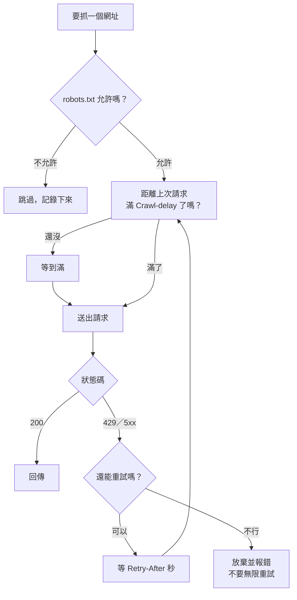
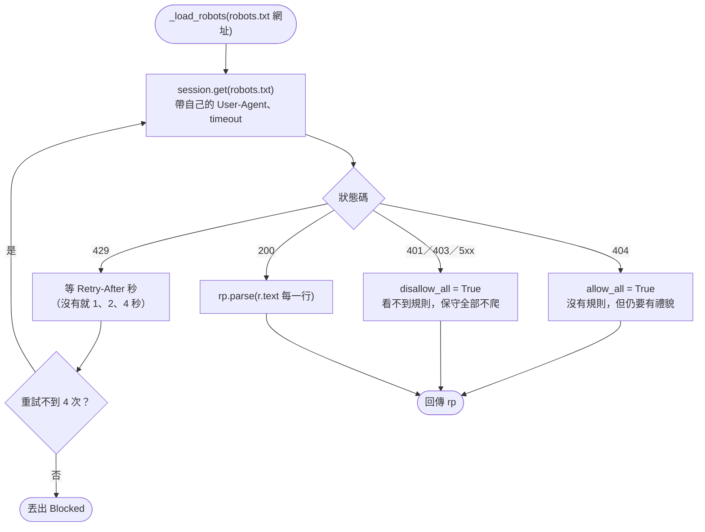
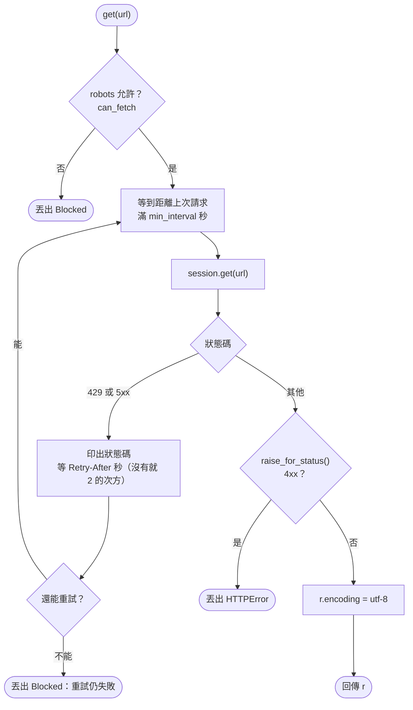
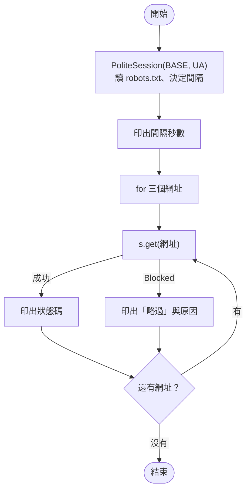

# 06｜有禮貌的爬蟲：robots.txt、速率與重試

> **定位**：讓程式自己遵守 robots.txt、控制請求速率、遇到 429 依 `Retry-After` 等待重試；真的被擋時，知道該走哪條路，而不是想辦法硬闖。

## 學習目標

完成本節後，你應該能夠：

- 在每次請求前，用 `urllib.robotparser` 自動檢查網址能不能爬
- 依 `Crawl-delay` 控制請求間隔，說明「固定間隔」和「每次 sleep」的差別
- 遇到 429、5xx 時依 `Retry-After` 等待並重試，且重試次數有上限
- 說出 `RobotFileParser.read()` 在 robots.txt 被 429 時會「全部允許」的陷阱，並改用自己下載再 `parse()`
- 被擋時依序考慮：找 API／開放資料、降速、聯絡網站、換來源

## 範例程式碼

- [demo：06-polite](https://github.com/4-learn/python-web-crawler-demo/tree/main/06-polite)
- 練習站：<https://4-learn.github.io/crawler-playground/>（關卡 6：禮貌與速率限制；本節 Workshop 使用老師的教室版伺服器）

---

## 情境

你是 AI 團隊的資料工程師。這一天你已經能用 API 拿 JSON、用 BeautifulSoup 爬完分頁、輸出 JSONL。主管準備把你的程式放進每天凌晨的排程：

> 「排程跑起來沒人盯著。我要確定它不會去碰人家說不能碰的路徑、不會把對方網站打掛；被限速了要自己等，等不到就停下來通知我。上次隔壁組的爬蟲被封 IP，整個辦公室都連不上那個網站。」

第 01 節你是「用眼睛」讀 robots.txt；今天要讓程式自己讀、自己守規矩。這也是第一天的最後一塊：之後所有爬蟲都會建立在這個「有禮貌的請求」之上。

---

## 講解

### 1. 沒禮貌的爬蟲會發生什麼事

網站通常會限制同一個 IP 的請求速度。老師的教室版練習站用「令牌桶」：每個 IP 一開始有 20 個額度（burst），每秒補 5 個（rate）；額度用完就回 **429 Too Many Requests**，並附上 `Retry-After` header 告訴你幾秒後再來。

先看一個沒禮貌的寫法：連續 30 次、完全不等待。demo 的 `rude_vs_polite.py`（只能對教室版執行，程式會拒絕對 GitHub Pages 執行）：

<!-- fn-table -->
| 函式名稱 | 說明 | 官方文件連結 |
|---|---|---|
| `requests.get(url, headers=, timeout=)` | 送出 GET 請求，回傳 `Response`；`headers` 放 User-Agent 等標頭，`timeout` 是最多等幾秒，沒設可能永遠卡住 | [文件](https://requests.readthedocs.io/en/latest/api/#requests.get) |
| `r.status_code` | HTTP 狀態碼（整數），例如 200、404、429 | [文件](https://requests.readthedocs.io/en/latest/api/#requests.Response.status_code) |

```python
print("--- 沒禮貌：連續 30 次，不等待 ---")
codes = [requests.get(BASE + "v1/api/laws.json", timeout=5).status_code for _ in range(30)]
print({c: codes.count(c) for c in set(codes)})
```

<!-- run-box -->
:::info
**▶ 怎麼執行**　程式在 demo repo 的 [`06-polite/rude_vs_polite.py`](https://github.com/4-learn/python-web-crawler-demo/blob/main/06-polite/rude_vs_polite.py)。在 **repo 根目錄**（`python-web-crawler-demo/`）執行：
**只對教室版執行**；程式偵測到 GitHub Pages 網址會直接停止。
```bash
export PLAYGROUND=http://老師IP:8000/
python 06-polite/rude_vs_polite.py
```
:::

```text
--- 沒禮貌：連續 30 次，不等待 ---
{200: 20, 429: 10}
```

前 20 次用完額度，後面 10 次全部被拒絕。被擋下的回應長這樣（`curl -i` 會連 header 一起印出；先用上面的程式把額度用完，再馬上執行）：

```bash
curl -i $PLAYGROUND/v1/api/laws.json
```

```text
HTTP/1.0 429 Too Many Requests
Content-Type: text/plain; charset=utf-8
Retry-After: 1

429 Too Many Requests：請放慢速度（每秒最多 1～2 個請求）。
```

在老師的終端機上，這 10 筆 429 都看得到你的 IP 和 User-Agent（這段程式沒設 UA，所以是 `python-requests/2.34.2`）。真實網站遇到這種流量，下一步通常是**封鎖整個 IP**，而學校、公司常常共用一個對外 IP，一個人的爬蟲會讓所有人都連不上。

### 2. 有禮貌的三件事



1. **先問 robots.txt**：每個網址送出前檢查，不允許就不送。
2. **控制速度**：兩次請求之間至少隔 `Crawl-delay` 秒。
3. **被限速就等**：依 `Retry-After` 等待，重試有上限；超過上限就停下來讓人處理。

demo 的 `polite_get.py` 把這三件事包成 `PoliteSession`，下面逐段看。

### 3. 每次請求前檢查 robots.txt

<!-- fn-table -->
| 函式名稱 | 說明 | 官方文件連結 |
|---|---|---|
| `rp.can_fetch(user_agent, url)` | 這個 User-Agent 可不可以抓這個網址，回傳 True／False | [文件](https://docs.python.org/3/library/urllib.robotparser.html#urllib.robotparser.RobotFileParser.can_fetch) |
| `raise 例外` | 主動丟出例外，程式停在這裡，不會繼續寫出錯誤資料 | [文件](https://docs.python.org/3/reference/simple_stmts.html#raise) |

```python
def get(self, url: str) -> requests.Response:
    if not self.robots.can_fetch(self.user_agent, url):
        raise Blocked(f"robots.txt 不允許：{url}")
    ...
```

<!-- run-box -->
:::info
**▶ 怎麼執行**　這段節錄自 [`06-polite/polite_get.py`](https://github.com/4-learn/python-web-crawler-demo/blob/main/06-polite/polite_get.py)，不是完整程式。要執行請跑整支（在 repo 根目錄）：
```bash
python 06-polite/polite_get.py
```
:::

用自訂例外 `Blocked`，而不是 `print` 一行就繼續：呼叫的人一定會知道「這個網址沒抓」，可以選擇跳過或中止，不會悄悄少一筆資料。

`robots` 物件在建立 `PoliteSession` 時就讀好了，robots.txt 只下載一次，不是每個請求都重抓。

### 4. 陷阱：`rp.read()` 遇到 429 會當成「全部允許」

第 01 節用的寫法是：

<!-- fn-table -->
| 函式名稱 | 說明 | 官方文件連結 |
|---|---|---|
| `RobotFileParser(url)` | 建立 robots.txt 解析器，`url` 是 robots.txt 的網址 | [文件](https://docs.python.org/3/library/urllib.robotparser.html#urllib.robotparser.RobotFileParser) |
| `rp.read()` | 下載並解析 robots.txt。遇到 429 等 4xx 會當成「全部允許」（見第 06 節） | [文件](https://docs.python.org/3/library/urllib.robotparser.html#urllib.robotparser.RobotFileParser.read) |

```python
rp = urllib.robotparser.RobotFileParser(BASE + "robots.txt")
rp.read()
```

<!-- run-box -->
:::info
**▶ 怎麼執行**　這兩行就是第 01 節 `robots_check.py` 的寫法。
:::

看起來沒問題，但看一下 Python 3.10 標準函式庫裡 `read()` 的原始碼：

<!-- fn-table -->
| 函式名稱 | 說明 | 官方文件連結 |
|---|---|---|
| `urllib.request.urlopen(url)` | Python 內建的開網址函式；`rp.read()` 內部就是用它 | [文件](https://docs.python.org/3/library/urllib.request.html#urllib.request.urlopen) |
| `urllib.error.HTTPError` | `urlopen` 遇到 4xx／5xx 時丟出的例外，`.code` 是狀態碼 | [文件](https://docs.python.org/3/library/urllib.error.html#urllib.error.HTTPError) |
| `rp.allow_all／rp.disallow_all` | 解析器內部的旗標：設成 True 代表全部允許／全部禁止 | [文件](https://github.com/python/cpython/blob/3.12/Lib/urllib/robotparser.py) |
| `rp.parse(lines)` | 解析自己下載好的 robots.txt（字串 list），不經過 `read()` | [文件](https://docs.python.org/3/library/urllib.robotparser.html#urllib.robotparser.RobotFileParser.parse) |

```python
def read(self):
    """Reads the robots.txt URL and feeds it to the parser."""
    try:
        f = urllib.request.urlopen(self.url)
    except urllib.error.HTTPError as err:
        if err.code in (401, 403):
            self.disallow_all = True
        elif err.code >= 400 and err.code < 500:
            self.allow_all = True
    else:
        raw = f.read()
        self.parse(raw.decode("utf-8").splitlines())
```

<!-- run-box -->
:::info
**▶ 怎麼執行**　這是 Python 標準函式庫的原始碼，給你讀的，不用執行。
:::

**401、403 以外的 4xx 一律當成「全部允許」**。404（網站沒有 robots.txt）這樣處理合理；但 **429 也是 4xx**。也就是說：你的爬蟲已經太快、連 robots.txt 都被限速擋下時，`read()` 反而判定「全部都能爬」，`admin/` 也照爬不誤。最需要保護的時候，保護消失了。

在教室版上實測：先用其他請求把額度用光，再呼叫 `read()`：

<!-- fn-table -->
| 函式名稱 | 說明 | 官方文件連結 |
|---|---|---|
| `rp.read()` | 下載並解析 robots.txt。遇到 429 等 4xx 會當成「全部允許」（見第 06 節） | [文件](https://docs.python.org/3/library/urllib.robotparser.html#urllib.robotparser.RobotFileParser.read) |
| `rp.allow_all／rp.disallow_all` | 解析器內部的旗標：設成 True 代表全部允許／全部禁止 | [文件](https://github.com/python/cpython/blob/3.12/Lib/urllib/robotparser.py) |
| `rp.can_fetch(user_agent, url)` | 這個 User-Agent 可不可以抓這個網址，回傳 True／False | [文件](https://docs.python.org/3/library/urllib.robotparser.html#urllib.robotparser.RobotFileParser.can_fetch) |

```python
codes = [requests.get(BASE + "v1/api/laws.json", timeout=5).status_code for _ in range(25)]
print("先把額度用完：", {c: codes.count(c) for c in sorted(set(codes))})
rp = urllib.robotparser.RobotFileParser(BASE + "robots.txt")
rp.read()
print("allow_all =", rp.allow_all)
print("can_fetch v1/admin/ ->", rp.can_fetch("course-crawler/1.0", BASE + "v1/admin/"))
```

<!-- run-box -->
:::info
**▶ 怎麼執行**　這段要對**教室版**執行才看得到 429。存成 `read_trap.py`，開頭補上 `import os, requests, urllib.robotparser` 與 `BASE = os.environ["PLAYGROUND"]`：
```bash
export PLAYGROUND=http://老師IP:8000/
python read_trap.py
```
:::

```text
先把額度用完： {200: 20, 429: 5}
allow_all = True
can_fetch v1/admin/ -> True
```

`v1/admin/` 明明是 Disallow，卻變成可以爬。另外，`read()` 用的是 `urllib`，**不會帶你設定的 User-Agent**，也沒有 timeout。

所以 `PoliteSession` 不用 `read()`，改成自己下載、自己判斷狀態碼，再交給 `parse()`：

<!-- flow-chart -->
**流程圖**



<!-- fn-table -->
| 函式名稱 | 說明 | 官方文件連結 |
|---|---|---|
| `session.get(url, timeout=)` | 用 Session 送 GET，用法同 `requests.get` | [文件](https://requests.readthedocs.io/en/latest/api/#requests.Session.get) |
| `r.headers.get(name)` | 取回應標頭；不分大小寫，沒有這個標頭就回傳 `None` | [文件](https://requests.readthedocs.io/en/latest/api/#requests.Response.headers) |
| `time.sleep(秒)` | 暫停幾秒；爬蟲用來控制速率 | [文件](https://docs.python.org/3/library/time.html#time.sleep) |
| `rp.parse(lines)` | 解析自己下載好的 robots.txt（字串 list），不經過 `read()` | [文件](https://docs.python.org/3/library/urllib.robotparser.html#urllib.robotparser.RobotFileParser.parse) |
| `rp.allow_all／rp.disallow_all` | 解析器內部的旗標：設成 True 代表全部允許／全部禁止 | [文件](https://github.com/python/cpython/blob/3.12/Lib/urllib/robotparser.py) |

```python
def _load_robots(self, url: str) -> urllib.robotparser.RobotFileParser:
    """自己下載 robots.txt。
    注意：rp.read() 遇到 429、404 等狀態碼會當成「全部允許」，被限速時反而失去保護。"""
    rp = urllib.robotparser.RobotFileParser(url)
    for attempt in range(4):
        r = self.session.get(url, timeout=10)
        if r.status_code == 429:
            time.sleep(float(r.headers.get("Retry-After", 2 ** attempt)))
            continue
        if r.status_code == 404:
            rp.allow_all = True  # 沒有 robots.txt：沒有限制，但仍要有禮貌
        elif r.status_code in (401, 403) or r.status_code >= 500:
            rp.disallow_all = True  # 看不到規則：保守起見全部不爬
        else:
            r.encoding = "utf-8"
            rp.parse(r.text.splitlines())
        return rp
    raise Blocked(f"拿不到 robots.txt：{url}")
```

<!-- run-box -->
:::info
**▶ 怎麼執行**　這段是 `PoliteSession` 的一個方法節錄自 [`06-polite/polite_get.py`](https://github.com/4-learn/python-web-crawler-demo/blob/main/06-polite/polite_get.py)，不是完整程式。要執行請跑整支（在 repo 根目錄）：
```bash
python 06-polite/polite_get.py
```
:::

| robots.txt 的狀態碼 | `read()` 的行為 | `PoliteSession` 的行為 |
|---|---|---|
| 200 | 解析 | 解析 |
| 404 | 全部允許 | 全部允許（仍維持速率） |
| 401／403 | 全部禁止 | 全部禁止 |
| **429** | **全部允許** | 等 `Retry-After` 後重試，仍拿不到就丟 `Blocked` |
| 5xx | 不處理；因為從未解析，`can_fetch` 一律回 `False` | 全部禁止 |

原則是：**看不到規則時，保守一點**。

### 5. 控制速率：固定間隔

<!-- fn-table -->
| 函式名稱 | 說明 | 官方文件連結 |
|---|---|---|
| `rp.crawl_delay(user_agent)` | robots.txt 的 `Crawl-delay` 秒數；沒寫就是 `None` | [文件](https://docs.python.org/3/library/urllib.robotparser.html#urllib.robotparser.RobotFileParser.crawl_delay) |

```python
delay = self.robots.crawl_delay(user_agent)
self.min_interval = min_interval if min_interval is not None else float(delay or 1)
```

<!-- run-box -->
:::info
**▶ 怎麼執行**　這段節錄自 [`06-polite/polite_get.py`](https://github.com/4-learn/python-web-crawler-demo/blob/main/06-polite/polite_get.py)，不是完整程式。要執行請跑整支（在 repo 根目錄）：
```bash
python 06-polite/polite_get.py
```
:::

間隔優先用 robots.txt 的 `Crawl-delay`；網站沒寫，就預設 1 秒。送出請求前：

<!-- fn-table -->
| 函式名稱 | 說明 | 官方文件連結 |
|---|---|---|
| `time.monotonic()` | 只會往前走的時鐘（秒），用來算「距離上次請求過了多久」 | [文件](https://docs.python.org/3/library/time.html#time.monotonic) |
| `time.sleep(秒)` | 暫停幾秒；爬蟲用來控制速率 | [文件](https://docs.python.org/3/library/time.html#time.sleep) |

```python
wait = self.min_interval - (time.monotonic() - self._last)
if wait > 0:
    time.sleep(wait)
self._last = time.monotonic()
r = self.session.get(url, timeout=10)
```

<!-- run-box -->
:::info
**▶ 怎麼執行**　這段節錄自 [`06-polite/polite_get.py`](https://github.com/4-learn/python-web-crawler-demo/blob/main/06-polite/polite_get.py)，不是完整程式。要執行請跑整支（在 repo 根目錄）：
```bash
python 06-polite/polite_get.py
```
:::

為什麼不是每次請求後直接 `time.sleep(1)`：

- 如果中間解析、寫檔就花了 0.6 秒，只需要再等 0.4 秒；固定間隔不會浪費時間。
- 這段邏輯放在 `PoliteSession` 裡，呼叫的人**不可能忘記**。第 05 節的 `time.sleep(1)` 寫在迴圈裡，只要有人新增一個請求忘了加，就破功了。
- `time.monotonic()` 不受系統時間調整影響，比 `time.time()` 適合量間隔。

### 6. 遇到 429：依 Retry-After 重試

<!-- flow-chart -->
**流程圖**



<!-- fn-table -->
| 函式名稱 | 說明 | 官方文件連結 |
|---|---|---|
| `r.headers.get(name)` | 取回應標頭；不分大小寫，沒有這個標頭就回傳 `None` | [文件](https://requests.readthedocs.io/en/latest/api/#requests.Response.headers) |
| `r.raise_for_status()` | 狀態碼是 4xx／5xx 就丟出 `HTTPError`，避免把錯誤頁當資料 | [文件](https://requests.readthedocs.io/en/latest/api/#requests.Response.raise_for_status) |
| `raise 例外` | 主動丟出例外，程式停在這裡，不會繼續寫出錯誤資料 | [文件](https://docs.python.org/3/reference/simple_stmts.html#raise) |

```python
for attempt in range(self.max_retries + 1):
    ...
    r = self.session.get(url, timeout=10)
    if r.status_code == 429 or r.status_code >= 500:
        retry_after = float(r.headers.get("Retry-After", 2 ** attempt))
        print(f"  {r.status_code}，等 {retry_after:.0f} 秒再試（第 {attempt + 1} 次）")
        time.sleep(retry_after)
        continue
    r.raise_for_status()
    r.encoding = "utf-8"
    return r
raise Blocked(f"重試 {self.max_retries} 次仍失敗：{url}")
```

<!-- run-box -->
:::info
**▶ 怎麼執行**　這段節錄自 [`06-polite/polite_get.py`](https://github.com/4-learn/python-web-crawler-demo/blob/main/06-polite/polite_get.py)，不是完整程式。要執行請跑整支（在 repo 根目錄）：
```bash
python 06-polite/polite_get.py
```
:::

- **網站有說 `Retry-After`，就照它說的等**。這是網站直接告訴你的答案，比自己猜準確。
- **沒說的話用指數退避**：1、2、4 秒…，每次失敗就等更久，給對方恢復的時間。
- **只重試 429 與 5xx**：403、404 重試也不會變，重試只是增加負擔。
- **重試有上限**，超過就丟例外。無限重試的爬蟲，本質上和攻擊沒有兩樣。

實測：先讓別的程式把額度用光，再用 `PoliteSession` 請求：

```text
別的程式先把額度用光： {200: 19, 429: 6}
  429，等 1 秒再試（第 1 次）
200 v1/api/laws/N0020012/page-1.json
```

### 7. 合起來跑一次

`polite_get.py` 的示範：

<!-- flow-chart -->
**流程圖**



```python
s = PoliteSession(BASE, "course-crawler/1.0 (demo)")
print("間隔", s.min_interval, "秒")
for path in ["v1/laws/", "v1/api/laws.json", "v1/admin/"]:
    try:
        r = s.get(BASE + path)
        print(r.status_code, path)
    except Blocked as e:
        print("略過：", e)
```

<!-- run-box -->
:::info
**▶ 怎麼執行**　程式在 demo repo 的 [`06-polite/polite_get.py`](https://github.com/4-learn/python-web-crawler-demo/blob/main/06-polite/polite_get.py)。在 **repo 根目錄**（`python-web-crawler-demo/`）執行：
這段是 `polite_get.py` 最下面的示範。對教室版執行可以看到 429 重試：先 `export PLAYGROUND=http://老師IP:8000/`。
```bash
python 06-polite/polite_get.py
```
:::

```text
間隔 1.0 秒
200 v1/laws/
200 v1/api/laws.json
略過： robots.txt 不允許：https://4-learn.github.io/crawler-playground/v1/admin/
```

`v1/admin/` 根本沒有送出，老師的終端機上也就不會出現 `[robots]` 紀錄。對照組是不看 robots.txt 的爬蟲，例如：

```bash
curl -A rude-bot $PLAYGROUND/v1/admin/
```

老師執行 `server.py` 的終端機就會出現：

```text
[robots] 127.0.0.1 抓了 Disallow 路徑 /v1/admin/（UA: rude-bot）
```

`rude_vs_polite.py` 的後半段改用 `PoliteSession`，同一台伺服器、同一個 IP，結果全部是 200（第 1 段的 `python 06-polite/rude_vs_polite.py` 會一起印出）：

```text
--- 有禮貌：每秒 1 次 ---
200
200
200
200
200
```

其他程式只要 `from polite_get import PoliteSession`，就能直接重用這些規則。

### 8. 被擋了怎麼辦

舊版講義這一節叫「反爬策略」，教的是換 User-Agent、輪換 IP、偽裝成瀏覽器。新版**不教這些**：網站已經明確表示「不要」，繞過它可能違反服務條款，甚至觸犯《刑法》妨害電腦使用罪章；更實際的是，你做出來的資料管線，隨時會因為對方加強防護而中斷，AI 團隊不能依賴這種來源。

被擋時，依序考慮：

| 順序 | 做法 | 例子 |
|---|---|---|
| 1 | **找 API／開放資料** | 全國法規資料庫網頁 `Disallow: /`，但有官方 JSON（第 03 節）；先查網站的「開發者」「開放資料」頁、[政府資料開放平臺](https://data.gov.tw/)、DevTools 的 Fetch/XHR |
| 2 | **降速** | 拉長間隔、改在離峰時段跑；用 ETag／304 只抓有變的（第 15 節）；能用列表頁就不要逐筆進詳細頁（第 05 節） |
| 3 | **聯絡網站** | 寫信說明身分、用途、頻率，詢問是否有資料授權或批次下載；User-Agent 留聯絡方式，方便對方找你而不是直接封你 |
| 4 | **換來源** | 找提供相同資料的其他官方單位、購買授權資料；或重新評估是否真的需要這份資料 |

判斷被擋的訊號與反應：

| 看到 | 代表 | 該做的事 |
|---|---|---|
| 429 | 太快 | 依 `Retry-After` 等待，之後整體降速 |
| 403 | 不給看，或已被封鎖 | **停下來**，檢查 robots.txt 與條款，走上表 |
| 突然出現驗證碼（CAPTCHA） | 網站判定你是機器人 | 停下來；驗證碼就是「不要自動化」的意思 |
| 回 200 但內容變成「請稍後再試」 | 軟性封鎖 | 筆數驗證會抓到（第 14 節），停下來 |

:::warning
「破解驗證碼」「用代理池輪換 IP」「偽造瀏覽器指紋」不在本課範圍，作業與總和 Workshop 中出現會直接扣分。資料工程師的價值是交出**可信、可持續取得**的資料，不是贏過網站的防護。
:::

---

## Workshop

### 題目

本題對**老師的教室版練習站**執行（`PLAYGROUND=http://老師IP:8000/`），**不要對 GitHub Pages 執行**。

要抓的網址：勞動基準法 API 的 5 頁（`v1/api/laws/N0030001/page-1.json` ～ `page-5.json`），外加一個 `v1/admin/`。

1. **沒禮貌版**：不看 robots.txt、不等待，對 `page-1.json` 連續請求 30 次，統計各狀態碼出現次數，確認出現 429。完成後等幾秒讓額度回復。
2. **有禮貌版**：
   - 用 requests 自己下載 robots.txt，交給 `RobotFileParser.parse()`（不要用 `read()`）。
   - 設定 User-Agent；間隔依 `Crawl-delay`，沒有就用 1 秒。
   - 每個網址先用 `can_fetch` 檢查，不允許就印出並跳過。
   - 遇到 429 依 `Retry-After` 等待後重試，最多 3 次。
3. 完成後請老師確認：終端機上**不應出現**你的 `[robots]` 紀錄。

本題請自己寫，不要直接 import demo 的 `PoliteSession`。

### 預期輸出

```text
=== 1. 沒禮貌：不等待、不看 robots.txt ===
{200: 20, 429: 10} ← 出現 429
=== 2. 有禮貌 ===
200 v1/api/laws/N0030001/page-1.json
200 v1/api/laws/N0030001/page-2.json
200 v1/api/laws/N0030001/page-3.json
200 v1/api/laws/N0030001/page-4.json
200 v1/api/laws/N0030001/page-5.json
robots.txt 禁止，跳過 v1/admin/
```

沒禮貌版約有 10 次 429（教室版預設 burst 20、每秒補 5 個；全班共用時你的數字可能不同）。有禮貌版應全部是 200，`v1/admin/` 被跳過。若有禮貌版剛開始就遇到 429，應看到「429，等 1 秒」之類的訊息後恢復 200。

### 解答

- [解答](https://github.com/4-learn/python-web-crawler-workshop/tree/master/2026/06)
