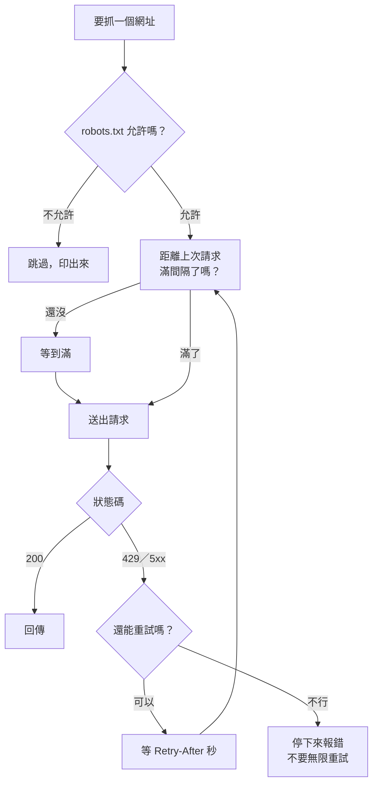
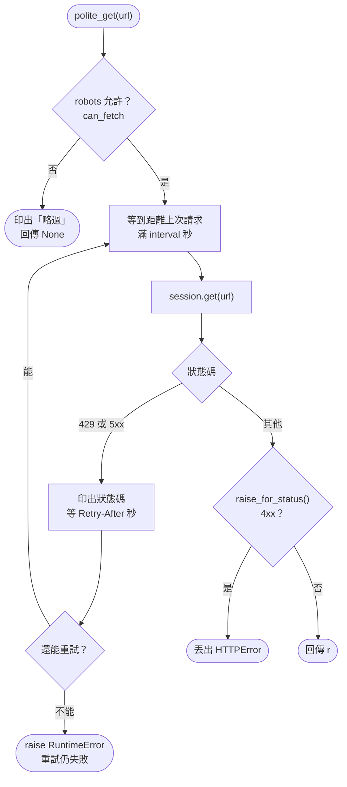

# 06｜有禮貌的爬蟲：robots.txt、速率與重試

> **定位**：讓程式自己遵守 robots.txt、控制請求速率、遇到 429 依 `Retry-After` 等待重試；真的被擋時，知道該走哪條路，而不是想辦法硬闖。

## 學習目標

完成本節後，你應該能夠：

- 在每次請求前，用 `urllib.robotparser` 自動檢查網址能不能爬（自己下載 robots.txt，再交給 `parse()`）
- 依 `Crawl-delay` 控制請求間隔，說明「固定間隔」和「每次 sleep」的差別
- 遇到 429、5xx 時依 `Retry-After` 等待並重試，且重試次數有上限
- 被擋時依序考慮：找 API／開放資料、降速、聯絡網站、換來源

## 範例程式碼

demo repo 的 [`06-polite/`](https://github.com/4-learn/python-web-crawler-demo/tree/main/06-polite) 資料夾，本節用到的程式（都在 **repo 根目錄** `python-web-crawler-demo/` 執行；標「只對教室版」的要先 `export PLAYGROUND=http://老師IP:8000/`）：

| 檔案 | 講解段落 | 內容 | 執行指令 |
|---|---|---|---|
| [`06-polite/step1_robots.py`](https://github.com/4-learn/python-web-crawler-demo/blob/main/06-polite/step1_robots.py) | 3. 第一步：先問 robots.txt | 讀 robots.txt、`can_fetch` | `python 06-polite/step1_robots.py` |
| [`06-polite/step2_wait_retry.py`](https://github.com/4-learn/python-web-crawler-demo/blob/main/06-polite/step2_wait_retry.py) | 5. 第二步：固定間隔、被限速就等 | 固定間隔、429 重試 | `python 06-polite/step2_wait_retry.py` |
| [`06-polite/polite_get.py`](https://github.com/4-learn/python-web-crawler-demo/blob/main/06-polite/polite_get.py) | 6. 合起來 | 有禮貌的 GET：`load_robots()`、`polite_get()`（Workshop 從這支改起） | `python 06-polite/polite_get.py` |
| [`06-polite/rude_vs_polite.py`](https://github.com/4-learn/python-web-crawler-demo/blob/main/06-polite/rude_vs_polite.py) | 1、7 | 沒禮貌 vs 有禮貌（只對教室版） | `python 06-polite/rude_vs_polite.py` |
| [`06-polite/retry_demo.py`](https://github.com/4-learn/python-web-crawler-demo/blob/main/06-polite/retry_demo.py) | 5 | 被限速時自動等待重試（只對教室版） | `python 06-polite/retry_demo.py` |
| [`06-polite/read_trap.py`](https://github.com/4-learn/python-web-crawler-demo/blob/main/06-polite/read_trap.py) | 4（進階） | `rp.read()` 被 429 騙成全部允許（只對教室版） | `python 06-polite/read_trap.py` |
| [`06-polite/real_robots.py`](https://github.com/4-learn/python-web-crawler-demo/blob/main/06-polite/real_robots.py) | 4（進階） | `robotparser` 讀真實網站也會出錯 | `python 06-polite/real_robots.py` |

- 練習站：<https://4-learn.github.io/crawler-playground/>（關卡 6：禮貌與速率限制；本節 Workshop 使用老師的教室版伺服器）
- 教室版怎麼開：〈[練習站原始碼與教室版伺服器](https://hackmd.io/@yillkid/B1ILf8kpze)〉

---

## 情境

你是 AI 團隊的資料工程師。這一天你已經能用 API 拿 JSON、用 BeautifulSoup 爬完分頁、輸出 JSONL。主管準備把你的程式放進每天凌晨的排程：

> 「排程跑起來沒人盯著。我要確定它不會去碰人家說不能碰的路徑、不會把對方網站打掛；被限速了要自己等，等不到就停下來通知我。上次隔壁組的爬蟲被封 IP，整個辦公室都連不上那個網站。」

第 01 節你是「用眼睛」讀 robots.txt；今天要讓程式自己讀、自己守規矩。這也是第一天的最後一塊：之後所有爬蟲都會建立在這個「有禮貌的請求」之上。

---

## 講解

### 1. 沒禮貌的爬蟲會發生什麼事

網站通常會限制同一個 IP 的請求速度。老師的教室版練習站用「令牌桶」：每個 IP 一開始有 20 個額度（burst），每秒補 5 個（rate）；額度用完就回 **429 Too Many Requests**，並附上 `Retry-After` header 告訴你幾秒後再來。

先看一個沒禮貌的寫法：連續 30 次、完全不等待。demo 的 `rude_vs_polite.py` 前半段（只能對教室版執行，程式會拒絕對 GitHub Pages 執行）：

<!-- fn-table -->
| 函式名稱 | 說明 | 官方文件連結 |
|---|---|---|
| `requests.get(url, headers=, timeout=)` | 送出 GET 請求，回傳 `Response`；`headers` 放 User-Agent 等標頭，`timeout` 是最多等幾秒，沒設可能永遠卡住 | [文件](https://requests.readthedocs.io/en/latest/api/#requests.get) |
| `r.status_code` | HTTP 狀態碼（整數），例如 200、404、429 | [文件](https://requests.readthedocs.io/en/latest/api/#requests.Response.status_code) |

```python
print("--- 沒禮貌：連續 30 次，不等待 ---")
codes = [requests.get(BASE + "v1/api/laws.json", timeout=5).status_code for _ in range(30)]
print({c: codes.count(c) for c in set(codes)})
```

<!-- run-box -->
:::info
**▶ 怎麼執行**　程式在 demo repo 的 [`06-polite/rude_vs_polite.py`](https://github.com/4-learn/python-web-crawler-demo/blob/main/06-polite/rude_vs_polite.py)。在 **repo 根目錄**（`python-web-crawler-demo/`）執行：
**只對教室版執行**；程式偵測到 GitHub Pages 網址會直接停止。
```bash
export PLAYGROUND=http://老師IP:8000/
python 06-polite/rude_vs_polite.py
```
:::

<sub>📄 來源：執行 [`06-polite/rude_vs_polite.py`](https://github.com/4-learn/python-web-crawler-demo/blob/main/06-polite/rude_vs_polite.py) 的輸出（前半）</sub>

```text
--- 沒禮貌：連續 30 次，不等待 ---
{200: 20, 429: 10}
```

前 20 次用完額度，後面 10 次全部被拒絕。被擋下的回應長這樣（`curl -i` 會連 header 一起印出；先用上面的程式把額度用完，再馬上執行）：

```bash
curl -i $PLAYGROUND/v1/api/laws.json
```

<sub>📄 來源：對教室版執行上面 `curl -i` 指令的輸出（只留重點 header）</sub>

```text
HTTP/1.0 429 Too Many Requests
Content-Type: text/plain; charset=utf-8
Retry-After: 1

429 Too Many Requests：請放慢速度（每秒最多 1～2 個請求）。
```

在老師的終端機上，這 10 筆 429 都看得到你的 IP 和 User-Agent（這段程式沒設 UA，所以是 `python-requests/2.34.2`）。真實網站遇到這種流量，下一步通常是**封鎖整個 IP**，而學校、公司常常共用一個對外 IP，一個人的爬蟲會讓所有人都連不上。

### 2. 有禮貌的三件事



1. **先問 robots.txt**：每個網址送出前檢查，不允許就不送。
2. **控制速度**：兩次請求之間至少隔 `Crawl-delay` 秒。
3. **被限速就等**：依 `Retry-After` 等待，重試有上限；超過上限就停下來讓人處理。

demo 的 `polite_get.py` 把這三件事寫成兩個函式：

| 函式 | 做什麼 | 什麼時候呼叫 |
|---|---|---|
| `load_robots(BASE)` | 下載並讀好 robots.txt，依 `Crawl-delay` 決定間隔 | 程式開始時呼叫**一次** |
| `polite_get(url)` | 檢查 robots → 等到滿間隔 → 送出；429 就等一下再試 | 每次要抓網址時，用它代替 `requests.get` |

### 3. 第一步：先問 robots.txt

先只做一件事：讀 robots.txt，每個網址送出前問一次「能不能爬」。

<!-- fn-table -->
| 函式名稱 | 說明 | 官方文件連結 |
|---|---|---|
| `RobotFileParser()` | 建立 robots.txt 解析器 | [文件](https://docs.python.org/3/library/urllib.robotparser.html#urllib.robotparser.RobotFileParser) |
| `rp.parse(lines)` | 解析自己下載好的 robots.txt（字串 list） | [文件](https://docs.python.org/3/library/urllib.robotparser.html#urllib.robotparser.RobotFileParser.parse) |
| `rp.crawl_delay(user_agent)` | robots.txt 的 `Crawl-delay` 秒數；沒寫就是 `None` | [文件](https://docs.python.org/3/library/urllib.robotparser.html#urllib.robotparser.RobotFileParser.crawl_delay) |
| `rp.can_fetch(user_agent, url)` | 這個 User-Agent 可不可以抓這個網址，回傳 True／False | [文件](https://docs.python.org/3/library/urllib.robotparser.html#urllib.robotparser.RobotFileParser.can_fetch) |

```python
import os
import urllib.robotparser
from urllib.parse import urljoin

import requests

BASE = os.environ.get("PLAYGROUND", "https://4-learn.github.io/crawler-playground/")
USER_AGENT = "course-crawler/1.0 (demo)"

# 自己下載 robots.txt，再交給 parse()（不用 rp.read()，原因見講義第 4 段）
r = requests.get(urljoin(BASE, "robots.txt"), headers={"User-Agent": USER_AGENT}, timeout=10)
r.encoding = "utf-8"
robots = urllib.robotparser.RobotFileParser()
robots.parse(r.text.splitlines())

interval = float(robots.crawl_delay(USER_AGENT) or 1)   # 沒寫 Crawl-delay 就 1 秒
print("間隔", interval, "秒")

for path in ["v1/laws/", "v1/api/laws.json", "v1/admin/"]:
    if robots.can_fetch(USER_AGENT, BASE + path):
        print("可以爬", path)
    else:
        print("略過  ", path)
```

<!-- run-box -->
:::info
**▶ 怎麼執行**　程式在 demo repo 的 [`06-polite/step1_robots.py`](https://github.com/4-learn/python-web-crawler-demo/blob/main/06-polite/step1_robots.py)。在 **repo 根目錄**（`python-web-crawler-demo/`）執行：
```bash
python 06-polite/step1_robots.py
```
:::

<sub>📄 來源：執行 [`06-polite/step1_robots.py`](https://github.com/4-learn/python-web-crawler-demo/blob/main/06-polite/step1_robots.py) 的輸出</sub>

```text
間隔 1.0 秒
可以爬 v1/laws/
可以爬 v1/api/laws.json
略過   v1/admin/
```

- 和第 01 節的差別：第 01 節用 `rp.read()` 讓 Python 自己去抓 robots.txt；這裡**自己用 `requests.get` 下載，再交給 `rp.parse()`**。原因在下一段。
- `interval` 從 `Crawl-delay` 來，第二步會用它控制速度。

### 4. 為什麼不用 `rp.read()`

`rp.read()` 遇到 429 會當成「全部允許」：你的爬蟲太快、連 robots.txt 都被限速時，`admin/` 反而變成可以爬。另外 `read()` 不會帶你設定的 User-Agent，也沒有 timeout。

所以完整版（第 6 段的 `polite_get.py`）會自己下載，再依狀態碼決定怎麼辦：

| robots.txt 回什麼 | `load_robots()` 怎麼做 | 為什麼 |
|---|---|---|
| 200 | 解析 | 正常情況 |
| 404 | 全部允許 | 網站沒有 robots.txt，沒有限制；但仍維持間隔 |
| 401／403／5xx | 全部禁止 | 看不到規則，**保守一點** |
| 429 | 等 `Retry-After` 後再試，試 4 次都不行就停 | 被限速了，先等 |

原則是：**看不到規則時，保守一點**。

#### `rp.read()` 與 robotparser 的陷阱（進階）

> 上課可以跳過。結論已經寫在上面：自己下載、交給 `parse()`；讀到的規則若跟你用眼睛看的不一樣，以眼睛看的為準。

:::spoiler 點我展開：read() 被 429 騙、真實網站的空行與 *

**陷阱 1：`read()` 遇到 429 會當成「全部允許」**

Python 3.10 標準函式庫裡 `read()` 的原始碼（給你讀的，不用執行）：

```python
def read(self):
    """Reads the robots.txt URL and feeds it to the parser."""
    try:
        f = urllib.request.urlopen(self.url)
    except urllib.error.HTTPError as err:
        if err.code in (401, 403):
            self.disallow_all = True
        elif err.code >= 400 and err.code < 500:
            self.allow_all = True
    else:
        raw = f.read()
        self.parse(raw.decode("utf-8").splitlines())
```

**401、403 以外的 4xx 一律當成「全部允許」**，而 429 也是 4xx。在教室版實測：先把額度用光，再呼叫 `read()`：

> **▶ 怎麼執行**　程式在 demo repo 的 [`06-polite/read_trap.py`](https://github.com/4-learn/python-web-crawler-demo/blob/main/06-polite/read_trap.py)，只對教室版執行（在 repo 根目錄）：

```bash
export PLAYGROUND=http://老師IP:8000/
python 06-polite/read_trap.py
```

<sub>📄 來源：執行 [`06-polite/read_trap.py`](https://github.com/4-learn/python-web-crawler-demo/blob/main/06-polite/read_trap.py) 的輸出</sub>

```text
先把額度用完： {200: 20, 429: 5}
allow_all = True
can_fetch v1/admin/ -> True
```

`v1/admin/` 明明是 Disallow，卻變成可以爬。

**陷阱 2：robotparser 讀真實網站也會出錯**

第 01 節的 Workshop 有同學把 `robots_check.py` 改去測真實網站，得到錯的答案。原因是 Python 的 robotparser 不支援一些常見寫法：

> **▶ 怎麼執行**　程式在 demo repo 的 [`06-polite/real_robots.py`](https://github.com/4-learn/python-web-crawler-demo/blob/main/06-polite/real_robots.py)（在 repo 根目錄）：

```bash
python 06-polite/real_robots.py
```

<sub>📄 來源：執行 [`06-polite/real_robots.py`](https://github.com/4-learn/python-web-crawler-demo/blob/main/06-polite/real_robots.py) 的輸出（2026-10-31）</sub>

```text
全國法規資料庫（原樣交給 parse）：
  可以爬  /
  可以爬  /api/Ch/Law/JSON
全國法規資料庫（拿掉空行再 parse）：
  禁止    /
  禁止    /api/Ch/Law/JSON
  禁止    /LawClass/LawAll.aspx
勞動部（disallow: /App_Data/*）：
  可以爬  /
  可以爬  /App_Data/x
```

| 網站 | robots.txt 寫法 | robotparser 的問題 |
|---|---|---|
| 全國法規資料庫 | `User-agent: *` 下面多一行**空行**，再寫 `Disallow: /` | 空行讓規則接不上，**整份都讀不到**，全部變成可以爬 |
| 全國法規資料庫 | `Disallow: /` 後面才寫 `Allow: /LawClass/LawAll.aspx` 等三行 | robotparser 用「第一條符合的規則」，`Allow` 被前面的 `Disallow: /` 蓋掉；但標準（RFC 9309）是看**最長符合**，這三個網址其實允許 |
| 勞動部 | `disallow: /App_Data/*` 用了萬用字元 `*` | 不支援 `*`，`/App_Data/x` 被當成可以爬 |

所以：**工具只是輔助，重要的網站要自己用眼睛讀一次 robots.txt**。練習站的 robots.txt 沒有這些寫法，`polite_get.py` 可以正確判斷。

:::

### 5. 第二步：固定間隔、被限速就等

再只做一件事：送出請求前先等到滿間隔；遇到 429 依 `Retry-After` 等待再試，最多 4 次。

#### 這段會用到的 Python 語法

| 寫法 | 意思 | 官方文件連結 |
|---|---|---|
| 檔案最上面的變數（`interval`、`last_time`） | 放在函式**外面**，用來記住「間隔幾秒」「上次請求的時間」 | [文件](https://docs.python.org/3/tutorial/classes.html#python-scopes-and-namespaces) |
| `global last_time` | 在函式裡要**改**外面的變數，要先用 `global` 宣告；只讀（例如 `interval`）不用 | [文件](https://docs.python.org/3/reference/simple_stmts.html#the-global-statement) |
| `for attempt in range(4):` | 最多試 4 次；`attempt` 依序是 0、1、2、3 | [文件](https://docs.python.org/3/library/stdtypes.html#range) |
| `continue` | 跳過這一輪剩下的程式，直接進下一輪（再試一次） | [文件](https://docs.python.org/3/reference/simple_stmts.html#the-continue-statement) |
| `2 ** attempt` | 2 的 attempt 次方：1、2、4、8，用來「每次多等一點」 | [文件](https://docs.python.org/3/reference/expressions.html#the-power-operator) |
| `raise RuntimeError("…")` | 主動丟出錯誤，程式停在這裡，不會繼續寫出錯誤資料 | [文件](https://docs.python.org/3/reference/simple_stmts.html#raise) |

<!-- fn-table -->
| 函式名稱 | 說明 | 官方文件連結 |
|---|---|---|
| `time.monotonic()` | 只會往前走的時鐘（秒），用來算「距離上次請求過了多久」 | [文件](https://docs.python.org/3/library/time.html#time.monotonic) |
| `time.sleep(秒)` | 暫停幾秒 | [文件](https://docs.python.org/3/library/time.html#time.sleep) |
| `r.headers.get(name)` | 取回應標頭；沒有這個標頭就回傳 `None` | [文件](https://requests.readthedocs.io/en/latest/api/#requests.Response.headers) |

```python
import os
import time

import requests

BASE = os.environ.get("PLAYGROUND", "https://4-learn.github.io/crawler-playground/")
interval = 1.0       # 兩次請求至少隔幾秒
last_time = 0.0      # 上一次送出請求的時間


def wait_and_get(url):
    global last_time
    for attempt in range(4):                                # 最多試 4 次
        wait = interval - (time.monotonic() - last_time)    # 距離上次請求還差幾秒
        if wait > 0:
            time.sleep(wait)
        last_time = time.monotonic()
        r = requests.get(url, headers={"User-Agent": "course-crawler/1.0 (demo)"}, timeout=10)
        if r.status_code == 429 or r.status_code >= 500:
            retry_after = float(r.headers.get("Retry-After", 2 ** attempt))
            print(f"  {r.status_code}，等 {retry_after:.0f} 秒再試")
            time.sleep(retry_after)
            continue                                        # 再試一次
        return r
    raise RuntimeError(f"試了 4 次仍失敗：{url}")


start = time.monotonic()
for n in [1, 2, 3]:
    r = wait_and_get(BASE + f"v1/api/laws/N0030001/page-{n}.json")
    print(f"{time.monotonic() - start:4.1f} 秒  {r.status_code}  page-{n}.json")
```

<!-- run-box -->
:::info
**▶ 怎麼執行**　程式在 demo repo 的 [`06-polite/step2_wait_retry.py`](https://github.com/4-learn/python-web-crawler-demo/blob/main/06-polite/step2_wait_retry.py)。在 **repo 根目錄**（`python-web-crawler-demo/`）執行：
```bash
python 06-polite/step2_wait_retry.py
```
:::

<sub>📄 來源：執行 [`06-polite/step2_wait_retry.py`](https://github.com/4-learn/python-web-crawler-demo/blob/main/06-polite/step2_wait_retry.py) 的輸出（GitHub Pages；秒數每次略有不同）</sub>

```text
 0.4 秒  200  page-1.json
 1.4 秒  200  page-2.json
 2.3 秒  200  page-3.json
```

三個請求剛好間隔約 1 秒。逐行看重點：

- **固定間隔**：`wait = interval - (time.monotonic() - last_time)`。如果中間解析、寫檔已經花了 0.6 秒，只需要再等 0.4 秒，不浪費時間。
- **網站有說 `Retry-After`，就照它說的等**；沒說就用 `2 ** attempt`：1、2、4 秒，每次失敗等更久。
- **只重試 429 與 5xx**：403、404 重試也不會變。
- **重試有上限**，超過就 `raise` 停下來。無限重試的爬蟲，本質上和攻擊沒有兩樣。

實測被限速的情況：先讓別的程式把額度用光，再用完整版的 `polite_get()` 請求（只對教室版）：

<!-- run-box -->
:::info
**▶ 怎麼執行**　程式在 demo repo 的 [`06-polite/retry_demo.py`](https://github.com/4-learn/python-web-crawler-demo/blob/main/06-polite/retry_demo.py)。在 **repo 根目錄**（`python-web-crawler-demo/`）執行：
**只對教室版執行**。
```bash
export PLAYGROUND=http://老師IP:8000/
python 06-polite/retry_demo.py
```
:::

<sub>📄 來源：執行 [`06-polite/retry_demo.py`](https://github.com/4-learn/python-web-crawler-demo/blob/main/06-polite/retry_demo.py) 的輸出（教室版）</sub>

```text
別的程式先把額度用光： {200: 19, 429: 6}
  429，等 1 秒再試（第 1 次）
200 v1/api/laws/N0020012/page-1.json
```

### 6. 合起來：`polite_get.py`

把第一步和第二步合起來，包成兩個函式，其他程式就能直接拿來用：

| 函式 | 做什麼 | 對應 |
|---|---|---|
| `load_robots(BASE)` | 讀 robots.txt、決定間隔（程式開始時呼叫一次） | 第一步＋第 4 段的狀態碼處理 |
| `polite_get(url)` | 檢查 robots → 等到滿間隔 → 送出；429 就等一下再試 | 第一步的 `can_fetch`＋第二步 |

<!-- flow-chart -->
**流程圖**



裡面幾乎都是前兩步看過的程式，所以這裡不貼全文，直接打開檔案對照。唯一新的寫法是：robots.txt 不允許時，`polite_get()` 會 `return None`（回傳「沒有東西」），呼叫的人用 `if r is not None:` 判斷有沒有拿到。

檔案：[`06-polite/polite_get.py`](https://github.com/4-learn/python-web-crawler-demo/blob/main/06-polite/polite_get.py)。

<!-- run-box -->
:::info
**▶ 怎麼執行**　程式在 demo repo 的 [`06-polite/polite_get.py`](https://github.com/4-learn/python-web-crawler-demo/blob/main/06-polite/polite_get.py)。在 **repo 根目錄**（`python-web-crawler-demo/`）執行：
```bash
python 06-polite/polite_get.py
```
:::

<sub>📄 來源：執行 [`06-polite/polite_get.py`](https://github.com/4-learn/python-web-crawler-demo/blob/main/06-polite/polite_get.py) 的輸出</sub>

```text
間隔 1.0 秒
200 v1/laws/
200 v1/api/laws.json
略過（robots.txt 不允許）： https://4-learn.github.io/crawler-playground/v1/admin/
```

`v1/admin/` 根本沒有送出，老師的終端機上也就不會出現 `[robots]` 紀錄。

其他程式只要把 `polite_get.py` 放在同一個資料夾，就能直接用：

```python
from polite_get import load_robots, polite_get

load_robots(BASE)                       # 開始時一次
r = polite_get(BASE + "v1/laws/")       # 之後用它代替 requests.get
```

### 7. 沒禮貌 vs 有禮貌：同一台伺服器的結果

`rude_vs_polite.py` 的後半段就是這樣用的。同一台伺服器、同一個 IP，前半段沒禮貌被擋了 10 次，後半段全部是 200：

<sub>📄 來源：執行 [`06-polite/rude_vs_polite.py`](https://github.com/4-learn/python-web-crawler-demo/blob/main/06-polite/rude_vs_polite.py) 的輸出（教室版；第 1 段已經執行過，這是後半）</sub>

```text
--- 有禮貌：每秒 1 次 ---
200
200
200
200
200
```

對照組是不看 robots.txt 的爬蟲，例如：

```bash
curl -A rude-bot $PLAYGROUND/v1/admin/
```

老師執行 `server.py` 的終端機就會出現：

<sub>📄 來源：教室版 `server.py` 的終端機（老師的畫面）</sub>

```text
[robots] 127.0.0.1 抓了 Disallow 路徑 /v1/admin/（UA: rude-bot）
```

### 8. 被擋了怎麼辦

:::info
**被擋了怎麼辦？** 停下來，依序考慮：① 找 API／開放資料（第 03 節）② 降速 ③ 聯絡網站 ④ 換來源。
看到 403、驗證碼，就是網站在說「不要」，**不要想辦法繞過**。換 User-Agent、代理池、破解驗證碼不在本課範圍，作業與總和 Workshop 中出現會扣分。
:::

---

## Workshop

### 題目

本題對**老師的教室版練習站**執行（`export PLAYGROUND=http://老師IP:8000/`），**不要對 GitHub Pages 執行**。

**課堂題**（從 `06-polite/polite_get.py` 改起）：

1. 執行 `python 06-polite/rude_vs_polite.py`，確認前半段出現 429。完成後等幾秒，讓額度回復。
2. 把 `polite_get.py` 複製一份成 `06-polite/my_polite.py`（不要直接改 demo 檔）。
3. 把最下面 `for path in [...]` 的網址清單改成：勞動基準法 API 的 5 頁（`v1/api/laws/N0030001/page-1.json` ～ `page-5.json`），外加 `v1/admin/`。
4. 執行 `python 06-polite/my_polite.py`，確認 5 頁都是 200、`v1/admin/` 被略過。
5. 請老師確認：終端機上**沒有**你的 `[robots]` 紀錄。

**延伸題**（做完課堂題再做）：不用 `polite_get.py`，自己從頭寫：

6. 用 `requests` 下載 robots.txt，交給 `RobotFileParser.parse()`（不要用 `read()`）。
7. 間隔依 `Crawl-delay`，沒有就用 1 秒；每個網址先用 `can_fetch` 檢查。
8. 遇到 429 依 `Retry-After` 等待後重試，最多 3 次。

### 預期輸出

課堂題：

```text
$ python 06-polite/rude_vs_polite.py
--- 沒禮貌：連續 30 次，不等待 ---
{200: 20, 429: 10}
…

$ python 06-polite/my_polite.py
間隔 1.0 秒
200 v1/api/laws/N0030001/page-1.json
200 v1/api/laws/N0030001/page-2.json
200 v1/api/laws/N0030001/page-3.json
200 v1/api/laws/N0030001/page-4.json
200 v1/api/laws/N0030001/page-5.json
略過（robots.txt 不允許）： http://老師IP:8000/v1/admin/
```

沒禮貌版約有 10 次 429（教室版預設 burst 20、每秒補 5 個；全班共用時你的數字可能不同）。有禮貌版剛開始若遇到 429，會看到「429，等 1 秒再試」之後恢復 200。

延伸題的輸出格式自訂，結果要一樣：5 頁都是 200、`v1/admin/` 沒有送出。

### 解答

- [解答](https://github.com/4-learn/python-web-crawler-workshop/tree/master/2026/06)
