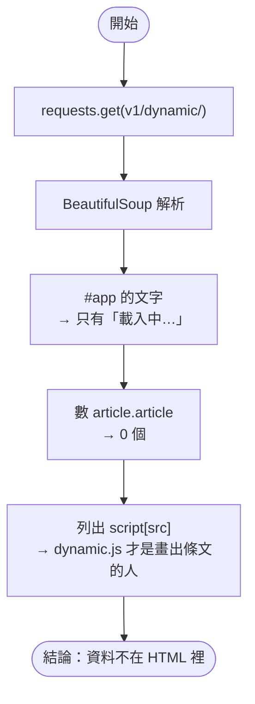
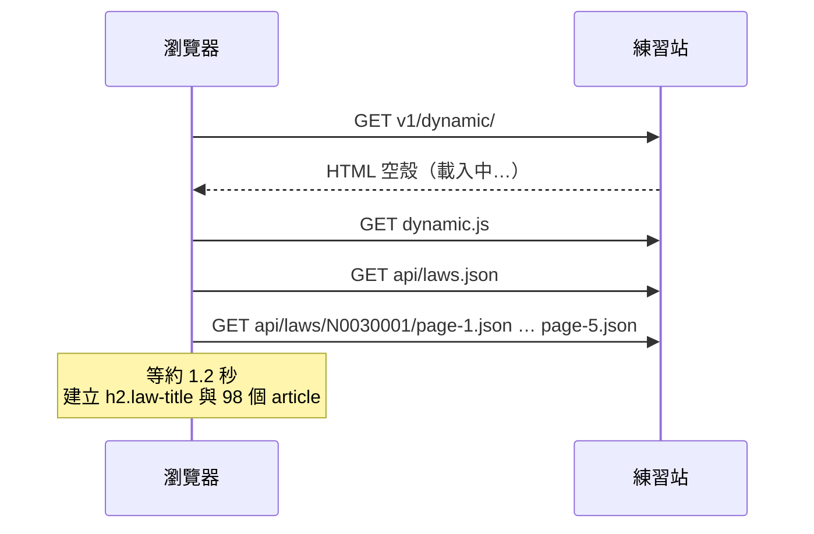
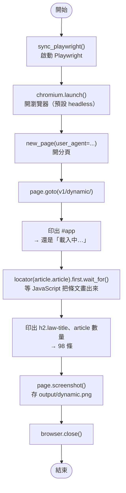

# 07｜為什麼需要瀏覽器：Playwright 第一支程式

> **定位**：分清楚「伺服器給的 HTML 原始碼」與「瀏覽器執行 JavaScript 後的 DOM」，並在 Ubuntu 上裝好 Playwright、寫出第一支會等內容、會截圖的程式。

## 學習目標

完成本節後，你應該能夠：

- 說明為什麼 requests 抓關卡 3 只看到「載入中…」
- 在 Ubuntu 上用 `pip install playwright` 與 `playwright install --with-deps chromium` 完成安裝
- 用 `sync_playwright` 開瀏覽器、`goto` 網頁、等元素出現、取 `content()`
- 分辨 headless 與 headed 模式，並用 `screenshot()` 留下畫面證據

## 範例程式碼

demo repo 的 [`07-playwright/`](https://github.com/4-learn/python-web-crawler-demo/tree/main/07-playwright) 資料夾，本節用到的程式（都在 **repo 根目錄** `python-web-crawler-demo/` 執行；要先做完第 4 段的安裝）：

| 檔案 | 講解段落 | 內容 | 執行指令 |
|---|---|---|---|
| [`07-playwright/requests_sees_nothing.py`](https://github.com/4-learn/python-web-crawler-demo/blob/main/07-playwright/requests_sees_nothing.py) | 1. 先用 requests 試試看 | requests 抓關卡 3 只看到「載入中…」 | `python 07-playwright/requests_sees_nothing.py` |
| [`07-playwright/first_playwright.py`](https://github.com/4-learn/python-web-crawler-demo/blob/main/07-playwright/first_playwright.py) | 5. 第一支 Playwright 程式 | 開瀏覽器、等條文出現、截圖（Workshop 從這支改起） | `python 07-playwright/first_playwright.py` |
| [`07-playwright/content_and_screenshot.py`](https://github.com/4-learn/python-web-crawler-demo/blob/main/07-playwright/content_and_screenshot.py) | 6. content()、8. 截圖 | 等待前後的 DOM、視窗截圖與整頁截圖 | `python 07-playwright/content_and_screenshot.py` |

- 關卡 3：<https://4-learn.github.io/crawler-playground/v1/dynamic/>

---

## 情境

你是 AI 團隊的資料工程師。第一天你已經用 API 和 BeautifulSoup 把練習站關卡 1、2 的條文整理成 JSONL，也替爬蟲加上了 robots.txt 檢查與速率限制。

今天主管丟來新的頁面：

> 「法務那邊說，有些法規網站是『點了才出現』的。你昨天那支 requests 程式，抓這種頁面會抓到什麼？」

你打開關卡 3，畫面上明明有條文；但用昨天的程式一抓，什麼都沒有。今天要搞清楚原因，並換上能「像人一樣開瀏覽器」的工具。

---

## 講解

### 1. 先用 requests 試試看

第 04、05 節用 requests + BeautifulSoup 都成功了，但那時抓的是**關卡 1**。今天要抓的是**關卡 3**：內容一樣是勞動基準法，條文放進網頁的方式卻不同。

<sub>📄 來源：分別用 `requests.get` 抓兩個網址、交給 BeautifulSoup 數 `article.article` 的結果（2026-10-31）</sub>

| | 關卡 1：第 04、05 節用的 | 關卡 3：本節用的 |
|---|---|---|
| 網址 | [`v1/laws/N0030001/`](https://4-learn.github.io/crawler-playground/v1/laws/N0030001/) | [`v1/dynamic/`](https://4-learn.github.io/crawler-playground/v1/dynamic/) |
| 伺服器送來的 HTML | 8811 字 | 1040 字 |
| 裡面有幾個 `article` | 20 個（第 1 條就在裡面） | **0 個** |
| 引用的 JavaScript | 沒有 | `dynamic.js` |
| 條文怎麼來的 | 伺服器**直接寫在 HTML 裡** | 瀏覽器拿到空殼後，執行 `dynamic.js` 去打 API，再把條文塞進畫面 |

在瀏覽器裡兩頁看起來都有條文，因為瀏覽器會自動執行 JavaScript，肉眼分不出差別。分辨方法：

:::info
**右鍵 →「檢視網頁原始碼」**，用 `Ctrl+F` 找你要的資料（例如「第 1 條」）：
- **找得到** → 資料在 HTML 裡，requests + BeautifulSoup 就夠（第 04、05 節）。
- **找不到** → 資料是 JavaScript 載入的，先找它背後的 API（第 03 節），找不到再用 Playwright（本節）。
:::

用第 04 節的寫法抓關卡 3，看看會發生什麼事：

<!-- flow-chart -->
**流程圖**



<!-- fn-table -->
| 函式名稱 | 說明 | 官方文件連結 |
|---|---|---|
| `BeautifulSoup(html, "html.parser")` | 把 HTML 字串解析成一棵樹（soup）；`html.parser` 是 Python 內建解析器 | [文件](https://www.crummy.com/software/BeautifulSoup/bs4/doc/#making-the-soup) |
| `soup.select_one(css)` | 找**第一個**符合的元素；找不到回傳 `None` | [文件](https://www.crummy.com/software/BeautifulSoup/bs4/doc/#css-selectors-through-the-css-property) |
| `soup.select(css)` | 用 CSS selector 找出**全部**符合的元素，回傳 list；找不到是空 list | [文件](https://www.crummy.com/software/BeautifulSoup/bs4/doc/#css-selectors-through-the-css-property) |

```python
import os

import requests
from bs4 import BeautifulSoup

BASE = os.environ.get("PLAYGROUND", "https://4-learn.github.io/crawler-playground/")
r = requests.get(BASE + "v1/dynamic/", headers={"User-Agent": "course-crawler/1.0 (demo)"}, timeout=10)
r.encoding = "utf-8"
soup = BeautifulSoup(r.text, "html.parser")
print("#app 的內容：", soup.select_one("#app").get_text(strip=True))
print("article 數量：", len(soup.select("article.article")))
print("頁面引用的 JS：", [s["src"] for s in soup.select("script[src]")])
```

<!-- run-box -->
:::info
**▶ 怎麼執行**　程式在 demo repo 的 [`07-playwright/requests_sees_nothing.py`](https://github.com/4-learn/python-web-crawler-demo/blob/main/07-playwright/requests_sees_nothing.py)。在 **repo 根目錄**（`python-web-crawler-demo/`）執行：
```bash
python 07-playwright/requests_sees_nothing.py
```
:::

執行結果：

<sub>📄 來源：執行 [`07-playwright/requests_sees_nothing.py`](https://github.com/4-learn/python-web-crawler-demo/blob/main/07-playwright/requests_sees_nothing.py) 的輸出</sub>

```text
#app 的內容： 載入中…
article 數量： 0
頁面引用的 JS： ['dynamic.js']
```

程式沒有錯，selector 也沒有錯，用在關卡 1 就抓得到。關卡 3 的伺服器送來的 HTML 本來就只有一個空殼：

<sub>📄 來源：關卡 3 [`v1/dynamic/`](https://4-learn.github.io/crawler-playground/v1/dynamic/) 的 HTML 原始碼節錄（瀏覽器右鍵 →「檢視網頁原始碼」）</sub>

```html
<label>選擇法規：<select id="law-select"><option value="">載入中…</option></select></label>
<div id="app" class="loading">載入中…</div>
...
<script src="dynamic.js"></script>
```

### 2. 原始碼與 DOM 是兩件事

條文是瀏覽器下載 `dynamic.js` 之後，**由 JavaScript 呼叫 API、再把結果塞進頁面**才出現的：



| | HTML 原始碼 | 渲染後的 DOM |
|---|---|---|
| 怎麼看 | 右鍵「檢視網頁原始碼」、`requests.get().text` | DevTools 的 Elements 分頁 |
| 誰產生 | 伺服器 | 瀏覽器執行 JavaScript 之後 |
| 關卡 3 有沒有條文 | 沒有 | 有 |

requests 只是 HTTP 客戶端，**不會執行 JavaScript**。所以要嘛直接去找 JavaScript 呼叫的那支 API（第 03 節的做法，第 09 節會再回來），要嘛就讓一個真正的瀏覽器替我們跑完 JavaScript。

:::info
判斷順序不變：**有 API 先用 API**。瀏覽器自動化比 requests 慢、吃記憶體，是在「找不到 API」或「需要模擬使用者操作」時才用的工具。
:::

### 3. 為什麼選 Playwright

上網搜尋「Python 爬蟲 動態網頁」，找到的教學大多是 **Selenium**。它是 2004 年就出現的老牌工具，資料多、用的人多。這門課改用 **Playwright**：微軟 2020 年推出，開發團隊有不少人來自 Google 的 Puppeteer，設計時就把 Selenium 常見的麻煩一起解決了：

| | Playwright | Selenium |
|---|---|---|
| 瀏覽器安裝 | `playwright install chromium` 一次搞定 | 要另外準備瀏覽器和對應版本的驅動程式（新版已能自動下載） |
| 等待 | 動作會自動等待元素出現、可以點 | 要自己寫 `time.sleep` 或 `WebDriverWait` |
| 攔截網路回應 | 內建（第 09 節） | 需要額外工具 |
| 除錯 | 內建 Trace Viewer，可以回放每一步（第 11 節） | 自己截圖、印 log |

學 Playwright 不代表看不懂 Selenium：兩者概念相同，都是「開瀏覽器 → 找元素 → 操作 → 取資料」，只是寫法不同。第 11 節會把同一支程式用兩種工具各寫一次，以後在網路上看到 Selenium 的教學，你也能自己改寫。

### 4. 在 Ubuntu 上安裝

在虛擬環境裡安裝 Python 套件，再下載瀏覽器：

<!-- fn-table -->
| 函式名稱 | 說明 | 官方文件連結 |
|---|---|---|
| `python3 -m venv .venv／source .venv/bin/activate` | 建立並啟用虛擬環境，套件只裝在這個專案 | [文件](https://docs.python.org/3/library/venv.html#creating-virtual-environments) |
| `pip install 套件` | 安裝 Python 套件 | [文件](https://pip.pypa.io/en/stable/cli/pip_install/) |
| `playwright install --with-deps chromium` | 下載 Chromium，並用 apt 安裝它需要的系統函式庫（會要求 sudo 密碼） | [文件](https://playwright.dev/python/docs/browsers#install-system-dependencies) |

```bash
python3 -m venv .venv
source .venv/bin/activate
pip install playwright
playwright install --with-deps chromium
```

<!-- run-box -->
:::info
**▶ 怎麼執行**　在 **repo 根目錄**執行（`.venv` 建在 repo 裡；做過第 01 節就不用再建）。`playwright install --with-deps` 會要求輸入 sudo 密碼。
:::

兩個步驟做的事不一樣：

| 指令 | 做什麼 | 需要 sudo |
|---|---|---|
| `pip install playwright` | 安裝 Python 套件（裝在 `.venv`） | 不需要 |
| `playwright install chromium` | 下載 Playwright 專用的 Chromium 到 `~/.cache/ms-playwright/` | 不需要 |
| `--with-deps` | 另外用 apt 安裝 Chromium 執行所需的系統函式庫（字型、圖形函式庫等） | **需要**，會要求輸入 sudo 密碼 |

:::warning
`--with-deps` 會在背後呼叫 `sudo apt-get install`，所以終端機會跳出密碼提示，這是正常的。

- 只裝 `chromium` 就好，不要省略瀏覽器名稱：不指定會連 Firefox、WebKit 一起下載，VM 硬碟和網路都吃不消。
- 如果 `pip` 裝的套件不在 PATH 上，可以改用 `python -m playwright install --with-deps chromium`。
- 沒有 sudo 權限時，請管理員先執行 `sudo playwright install-deps chromium`，你再執行 `playwright install chromium`。
:::

確認安裝成功：

<!-- fn-table -->
| 函式名稱 | 說明 | 官方文件連結 |
|---|---|---|
| `playwright --version` | 顯示 Playwright 版本 | [文件](https://playwright.dev/python/docs/intro#updating-playwright) |

```bash
playwright --version
```

顯示版本號就代表裝好了（數字會隨時間更新）：

<sub>📄 來源：在終端機執行 `playwright --version` 的輸出（2026-10-31）</sub>

```text
Version 1.64.1
```

### 5. 第一支 Playwright 程式

#### 這節會用到的 Python 語法

| 寫法 | 意思 | 官方文件連結 |
|---|---|---|
| `with sync_playwright() as p:` | 和第 05 節的 `with open(...) as f:` 一樣：進入時打開、**離開縮排區塊時自動關閉**。這裡打開的是 Playwright | [文件](https://docs.python.org/3/reference/compound_stmts.html#the-with-statement) |
| `os.environ.get("HEADED")` | 讀環境變數 `HEADED`；沒設定就是 `None` | [文件](https://docs.python.org/3/library/os.html#os.environ) |
| `not X` | 把真假反過來：`None`、空字串算「假」，`not None` 就是 `True` | [文件](https://docs.python.org/3/reference/expressions.html#boolean-operations) |

所以 `headless=not os.environ.get("HEADED")` 的意思是：**沒設定 `HEADED` 就用 headless**（看不到視窗）；執行前加上 `HEADED=1` 就會跳出瀏覽器視窗（第 7 段）。

<!-- flow-chart -->
**流程圖**



<!-- fn-table -->
| 函式名稱 | 說明 | 官方文件連結 |
|---|---|---|
| `sync_playwright()` | 啟動 Playwright（同步版）；放在 `with` 裡，結束時自動關閉 | [文件](https://playwright.dev/python/docs/library#usage) |
| `p.chromium.launch(headless=)` | 開一個 Chromium 瀏覽器；`headless=True`（預設）不顯示視窗 | [文件](https://playwright.dev/python/docs/api/class-browsertype#browser-type-launch) |
| `browser.new_page(user_agent=)` | 開一個新分頁，可順便設定 User-Agent | [文件](https://playwright.dev/python/docs/api/class-browser#browser-new-page) |
| `page.goto(url)` | 開啟網址，等頁面 load 事件完成才繼續 | [文件](https://playwright.dev/python/docs/api/class-page#page-goto) |
| `page.locator(css)` | 建立 Locator：描述「怎麼找到元素」，真正用到時才去找，並自動等待 | [文件](https://playwright.dev/python/docs/api/class-page#page-locator) |
| `locator.inner_text()` | 元素顯示出來的文字 | [文件](https://playwright.dev/python/docs/api/class-locator#locator-inner-text) |
| `locator.first／locator.last` | 第一個／最後一個符合的元素 | [文件](https://playwright.dev/python/docs/api/class-locator#locator-first) |
| `locator.wait_for(timeout=)` | 等到元素出現（預設最多 30 秒） | [文件](https://playwright.dev/python/docs/api/class-locator#locator-wait-for) |
| `locator.count()` | 目前有幾個符合的元素（不等待） | [文件](https://playwright.dev/python/docs/api/class-locator#locator-count) |
| `page.screenshot(path=, full_page=)` | 截圖存檔；`full_page=True` 截整頁而非只截視窗 | [文件](https://playwright.dev/python/docs/api/class-page#page-screenshot) |
| `context.close()／browser.close()` | 關閉瀏覽環境／整個瀏覽器 | [文件](https://playwright.dev/python/docs/api/class-browser#browser-close) |

```python
import os

from playwright.sync_api import sync_playwright

BASE = os.environ.get("PLAYGROUND", "https://4-learn.github.io/crawler-playground/")

with sync_playwright() as p:
    browser = p.chromium.launch(headless=not os.environ.get("HEADED"))
    page = browser.new_page(user_agent="course-crawler/1.0 (demo)")
    page.goto(BASE + "v1/dynamic/")
    print("一開始：", page.locator("#app").inner_text())

    page.locator("article.article").first.wait_for()  # 等第一條條文出現
    print("等待後：", page.locator("h2.law-title").inner_text())
    print("article 數量：", page.locator("article.article").count())

    os.makedirs("output", exist_ok=True)
    page.screenshot(path="output/dynamic.png", full_page=False)
    print("已存 output/dynamic.png")
    browser.close()
```

<!-- run-box -->
:::info
**▶ 怎麼執行**　程式在 demo repo 的 [`07-playwright/first_playwright.py`](https://github.com/4-learn/python-web-crawler-demo/blob/main/07-playwright/first_playwright.py)。在 **repo 根目錄**（`python-web-crawler-demo/`）執行，截圖存在 `output/dynamic.png`，可以用檔案總管打開看：
```bash
python 07-playwright/first_playwright.py
```
:::

執行結果：

<sub>📄 來源：執行 [`07-playwright/first_playwright.py`](https://github.com/4-learn/python-web-crawler-demo/blob/main/07-playwright/first_playwright.py) 的輸出</sub>

```text
一開始： 載入中…
等待後： 勞動基準法（98 條）
article 數量： 98
已存 output/dynamic.png
```

逐行看：

| 程式 | 意思 |
|---|---|
| `with sync_playwright() as p` | 啟動 Playwright；離開 `with` 會自動清理 |
| `p.chromium.launch()` | 開一個 Chromium |
| `browser.new_page(user_agent=...)` | 開一個分頁；沿用第 06 節的習慣，寫上自己是誰 |
| `page.goto(url)` | 前往網址，等到頁面 `load` 事件 |
| `locator(...).first.wait_for()` | 等第一個符合的元素出現（預設最多 30 秒） |
| `page.screenshot(path=...)` | 截下目前畫面 |

注意「一開始」那行：`goto` 回來時 JavaScript 還在打 API，畫面仍是「載入中…」。**`goto` 完成不代表資料到了**，一定要等你要的東西出現。

:::info
**為什麼用 `wait_for()`，不用 `time.sleep()`？**

| | 資料到了 | 資料一直沒到 |
|---|---|---|
| `time.sleep(秒)` | 照時間等完才走 | 時間到就往下跑，拿到空資料 |
| `locator(...).wait_for()` | **立刻**往下跑 | 超過時間上限就**報錯停下來** |
:::

### 6. `content()`：拿到渲染後的 HTML

`page.content()` 回傳的是**此刻**的 DOM，不是原始碼。對照等待前後：

<!-- fn-table -->
| 函式名稱 | 說明 | 官方文件連結 |
|---|---|---|
| `page.title()` | 網頁 `<title>` 的文字 | [文件](https://playwright.dev/python/docs/api/class-page#page-title) |
| `page.content()` | 目前瀏覽器裡的完整 HTML（JavaScript 執行後的結果） | [文件](https://playwright.dev/python/docs/api/class-page#page-content) |

```python
page.goto(BASE + "v1/dynamic/")
print("網頁標題：", page.title())
print("剛 goto 完：", "<article" in page.content())
page.locator("article.article").first.wait_for()
print("等待之後：", page.content().count('<article class="article"'), "個 article")
```

<!-- run-box -->
:::info
**▶ 怎麼執行**　這段在 demo repo 的 [`07-playwright/content_and_screenshot.py`](https://github.com/4-learn/python-web-crawler-demo/blob/main/07-playwright/content_and_screenshot.py)（前半）。在 **repo 根目錄**（`python-web-crawler-demo/`）執行：
```bash
python 07-playwright/content_and_screenshot.py
```
:::

<sub>📄 來源：執行 [`07-playwright/content_and_screenshot.py`](https://github.com/4-learn/python-web-crawler-demo/blob/main/07-playwright/content_and_screenshot.py) 的輸出（前半）</sub>

```text
--- content()：等待前後 ---
網頁標題： 動態載入｜爬蟲練習站
剛 goto 完： False
等待之後： 98 個 article
```

等待之後拿到的 HTML，可以直接丟給第 04 節學過的 BeautifulSoup 解析。也就是說：**Playwright 負責「讓內容出現」，解析可以沿用舊技巧**。下一節會改用 Playwright 自己的 locator 取資料，更省事。

### 7. headless 與 headed

| 模式 | 寫法 | 用途 |
|---|---|---|
| headless（預設） | `launch()` | 沒有視窗，在背景跑；排程、伺服器、SSH 都能用 |
| headed | `launch(headless=False)` | 會跳出瀏覽器視窗，適合開發時看它在做什麼 |

demo 用環境變數切換，不必改程式：

```bash
python 07-playwright/first_playwright.py           # headless
HEADED=1 python 07-playwright/first_playwright.py  # headed，需要桌面環境
```

如果在沒有桌面的環境（例如 SSH 進 VM）用 headed 模式，會看到：

<sub>📄 來源：在沒有桌面的 Ubuntu 執行 `HEADED=1 python 07-playwright/first_playwright.py` 的錯誤訊息（節錄）</sub>

```text
Looks like you launched a headed browser without having a XServer running.
Set either 'headless: true' or use 'xvfb-run <your-playwright-app>' before running Playwright.
```

意思是「找不到螢幕」。改回 headless 即可；真的要用 headed，就到 VM 的桌面開終端機執行。

### 8. 截圖：爬蟲的現場證據

`screenshot()` 預設只截「視窗範圍」（1280×720）；`full_page=True` 會截整頁：

<!-- fn-table -->
| 函式名稱 | 說明 | 官方文件連結 |
|---|---|---|
| `page.screenshot(path=, full_page=)` | 截圖存檔；`full_page=True` 截整頁而非只截視窗 | [文件](https://playwright.dev/python/docs/api/class-page#page-screenshot) |

```python
page.screenshot(path="output/dynamic.png")                  # 只截視窗範圍：1280 x 720
page.screenshot(path="output/full.png", full_page=True)     # 截整頁：關卡 3 勞基法 1280 x 20836
```

<!-- run-box -->
:::info
**▶ 怎麼執行**　這段在 demo repo 的 [`07-playwright/content_and_screenshot.py`](https://github.com/4-learn/python-web-crawler-demo/blob/main/07-playwright/content_and_screenshot.py)（後半），和第 6 段是同一支程式：
```bash
python 07-playwright/content_and_screenshot.py
```
兩張圖存在 `output/`，用檔案總管打開比較：`full.png` 很長，因為 98 條全部都在裡面。
:::

為什麼要截圖？headless 模式下你看不到瀏覽器。程式抓到 0 筆時，一張截圖能立刻告訴你：是還在「載入中…」、被導到登入頁、還是網站改版。第 11 節的 Trace Viewer 會把這件事做得更完整。

:::info
截圖和輸出檔都是**產出物**，不要 commit 進 Git。demo repo 的 `.gitignore` 已經排除 `output/` 和 `*.png`。
:::

---

## Workshop

### 題目

用 Playwright 開啟關卡 3，完成：

1. 等預設的法規載入完成後，把下拉選單切換成「職業安全衛生法」。
2. 等標題變成「職業安全衛生法」後，印出標題文字與頁面上的條文數。
3. 截圖存成 `output/osh.png`，確認截圖裡看得到「職業安全衛生法（61 條）」。
4. 程式以 headless 模式執行；User-Agent 寫上你的名字或學號。

做法：把 `first_playwright.py` 複製一份成 `07-playwright/my_osh.py`，在「等第一條條文出現」之後加上下面兩行（第 08 節會詳細介紹），再把截圖檔名改掉：

```python
page.select_option("#law-select", label="職業安全衛生法")              # 下拉選單選「職業安全衛生法」
page.locator("h2.law-title", has_text="職業安全衛生法").wait_for()   # 等標題變成職安法
```

- `select_option`：在下拉選單（`<select>`）選一個選項；`label=` 是選項上顯示的文字。
- `has_text=`：只找「文字裡有這幾個字」的元素。直接等 `h2.law-title` 不行，因為切換前它就已經存在（顯示勞動基準法），程式會立刻往下跑。

### 預期輸出

```text
職業安全衛生法（61 條） → 頁面上 61 條
```

並產生 `output/osh.png`，畫面中的標題為「職業安全衛生法（61 條）」，不是「載入中…」也不是「勞動基準法」。

### 解答

- [解答](https://github.com/4-learn/python-web-crawler-workshop/tree/master/2026/07)
