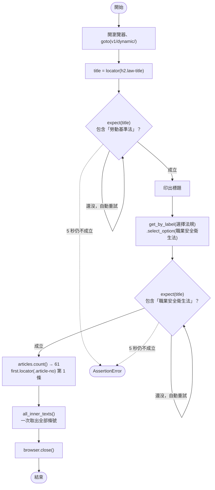
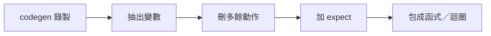

# 08｜Locator、自動等待與 codegen

> **定位**：用 locator 找元素、用 `expect` 等結果，徹底告別 `time.sleep`；再用 codegen 錄下操作，整理成可重複使用的函式。

## 學習目標

完成本節後，你應該能夠：

- 用 `page.locator` 搭配 CSS selector 取得一個或多個元素的文字
- 用 `get_by_label`、`get_by_role`、`get_by_text` 以「使用者看得到的東西」找元素
- 說明 Playwright 的自動等待（auto-wait）與 `expect` 為什麼比 `time.sleep` 可靠
- 用 `playwright codegen` 錄製操作，再整理成函式與迴圈

## 範例程式碼

demo repo 的 [`08-locator/`](https://github.com/4-learn/python-web-crawler-demo/tree/main/08-locator) 資料夾，本節用到的程式（都在 **repo 根目錄** `python-web-crawler-demo/` 執行）：

| 檔案 | 講解段落 | 內容 | 執行指令 |
|---|---|---|---|
| [`08-locator/locators.py`](https://github.com/4-learn/python-web-crawler-demo/blob/main/08-locator/locators.py) | 2. Locator、3. 常用操作 | locator、expect、切換法規、取全部條號 | `python 08-locator/locators.py` |
| [`08-locator/more_locators.py`](https://github.com/4-learn/python-web-crawler-demo/blob/main/08-locator/more_locators.py) | 4、5、7 | get_by_role、切換後立刻數 vs expect、show_law() 函式（Workshop 從這支改起） | `python 08-locator/more_locators.py` |
| [`08-locator/expect_timeout.py`](https://github.com/4-learn/python-web-crawler-demo/blob/main/08-locator/expect_timeout.py) | 6. expect | expect 等不到時直接報錯（預期會出錯） | `python 08-locator/expect_timeout.py` |
| [`08-locator/codegen.md`](https://github.com/4-learn/python-web-crawler-demo/blob/main/08-locator/codegen.md) | 8. codegen | codegen 指令與整理步驟（說明文件，不是程式） | `playwright codegen …` |

- 關卡 3：<https://4-learn.github.io/crawler-playground/v1/dynamic/>

---

## 情境

你是 AI 團隊的資料工程師。上一節你讓 Playwright 打開關卡 3，拿到了勞動基準法的 98 條。

主管看完很滿意，接著問：

> 「問答系統不會只有勞基法。這個頁面有下拉選單，你能不能讓程式自己切換法規、把每一部的條文都拿下來？還有，每切一次都要等它載完，你打算怎麼等？」

這一節要學會「操作」頁面：選選單、等結果、取多筆資料，而且不靠猜秒數。

---

## 講解

### 1. 每切換一次，都要等

上一節說過：不要用 `time.sleep` 猜秒數，要用 `wait_for` 等你要的東西出現。

這一節要在下拉選單切換法規。關卡 3 每切換一次，都會清空畫面、重新打 API、再延遲約 1.2 秒才畫出條文。所以每切一次就要等一次，而且要說清楚**等什麼**：不是「等條文出現」（舊的也是條文），而是「等標題變成新的法規」。Playwright 用 **Locator** 描述要找什麼、用 **`expect`** 描述要等什麼。

### 2. Locator：先描述「要找什麼」

`page.locator(selector)` 回傳一個 **Locator**。它不是元素本身，而是一個「怎麼找」的描述；真正要用時（取文字、點擊）才去頁面上找，找不到會自動等。

<!-- flow-chart -->
**流程圖**



<!-- fn-table -->
| 函式名稱 | 說明 | 官方文件連結 |
|---|---|---|
| `expect(locator)` | 對 Locator 下斷言；條件不成立會自動重試，直到逾時（預設 5 秒） | [文件](https://playwright.dev/python/docs/test-assertions#auto-retrying-assertions) |
| `.to_contain_text(text, timeout=)` | 斷言元素文字包含某段字 | [文件](https://playwright.dev/python/docs/api/class-locatorassertions#locator-assertions-to-contain-text) |
| `page.get_by_label(text)` | 用表單欄位的 `<label>` 文字找元素 | [文件](https://playwright.dev/python/docs/api/class-page#page-get-by-label) |
| `locator.select_option(label=)` | 在這個下拉選單選一個選項 | [文件](https://playwright.dev/python/docs/api/class-locator#locator-select-option) |
| `locator.locator(css)` | 在這個元素裡面再往下找 | [文件](https://playwright.dev/python/docs/api/class-locator#locator-locator) |
| `locator.all_inner_texts()` | 所有符合元素的文字，一次回傳 list | [文件](https://playwright.dev/python/docs/api/class-locator#locator-all-inner-texts) |

```python
import os

from playwright.sync_api import expect, sync_playwright

BASE = os.environ.get("PLAYGROUND", "https://4-learn.github.io/crawler-playground/")

with sync_playwright() as p:
    browser = p.chromium.launch()
    page = browser.new_page()
    page.goto(BASE + "v1/dynamic/")

    title = page.locator("h2.law-title")
    expect(title).to_contain_text("勞動基準法")  # 會自動重試直到成立或逾時（預設 5 秒）
    print(title.inner_text())

    # 用「使用者看得到的東西」找元素：label、role、文字
    page.get_by_label("選擇法規").select_option(label="職業安全衛生法")
    expect(title).to_contain_text("職業安全衛生法")
    print(title.inner_text())

    articles = page.locator("article.article")
    print("條數：", articles.count())
    first = articles.first
    print(first.locator(".article-no").inner_text(), first.locator(".article-content").inner_text()[:30], "…")

    # 取全部：all_inner_texts() 一次拿回 list
    numbers = page.locator("article.article .article-no").all_inner_texts()
    print("前 5 個條號：", numbers[:5])
    browser.close()
```

<!-- run-box -->
:::info
**▶ 怎麼執行**　程式在 demo repo 的 [`08-locator/locators.py`](https://github.com/4-learn/python-web-crawler-demo/blob/main/08-locator/locators.py)。在 **repo 根目錄**（`python-web-crawler-demo/`）執行：
```bash
python 08-locator/locators.py
```
:::

執行結果：

<sub>📄 來源：執行 [`08-locator/locators.py`](https://github.com/4-learn/python-web-crawler-demo/blob/main/08-locator/locators.py) 的輸出</sub>

```text
勞動基準法（98 條）
職業安全衛生法（61 條）
條數： 61
第 1 條 為防止職業災害，保障工作者安全及健康，特制定本法；其他法律有 …
前 5 個條號： ['第 1 條', '第 2 條', '第 3 條', '第 4 條', '第 5 條']
```

整支程式沒有一個 `sleep`，切換法規後卻能拿到正確的 61 條。

### 3. Locator 常用操作

| 寫法 | 回傳 | 說明 |
|---|---|---|
| `loc.inner_text()` | `str` | 元素的文字；**只能對到一個元素** |
| `loc.count()` | `int` | 目前符合的元素數量（不等待） |
| `loc.first`／`loc.last`／`loc.nth(i)` | Locator | 取第幾個 |
| `loc.all_inner_texts()` | `list[str]` | 全部元素的文字 |
| `loc.all()` | `list[Locator]` | 逐一處理時用 |
| `loc.locator("子選擇器")` | Locator | 在某元素「裡面」再找，相當於 BeautifulSoup 的 `select` |
| `loc.get_attribute("data-slug")` | `str` | 取屬性 |

`inner_text()` 對到多個元素時會直接報錯，這叫 **strict mode**：

<sub>📄 來源：在關卡 3 等條文出現後執行 `page.locator("article.article").inner_text()` 的錯誤訊息（第一行）</sub>

```text
Locator.inner_text: Error: strict mode violation: locator("article.article") resolved to 98 elements:
```

這是好事：它逼你明確說「要第一個」還是「要全部」，避免默默拿錯。

### 4. 用使用者看得到的東西找元素

CSS selector 依賴網頁的 class 與 id，網站一改版就可能失效（第 15 節會遇到）。Playwright 提供另一組方法，用畫面上的文字與角色定位：

| 方法 | 對應練習站 | 找到 |
|---|---|---|
| `get_by_label("選擇法規")` | `<label>選擇法規：<select id="law-select">` | 下拉選單 |
| `get_by_role("combobox", name="選擇法規")` | 同上，以 ARIA 角色描述 | 下拉選單 |
| `get_by_role("heading", level=2)` | `h2.law-title` | 法規標題 |
| `get_by_role("button", name="登入")` | 關卡 5 的按鈕 | 登入按鈕 |
| `get_by_text("第 1 條", exact=True)` | 條號文字 | 第 1 條的 `h3` |

實際執行：

<!-- fn-table -->
| 函式名稱 | 說明 | 官方文件連結 |
|---|---|---|
| `page.get_by_role(role, name=)` | 用元素的角色（button、heading、combobox…）與名稱找元素 | [文件](https://playwright.dev/python/docs/api/class-page#page-get-by-role) |
| `locator.input_value()` | 輸入框／下拉選單目前的值 | [文件](https://playwright.dev/python/docs/api/class-locator#locator-input-value) |

```python
print(page.get_by_role("combobox", name="選擇法規").input_value())
print(page.get_by_role("heading", level=2).inner_text())
```

<!-- run-box -->
:::info
**▶ 怎麼執行**　程式在 demo repo 的 [`08-locator/more_locators.py`](https://github.com/4-learn/python-web-crawler-demo/blob/main/08-locator/more_locators.py)。在 **repo 根目錄**（`python-web-crawler-demo/`）執行：
這兩行在程式的前半段（剛打開頁面、還是勞動基準法的時候）。
```bash
python 08-locator/more_locators.py
```
:::

<sub>📄 來源：執行 [`08-locator/more_locators.py`](https://github.com/4-learn/python-web-crawler-demo/blob/main/08-locator/more_locators.py) 的輸出（「get_by_role」那段）</sub>

```text
--- get_by_role ---
N0030001
勞動基準法（98 條）
```

怎麼選？

- **操作元素**（選單、按鈕、輸入框）：優先用 `get_by_label`、`get_by_role`。畫面上的字比 class 名稱穩定。
- **取資料**（條文、條號）：用 CSS selector 通常比較直接，例如 `article.article .article-no`。
- `get_by_text` 適合找唯一的文字；條文裡常有重複字串，用 `exact=True` 避免部分比對。

### 5. 自動等待（auto-wait）

Playwright 的**動作**（`click`、`fill`、`select_option`）在執行前會自動等元素：

1. 出現在 DOM 裡
2. 看得見
3. 可以操作（沒有被停用）

所以關卡 3 的下拉選單在 `laws.json` 載完前還是「載入中…」，`select_option` 會自己等選項出現，不用你處理。

但**讀取**（`count()`、`inner_text()`）不會等「內容變對」。切換法規後，頁面會先清空、顯示「載入中…」，這時立刻 `count()`：

```python
page.get_by_label("選擇法規").select_option(label="職業安全衛生法")
print("立刻 count()：", page.locator("article.article").count())
expect(page.locator("h2.law-title")).to_contain_text("職業安全衛生法")
print("expect 之後：", page.locator("article.article").count())
```

<sub>📄 來源：執行 [`08-locator/more_locators.py`](https://github.com/4-learn/python-web-crawler-demo/blob/main/08-locator/more_locators.py) 的輸出（「切換後立刻數 vs 用 expect 等」那段）</sub>

```text
--- 切換後立刻數 vs 用 expect 等 ---
立刻 count()： 0
expect 之後： 61
```

立刻數得到 **0**，而且**不會報錯**，就是上一節藍框說的「拿到空資料」。這時要用 `expect`。

### 6. `expect`：等「結果成立」

```python
expect(title).to_contain_text("職業安全衛生法")
```

<!-- run-box -->
:::info
**▶ 怎麼執行**　這行節錄自 [`08-locator/locators.py`](https://github.com/4-learn/python-web-crawler-demo/blob/main/08-locator/locators.py)，不是完整程式。要執行請跑整支（在 repo 根目錄）：
```bash
python 08-locator/locators.py
```
:::

`expect` 會每隔一小段時間重新檢查，**成立就立刻往下走**，5 秒內都不成立才拋出 `AssertionError`：

<!-- fn-table -->
| 函式名稱 | 說明 | 官方文件連結 |
|---|---|---|
| `.to_contain_text(text, timeout=)` | 斷言元素文字包含某段字 | [文件](https://playwright.dev/python/docs/api/class-locatorassertions#locator-assertions-to-contain-text) |

故意等一個不可能出現的標題，看看會怎樣：

```python
print("等標題出現「不存在的法」，最多 2 秒…")
expect(page.locator("h2.law-title")).to_contain_text("不存在的法", timeout=2000)
print("這一行不會被執行到")
```

<!-- run-box -->
:::info
**▶ 怎麼執行**　程式在 demo repo 的 [`08-locator/expect_timeout.py`](https://github.com/4-learn/python-web-crawler-demo/blob/main/08-locator/expect_timeout.py)。在 **repo 根目錄**（`python-web-crawler-demo/`）執行：
**最後出現紅字錯誤是預期結果。**
```bash
python 08-locator/expect_timeout.py
```
:::

<sub>📄 來源：執行 [`08-locator/expect_timeout.py`](https://github.com/4-learn/python-web-crawler-demo/blob/main/08-locator/expect_timeout.py) 的輸出（中間的 Traceback 省略）</sub>

```text
等標題出現「不存在的法」，最多 2 秒…
Traceback (most recent call last):
  …
AssertionError: Locator expected to contain text '不存在的法'
Actual value: 勞動基準法（98 條）
Call log:
  - Expect "to_contain_text" locator("h2.law-title") with timeout 2000ms
  - waiting for locator("h2.law-title")
    5 × locator resolved to <h2 class="law-title">勞動基準法（98 條）</h2>
      - unexpected value "勞動基準法（98 條）"
```

怎麼讀這段錯誤：

| 那一行 | 意思 |
|---|---|
| `AssertionError: … expected to contain text '不存在的法'` | 你要等的條件 |
| `Actual value: 勞動基準法（98 條）` | 畫面上實際是什麼 |
| `with timeout 2000ms`、`5 ×` | 等了 2 秒、檢查了 5 次都不成立 |

最後一行 `print` 沒有執行，程式停在這裡。**等不到就停下來**，不會帶著錯的資料繼續跑。

常用的 `expect`：

| 斷言 | 用在 |
|---|---|
| `to_contain_text("...")` | 標題換成新法規 |
| `to_have_count(n)` | 條數到齊 |
| `to_be_visible()` | 登入後歡迎訊息出現（第 10 節） |
| `not_to_have_class("loading")` | `#app` 已經不是載入中 |

「等什麼」是你的判斷：要選一個**只有在資料正確時才會成立**的條件。在關卡 3，「標題包含新法規名稱」就是好的條件，因為標題和條文是同時畫上去的。

### 7. 把操作包成函式

切換法規這件事會重複做，整理成函式：

```python
def show_law(page, name):
    """在關卡 3 選一部法規，等它載完，回傳標題文字。"""
    page.get_by_label("選擇法規").select_option(label=name)
    title = page.locator("h2.law-title")
    expect(title).to_contain_text(name)
    return title.inner_text()

print(show_law(page, "勞資爭議處理法"))
```

<!-- run-box -->
:::info
**▶ 怎麼執行**　程式在 demo repo 的 [`08-locator/more_locators.py`](https://github.com/4-learn/python-web-crawler-demo/blob/main/08-locator/more_locators.py)。在 **repo 根目錄**（`python-web-crawler-demo/`）執行：
`show_law()` 定義在程式最上面，最後一段呼叫它。
```bash
python 08-locator/more_locators.py
```
:::

<sub>📄 來源：執行 [`08-locator/more_locators.py`](https://github.com/4-learn/python-web-crawler-demo/blob/main/08-locator/more_locators.py) 的輸出（「包成函式」那段）</sub>

```text
--- 包成函式 ---
勞資爭議處理法（67 條）
```

有了函式，「切換三部法規」就只是一個 `for` 迴圈。

### 8. codegen：讓 Playwright 幫你錄

不確定該用哪個 locator 時，可以讓 Playwright 錄下你的操作：

<!-- fn-table -->
| 函式名稱 | 說明 | 官方文件連結 |
|---|---|---|
| `playwright codegen 網址` | 開瀏覽器錄製你的操作，自動產生程式碼 | [文件](https://playwright.dev/python/docs/codegen#running-codegen) |

```bash
playwright codegen https://4-learn.github.io/crawler-playground/v1/dynamic/
```

<!-- run-box -->
:::info
**▶ 怎麼執行**　在 repo 根目錄或任何地方都可以執行；**需要桌面環境**（VM 的 Ubuntu Desktop 終端機），純 SSH 會失敗。
:::

會打開兩個視窗：左邊是瀏覽器，右邊是即時產生的 Python 程式碼。你在瀏覽器裡選下拉選單、點元素，右邊就會出現對應的 `get_by_label(...)`、`get_by_role(...)`。工具列的「Pick locator」可以點任一元素，看 Playwright 建議怎麼找它。

:::warning
codegen 會開視窗，**需要桌面環境**。在 VM 的 Ubuntu Desktop 裡開終端機執行可以；純 SSH 連線不行（會出現找不到 XServer 的錯誤）。可以加 `-o recorded.py` 把結果存檔。
:::

錄下來的程式只是**起點**，要整理才能用：

1. 把網址、法規名稱抽成變數或參數。
2. 刪掉多餘的點擊（錄製時的誤點也會被錄進去）。
3. 加上 `expect(...)`，確認結果真的出現。錄製只記「做了什麼」，不記「要等什麼」。
4. 把重複的部分改成函式與迴圈。



---

## Workshop

### 題目

在關卡 3 依序切換以下三部法規，**不使用 `time.sleep`**，記錄每部法規頁面上的條文數：

1. 勞動基準法
2. 性別平等工作法
3. 大量解僱勞工保護法

**課堂題**（從 `08-locator/more_locators.py` 改起）：

1. 把 `more_locators.py` 複製一份成 `08-locator/my_three_laws.py`（不要直接改 demo 檔）。
2. 保留最上面的 `show_law()` 函式和開頭的 `goto`、`expect`，把中間三段示範換成一個 `for` 迴圈：每部法規呼叫 `show_law(page, name)`，再印出標題和 `page.locator("article.article").count()`。

**延伸題**（做完課堂題再做）：

3. 每次切換後，再加一個 `expect(page.locator("#app")).not_to_have_class("loading")`，確認不是載入中才計算條數。
4. 最後用 requests 讀 `v1/api/laws.json`，把你算到的條數和 API 的 `article_count` 比對，全部一致才印出「全部與 API 一致」。

可以先用 codegen 錄一次「選擇性別平等工作法」，看看 Playwright 產生的寫法。

### 預期輸出

課堂題：

```text
勞動基準法（98 條） → 98
性別平等工作法（50 條） → 50
大量解僱勞工保護法（21 條） → 21
```

延伸題最後多一行：

```text
全部與 API 一致
```

### 解答

- [解答](https://github.com/4-learn/python-web-crawler-workshop/tree/master/2026/08)
