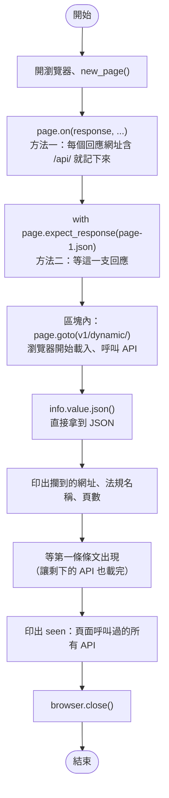
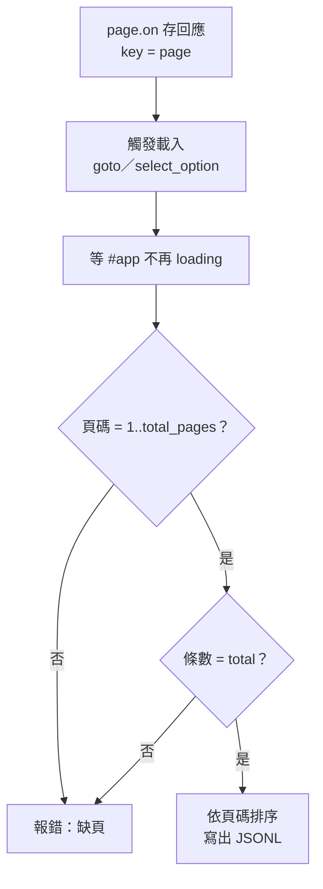

# 09｜攔截網路回應：從瀏覽器背後拿 JSON

> **定位**：讓瀏覽器照常載入頁面，我們在旁邊攔下它呼叫的 API 回應，直接拿到結構化的 JSON，不必解析 DOM。

## 學習目標

完成本節後，你應該能夠：

- 用 `page.on("response", ...)` 列出頁面背後呼叫了哪些 API
- 用 `page.expect_response(...)` 等待並取得某一支特定 API 的 JSON
- 說明為什麼攔截 JSON 常比解析 DOM 更穩、資料更完整
- 判斷攔截到的分頁是否齊全，並把結果存成 JSONL

## 範例程式碼

- [demo：09-intercept](https://github.com/4-learn/python-web-crawler-demo/tree/main/09-intercept)
- 關卡 3：<https://4-learn.github.io/crawler-playground/v1/dynamic/>

---

## 情境

你是 AI 團隊的資料工程師。上一節你用 locator 在關卡 3 切換法規、數出每部法規的條文數，也和 API 比對過了。

問答系統的工程師看了你的輸出，提出一個問題：

> 「你給我的條文只有條號和內容。可是使用者常問『勞基法第三章在講什麼』，我需要每一條屬於哪一章。畫面上沒有章節嗎？」

你回去看關卡 3 的畫面：確實沒有顯示章節。可是你記得第 02 節在 DevTools 的 Network 分頁看過，這個頁面背後打的 API 裡**有** `chapter` 欄位。這一節就是要把那份 JSON 直接拿過來。

---

## 講解

### 1. 回到 DevTools：頁面到底呼叫了什麼

打開關卡 3，按 F12 → Network → 篩選 Fetch/XHR，重新整理。你會看到：

```text
laws.json
page-1.json
page-2.json
...
page-5.json
```

點開 `page-1.json` 的 Response，就是第 03 節用 requests 讀過的格式：

```json
{"version": 1, "pcode": "N0030001", "name": "勞動基準法", "page": 1,
 "total_pages": 5, "total": 98, "next": "page-2.json", "articles": [...]}
```

第 07 節說過：條文是 JavaScript 呼叫 API 後才畫出來的。既然資料的源頭是 JSON，那就**在 JSON 這一層拿**，不要等它變成 HTML 再拆回來。

### 2. 為什麼攔截 JSON 常比解析 DOM 更穩

同一條勞基法第 1 條，兩種來源：

| | 解析 DOM | 攔截 JSON |
|---|---|---|
| 拿到的東西 | `第 1 條  為規定勞動條件最低標準…` 一串文字 | `{"slug": "1", "article_no": "第 1 條", "chapter": "第一章 總則", ...}` |
| 章節 | 關卡 3 畫面上**沒有顯示** | 有 `chapter` 欄位 |
| 網站改版、class 改名 | selector 失效 | 通常不受影響（API 比畫面少改） |
| 總數驗證 | 只能數畫面上有幾個 | JSON 自帶 `total`、`total_pages` |
| 換行、空白 | 要自己清理 | 原始的 `\n` 保留 |

畫面是給人看的，會挑欄位、會排版；API 是給程式用的，欄位通常比畫面多。**畫面上沒有的資料，不代表網站沒有。**

:::info
那為什麼不直接用 requests 打 API（第 03 節）？很多時候確實可以，而且更快。攔截適合這些情況：

- API 網址要從頁面裡的 JavaScript 才知道，或帶有一次性的參數。
- API 需要瀏覽器的 cookie、登入狀態（第 10 節）。
- 你需要「先操作頁面」（選選單、捲動）才會觸發請求。

攔截的好處是：網址、header、cookie 都由瀏覽器處理，你只負責接住結果。
:::

### 3. 方法一：`page.on("response")` 監聽所有回應

`page.on("response", 函式)` 會在**每一個**回應到達時呼叫你的函式。先拿它來偵察：

<!-- fn-table -->
| 函式名稱 | 說明 | 官方文件連結 |
|---|---|---|
| `page.on("response", handler)` | 註冊事件：每收到一個回應就呼叫 `handler(response)` | [文件](https://playwright.dev/python/docs/api/class-page#page-event-response) |
| `response.url／.status／.headers` | 回應的網址、狀態碼、標頭（dict） | [文件](https://playwright.dev/python/docs/api/class-response#response-url) |
| `response.request.resource_type` | 這個請求的類型：`document`、`script`、`fetch`、`xhr`… | [文件](https://playwright.dev/python/docs/api/class-request#request-resource-type) |
| `page.remove_listener("response", handler)` | 取消先前註冊的事件處理函式 | [文件](https://playwright.dev/python/docs/events#addingremoving-event-listener) |

```python
def log(resp):
    if "/api/" in resp.url:
        print(resp.status, resp.request.resource_type, resp.headers.get("content-type"), resp.url.replace(BASE, ""))

page.on("response", log)
page.goto(BASE + "v1/dynamic/")
page.locator("article.article").first.wait_for()
page.remove_listener("response", log)
```

<!-- run-box -->
:::info
**▶ 怎麼執行**　這段接在前一段後面（沿用同一個 `page`／`session`），單獨貼上不能執行。要自己試，把這段貼到 `09-intercept/intercept.py` 的 `page = browser.new_page()` 下面，並把原本的 `page.goto` 之後的內容先註解掉。
:::

```text
200 fetch application/json; charset=utf-8 v1/api/laws.json
200 fetch application/json; charset=utf-8 v1/api/laws/N0030001/page-1.json
200 fetch application/json; charset=utf-8 v1/api/laws/N0030001/page-2.json
200 fetch application/json; charset=utf-8 v1/api/laws/N0030001/page-3.json
200 fetch application/json; charset=utf-8 v1/api/laws/N0030001/page-4.json
200 fetch application/json; charset=utf-8 v1/api/laws/N0030001/page-5.json
```

頁面會載入 HTML、CSS、JS、圖片，回應很多，所以函式裡**一定要先過濾**。`resp` 常用的屬性：

| 屬性／方法 | 內容 |
|---|---|
| `resp.url` | 網址 |
| `resp.status`／`resp.ok` | 狀態碼／是否 2xx |
| `resp.headers` | 回應 header |
| `resp.request.resource_type` | `document`、`script`、`fetch`… |
| `resp.json()`／`resp.text()` | 回應內容 |

### 4. 方法二：`expect_response` 等一支特定的 API

只需要一支時，用 `with page.expect_response(條件)`：先說好要等什麼，再在 `with` 區塊裡做會觸發請求的動作。

<!-- flow-chart -->
**流程圖**



<!-- fn-table -->
| 函式名稱 | 說明 | 官方文件連結 |
|---|---|---|
| `lambda 參數: 運算式` | 一行的匿名函式，常用來當條件，例如 `lambda r: "page-1" in r.url` | [文件](https://docs.python.org/3/reference/expressions.html#lambda) |
| `page.expect_response(條件)` | 搭配 `with`：在區塊內觸發動作，等到第一個符合條件的回應 | [文件](https://playwright.dev/python/docs/api/class-page#page-wait-for-response) |
| `info.value` | `expect_response` 等到的那個 `Response` | [文件](https://playwright.dev/python/docs/events#waiting-for-event) |
| `response.json()` | 把回應內容轉成 dict／list | [文件](https://playwright.dev/python/docs/api/class-response#response-json) |

```python
import os

from playwright.sync_api import sync_playwright

BASE = os.environ.get("PLAYGROUND", "https://4-learn.github.io/crawler-playground/")

with sync_playwright() as p:
    browser = p.chromium.launch()
    page = browser.new_page()

    # 方法一：監聽所有回應，看看頁面呼叫了哪些 API
    seen = []
    page.on("response", lambda resp: seen.append(resp.url) if "/api/" in resp.url else None)

    # 方法二：等待「特定」回應，直接拿 JSON
    with page.expect_response(lambda r: "/api/laws/N0030001/page-1.json" in r.url) as info:
        page.goto(BASE + "v1/dynamic/")
    data = info.value.json()
    print("攔到：", info.value.url)
    print(data["name"], "第", data["page"], "頁，共", data["total_pages"], "頁")

    page.locator("article.article").first.wait_for()
    print("頁面呼叫過的 API：")
    for url in seen:
        print("  ", url.replace(BASE, ""))
    browser.close()
```

<!-- run-box -->
:::info
**▶ 怎麼執行**　程式在 demo repo 的 [`09-intercept/intercept.py`](https://github.com/4-learn/python-web-crawler-demo/blob/main/09-intercept/intercept.py)。在 **repo 根目錄**（`python-web-crawler-demo/`）執行：
```bash
python 09-intercept/intercept.py
```
:::

執行結果：

```text
攔到： https://4-learn.github.io/crawler-playground/v1/api/laws/N0030001/page-1.json
勞動基準法 第 1 頁，共 5 頁
頁面呼叫過的 API：
   v1/api/laws.json
   v1/api/laws/N0030001/page-1.json
   v1/api/laws/N0030001/page-2.json
   v1/api/laws/N0030001/page-3.json
   v1/api/laws/N0030001/page-4.json
   v1/api/laws/N0030001/page-5.json
```

:::warning
順序很重要：**先開始等，再觸發動作**。如果先 `goto` 再 `expect_response`，回應可能早就到了，你會一直等到逾時。`with` 的寫法就是在保證這個順序。
:::

操作選單也一樣，把 `select_option` 放進 `with` 裡：

<!-- fn-table -->
| 函式名稱 | 說明 | 官方文件連結 |
|---|---|---|
| `page.expect_response(條件)` | 搭配 `with`：在區塊內觸發動作，等到第一個符合條件的回應 | [文件](https://playwright.dev/python/docs/api/class-page#page-wait-for-response) |
| `locator.select_option(label=)` | 在這個下拉選單選一個選項 | [文件](https://playwright.dev/python/docs/api/class-locator#locator-select-option) |

```python
with page.expect_response(lambda r: "/api/laws/N0020012/page-1.json" in r.url) as info:
    page.get_by_label("選擇法規").select_option(label="大量解僱勞工保護法")
data = info.value.json()
print(list(data.keys()))
print(data["articles"][0])
```

<!-- run-box -->
:::info
**▶ 怎麼執行**　這段接在前一段後面（沿用同一個 `page`／`session`），單獨貼上不能執行。要自己試，貼到 `intercept.py` 的 `browser.close()` 之前（頁面要先載入完成）。
:::

```text
['version', 'pcode', 'name', 'page', 'total_pages', 'total', 'next', 'articles']
{'slug': '1', 'article_no': '第 1 條', 'chapter': '', 'section': '', 'content': '為保障勞工工作權及調和雇主經營權，避免因事業單位大量解僱勞工，致勞工權益受損害或有受損害之虞，並維護社會安定，特制定本法；本法未規定者，適用其他法律之規定。'}
```

大量解僱勞工保護法沒有分章，所以 `chapter` 是空字串；勞基法第 1 條則是 `第一章 總則`。

### 5. 兩種方法怎麼選

| | `page.on("response")` | `expect_response` |
|---|---|---|
| 適合 | 不知道會有幾支、要收集全部分頁 | 確定要哪一支 |
| 回傳 | 在回呼函式裡自己存 | 直接拿到 `info.value` |
| 何時結束 | 要另外決定「什麼時候算收完」 | 拿到那一支就結束 |

收集多頁時，常見做法是：用 `page.on` 把回應**存進 dict**（用頁碼當 key，重複的回應自然覆蓋），再用頁面上的某個條件判斷「載完了」。

### 6. 「收完了嗎？」要自己驗證

`page.on` 只是被動接收，它不會告訴你漏了哪一頁。收集完一定要檢查：

1. **頁碼連續**：收到的 `page` 是不是剛好 `1..total_pages`？
2. **筆數一致**：所有 `articles` 加起來，是不是等於 `total`？
3. **什麼時候停**：關卡 3 會在全部分頁載完後才移除 `#app` 的 `loading` class，可以等這件事成立再關瀏覽器。



這也是第 14 節「驗證」的前身：**資料管線的每一段，都要能說出「我怎麼知道它是完整的」**。

### 7. 小心回呼裡的錯誤

在 `page.on("response", ...)` 的函式裡呼叫 `resp.json()` 時：

- 先用網址過濾，只對 JSON API 呼叫；對 HTML 或圖片呼叫 `json()` 會失敗。
- 先檢查 `resp.ok`；教室版練習站被限速時會回 429（第 06 節），那個回應沒有條文。關卡 3 的 JavaScript 會自己等待重試，所以之後還會收到一個 200 的同頁回應。

---

## Workshop

### 題目

在關卡 3，**不解析任何 HTML**，只靠攔截網路回應，取得「營造安全衛生設施標準」（pcode `N0060014`）的全部條文：

1. 開啟關卡 3，用 `page.on("response", ...)` 收集 `v1/api/laws/N0060014/page-N.json` 的回應。
2. 用下拉選單切換到「營造安全衛生設施標準」，等全部分頁載完。
3. 驗證：收到的頁碼剛好是 `1..total_pages`，條文總數等於 `total`。
4. 依頁碼排序，每條加上 `pcode` 欄位，存成 `N0060014.jsonl`（一行一條，`ensure_ascii=False`）。

可以用 locator 判斷「載完了沒」，但條文資料只能來自攔截到的 JSON。

### 預期輸出

```text
攔到 10 頁、189 條
```

`N0060014.jsonl` 共 189 行，第一行：

```json
{"pcode": "N0060014", "slug": "1", "article_no": "第 1 條", "chapter": "第一章 總則", "section": "", "content": "本標準依職業安全衛生法第六條第三項規定訂定之。\n本標準未規定者，適用其他有關職業安全衛生法令之規定。"}
```

### 解答

- [解答](https://github.com/4-learn/python-web-crawler-workshop/tree/master/2026/09)
