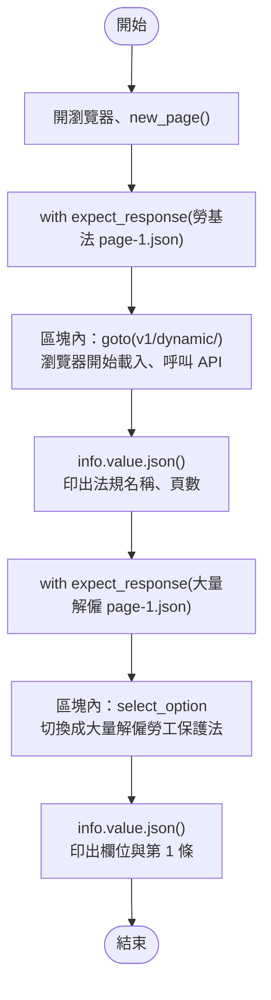
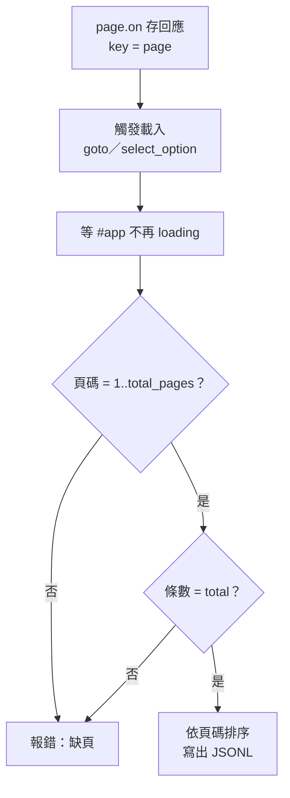

# 09｜攔截網路回應：從瀏覽器背後拿 JSON

> **定位**：讓瀏覽器照常載入頁面，我們在旁邊攔下它呼叫的 API 回應，直接拿到結構化的 JSON，不必解析 DOM。

## 學習目標

完成本節後，你應該能夠：

- 用 `page.on("response", ...)` 列出頁面背後呼叫了哪些 API
- 用 `page.expect_response(...)` 等待並取得某一支特定 API 的 JSON
- 說明為什麼攔截 JSON 常比解析 DOM 更穩、資料更完整
- 判斷攔截到的分頁是否齊全，並把結果存成 JSONL

## 範例程式碼

demo repo 的 [`09-intercept/`](https://github.com/4-learn/python-web-crawler-demo/tree/main/09-intercept) 資料夾，本節用到的程式（都在 **repo 根目錄** `python-web-crawler-demo/` 執行）：

| 檔案 | 講解段落 | 內容 | 執行指令 |
|---|---|---|---|
| [`09-intercept/intercept_on.py`](https://github.com/4-learn/python-web-crawler-demo/blob/main/09-intercept/intercept_on.py) | 3. 方法一 | page.on 監聽所有回應，列出頁面呼叫的 API（Workshop 從這支改起） | `python 09-intercept/intercept_on.py` |
| [`09-intercept/intercept_expect.py`](https://github.com/4-learn/python-web-crawler-demo/blob/main/09-intercept/intercept_expect.py) | 4. 方法二 | expect_response 等一支 API；打開頁面時與切換法規時各一次 | `python 09-intercept/intercept_expect.py` |

- 關卡 3：<https://4-learn.github.io/crawler-playground/v1/dynamic/>

---

## 情境

你是 AI 團隊的資料工程師。上一節你用 locator 在關卡 3 切換法規、數出每部法規的條文數，也和 API 比對過了。

問答系統的工程師看了你的輸出，提出一個問題：

> 「你給我的條文只有條號和內容。可是使用者常問『勞基法第三章在講什麼』，我需要每一條屬於哪一章。畫面上沒有章節嗎？」

你回去看關卡 3 的畫面：確實沒有顯示章節。可是你記得第 02 節在 DevTools 的 Network 分頁看過，這個頁面背後打的 API 裡**有** `chapter` 欄位。這一節就是要把那份 JSON 直接拿過來。

---

## 講解

### 1. 回到 DevTools：頁面到底呼叫了什麼

打開關卡 3，按 F12 → Network → 篩選 Fetch/XHR，重新整理。你會看到：

<sub>📄 來源：Chrome DevTools → Network → Fetch/XHR 的請求清單（關卡 3）</sub>

```text
laws.json
page-1.json
page-2.json
...
page-5.json
```

點開 `page-1.json` 的 Response，就是第 03 節用 requests 讀過的格式：

<sub>📄 來源：[`v1/api/laws/N0030001/page-1.json`](https://4-learn.github.io/crawler-playground/v1/api/laws/N0030001/page-1.json) 的內容節錄（`articles` 省略）</sub>

```json
{"version": 1, "pcode": "N0030001", "name": "勞動基準法", "page": 1,
 "total_pages": 5, "total": 98, "next": "page-2.json", "articles": [...]}
```

第 07 節說過：條文是 JavaScript 呼叫 API 後才畫出來的。既然資料的源頭是 JSON，那就**在 JSON 這一層拿**，不要等它變成 HTML 再拆回來。

### 2. 為什麼攔截 JSON 常比解析 DOM 更穩

同一條勞基法第 1 條，兩種來源：

| | 解析 DOM | 攔截 JSON |
|---|---|---|
| 拿到的東西 | `第 1 條  為規定勞動條件最低標準…` 一串文字 | `{"slug": "1", "article_no": "第 1 條", "chapter": "第一章 總則", ...}` |
| 章節 | 關卡 3 畫面上**沒有顯示** | 有 `chapter` 欄位 |
| 網站改版、class 改名 | selector 失效 | 通常不受影響（API 比畫面少改） |
| 總數驗證 | 只能數畫面上有幾個 | JSON 自帶 `total`、`total_pages` |
| 換行、空白 | 要自己清理 | 原始的 `\n` 保留 |

畫面是給人看的，會挑欄位、會排版；API 是給程式用的，欄位通常比畫面多。**畫面上沒有的資料，不代表網站沒有。**

:::info
那為什麼不直接用 requests 打 API（第 03 節）？很多時候確實可以，而且更快。攔截適合這些情況：

- API 網址要從頁面裡的 JavaScript 才知道，或帶有一次性的參數。
- API 需要瀏覽器的 cookie、登入狀態（第 10 節）。
- 你需要「先操作頁面」（選選單、捲動）才會觸發請求。

攔截的好處是：網址、header、cookie 都由瀏覽器處理，你只負責接住結果。
:::

### 3. 方法一：`page.on("response")` 監聽所有回應

`page.on("response", log)` 的意思是：**把 `log` 這個函式交給 Playwright，每收到一個回應，它就幫你呼叫一次 `log(回應)`**。這種「先交出去、事情發生時再被呼叫」的函式叫做**回呼（callback）**。

注意 `log` 後面**不加 `()`**：加了括號是「現在就執行」，不加才是「把函式交出去」。

<!-- fn-table -->
| 函式名稱 | 說明 | 官方文件連結 |
|---|---|---|
| `page.on("response", handler)` | 註冊事件：每收到一個回應就呼叫 `handler(response)` | [文件](https://playwright.dev/python/docs/api/class-page#page-event-response) |
| `response.url／.status／.headers` | 回應的網址、狀態碼、標頭（dict） | [文件](https://playwright.dev/python/docs/api/class-response#response-url) |
| `response.request.resource_type` | 這個請求的類型：`document`、`script`、`fetch`、`xhr`… | [文件](https://playwright.dev/python/docs/api/class-request#request-resource-type) |

```python
import os

from playwright.sync_api import sync_playwright

BASE = os.environ.get("PLAYGROUND", "https://4-learn.github.io/crawler-playground/")


def log(resp):
    """每收到一個回應，Playwright 就呼叫一次這個函式。"""
    if "/api/" in resp.url:                          # 只看 API，其他（HTML、CSS、JS）略過
        print(resp.status, resp.request.resource_type, resp.headers.get("content-type"), resp.url.replace(BASE, ""))


with sync_playwright() as p:
    browser = p.chromium.launch()
    page = browser.new_page()
    page.on("response", log)                         # 把 log 交給 Playwright（不加括號）
    page.goto(BASE + "v1/dynamic/")
    page.locator("article.article").first.wait_for()
    browser.close()
```

<!-- run-box -->
:::info
**▶ 怎麼執行**　程式在 demo repo 的 [`09-intercept/intercept_on.py`](https://github.com/4-learn/python-web-crawler-demo/blob/main/09-intercept/intercept_on.py)。在 **repo 根目錄**（`python-web-crawler-demo/`）執行：
```bash
python 09-intercept/intercept_on.py
```
:::

<sub>📄 來源：執行 [`09-intercept/intercept_on.py`](https://github.com/4-learn/python-web-crawler-demo/blob/main/09-intercept/intercept_on.py) 的輸出</sub>

```text
200 fetch application/json; charset=utf-8 v1/api/laws.json
200 fetch application/json; charset=utf-8 v1/api/laws/N0030001/page-1.json
200 fetch application/json; charset=utf-8 v1/api/laws/N0030001/page-2.json
200 fetch application/json; charset=utf-8 v1/api/laws/N0030001/page-3.json
200 fetch application/json; charset=utf-8 v1/api/laws/N0030001/page-4.json
200 fetch application/json; charset=utf-8 v1/api/laws/N0030001/page-5.json
```

程式裡沒有任何一行呼叫 `log(...)`，它卻印出了 6 行：每個 API 回應到達時，Playwright 幫你呼叫了一次。

頁面會載入 HTML、CSS、JS、圖片，回應很多，所以函式裡**一定要先過濾**。`resp` 常用的屬性：

| 屬性／方法 | 內容 |
|---|---|
| `resp.url` | 網址 |
| `resp.status`／`resp.ok` | 狀態碼／是否 2xx |
| `resp.headers` | 回應 header |
| `resp.request.resource_type` | `document`、`script`、`fetch`… |
| `resp.json()`／`resp.text()` | 回應內容 |

### 4. 方法二：`expect_response` 等一支特定的 API

只需要一支時，用 `with page.expect_response(條件)`：先說好要等什麼，再在 `with` 區塊裡做會觸發請求的動作。

#### 這段會用到的 Python 語法：`lambda`

**先看要解決什麼問題**

`expect_response(條件)` 的「條件」要給一個**函式**。打開關卡 3 會收到很多回應（`laws.json`、`page-1.json`、`page-2.json`…），Playwright 每收到一個，就把它交給這個函式問一次：「是不是你要的那支？」函式回傳 `True`，Playwright 就停下來，把這個回應交給你。

**第一步：用學過的 `def` 寫**

```python
def is_page1(r):                                   # r 是一個回應
    return "/api/laws/N0030001/page-1.json" in r.url

with page.expect_response(is_page1) as info:       # 交出 is_page1，不加括號
    page.goto(BASE + "v1/dynamic/")
```

這樣寫完全可以執行，跟第 3 段的 `log` 一樣，是把函式交給 Playwright。`in` 是「左邊的字有沒有出現在右邊」，回傳 `True`／`False`。

Playwright 收到回應時，會這樣問 `is_page1`：

<sub>📄 來源：把兩個網址分別交給 `is_page1` 的結果</sub>

| 收到的回應網址 | `is_page1(r)` 回傳 | Playwright 怎麼做 |
|---|---|---|
| `…/v1/api/laws.json` | `False` | 不是，繼續等 |
| `…/v1/api/laws/N0030001/page-1.json` | `True` | 就是它，停下來交給你 |

**第二步：把它縮成一行，就是 `lambda`**

`is_page1` 只在這裡用一次，為了它多取一個名字、多寫兩行有點麻煩。`lambda` 就是「**沒有名字、只有一行**的函式」，可以直接寫在要用的地方：

| | `def` 寫法 | `lambda` 寫法 |
|---|---|---|
| 程式碼 | `def is_page1(r):`<br/>`    return "page-1.json" in r.url` | `lambda r: "page-1.json" in r.url` |
| 函式名字 | `is_page1` | 沒有名字 |
| 參數 | 括號裡的 `r` | `lambda` 後面、冒號左邊的 `r` |
| 回傳什麼 | `return` 後面 | 冒號右邊（不用寫 `return`） |

逐字拆開：

```text
lambda   r   :   "page-1.json" in r.url
  │      │   │   └────────┬──────────┘
  │      │   │       回傳這個（True／False）
  │      │   └─ 分隔：左邊是參數，右邊是回傳值
  │      └─ 參數：Playwright 交給你的回應
  └─ 「我要寫一個沒有名字的函式」
```

所以 `lambda r: "page-1.json" in r.url` 讀作：**「給我一個回應 `r`，回傳它的網址裡有沒有 `page-1.json`」**。

**第三步：放回程式裡**

```python
with page.expect_response(lambda r: "/api/laws/N0030001/page-1.json" in r.url) as info:
    page.goto(BASE + "v1/dynamic/")
```

跟第一步的 `def` 版本做的事情完全一樣，只是把函式直接寫在括號裡。

:::info
**看不懂 `lambda` 時，就把它改回 `def`**：冒號左邊當參數、右邊前面加 `return`，結果一模一樣。自己寫程式時用 `def` 也完全沒問題；學會讀 `lambda`，是因為網路上的範例和別人的程式很常這樣寫。
:::

| 函式名稱 | 說明 | 官方文件連結 |
|---|---|---|
| `lambda 參數: 運算式` | 沒有名字、只有一行的函式，常用來當條件 | [文件](https://docs.python.org/3/reference/expressions.html#lambda) |

<!-- flow-chart -->
**流程圖**



<!-- fn-table -->
| 函式名稱 | 說明 | 官方文件連結 |
|---|---|---|
| `page.expect_response(條件)` | 搭配 `with`：在區塊內觸發動作，等到第一個符合條件的回應 | [文件](https://playwright.dev/python/docs/api/class-page#page-wait-for-response) |
| `info.value` | `expect_response` 等到的那個 `Response` | [文件](https://playwright.dev/python/docs/events#waiting-for-event) |
| `response.json()` | 把回應內容轉成 dict／list | [文件](https://playwright.dev/python/docs/api/class-response#response-json) |
| `locator.select_option(label=)` | 在這個下拉選單選一個選項 | [文件](https://playwright.dev/python/docs/api/class-locator#locator-select-option) |

```python
import os

from playwright.sync_api import sync_playwright

BASE = os.environ.get("PLAYGROUND", "https://4-learn.github.io/crawler-playground/")

with sync_playwright() as p:
    browser = p.chromium.launch()
    page = browser.new_page()

    print("--- 打開頁面時，等勞動基準法第 1 頁 ---")
    with page.expect_response(lambda r: "/api/laws/N0030001/page-1.json" in r.url) as info:
        page.goto(BASE + "v1/dynamic/")
    data = info.value.json()
    print("攔到：", info.value.url)
    print(data["name"], "第", data["page"], "頁，共", data["total_pages"], "頁")

    print("--- 切換法規時，等大量解僱勞工保護法第 1 頁 ---")
    with page.expect_response(lambda r: "/api/laws/N0020012/page-1.json" in r.url) as info:
        page.get_by_label("選擇法規").select_option(label="大量解僱勞工保護法")
    data = info.value.json()
    print(list(data.keys()))
    print(data["articles"][0])
    browser.close()
```

<!-- run-box -->
:::info
**▶ 怎麼執行**　程式在 demo repo 的 [`09-intercept/intercept_expect.py`](https://github.com/4-learn/python-web-crawler-demo/blob/main/09-intercept/intercept_expect.py)。在 **repo 根目錄**（`python-web-crawler-demo/`）執行：
```bash
python 09-intercept/intercept_expect.py
```
:::

<sub>📄 來源：執行 [`09-intercept/intercept_expect.py`](https://github.com/4-learn/python-web-crawler-demo/blob/main/09-intercept/intercept_expect.py) 的輸出</sub>

```text
--- 打開頁面時，等勞動基準法第 1 頁 ---
攔到： https://4-learn.github.io/crawler-playground/v1/api/laws/N0030001/page-1.json
勞動基準法 第 1 頁，共 5 頁
--- 切換法規時，等大量解僱勞工保護法第 1 頁 ---
['version', 'pcode', 'name', 'page', 'total_pages', 'total', 'next', 'articles']
{'slug': '1', 'article_no': '第 1 條', 'chapter': '', 'section': '', 'content': '為保障勞工工作權及調和雇主經營權，避免因事業單位大量解僱勞工，致勞工權益受損害或有受損害之虞，並維護社會安定，特制定本法；本法未規定者，適用其他法律之規定。'}
```

:::warning
順序很重要：**先開始等，再觸發動作**。如果先 `goto` 再 `expect_response`，回應可能早就到了，你會一直等到逾時。`with` 的寫法就是在保證這個順序。
:::

打開頁面（`goto`）和操作選單（`select_option`）都一樣，把會觸發請求的動作放進 `with` 裡。

大量解僱勞工保護法沒有分章，所以 `chapter` 是空字串；勞基法第 1 條則是 `第一章 總則`。

### 5. 兩種方法怎麼選

| | `page.on("response")` | `expect_response` |
|---|---|---|
| 適合 | 不知道會有幾支、要收集全部分頁 | 確定要哪一支 |
| 回傳 | 在回呼函式裡自己存 | 直接拿到 `info.value` |
| 何時結束 | 要另外決定「什麼時候算收完」 | 拿到那一支就結束 |

收集多頁時，常見做法是：用 `page.on` 把回應**存進 dict**（用頁碼當 key，重複的回應自然覆蓋），再用頁面上的某個條件判斷「載完了」。

### 6. 「收完了嗎？」要自己驗證

`page.on` 只是被動接收，它不會告訴你漏了哪一頁。收集完一定要檢查：

1. **頁碼連續**：收到的 `page` 是不是剛好 `1..total_pages`？
2. **筆數一致**：所有 `articles` 加起來，是不是等於 `total`？
3. **什麼時候停**：關卡 3 會在全部分頁載完後才移除 `#app` 的 `loading` class，用第 08 節的 `expect(page.locator("#app")).not_to_have_class("loading")` 等它成立，再關瀏覽器。



這也是第 14 節「驗證」的前身：**資料管線的每一段，都要能說出「我怎麼知道它是完整的」**。

### 7. 小心回呼裡的錯誤

在 `page.on("response", ...)` 的函式裡呼叫 `resp.json()` 時：

- 先用網址過濾，只對 JSON API 呼叫；對 HTML 或圖片呼叫 `json()` 會失敗。
- 先檢查 `resp.ok`；教室版練習站被限速時會回 429（第 06 節），那個回應沒有條文。關卡 3 的 JavaScript 會自己等待重試，所以之後還會收到一個 200 的同頁回應。

---

## Workshop

### 題目

在關卡 3，**不解析任何 HTML**，只靠攔截網路回應，取得「營造安全衛生設施標準」（pcode `N0060014`）的全部條文。

**課堂題**（從 `09-intercept/intercept_on.py` 改起）：

1. 把 `intercept_on.py` 複製一份成 `09-intercept/my_n0060014.py`（不要直接改 demo 檔）。
2. 在最上面建一個空的 dict：`pages = {}`。
3. 把 `log` 改成：網址包含 `/api/laws/N0060014/page-` 而且 `resp.ok`，就 `data = resp.json()`，存進 `pages[data["page"]] = data`。
4. 等第一條條文出現之後，加上第 08 節學過的三行：切換成「營造安全衛生設施標準」、`expect` 標題變成它、`expect` `#app` 不再是 `loading`。
5. 最後印出 `print("攔到", len(pages), "頁：", sorted(pages))`。

**延伸題**（做完課堂題再做）：

6. 驗證：收到的頁碼剛好是 `1..total_pages`，所有 `articles` 加起來等於 `total`。
7. 依頁碼排序，每條加上 `pcode` 欄位，存成 `output/N0060014.jsonl`（一行一條，`ensure_ascii=False`，第 05 節）。

可以用 locator 判斷「載完了沒」，但條文資料只能來自攔截到的 JSON。

### 預期輸出

課堂題：

```text
攔到 10 頁： [1, 2, 3, 4, 5, 6, 7, 8, 9, 10]
```

延伸題：

```text
攔到 10 頁、189 條
```

`output/N0060014.jsonl` 共 189 行，第一行：

```json
{"pcode": "N0060014", "slug": "1", "article_no": "第 1 條", "chapter": "第一章 總則", "section": "", "content": "本標準依職業安全衛生法第六條第三項規定訂定之。\n本標準未規定者，適用其他有關職業安全衛生法令之規定。"}
```

### 解答

- [解答](https://github.com/4-learn/python-web-crawler-workshop/tree/master/2026/09)
