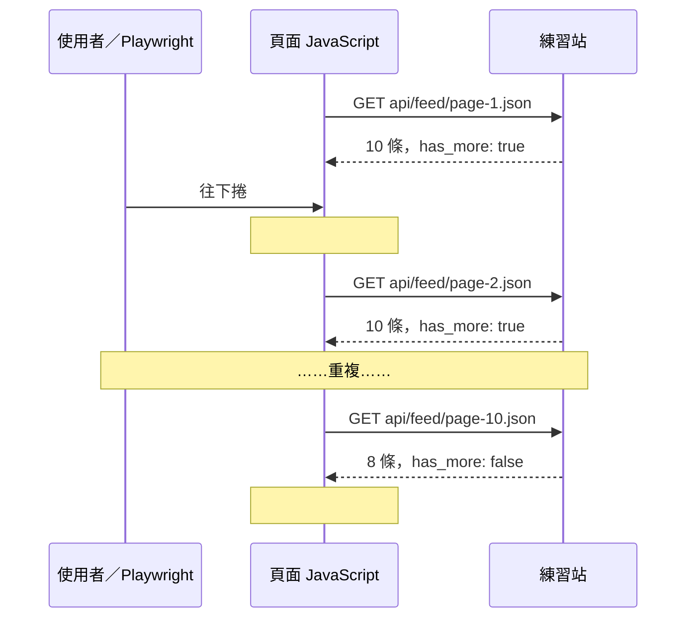
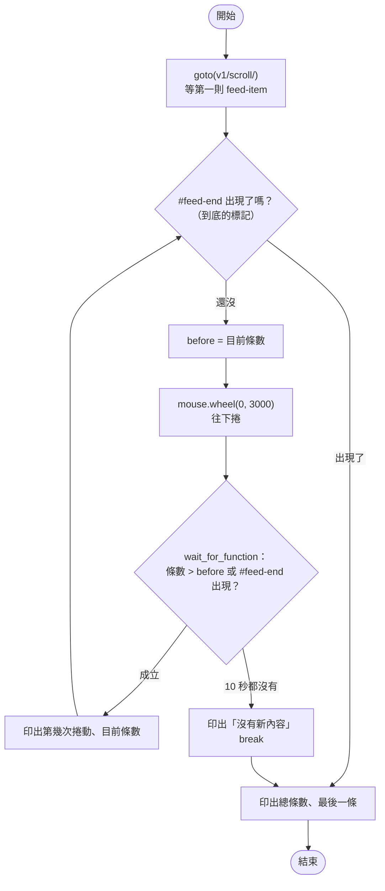
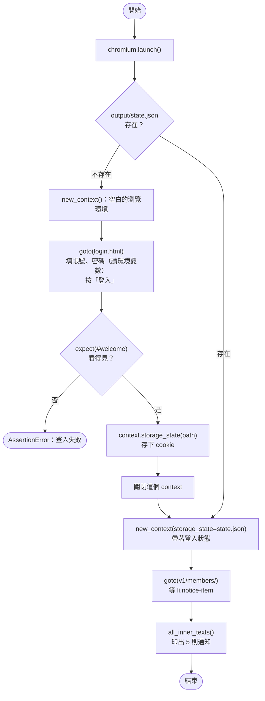
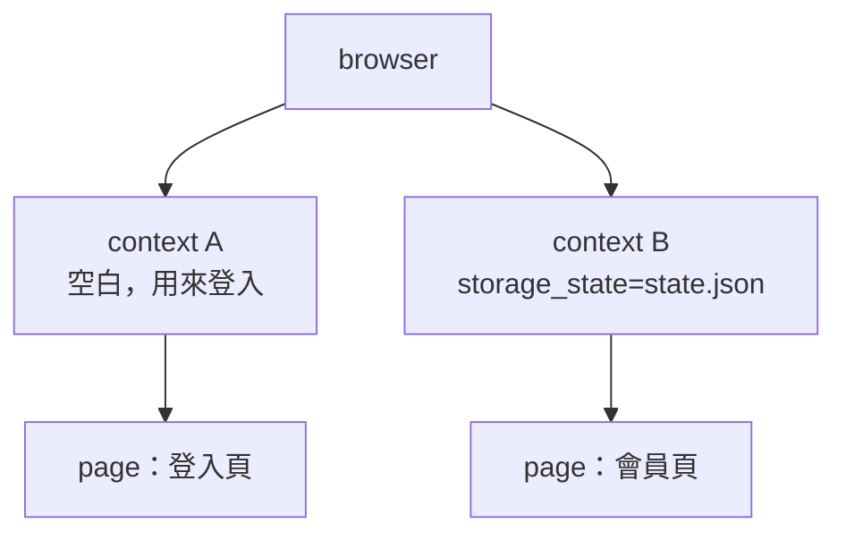

# 10｜無限捲動與登入狀態

> **定位**：處理「捲到底才載入更多」的頁面，並完成表單登入，把登入狀態存成 `storage_state` 重複使用，同時守住帳密與憑證不外流。

## 學習目標

完成本節後，你應該能夠：

- 用 `mouse.wheel` 觸發無限捲動，並寫出明確的終止條件
- 用 `get_by_label`、`get_by_role` 填寫並送出登入表單
- 用 `context.storage_state()` 保存登入狀態，再用 `new_context(storage_state=...)` 重用
- 說明為什麼帳密要放環境變數、`state.json` 不能 commit

## 範例程式碼

- [demo：10-scroll-login](https://github.com/4-learn/python-web-crawler-demo/tree/main/10-scroll-login)
- 關卡 4（無限捲動）：<https://4-learn.github.io/crawler-playground/v1/scroll/>
- 關卡 5（會員登入）：<https://4-learn.github.io/crawler-playground/v1/members/login.html>

---

## 情境

你是 AI 團隊的資料工程師。上一節你從關卡 3 背後攔下 JSON，條文終於帶有章節欄位。

這週又來了兩個需求：

> 產品經理：「有個『最新條文』的動態牆，要一直往下滑才會出現更多。能抓完整嗎？」
>
> 主管：「會員區有『最近異動的法規通知』，問答系統要知道哪些法規剛改過。帳號我給你，**不要寫在程式裡**。」

一個是「什麼時候停」的問題，一個是「怎麼安全地保持登入」的問題。

---

## 講解

### 1. 無限捲動怎麼運作

打開關卡 4，一開始只有 10 條；往下捲才會再出現。原理：



頁面底部有個看不見的 `#sentinel`（哨兵）元素。JavaScript 用 `IntersectionObserver` 盯著它：**它一進入畫面，就載入下一批**。所以不捲動，就永遠只有 10 條：

```text
剛開啟： 10
1.5 秒後不捲動： 10
```

### 2. 終止條件：什麼時候停

舊版臉書題的寫法是「捲 3 次，每次睡 5 秒」：

<!-- fn-table -->
| 函式名稱 | 說明 | 官方文件連結 |
|---|---|---|
| `driver.execute_script(js)` | 在頁面執行 JavaScript，例如捲到底 | [文件](https://www.selenium.dev/selenium/docs/api/py/selenium_webdriver_remote/selenium.webdriver.remote.webdriver.html#selenium.webdriver.remote.webdriver.WebDriver.execute_script) |
| `time.sleep(秒)` | 暫停幾秒；爬蟲用來控制速率 | [文件](https://docs.python.org/3/library/time.html#time.sleep) |

```python
for x in range(1, 4):
    driver.execute_script("window.scrollTo(0,document.body.scrollHeight)")
    time.sleep(5)
```

<!-- run-box -->
:::info
**▶ 怎麼執行**　這是舊版 Selenium 講義的寫法，作為**反例**，不要照抄。
:::

這有兩個問題：3 次不一定到底（資料不完整），5 秒不一定夠（資料可能還沒來）。要改成**看頁面告訴我們什麼**：

| 終止條件 | 說明 | 關卡 4 |
|---|---|---|
| 出現「到底了」的標記 | 最明確，優先使用 | `#feed-end` |
| 捲動後條數不再增加 | 沒有標記時的備案 | 等 10 秒仍沒新內容就停 |
| API 回 `has_more: false` | 搭配第 09 節攔截 | `page-10.json` |
| 安全上限 | 防止無窮迴圈 | 例如最多捲 50 次 |

### 3. 捲動到底的程式

<!-- flow-chart -->
**流程圖**



<!-- fn-table -->
| 函式名稱 | 說明 | 官方文件連結 |
|---|---|---|
| `page.mouse.wheel(dx, dy)` | 模擬滑鼠滾輪；`dy` 正數往下捲 | [文件](https://playwright.dev/python/docs/api/class-mouse#mouse-wheel) |
| `page.wait_for_function(js, arg=, timeout=)` | 在頁面裡反覆執行一段 JavaScript，直到它回傳真值 | [文件](https://playwright.dev/python/docs/api/class-page#page-wait-for-function) |
| `document.querySelectorAll(css)` | （JavaScript）瀏覽器內建：找出全部符合的元素 | [文件](https://developer.mozilla.org/en-US/docs/Web/API/Document/querySelectorAll) |
| `locator.first／locator.last` | 第一個／最後一個符合的元素 | [文件](https://playwright.dev/python/docs/api/class-locator#locator-first) |

```python
import os

from playwright.sync_api import sync_playwright

BASE = os.environ.get("PLAYGROUND", "https://4-learn.github.io/crawler-playground/")

with sync_playwright() as p:
    browser = p.chromium.launch()
    page = browser.new_page()
    page.goto(BASE + "v1/scroll/")
    items = page.locator("article.feed-item")
    items.first.wait_for()

    rounds = 0
    while page.locator("#feed-end").count() == 0:
        before = items.count()
        page.mouse.wheel(0, 3000)
        try:
            # 等到條數變多（或到底）；不寫死 sleep
            page.wait_for_function(
                "([n]) => document.querySelectorAll('article.feed-item').length > n || document.querySelector('#feed-end')",
                arg=[before], timeout=10_000)
        except Exception:
            print("10 秒內沒有新內容，停止")
            break
        rounds += 1
        print(f"第 {rounds} 次捲動：{items.count()} 條")

    print("總共", items.count(), "條；最後一條：", items.last.locator(".article-no").inner_text())
    browser.close()
```

<!-- run-box -->
:::info
**▶ 怎麼執行**　程式在 demo repo 的 [`10-scroll-login/infinite_scroll.py`](https://github.com/4-learn/python-web-crawler-demo/blob/main/10-scroll-login/infinite_scroll.py)。在 **repo 根目錄**（`python-web-crawler-demo/`）執行：
```bash
python 10-scroll-login/infinite_scroll.py
```
:::

執行結果：

```text
第 1 次捲動：20 條
第 2 次捲動：30 條
第 3 次捲動：40 條
第 4 次捲動：50 條
第 5 次捲動：60 條
第 6 次捲動：70 條
第 7 次捲動：80 條
第 8 次捲動：90 條
第 9 次捲動：98 條
總共 98 條；最後一條： 勞動基準法 第 86 條
```

重點：

- `page.mouse.wheel(0, 3000)`：模擬滑鼠滾輪往下 3000 像素，讓 `#sentinel` 進入畫面。也可以用 `page.locator("#sentinel").scroll_into_view_if_needed()`。
- `wait_for_function`：在瀏覽器裡反覆執行一段 JavaScript，直到回傳真值。這裡等「條數比捲動前多」**或**「已經到底」。
- `arg=[before]`：把 Python 的變數傳進 JavaScript。
- 最後一條是第 86 條而不是第 98 條，因為勞基法有 `第 84-1 條` 這類條號，98 是「條文筆數」。

:::info
捲完之後，資料仍要驗證：條數是否等於 API 說的 98、有沒有重複的條號。無限捲動的頁面若寫得不好，同一批可能載入兩次。
:::

### 4. 登入表單

關卡 5 是一個普通的登入表單：

```html
<label>帳號 <input name="username" id="username"></label>
<label>密碼 <input name="password" id="password" type="password"></label>
<button type="submit" id="login-button">登入</button>
<p id="login-error" class="error" hidden>帳號或密碼錯誤</p>
```

用第 08 節的 `get_by_label`、`get_by_role` 操作：

<!-- fn-table -->
| 函式名稱 | 說明 | 官方文件連結 |
|---|---|---|
| `page.get_by_label(text)` | 用表單欄位的 `<label>` 文字找元素 | [文件](https://playwright.dev/python/docs/api/class-page#page-get-by-label) |
| `locator.fill(text)` | 清空輸入框後填入文字 | [文件](https://playwright.dev/python/docs/api/class-locator#locator-fill) |
| `page.get_by_role(role, name=)` | 用元素的角色（button、heading、combobox…）與名稱找元素 | [文件](https://playwright.dev/python/docs/api/class-page#page-get-by-role) |
| `locator.click()` | 點擊元素；會先等它可見、可點 | [文件](https://playwright.dev/python/docs/api/class-locator#locator-click) |
| `.to_be_visible()` | 斷言元素看得見 | [文件](https://playwright.dev/python/docs/api/class-locatorassertions#locator-assertions-to-be-visible) |

```python
page.goto(BASE + "v1/members/login.html")
page.get_by_label("帳號").fill(os.environ["PG_USER"])
page.get_by_label("密碼").fill(os.environ["PG_PASS"])
page.get_by_role("button", name="登入").click()
expect(page.locator("#welcome")).to_be_visible()
```

<!-- run-box -->
:::info
**▶ 怎麼執行**　這段是 `login_and_save.py` 的登入部分節錄自 [`10-scroll-login/login_and_save.py`](https://github.com/4-learn/python-web-crawler-demo/blob/main/10-scroll-login/login_and_save.py)，不是完整程式。要執行請跑整支（在 repo 根目錄）：
```bash
export PG_USER=student PG_PASS=crawler-demo
python 10-scroll-login/login_and_save.py
```
:::

最後一行很重要：**按下登入不代表登入成功**。要確認「只有登入成功才會出現的東西」真的出現了。密碼打錯時，頁面會顯示 `#login-error`：

```text
錯誤： 帳號或密碼錯誤
```

沒有那行 `expect`，程式會繼續往下跑，最後抓到 0 則通知，而你不知道是「沒有通知」還是「沒登入」。

### 5. 帳密放環境變數，不放程式裡

<!-- fn-table -->
| 函式名稱 | 說明 | 官方文件連結 |
|---|---|---|
| `os.environ[name]` | 讀環境變數；沒設定會直接報錯，適合「一定要有」的帳密 | [文件](https://docs.python.org/3/library/os.html#os.environ) |

```python
os.environ["PG_USER"]   # 不是 "student"
os.environ["PG_PASS"]   # 不是 "crawler-demo"
```

<!-- run-box -->
:::info
**▶ 怎麼執行**　這兩行只是說明寫法，完整程式見下一段。
:::

執行前在終端機設定：

<!-- fn-table -->
| 函式名稱 | 說明 | 官方文件連結 |
|---|---|---|
| `export 名稱=值` | （bash）設定環境變數，之後執行的程式都讀得到 | [文件](https://www.gnu.org/software/bash/manual/html_node/Bourne-Shell-Builtins.html#index-export) |

```bash
export PG_USER=student PG_PASS=crawler-demo
python 10-scroll-login/login_and_save.py
```

<!-- run-box -->
:::info
**▶ 怎麼執行**　在 **repo 根目錄**執行，`state.json` 會存在 `output/state.json`（已在 `.gitignore` 排除，不會被 commit）。要重新登入，刪掉它再跑一次：`rm output/state.json`。
:::

為什麼？

| 寫死在程式裡 | 放環境變數 |
|---|---|
| commit 到 GitHub，全世界都看得到 | 程式碼裡只有變數名稱 |
| Git 歷史永久保留，刪檔也沒用 | 換密碼不必改程式 |
| 給同事程式等於給他你的帳號 | 每個人用自己的帳號 |
| 截圖、貼程式問人時一起外流 | 不會跟著程式碼外流 |

用 `os.environ["PG_USER"]`（中括號）而不是 `.get()`：沒設定時會立刻報 `KeyError`，比默默用空字串登入失敗更容易發現問題。

:::warning
練習站的 `student / crawler-demo` 是公開的練習帳號。**真實網站的帳密，即使是自己的，也一樣只放環境變數或 `.env` 檔**，並確認 `.env` 已列在 `.gitignore`。
:::

### 6. `storage_state`：登入一次，重複使用

每次執行都重新登入，會增加網站負擔，也容易觸發「異常登入」偵測。Playwright 可以把登入後的 cookie 存起來：

<!-- flow-chart -->
**流程圖**



<!-- fn-table -->
| 函式名稱 | 說明 | 官方文件連結 |
|---|---|---|
| `Path(path)／.exists()` | `pathlib` 的路徑物件；`.exists()` 檔案存在嗎 | [文件](https://docs.python.org/3/library/pathlib.html#pathlib.Path.exists) |
| `browser.new_context(storage_state=)` | 開一個獨立的瀏覽環境（cookie 互不影響）；`storage_state` 載入先前存的登入狀態 | [文件](https://playwright.dev/python/docs/api/class-browser#browser-new-context) |
| `context.new_page()` | 在這個瀏覽環境中開新分頁 | [文件](https://playwright.dev/python/docs/api/class-browsercontext#browser-context-new-page) |
| `context.storage_state(path=)` | 把目前的 cookie 與 localStorage 存成 JSON 檔（登入狀態） | [文件](https://playwright.dev/python/docs/api/class-browsercontext#browser-context-storage-state) |
| `context.close()／browser.close()` | 關閉瀏覽環境／整個瀏覽器 | [文件](https://playwright.dev/python/docs/api/class-browser#browser-close) |

```python
STATE = Path("state.json")  # 內含 cookie，等同登入憑證：不要 commit、不要分享

with sync_playwright() as p:
    browser = p.chromium.launch()

    if not STATE.exists():
        context = browser.new_context()
        page = context.new_page()
        # ……登入表單（同上一段）……
        context.storage_state(path=STATE)
        print("登入成功，已保存", STATE)
        context.close()

    context = browser.new_context(storage_state=STATE)
    page = context.new_page()
    page.goto(BASE + "v1/members/")
    notices = page.locator("li.notice-item")
    notices.first.wait_for()
    print("會員通知：")
    for text in notices.all_inner_texts():
        print("  -", text)
    browser.close()
```

<!-- run-box -->
:::info
**▶ 怎麼執行**　這段節錄自 [`10-scroll-login/login_and_save.py`](https://github.com/4-learn/python-web-crawler-demo/blob/main/10-scroll-login/login_and_save.py)，不是完整程式。要執行請跑整支（在 repo 根目錄）：
```bash
export PG_USER=student PG_PASS=crawler-demo
python 10-scroll-login/login_and_save.py
```
:::

第一次執行（沒有 `state.json`）：

```text
登入成功，已保存 state.json
會員通知：
  - 營造安全衛生設施標準 最近異動日期 20260630
  - 職業安全衛生法 最近異動日期 20251219
  - 就業服務法 最近異動日期 20250120
  - 勞動基準法 最近異動日期 20240731
  - 性別平等工作法 最近異動日期 20230816
```

第二次執行：沒有「登入成功」那行，直接用存好的狀態進會員頁，結果一樣是 5 則通知。

這裡出現了一個新角色 **context**（瀏覽器情境）。一個 browser 可以開多個 context，彼此的 cookie、localStorage 完全隔離，就像多個無痕視窗：



### 7. `state.json` 裡有什麼

跑過 `login_and_save.py` 後，用 `cat output/state.json` 看內容：

```json
{"cookies": [{"name": "pg_session", "value": "demo-session-token", "domain": "4-learn.github.io", "path": "/crawler-playground/v1/", "expires": -1, "httpOnly": false, "secure": false, "sameSite": "Lax"}], "origins": []}
```

`pg_session` 就是登入憑證。**誰拿到這個檔案，誰就是你**，不需要密碼。所以：

- `state.json` 一定要列在 `.gitignore`（demo repo 已經列了）。
- 不要貼到聊天室、不要放進共享雲端資料夾。
- 憑證會過期或被登出；過期時刪掉 `state.json` 重新登入即可。

### 8. 登入保護了什麼

教室版練習站（老師執行的 `server.py`）由伺服器檢查 cookie。不帶 cookie 直接連（`PLAYGROUND` 換成教室版網址）：

```bash
curl -s -o /dev/null -w "%{http_code} -> %{redirect_url}\n" $PLAYGROUND/v1/members/
curl -s -o /dev/null -w "%{http_code}\n" $PLAYGROUND/v1/api/members/notices.json
```

```text
未登入開會員頁 → http://127.0.0.1:8765/v1/members/login.html
未登入呼叫會員 API → 401
```

會員頁被導回登入頁，會員 API `v1/api/members/notices.json` 回 **401 Unauthorized**（第 02 節的狀態碼）。帶著 `state.json` 的 context 呼叫同一支 API 則回 200。

:::info
GitHub Pages 是靜態網站，伺服器無法檢查 cookie，所以線上版的「保護」是由頁面 JavaScript 判斷的，API 檔案其實直接打得到。這是練習站的限制；真實網站的會員資料會由伺服器端保護，請以教室版的行為為準。
:::

---

## Workshop

### 題目

**A. 關卡 4：無限捲動**

1. 開啟關卡 4，用捲動觸發載入，直到出現 `#feed-end`。
2. 不使用 `time.sleep`；每次捲動都要有等待條件與逾時。
3. 取出全部條號，確認總數為 98、沒有重複。

**B. 關卡 5：登入與重用**

1. 帳密從環境變數 `PG_USER`、`PG_PASS` 讀取，程式碼中不可出現密碼。
2. 若 `state.json` 不存在：登入、確認 `#welcome` 出現，存成 `state.json`。
3. 用 `state.json` 開新的 context 進入會員頁，印出 `#member-name` 與通知則數。
4. 執行兩次：第二次不應再經過登入頁。
5. 確認你的 `.gitignore` 含有 `state.json`。

### 預期輸出

```text
A. 捲動取得 98 條，不重複 98 條
B. student 有 5 則通知
```

### 解答

- [解答](https://github.com/4-learn/python-web-crawler-workshop/tree/master/2026/10)
