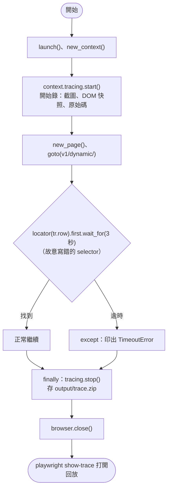
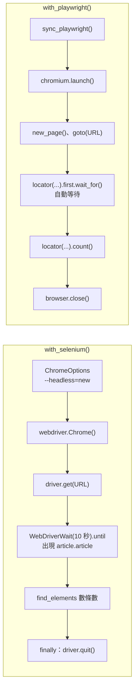

# 11｜除錯與穩定：Trace Viewer 與 Selenium 對照

> **定位**：爬蟲在 headless 模式下失敗時，用 Trace Viewer 回放每一步找出原因；並看懂舊的 Selenium 程式，能把它改寫成 Playwright。

## 學習目標

完成本節後，你應該能夠：

- 用 `context.tracing.start/stop` 錄下執行過程，再用 `playwright show-trace` 回放
- 從 trace 的動作清單、DOM 快照、網路紀錄判斷失敗原因
- 處理 timeout：設定合理的逾時、捕捉 `TimeoutError`、失敗時留下證據
- 看懂 Selenium 4 的程式（Selenium Manager、`--headless=new`、`WebDriverWait`），並對照改寫成 Playwright

## 範例程式碼

- [demo：11-trace-selenium](https://github.com/4-learn/python-web-crawler-demo/tree/main/11-trace-selenium)
- 舊版講義：[法規資料爬蟲與分析系統](https://hackmd.io/@yillkid/rk7pe-Amyx)（Selenium 版，本節改寫對象）

---

## 情境

你是 AI 團隊的資料工程師。過去三節你寫了好幾支 Playwright 程式：切換法規、攔截 JSON、捲動到底、登入。

週一早上，排程的爬蟲失敗了，log 只有一行：

```text
TimeoutError
```

主管問：「為什麼失敗？是網站掛了、被擋了，還是我們的程式有問題？」headless 模式沒有畫面，你什麼都沒看到。

同時，你在公司的舊專案裡翻到一支前輩用 Selenium 寫的「法規資料爬蟲」，主管希望你把它改成和現在一致的 Playwright，並且改爬練習站。

---

## 講解

### 1. headless 失敗時，你需要什麼證據

一個失敗的爬蟲，要回答三個問題：

| 問題 | 需要的證據 |
|---|---|
| 失敗在哪一步？ | 每個動作的順序與耗時 |
| 當下畫面長怎樣？ | 截圖、DOM |
| 網站回了什麼？ | 每個請求的網址、狀態碼、回應內容 |

第 07 節的 `screenshot()` 只能回答第二個，而且只有一個時間點。Playwright 的 **Trace** 會把三者全部錄下來，存成一個 zip 檔。

### 2. 錄一份 trace

demo 故意寫錯 selector，讓它失敗：

<!-- flow-chart -->
**流程圖**



<!-- fn-table -->
| 函式名稱 | 說明 | 官方文件連結 |
|---|---|---|
| `browser.new_context(storage_state=)` | 開一個獨立的瀏覽環境（cookie 互不影響）；`storage_state` 載入先前存的登入狀態 | [文件](https://playwright.dev/python/docs/api/class-browser#browser-new-context) |
| `context.tracing.start(screenshots=, snapshots=, sources=)` | 開始錄 trace：每個動作的截圖、DOM 快照、原始碼 | [文件](https://playwright.dev/python/docs/api/class-tracing#tracing-start) |
| `locator.wait_for(timeout=)` | 等到元素出現（預設最多 30 秒） | [文件](https://playwright.dev/python/docs/api/class-locator#locator-wait-for) |
| `context.tracing.stop(path=)` | 停止錄製並存成 `trace.zip` | [文件](https://playwright.dev/python/docs/api/class-tracing#tracing-stop) |

```python
import os

from playwright.sync_api import sync_playwright

BASE = os.environ.get("PLAYGROUND", "https://4-learn.github.io/crawler-playground/")

with sync_playwright() as p:
    browser = p.chromium.launch()
    context = browser.new_context()
    context.tracing.start(screenshots=True, snapshots=True, sources=True)
    page = context.new_page()
    try:
        page.goto(BASE + "v1/dynamic/")
        # 故意寫錯 selector：v2 的寫法，在 v1 頁面上找不到
        page.locator("tr.row").first.wait_for(timeout=3000)
    except Exception as e:
        print("失敗了：", type(e).__name__)
        print("打開 trace.zip 看失敗當下的畫面與 DOM")
    finally:
        context.tracing.stop(path="trace.zip")
        browser.close()
```

<!-- run-box -->
:::info
**▶ 怎麼執行**　程式在 demo repo 的 [`11-trace-selenium/trace_demo.py`](https://github.com/4-learn/python-web-crawler-demo/blob/main/11-trace-selenium/trace_demo.py)。在 **repo 根目錄**（`python-web-crawler-demo/`）執行：
trace 檔存在 `output/trace.zip`。
```bash
python 11-trace-selenium/trace_demo.py
```
:::

執行結果：

```text
失敗了： TimeoutError
打開 trace.zip 看失敗當下的畫面與 DOM
```

| 參數 | 錄下什麼 |
|---|---|
| `screenshots=True` | 執行過程的連續截圖 |
| `snapshots=True` | 每個動作前後的 DOM 快照（可以在裡面點元素、看 HTML） |
| `sources=True` | 你的 Python 原始碼，對應到每個動作 |

`tracing` 掛在 **context** 上（第 10 節介紹過），所以要用 `browser.new_context()` 再開 page。`tracing.stop` 放在 `finally`：**正是失敗的時候最需要 trace**，不能因為例外就沒存到。

`trace.zip` 是一般的 zip 檔，可以看裡面有什麼：

```bash
python -m zipfile -l output/trace.zip
```

裡面有動作紀錄、網路紀錄、截圖和頁面資源：

```text
trace.trace
trace.network
screencast/page@….jpeg
resources/….html
resources/….css
resources/….json
...
```

### 3. 用 Trace Viewer 回放

<!-- fn-table -->
| 函式名稱 | 說明 | 官方文件連結 |
|---|---|---|
| `playwright show-trace trace.zip` | 用 Trace Viewer 打開 trace 檔，逐步看每個動作 | [文件](https://playwright.dev/python/docs/trace-viewer#opening-trace-viewer) |

```bash
playwright show-trace output/trace.zip
```

<!-- run-box -->
:::info
**▶ 怎麼執行**　在 repo 根目錄執行；需要桌面環境。沒有桌面時，把 `output/trace.zip` 拖到 <https://trace.playwright.dev>。
:::

會開一個視窗（需要桌面環境）。沒有桌面時，把 `trace.zip` 拖到 <https://trace.playwright.dev>，檔案只在你本機的瀏覽器裡處理，不會上傳。

Trace Viewer 的幾個區塊：

| 區塊 | 看什麼 | 這個例子看到的 |
|---|---|---|
| Actions（左） | 每個動作與耗時 | `goto` 成功；`locator.wait_for` 紅色、跑滿 3 秒 |
| Timeline（上） | 連續截圖 | 畫面從「載入中…」變成勞基法條文 |
| Snapshot（中） | 動作前後的 DOM | 失敗當下**條文已經在畫面上** |
| Network | 請求清單 | `laws.json`、`page-1..5.json` 都是 200 |
| Source | 對應的程式碼行 | 停在 `page.locator("tr.row")` 那行 |

推理過程：

1. 網路紀錄全是 200 → 不是網站掛了、也不是被擋（被擋會看到 429 或 403）。
2. 截圖裡有條文 → 不是「還沒載入」，加長等待時間也沒用。
3. 在 DOM 快照點一下條文 → 是 `<article class="article">`，不是 `tr.row`。

結論：**selector 寫錯了**（`tr.row` 是 v2 條文頁的寫法）。不看 trace，最常見的錯誤修法是把 timeout 從 3 秒改成 30 秒，結果只是失敗得更慢。

### 4. timeout 與錯誤處理

Playwright 的預設逾時：

| 對象 | 預設 | 調整 |
|---|---|---|
| 動作、`wait_for` | 30 秒 | `page.set_default_timeout(ms)` 或各自的 `timeout=` |
| `goto` 等導覽 | 30 秒 | `page.set_default_navigation_timeout(ms)` |
| `expect(...)` | 5 秒 | `expect(..., timeout=ms)` |

逾時會拋出 `playwright.sync_api.TimeoutError`；網路層錯誤（連不上、DNS 失敗）則是一般的 `Error`：

<!-- fn-table -->
| 函式名稱 | 說明 | 官方文件連結 |
|---|---|---|
| `PlaywrightTimeoutError` | Playwright 等待逾時丟出的例外（`playwright.sync_api.TimeoutError`） | [文件](https://playwright.dev/python/docs/api/class-timeouterror) |
| `page.set_default_timeout(ms)` | 改這個分頁所有動作的預設逾時（毫秒） | [文件](https://playwright.dev/python/docs/api/class-page#page-set-default-timeout) |

```python
from playwright.sync_api import TimeoutError as PlaywrightTimeoutError

page.set_default_timeout(5_000)
try:
    page.locator("tr.row").first.wait_for()
except PlaywrightTimeoutError as e:
    print("逾時：", str(e).splitlines()[0])
```

<!-- run-box -->
:::info
**▶ 怎麼執行**　這段接在前一段後面（沿用同一個 `page`／`session`），單獨貼上不能執行。要自己試，把 `try` 那段取代 `trace_demo.py` 裡的 `page.locator("tr.row")...` 那行；`import` 放檔案最上面。
:::

```text
逾時： Locator.wait_for: Timeout 5000ms exceeded.
```

:::info
`TimeoutError` 要從 `playwright.sync_api` 匯入，它和 Python 內建的 `TimeoutError` 不是同一個。用 `as PlaywrightTimeoutError` 改名可以避免混淆。
:::

排程爬蟲的建議：

- **逾時設短一點**（例如 10 秒），失敗要快；不要讓一支卡住的爬蟲佔著資源 30 秒乘以 9 部法規。
- **捕捉例外時一定留證據**：trace 或至少一張截圖，加上網址與時間。
- **不要吞掉例外**：記錄之後要讓排程知道「這次失敗了」，不要輸出一份不完整的 JSONL 假裝成功。
- 重試只對「暫時性」錯誤有意義（429、503、連線逾時，見第 06 節）；selector 錯了，重試幾次都一樣。

### 5. Selenium 還會遇到嗎

會。很多公司的既有爬蟲與自動化測試是 Selenium 寫的，網路上的舊教學也大多是 Selenium。你需要**看得懂**，必要時改寫。

先看 Selenium 4 的現代寫法，demo 用兩個工具做同一件事：

<!-- flow-chart -->
**流程圖**



<!-- fn-table -->
| 函式名稱 | 說明 | 官方文件連結 |
|---|---|---|
| `webdriver.ChromeOptions()／options.add_argument()` | Chrome 啟動參數；`--headless=new` 不開視窗 | [文件](https://www.selenium.dev/selenium/docs/api/py/selenium_webdriver_chromium/selenium.webdriver.chromium.options.html#selenium.webdriver.chromium.options.ChromiumOptions.add_argument) |
| `webdriver.Chrome(options=)` | 開 Chrome；Selenium 4.6 起會自動下載對應的驅動程式 | [文件](https://www.selenium.dev/selenium/docs/api/py/selenium_webdriver_chrome/selenium.webdriver.chrome.webdriver.html#selenium.webdriver.chrome.webdriver.WebDriver) |
| `driver.get(url)` | 開啟網址（相當於 `page.goto`） | [文件](https://www.selenium.dev/selenium/docs/api/py/selenium_webdriver_remote/selenium.webdriver.remote.webdriver.html#selenium.webdriver.remote.webdriver.WebDriver.get) |
| `WebDriverWait(driver, 秒).until(條件)` | 明確等待：反覆檢查條件直到成立或逾時 | [文件](https://www.selenium.dev/selenium/docs/api/py/selenium_webdriver_support/selenium.webdriver.support.wait.html#selenium.webdriver.support.wait.WebDriverWait.until) |
| `EC.presence_of_element_located((By.CSS_SELECTOR, css))` | 等待條件：元素出現在 DOM 中 | [文件](https://www.selenium.dev/selenium/docs/api/py/selenium_webdriver_support/selenium.webdriver.support.expected_conditions.html#selenium.webdriver.support.expected_conditions.presence_of_element_located) |
| `driver.find_elements(By.CSS_SELECTOR, css)` | 找出全部符合的元素（不等待） | [文件](https://www.selenium.dev/selenium/docs/api/py/selenium_webdriver_remote/selenium.webdriver.remote.webdriver.html#selenium.webdriver.remote.webdriver.WebDriver.find_elements) |
| `driver.quit()` | 關閉瀏覽器與驅動程式 | [文件](https://www.selenium.dev/selenium/docs/api/py/selenium_webdriver_remote/selenium.webdriver.remote.webdriver.html#selenium.webdriver.remote.webdriver.WebDriver.quit) |

```python
def with_selenium() -> int:
    from selenium import webdriver
    from selenium.webdriver.common.by import By
    from selenium.webdriver.support import expected_conditions as EC
    from selenium.webdriver.support.ui import WebDriverWait

    options = webdriver.ChromeOptions()
    options.add_argument("--headless=new")
    driver = webdriver.Chrome(options=options)
    try:
        driver.get(URL)
        WebDriverWait(driver, 10).until(EC.presence_of_element_located((By.CSS_SELECTOR, "article.article")))
        return len(driver.find_elements(By.CSS_SELECTOR, "article.article"))
    finally:
        driver.quit()


def with_playwright() -> int:
    from playwright.sync_api import sync_playwright

    with sync_playwright() as p:
        browser = p.chromium.launch()
        page = browser.new_page()
        page.goto(URL)
        page.locator("article.article").first.wait_for()
        n = page.locator("article.article").count()
        browser.close()
        return n
```

<!-- run-box -->
:::info
**▶ 怎麼執行**　程式在 demo repo 的 [`11-trace-selenium/selenium_vs_playwright.py`](https://github.com/4-learn/python-web-crawler-demo/blob/main/11-trace-selenium/selenium_vs_playwright.py)。在 **repo 根目錄**（`python-web-crawler-demo/`）執行：
Selenium 需要電腦上有 Chrome／Chromium；第一次執行 Selenium Manager 會自動下載驅動程式，比較慢。
```bash
pip install selenium     # requirements.txt 已包含，裝過可略
python 11-trace-selenium/selenium_vs_playwright.py
```
:::

執行結果：

```text
Playwright: 98 條，2.7 秒
Selenium: 98 條，17.3 秒
```

兩邊都拿到 98 條。Selenium 的秒數包含 Selenium Manager 尋找 driver 與啟動完整版 Chrome 的時間（第一次執行還要下載），會因環境而異，不是本節重點。

三個 Selenium 4 的重點：

1. **Selenium Manager**：Selenium 4.6 起內建，`webdriver.Chrome()` 會自動找或下載對應版本的 Chrome 與 chromedriver（快取在 `~/.cache/selenium/`）。**不需要再裝 `webdriver_manager`**，舊教學裡的 `ChromeDriverManager().install()` 可以刪掉。
2. **`--headless=new`**：新版 Chrome 的 headless 模式；舊教學的 `--headless` 或 `options.headless = True` 已過時。
3. **`WebDriverWait` + `expected_conditions`**：Selenium 沒有自動等待，要明確寫出「等什麼」。舊程式裡的 `time.sleep(5)` 都應該換成它。

### 6. Selenium 與 Playwright 對照表

| 做什麼 | Selenium 4 | Playwright |
|---|---|---|
| 安裝瀏覽器 | Selenium Manager 自動處理 | `playwright install --with-deps chromium` |
| 開瀏覽器 | `webdriver.Chrome(options=options)` | `p.chromium.launch()` → `browser.new_page()` |
| headless | `options.add_argument("--headless=new")` | 預設就是；`headless=False` 才有視窗 |
| 開網址 | `driver.get(url)` | `page.goto(url)` |
| 找一個元素 | `driver.find_element(By.CSS_SELECTOR, s)` | `page.locator(s)` |
| 找多個元素 | `driver.find_elements(By.CSS_SELECTOR, s)` | `page.locator(s).all()` |
| 依 class 找 | `By.CLASS_NAME, "row"` | `page.locator(".row")` |
| 取文字 | `el.text` | `loc.inner_text()` |
| 取屬性 | `el.get_attribute("href")` | `loc.get_attribute("href")` |
| 等元素出現 | `WebDriverWait(d, 10).until(EC.presence_of_element_located(...))` | `loc.wait_for()`；動作本身也會自動等 |
| 輸入文字 | `el.send_keys("x")` | `loc.fill("x")` |
| 點擊 | `el.click()` | `loc.click()` |
| 下拉選單 | `Select(el).select_by_visible_text("...")` | `loc.select_option(label="...")` |
| 捲動 | `driver.execute_script("window.scrollTo(0, document.body.scrollHeight)")` | `page.mouse.wheel(0, 3000)` |
| 執行 JavaScript | `driver.execute_script(js)` | `page.evaluate(js)` |
| 取 HTML | `driver.page_source` | `page.content()` |
| 截圖 | `driver.save_screenshot("a.png")` | `page.screenshot(path="a.png")` |
| 攔截網路回應 | 需要額外工具 | `page.on("response")`、`expect_response` |
| 保存登入 | 自己存取 cookie | `context.storage_state(path=...)` |
| 除錯紀錄 | 自己截圖、寫 log | `context.tracing` + Trace Viewer |
| 關閉 | `driver.quit()` | `browser.close()` |

### 7. 舊版「法規資料爬蟲」的問題

舊講義的題目是：用 Selenium headless Chrome 爬 `law.moj.gov.tw` 的勞動法規頁，`WebDriverWait` 等頁面，再用 `find_elements(By.CLASS_NAME, "row")` 找出所有法條列，區分章節與條文，存成 `laws_data.json`。

改寫前先想清楚，問題不只是工具：

| 舊版 | 問題 | 新版 |
|---|---|---|
| 爬 `law.moj.gov.tw` 網頁 | robots.txt 是 `Disallow: /`（第 01 節） | 練習站；真實資料用官方 API（第 03 節） |
| Selenium + 手動配對 driver | 環境設定是學員最常卡住的地方 | Playwright |
| 一頁全部條文 | 練習站分頁 | 跟著 `a.next` 走（第 05 節） |
| 輸出 JSON 陣列 | 無來源、無法增量 | JSONL（第 16 節會加 `source_url` 等欄位） |

另外，練習站的 v1 法規頁其實是**靜態 HTML**，requests + BeautifulSoup 就能完成（第 05 節）。本節的 Workshop 仍用 Playwright 改寫，目的是練習對照；實務上，**能用更簡單的工具就用更簡單的工具**，這正是下一節的主題。

---

## Workshop

### 題目

**A. 用 Trace 找錯**

1. 執行 demo 的 `trace_demo.py`，產生 `trace.zip`。
2. 用 `playwright show-trace trace.zip`（或 trace.playwright.dev）打開，寫下：失敗的是哪個動作？網路請求有沒有錯誤？失敗當下畫面上有沒有條文？正確的 selector 是什麼？
3. 修正 selector，重新執行並錄一份新的 trace，確認所有動作都是成功的。

**B. Selenium 改寫為 Playwright**

1. 參考舊版講義 [法規資料爬蟲與分析系統](https://hackmd.io/@yillkid/rk7pe-Amyx) 的需求（章節、條文編號、條文內容），改用 Playwright 爬練習站 `v1/laws/N0030001/`，跟著「下一頁」爬完。
2. 把舊程式用到的 Selenium 寫法，逐一對照到 Playwright，整理成表格（至少 6 列）。
3. 寫一段話：什麼情況下你還會選擇 Selenium？

### 預期輸出

A. 修正後執行：

```text
找到 98 條
```

B. 爬完勞動基準法：共 98 條、12 個章節，第一條為：

```text
第一章 總則 | 第 1 條
```

對照表至少包含：開瀏覽器、開網址、等待元素、找多個元素、捲動或執行 JavaScript、關閉。

### 解答

- [解答](https://github.com/4-learn/python-web-crawler-workshop/tree/master/2026/11)
