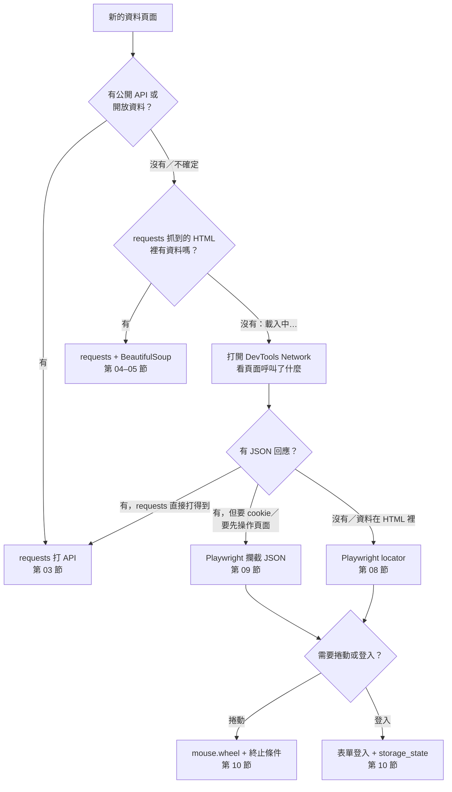

# 12｜Workshop：動態關卡實戰

> **定位**：綜合第 07–11 節，自己判斷關卡 3、4、5 各該用哪一種方法取得資料，說得出理由，並用 trace 與筆數證明結果正確。

## 學習目標

完成本節後，你應該能夠：

- 面對一個新頁面，依「API → 靜態 HTML → 攔截 JSON → 操作 DOM」的順序選擇工具
- 為每一關選定方法，並用文字說明「為什麼選它、為什麼不選別的」
- 至少用一次攔截 JSON 取代解析 DOM
- 用筆數驗證結果，並附上一份 trace 檔作為執行證據

## 範例程式碼

本節是 Workshop，沒有新的示範程式。每一關都可以從前幾節的 demo 出發：

| 需要 | 參考 demo | 第幾節 |
|---|---|---|
| 攔截 JSON（`page.on`、`expect_response`） | [`09-intercept/intercept_on.py`](https://github.com/4-learn/python-web-crawler-demo/blob/main/09-intercept/intercept_on.py)、[`09-intercept/intercept_expect.py`](https://github.com/4-learn/python-web-crawler-demo/blob/main/09-intercept/intercept_expect.py) | 09 |
| 用 locator 取資料、`expect` 等待 | [`08-locator/locators.py`](https://github.com/4-learn/python-web-crawler-demo/blob/main/08-locator/locators.py)、[`08-locator/more_locators.py`](https://github.com/4-learn/python-web-crawler-demo/blob/main/08-locator/more_locators.py) | 08 |
| 無限捲動到底 | [`10-scroll-login/infinite_scroll.py`](https://github.com/4-learn/python-web-crawler-demo/blob/main/10-scroll-login/infinite_scroll.py) | 10 |
| 登入、存／重用 `storage_state` | [`10-scroll-login/login_and_save.py`](https://github.com/4-learn/python-web-crawler-demo/blob/main/10-scroll-login/login_and_save.py) | 10 |
| 錄 trace、`try/finally` | [`11-trace-selenium/trace_demo.py`](https://github.com/4-learn/python-web-crawler-demo/blob/main/11-trace-selenium/trace_demo.py) | 11 |

- 練習站：<https://4-learn.github.io/crawler-playground/>

---

## 情境

你是 AI 團隊的資料工程師。今天你已經學會讓瀏覽器替你執行 JavaScript、等待元素、攔截 API、捲動到底、保持登入、用 trace 除錯。

下班前，主管要你交一份「動態頁面處理報告」：

> 「問答系統之後要接的來源，有的是動態載入，有的要捲動，有的要登入。我不需要你每種方法都會寫，我需要你**每一種頁面都知道該用什麼方法、為什麼**，而且交給我的資料筆數是對的。附上執行紀錄，萬一之後壞了，別人能接手查。」

這份報告就是明天交給 OpenCode 寫規格（第 13 節）的基礎：你得先知道正確答案長什麼樣子，才能判斷 AI 寫得對不對。

---

## 講解

### 1. 選工具的判斷流程

拿到一個頁面，不要一開始就開瀏覽器。依序問：



每往下一層，工具就更重、更慢、更容易壞：

| 方法 | 速度 | 穩定度 | 資料完整度 | 什麼時候用 |
|---|---|---|---|---|
| requests 打 API | 最快 | 高 | 高（欄位最多） | 有 API 就用 |
| requests + BeautifulSoup | 快 | 中（怕改版） | 只有畫面上的 | 靜態 HTML |
| Playwright 攔截 JSON | 慢（要開瀏覽器） | 高 | 高 | API 需要瀏覽器才打得到 |
| Playwright locator | 慢 | 中（怕改版） | 只有畫面上的 | 資料只存在 DOM 裡 |

:::info
「選擇」本身就是這節的作業。同一關可以有不只一種正確做法，例如關卡 4 可以捲動，也可以攔截 `v1/api/feed/page-N.json`。評分看的是：**理由是否成立、筆數是否正確**，不是你選了哪一種。
:::

### 2. 三個關卡的線索

動手之前，先用 DevTools 偵察，把觀察寫進 README：

<sub>📄 來源：在三個關卡分別打開 DevTools（Elements、Network → Fetch/XHR）觀察到的內容</sub>

| 關卡 | 網址 | 畫面上的線索 | Network 上的線索 |
|---|---|---|---|
| 3 動態載入 | `v1/dynamic/` | `#app.loading`「載入中…」；`h2.law-title`「勞動基準法（98 條）」 | `v1/api/laws/N0030001/page-1..5.json`，有 `total`、`total_pages` |
| 4 無限捲動 | `v1/scroll/` | `article.feed-item`、`#sentinel`；到底出現 `#feed-end` | 捲動時出現 `v1/api/feed/page-N.json`，每批 10，有 `has_more` |
| 5 會員登入 | `v1/members/login.html` | `#username`、`#password`、`#login-button`；登入後 `#welcome`、`li.notice-item` | 會員頁呼叫 `v1/api/members/notices.json`；教室版未登入回 401 |

問自己幾個問題：

- 這關的資料，在 JSON 裡和在畫面上，**哪一邊比較完整**？
- 我怎麼知道「抓完了」？頁面或 JSON 有沒有給我總數或結束標記？
- 如果網站明天把 class 名稱改掉，我的方法會不會壞？

### 3. 一份 trace 要錄什麼

trace 是你交給「之後接手的人」的執行紀錄。要求：

- 至少錄下一個關卡的完整過程（建議錄攔截 JSON 那一關，Network 面板最有說服力）。
- `tracing.start(screenshots=True, snapshots=True)`；`tracing.stop` 放在 `finally`。
- 存到 `output/trace.zip`；交出前自己用 `playwright show-trace output/trace.zip` 打開一次，確認看得到動作與網路請求。

:::warning
**trace 會記錄你輸入的內容**，包括 `fill()` 填進密碼欄的字串。實測錄下關卡 5 的登入過程，`trace.zip` 裡可以找到明文密碼。

- 登入那一段**不要錄進 trace**：先用另一個 context 登入並存 `output/state.json`，trace 只錄之後的操作；或在登入前 `stop`、登入後再 `start`。
- 練習帳號沒關係，真實帳號的 trace 絕對不能分享或上傳。
- `state.json` 一樣不能交、不能 commit（第 10 節）。
:::

### 4. 交件內容

```text
12-workshop/
├── README.md          ← 方法與理由（最重要）
├── levels.py          ← 你的程式（可分成多支）
├── output/
│   ├── levels.json    ← 結果摘要（要交）
│   ├── trace.zip      ← 至少一關的 trace（要交，不含登入）
│   └── state.json     ← 登入狀態（不能交）
└── .gitignore         ← 含 output/state.json、*.png
```

README 每一關至少寫三件事：

1. **選了什麼方法**（攔截 JSON／locator／捲動／登入＋storage_state……）
2. **為什麼**：根據第 2 段的觀察，這個方法的好處是什麼
3. **怎麼驗證**：用什麼數字或條件確認抓完、抓對

範例格式（內容請寫你自己的判斷）：

```markdown
| 關卡 | 方法 | 為什麼 | 怎麼驗證 |
|---|---|---|---|
| 3 | …… | …… | …… |
| 4 | …… | …… | …… |
| 5 | …… | …… | …… |
```

### 5. 驗收標準

| 項目 | 標準 |
|---|---|
| 關卡 3 | 勞動基準法 98 條；若用攔截，收到 5 頁且頁碼連續 |
| 關卡 4 | 98 條、條號不重複 |
| 關卡 5 | 5 則會員通知；帳密來自環境變數；第二次執行重用 `output/state.json` |
| 攔截 JSON | 三關中至少一關的資料完全來自攔截到的回應 |
| 等待 | 全部程式沒有 `time.sleep`；用 `wait_for`、`expect` 等待 |
| trace | 附 `output/trace.zip`，打得開，看得到動作與網路請求；不含登入密碼 |
| README | 每關都有「方法、理由、驗證」 |
| 安全 | repo 裡沒有密碼、沒有 `output/state.json` |

### 6. 常見卡關

| 症狀 | 可能原因 | 回頭看 |
|---|---|---|
| 關卡 3 抓到 0 條 | `goto` 完就取資料，沒等 | 第 07 節 |
| 切換法規後條數是 0 | 用 `count()` 前沒有 `expect` 新標題 | 第 08 節 |
| `expect_response` 一直等到逾時 | 先觸發動作，才開始等 | 第 09 節 |
| 攔截到的條數少於 `total` | 太早關瀏覽器，後面幾頁還沒到 | 第 09 節 |
| 關卡 4 卡住或停在某個數字 | 沒有判斷 `#feed-end`、沒有安全上限，或每次捲動後沒有 `expect` 下一條 | 第 10 節 |
| 關卡 5 印出 0 則 | 登入沒成功，但沒用 `expect(#welcome)` 確認 | 第 10 節 |
| 不知道為什麼失敗 | 沒有證據 | 第 11 節：錄 trace |

---

## Workshop

### 題目

完成練習站關卡 3、4、5，每一關**各選一種方法**，並交出 README 說明選擇理由：

1. **關卡 3 動態載入**：取得「勞動基準法」全部條文。
2. **關卡 4 無限捲動**：取得動態牆上全部條文。
3. **關卡 5 會員登入**：登入後取得全部會員通知；帳密用環境變數 `PG_USER`、`PG_PASS`，登入狀態存成 `output/state.json` 並重用。

規定：

- 三關中**至少一關改用攔截 JSON**（`page.on("response")` 或 `expect_response`），該關的資料不得來自解析 HTML。
- 不使用 `time.sleep`。
- 附上一份 `output/trace.zip`（至少涵蓋一關），不得包含登入密碼。
- README 每一關寫出「方法、為什麼、怎麼驗證」。
- 把三關的結果摘要寫進 `output/levels.json`。

### 預期輸出

執行程式（教室版請先 `export PLAYGROUND=http://老師IP:8000/`）：

<!-- fn-table -->
| 函式名稱 | 說明 | 官方文件連結 |
|---|---|---|
| `export 名稱=值` | （bash）設定環境變數，之後執行的程式都讀得到 | [文件](https://www.gnu.org/software/bash/manual/html_node/Bourne-Shell-Builtins.html#index-export) |

```bash
export PG_USER=student PG_PASS=crawler-demo
python levels.py
```

終端機輸出應包含三關的筆數，例如關卡 3 用攔截、關卡 4 用捲動時：

<sub>📄 來源：執行參考解答 `levels.py` 的輸出</sub>

```text
關卡 3：攔截 5 頁，勞動基準法 98 條
關卡 4：捲動取得 98 條（不重複）
關卡 5：5 則會員通知
```

（方法不同時，文字可以不同，但筆數必須是 98、98、5。）

`output/levels.json`：

<sub>📄 來源：參考解答產生的 `output/levels.json`</sub>

```json
{
 "level3": 98,
 "level4": 98,
 "level5": [
  "營造安全衛生設施標準 最近異動日期 20260630",
  "職業安全衛生法 最近異動日期 20251219",
  "就業服務法 最近異動日期 20250120",
  "勞動基準法 最近異動日期 20240731",
  "性別平等工作法 最近異動日期 20230816"
 ]
}
```

另附 `output/trace.zip`，可用 `playwright show-trace output/trace.zip` 開啟。

### 解答

- [解答](https://github.com/4-learn/python-web-crawler-workshop/tree/master/2026/12)
