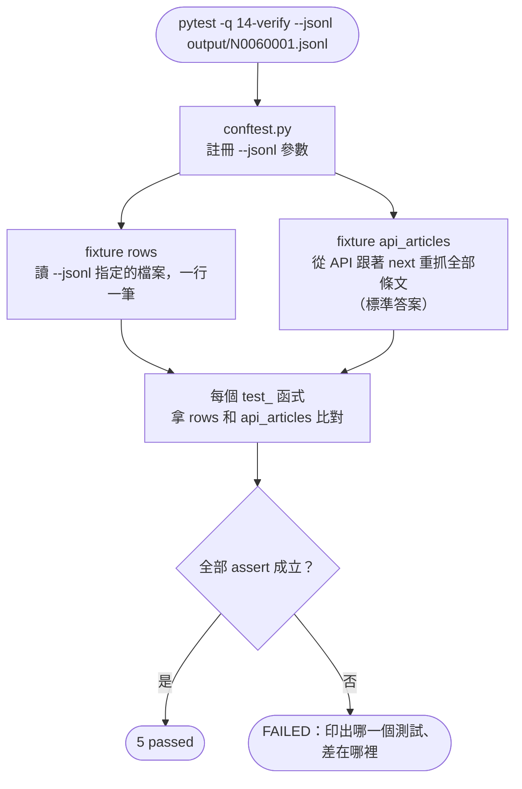

# 14｜驗證 AI 寫的爬蟲：筆數、抽樣與測試

> **定位**：不靠「能跑就好」判斷爬蟲是否正確；用筆數對照、隨機抽樣與 pytest 自動測試驗收 AI 寫的程式。

## 學習目標

完成本節後，你應該能夠：

- 用「另一個來源」當標準答案，做筆數對照與隨機抽樣比對
- 用 pytest 把驗證寫成可以重複執行的測試
- 說出爬蟲常見錯誤：漏最後一頁、重複、欄位錯位、違反 robots.txt
- 故意製造錯誤，確認測試真的抓得到

## 範例程式碼

demo repo 的 [`14-verify/`](https://github.com/4-learn/python-web-crawler-demo/tree/main/14-verify) 資料夾，本節用到的程式（都在 **repo 根目錄** `python-web-crawler-demo/` 執行）：

| 檔案 | 講解段落 | 內容 | 執行指令 |
|---|---|---|---|
| [`14-verify/test_crawler_output.py`](https://github.com/4-learn/python-web-crawler-demo/blob/main/14-verify/test_crawler_output.py) | 4–7 | 5 個測試：筆數、重複、欄位、抽樣、順序（Workshop 用這支） | `pytest -q 14-verify --jsonl output/N0060001.jsonl` |
| [`14-verify/conftest.py`](https://github.com/4-learn/python-web-crawler-demo/blob/main/14-verify/conftest.py) | 5 | 註冊 `--jsonl` 參數 | （pytest 自動讀取） |

- 要驗證的檔案先用第 05 節產生：`python 05-pagination/crawl_law.py N0060001`
- 練習站：<https://4-learn.github.io/crawler-playground/>

---

## 情境

你是 AI 團隊的資料工程師。上一節你讓 OpenCode 寫了「職業安全衛生法」的爬蟲，它說：

> 「已完成，共抓取 61 條條文，輸出至 osh.jsonl。」

主管看了一眼：

> 「它說 61 條，你怎麼知道是對的？問答系統如果少了一條，使用者問到的時候就會答錯。給我證據。」

程式能跑、沒有錯誤訊息，不代表資料是對的。這一節要學的是：**怎麼證明它是對的**，而且下次改了程式還能再證明一次。

---

## 講解

### 1. 「能跑」不等於「正確」

爬蟲最危險的錯誤不是當掉，而是**安靜地產出錯誤的資料**：

| 錯誤 | 症狀 | 會發生什麼事 |
|---|---|---|
| 漏最後一頁 | 61 條只抓到 60 條 | 程式正常結束，沒有任何錯誤訊息 |
| 重複 | 分頁邏輯錯，某頁抓兩次 | 筆數看起來甚至「更多」 |
| 欄位錯位 | `content` 放成上一條的內容 | 每一筆都有值，看起來很完整 |
| 內容被改動 | 多段被接成一段、多了空白 | 肉眼很難看出來 |
| 違反 robots.txt | 抓到 `admin/`、沒有間隔 | 資料是對的，但做法不對 |

這些錯誤都不會讓程式當掉。要抓到它們，需要**有標準答案的檢查**。

### 2. 標準答案要來自另一個來源

驗證的關鍵原則：

> **不能拿爬蟲自己的輸出當標準答案。**

如果爬蟲漏了最後一頁，它自己算出來的「總條數」也會少一頁。標準答案必須從**另一個獨立的來源**取得：

| 來源 | 提供什麼 |
|---|---|
| API 的 `total` | 總條數 |
| 法規頁的 `dd.count` | 頁面上寫的總條數 |
| API 的 `articles` | 每一條的條號與內容 |
| 詳細頁 | 單一條文的原文 |

練習站的 HTML 頁面和 API 是同一份資料的兩種呈現方式，所以 HTML 爬蟲可以用 API 驗證，API 爬蟲可以用頁面上的總數驗證。

### 3. 驗證一：筆數對照

最簡單、最有效的檢查。第 05 節的 `crawl_law.py` 已經做了：

<!-- fn-table -->
| 函式名稱 | 說明 | 官方文件連結 |
|---|---|---|
| `soup.select_one(css)` | 找**第一個**符合的元素；找不到回傳 `None` | [文件](https://www.crummy.com/software/BeautifulSoup/bs4/doc/#css-selectors-through-the-css-property) |
| `assert 條件, 訊息` | 條件不成立就丟出 `AssertionError` 並停止；用來把「應該要對」寫成檢查 | [文件](https://docs.python.org/3/reference/simple_stmts.html#assert) |

```python
expected = int(soup.select_one("dd.count").get_text())
assert len(rows) == expected, f"只抓到 {len(rows)} 條，頁面寫 {expected} 條"
```

<!-- run-box -->
:::info
**▶ 怎麼執行**　這兩行是第 05 節 `crawl_law.py` 最後的檢查，節錄自 [`05-pagination/crawl_law.py`](https://github.com/4-learn/python-web-crawler-demo/blob/main/05-pagination/crawl_law.py)，不是完整程式。要執行請跑整支（在 repo 根目錄）：
```bash
python 05-pagination/crawl_law.py N0060001
```
:::

筆數對照能抓到「漏頁」「多抓」，但抓不到「欄位錯位」：61 條都在，只是內容放錯位置，筆數照樣對。所以還需要抽樣。

### 4. 驗證二：隨機抽樣比對原文

不可能每一條都用眼睛看，但可以**隨機抽幾條**和原文比對。為什麼要隨機？

- 只看第 1 條：第 1 條通常最不會錯（錯誤常發生在分頁交界、最後一頁）
- 固定看前 5 條：每次都看一樣的，後面的錯永遠看不到
- 隨機抽：每個位置都有機會被檢查到

<!-- fn-table -->
| 函式名稱 | 說明 | 官方文件連結 |
|---|---|---|
| `random.Random(seed).sample(list, k)` | 固定種子的亂數產生器，從 list 隨機抽 k 個；同一個種子每次抽到一樣 | [文件](https://docs.python.org/3/library/random.html#random.Random) |

```python
truth = {a["article_no"]: a["content"] for a in api_articles}
for r in random.Random(0).sample(rows, k=min(5, len(rows))):
    assert r["content"] == truth[r["article_no"]], f"{r['article_no']} 內容不同"
```

<!-- run-box -->
:::info
**▶ 怎麼執行**　這段是測試檔裡的抽樣測試，完整程式在第 5 段。要執行請跑整支（在 repo 根目錄）：
```bash
pytest -q 14-verify --jsonl output/N0060001.jsonl
```
:::

`random.Random(0)` 固定了亂數種子：每次抽到同一組，測試失敗時才能重現。以職業安全衛生法 61 條為例，抽到的是：

<sub>📄 來源：讀 `output/N0060001.jsonl`，執行 `random.Random(0).sample(rows, k=5)` 印出條號</sub>

```text
['第 50 條', '第 22-2 條', '第 44 條', '第 51-1 條', '第 23 條']
```

`22-2`、`51-1` 這種「之 X 條」正是 AI 最容易處理錯的地方。

:::info
固定種子的缺點是永遠只看這 5 條。實務上可以每次換種子，但把種子印出來，失敗時用同一個種子重跑。
:::

### 5. 驗證三：用 pytest 自動化

手動檢查做一次就忘了。寫成 pytest 測試，**每次改完程式都能重跑**，AI 改壞了也能立刻發現。

#### 這節會用到的語法：pytest 怎麼運作

pytest 會自動找 `test_` 開頭的函式來執行，你不用自己呼叫。最特別的是 **fixture**：

```python
@pytest.fixture(scope="module")
def rows(request):              # ① 這是 fixture：負責準備資料
    ...
    return [...]                #    回傳的東西就是「rows」

def test_no_duplicates(rows):   # ② 參數名稱寫 rows
    ...                         #    pytest 會先執行上面的 rows()，把結果傳進來
```

| 寫法 | 意思 |
|---|---|
| `@pytest.fixture` | 寫在函式上一行的 `@` 叫 decorator，可以先想成「**貼標籤**」：告訴 pytest「這個函式是用來準備資料的」 |
| `def test_xxx(rows, api_articles):` | **參數名稱 = fixture 名稱**。pytest 看到參數叫 `rows`，就去找叫 `rows` 的 fixture，執行它、把回傳值傳進來 |
| `scope="module"` | 整個檔案只執行一次；5 個測試共用同一份資料，不會打 5 次 API |
| `conftest.py` | pytest 會自動讀的設定檔，用來註冊 `--jsonl` 這種自訂參數 |
| `{n for n in numbers if …}` | **set comprehension**：和第 05 節的 list comprehension 一樣，只是用 `{}`，結果是 set（自動去掉重複） |
| `assert 條件, 訊息` | 條件不成立，這個測試就失敗，並印出訊息 |

所以整個流程是：

<!-- flow-chart -->
**流程圖**



<!-- fn-table -->
| 函式名稱 | 說明 | 官方文件連結 |
|---|---|---|
| `@pytest.fixture(scope="module")` | 定義測試共用的資料；`scope="module"` 整個檔案只算一次 | [文件](https://docs.pytest.org/en/stable/reference/reference.html#pytest.fixture) |
| `request.config.getoption(name)` | 讀命令列參數，例如 `--jsonl` | [文件](https://docs.pytest.org/en/stable/reference/reference.html#pytest.Config.getoption) |
| `pytest_addoption(parser)` | （寫在 conftest.py）註冊自訂命令列參數 | [文件](https://docs.pytest.org/en/stable/reference/reference.html#std-hook-pytest_addoption) |
| `random.Random(seed).sample(list, k)` | 固定種子的亂數產生器，從 list 隨機抽 k 個 | [文件](https://docs.python.org/3/library/random.html#random.Random) |

`conftest.py`（只有一行設定）：

```python
def pytest_addoption(parser):
    parser.addoption("--jsonl", action="store", default="output/N0060001.jsonl", help="要驗證的 JSONL 檔")
```

完整的 `test_crawler_output.py`：

```python
import json
import os
import random
import time
from urllib.parse import urljoin

import pytest
import requests

BASE = os.environ.get("PLAYGROUND", "https://4-learn.github.io/crawler-playground/")
HEADERS = {"User-Agent": "course-crawler/1.0 (test)"}   # 測試也要有禮貌：設 UA、每次間隔 1 秒


@pytest.fixture(scope="module")
def rows(request):
    path = request.config.getoption("--jsonl")
    with open(path, encoding="utf-8") as f:
        return [json.loads(line) for line in f if line.strip()]


@pytest.fixture(scope="module")
def api_articles(rows):
    """用另一個來源（API）當作標準答案。"""
    pcode = rows[0]["pcode"]
    url = BASE + f"v1/api/laws/{pcode}/page-1.json"
    out = []
    while url:
        data = requests.get(url, headers=HEADERS, timeout=10).json()
        out += data["articles"]
        url = urljoin(url, data["next"]) if data["next"] else None
        time.sleep(1)
    return out


def test_count_matches_source(rows, api_articles):
    assert len(rows) == len(api_articles)


def test_no_duplicates(rows):
    numbers = [r["article_no"] for r in rows]
    dup = {n for n in numbers if numbers.count(n) > 1}
    assert not dup, f"重複的條號：{dup}"


def test_required_fields(rows):
    for r in rows:
        for key in ("pcode", "article_no", "content", "source_url"):
            assert r.get(key), f"{r.get('article_no')} 缺少 {key}"


def test_random_sample_matches_source(rows, api_articles):
    truth = {a["article_no"]: a["content"] for a in api_articles}
    for r in random.Random(0).sample(rows, k=min(5, len(rows))):
        assert r["content"] == truth[r["article_no"]], f"{r['article_no']} 內容不同"


def test_order_kept(rows, api_articles):
    assert [r["article_no"] for r in rows] == [a["article_no"] for a in api_articles]
```

<!-- run-box -->
:::info
**▶ 怎麼執行**　程式在 demo repo 的 [`14-verify/test_crawler_output.py`](https://github.com/4-learn/python-web-crawler-demo/blob/main/14-verify/test_crawler_output.py)。在 **repo 根目錄**（`python-web-crawler-demo/`）執行：
```bash
python 05-pagination/crawl_law.py N0060001
pytest -q 14-verify --jsonl output/N0060001.jsonl
```
:::

- `rows`：要被檢查的爬蟲輸出（檔名用 `--jsonl` 參數指定）。
- `api_articles`：從 API 重新取得的標準答案。**測試也要有禮貌**：設定 User-Agent、每頁間隔 1 秒，和第 06 節一樣。
- 每個 `test_` 函式只檢查一件事：

| 測試 | 抓得到的錯誤 |
|---|---|
| `test_count_matches_source` | 漏頁、多抓 |
| `test_no_duplicates` | 同一頁抓兩次 |
| `test_required_fields` | 選擇器失效導致欄位空白 |
| `test_random_sample_matches_source` | 欄位錯位、內容被改動 |
| `test_order_kept` | 順序亂掉、中間缺條 |

一個測試只檢查一件事，失敗時一看名稱就知道哪裡壞了。

### 6. 執行測試

拿第 05 節爬下來的職業安全衛生法來驗證：

<!-- fn-table -->
| 函式名稱 | 說明 | 官方文件連結 |
|---|---|---|
| `pytest -q／-v／--tb=short` | `-q` 精簡輸出、`-v` 列出每個測試、`--tb=short` 失敗訊息簡短 | [文件](https://docs.pytest.org/en/stable/how-to/output.html#verbosity) |

```bash
python 05-pagination/crawl_law.py N0060001      # 先產生要驗證的檔案
pytest -q 14-verify --jsonl output/N0060001.jsonl
```

執行結果：

<sub>📄 來源：執行 `pytest -q 14-verify --jsonl output/N0060001.jsonl` 的輸出</sub>

```text
.....                                                                    [100%]
5 passed in 4.73s
```

約 5 秒，大部分是 `api_articles` 每頁等 1 秒。

同一支測試也能驗證其他法規，例如第 13 節示範的大量解僱勞工保護法（21 條）：

```bash
python 05-pagination/crawl_law.py N0020012
pytest -v 14-verify --jsonl output/N0020012.jsonl
```

<sub>📄 來源：執行 `pytest -v 14-verify --jsonl output/N0020012.jsonl` 的輸出（節錄）</sub>

```text
14-verify/test_crawler_output.py::test_count_matches_source PASSED       [ 20%]
14-verify/test_crawler_output.py::test_no_duplicates PASSED              [ 40%]
14-verify/test_crawler_output.py::test_required_fields PASSED            [ 60%]
14-verify/test_crawler_output.py::test_random_sample_matches_source PASSED [ 80%]
14-verify/test_crawler_output.py::test_order_kept PASSED                 [100%]
```

測試裡沒有寫死 61 或 21，標準答案都從 API 來，所以換法規不用改測試。

### 7. 測試真的抓得到錯嗎？故意弄壞它

全部通過不一定代表資料正確，也可能是**測試寫得太鬆**。驗證測試的方法：故意製造一個錯誤，看測試會不會失敗。

模擬「漏最後一頁的最後一條」：刪掉 JSONL 最後一行。

<!-- fn-table -->
| 函式名稱 | 說明 | 官方文件連結 |
|---|---|---|
| `sed '$d' 檔案` | 輸出檔案但刪掉最後一行（`$` 是最後一行，`d` 是刪除） | [文件](https://manpages.ubuntu.com/manpages/noble/man1/sed.1.html) |
| `wc -l 檔案` | 計算檔案行數；JSONL 一行一筆，等於筆數 | [文件](https://manpages.ubuntu.com/manpages/noble/man1/wc.1.html) |
| `pytest -q／-v／--tb=short` | `-q` 精簡輸出、`-v` 列出每個測試、`--tb=short` 失敗訊息簡短 | [文件](https://docs.pytest.org/en/stable/how-to/output.html#verbosity) |

```bash
sed '$d' output/N0060001.jsonl > output/cut.jsonl
wc -l output/cut.jsonl
pytest -q --tb=short 14-verify --jsonl output/cut.jsonl
```

執行結果（節錄）：

<sub>📄 來源：執行上面三行指令的輸出（只留重點行）</sub>

```text
60 output/cut.jsonl
E   AssertionError: assert 60 == 61
E   AssertionError: assert ['第 1 條', '第 ... '第 6 條', ...] == ['第 1 條', '第 ... '第 6 條', ...]
E     Right contains one more item: '第 55 條'
FAILED 14-verify/test_crawler_output.py::test_count_matches_source - Assertio...
FAILED 14-verify/test_crawler_output.py::test_order_kept - AssertionError: as...
2 failed, 3 passed in 4.79s
```

兩個測試抓到了，而且訊息直接告訴你**少的是第 55 條**。

再模擬「重複」：把第 3 條多寫一次到檔尾（`sed -n 3p` 是只印出第 3 行）：

```bash
(cat output/N0060001.jsonl; sed -n 3p output/N0060001.jsonl) > output/dup.jsonl
pytest -q --tb=short 14-verify --jsonl output/dup.jsonl
```

這次會有 3 個測試失敗：

<sub>📄 來源：執行上面兩行指令的輸出（只留重點行）</sub>

```text
FAILED 14-verify/test_crawler_output.py::test_count_matches_source - Assertio...
FAILED 14-verify/test_crawler_output.py::test_no_duplicates - AssertionError:...
FAILED 14-verify/test_crawler_output.py::test_order_kept - AssertionError: as...
3 failed, 2 passed in 4.79s
```

注意隨機抽樣測試在這兩種情況都通過：它檢查的是「抽到的條文內容對不對」，不負責筆數。**每種驗證各管一件事，要一起用。**

:::warning
永遠不要為了讓測試通過去改測試（或請 AI 改測試）。測試失敗時，該修的是爬蟲；除非你能說明「測試本身寫錯了」的理由。
:::

### 8. AI 寫的爬蟲常見問題

驗證 AI 的程式時，特別留意：

| 問題 | 怎麼發現 |
|---|---|
| 寫死頁數或條數 | 搜尋程式裡的數字；換一部法規跑跑看 |
| `article_no` 和 `slug` 對不上（`第 2-1 條` 的 slug 是 `2-1`） | 抽樣比對 `slug` 與條號 |
| 多段內容被接成一段，或多了空白、換行 | 抽樣比對 `content` 完全相同 |
| `source_url` 用字串拼接，`../` 沒處理 | 檢查網址格式、實際打開一個 |
| 沒處理 429，教室版一跑就失敗 | 用教室版練習站（`PLAYGROUND=...`）跑一次 |
| 沒讀 robots.txt、沒有間隔 | 讀程式；看老師畫面有沒有 `[robots]` 紀錄 |

最後兩項是「做法」的問題，資料對了也不算過關。

---

## Workshop

### 題目

驗證第 13 節 OpenCode 寫的「職業安全衛生法」爬蟲。

**課堂題**（用 demo 的測試，不用自己寫）：

1. 準備要驗證的檔案：用第 13 節 OpenCode 產生的 `osh.jsonl`；**還沒有的人**先在 demo repo 執行 `python 05-pagination/crawl_law.py N0060001`，用 `output/N0060001.jsonl`。
2. 執行 `pytest -q 14-verify --jsonl 你的檔案路徑`，確認 5 個測試都通過。
3. 用 `sed '$d'` 刪掉最後一行再跑一次，確認至少一個測試會失敗，記下是哪一條不見了。
4. 打開第 13 節 AI 寫的 `crawler.py`，對照講解第 8 點的表格，找出至少一個 AI 寫錯或沒考慮到的地方，寫進 `README.md`，並說明你怎麼發現的。

**延伸題**（做完課堂題再做）：自己寫測試

5. 新增 `test_osh.py`，至少 3 個測試，分別對應：**筆數**、**重複／缺號**、**抽樣內容**。
6. 標準答案必須來自**另一個來源**（API 或頁面上的總數），不能拿爬蟲自己的輸出當答案。
7. 同樣用「刪最後一行」確認你的測試抓得到錯。

測試檔可以自己寫，也可以讓 OpenCode 幫忙寫；如果讓 AI 寫，要附對話紀錄（`/export`），而且「故意弄壞」一定要自己做。

### 預期輸出

課堂題第 2、3 步：

```text
.....                                                                    [100%]
5 passed

（刪掉最後一行後）
FAILED 14-verify/test_crawler_output.py::test_count_matches_source - Assertio...
FAILED 14-verify/test_crawler_output.py::test_order_kept - AssertionError: as...
2 failed, 3 passed
```

`README.md` 中至少一項發現，例如：

```text
AI 的 crawler.py 第 16 行 User-Agent 寫成 course-crawler/1.0 (opencode)，
SPEC 要求的是 (你的暱稱)。用 grep -n USER_AGENT crawler.py 發現的，已要求它改成 (student)。
```

延伸題：自己的測試在原始檔全部通過、刪掉最後一行後至少一個失敗。

### 解答

- [解答](https://github.com/4-learn/python-web-crawler-workshop/tree/master/2026/14)
