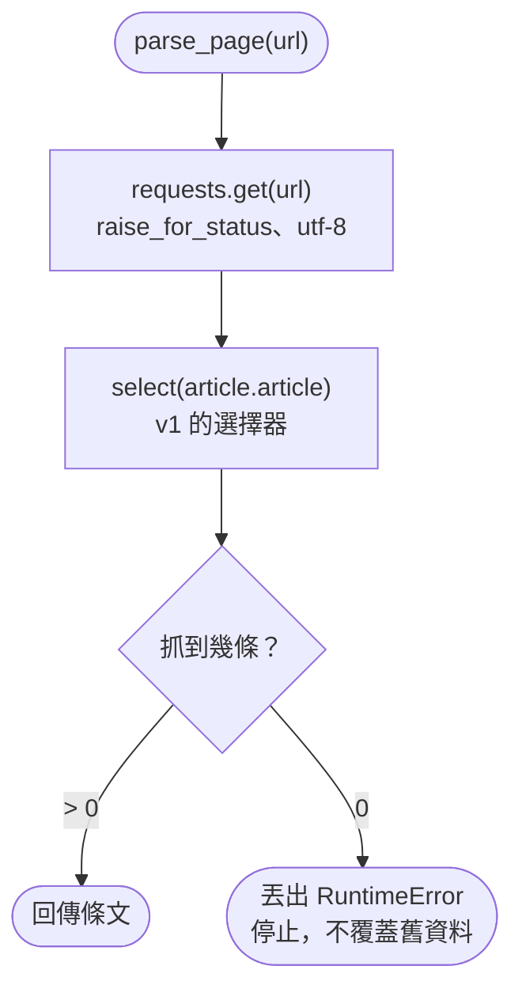
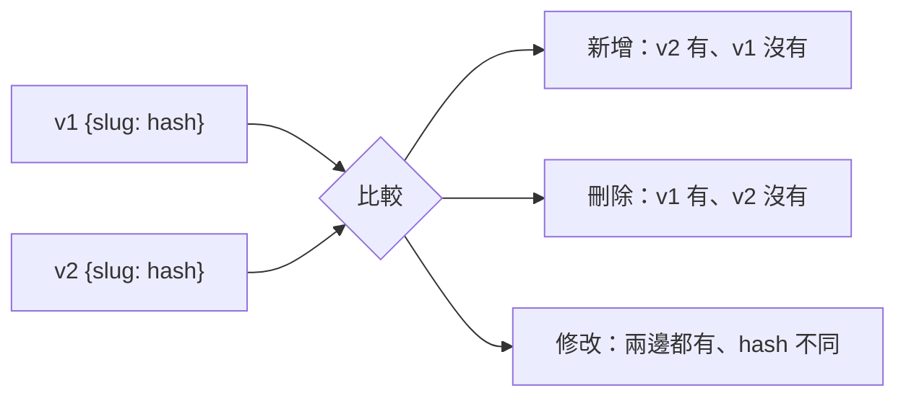
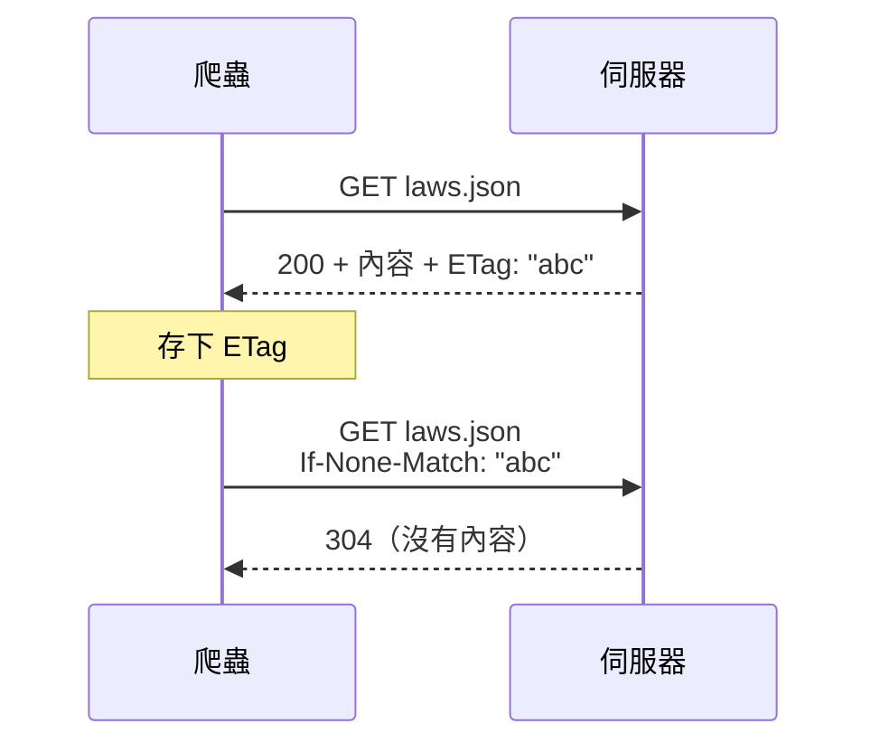

# 15｜網站改版了：變動偵測與增量更新

> **定位**：用 `content_hash` 找出新增、刪除、修改的條文；用 ETag／304 避免重複下載；在選擇器失效時第一時間發現。

## 學習目標

完成本節後，你應該能夠：

- 用 SHA-256 算出 `content_hash`，比對兩次爬取找出新增、刪除、修改
- 把欄位名稱不同的兩個版本「正規化」成同一種格式再比較
- 用 ETag 與 `If-None-Match` 發出條件式請求，看懂 304
- 在爬蟲裡加上「筆數歸零就報警」，避免改版後安靜地產出空資料

## 範例程式碼

demo repo 的 [`15-change/`](https://github.com/4-learn/python-web-crawler-demo/tree/main/15-change) 資料夾，本節用到的程式（都在 **repo 根目錄** `python-web-crawler-demo/` 執行）：

| 檔案 | 講解段落 | 內容 | 執行指令 |
|---|---|---|---|
| [`15-change/zero_guard.py`](https://github.com/4-learn/python-web-crawler-demo/blob/main/15-change/zero_guard.py) | 2. 筆數歸零就報警 | v1 選擇器在 v2 找不到東西 → 報錯（預期會出錯） | `python 15-change/zero_guard.py` |
| [`15-change/detect_changes.py`](https://github.com/4-learn/python-web-crawler-demo/blob/main/15-change/detect_changes.py) | 3–4 | 比較 v1／v2，找出新增、刪除、修改（可帶 pcode） | `python 15-change/detect_changes.py [pcode]` |
| [`15-change/etag_check.py`](https://github.com/4-learn/python-web-crawler-demo/blob/main/15-change/etag_check.py) | 6. ETag 與 304 | 條件式請求，第二次回 304 | `python 15-change/etag_check.py` |

- 練習站關卡 7（網站改版）：<https://4-learn.github.io/crawler-playground/v2/laws/>

---

## 情境

你是 AI 團隊的資料工程師。條文資料已經能抓、也有測試驗證。某天早上，排程跑完的爬蟲回報：

<sub>📄 來源：情境示意：選擇器失效時，沒有守門檢查的爬蟲會印出的訊息</sub>

```text
寫入 N0030001.jsonl，共 0 條
```

網站改版了。主管問了兩個問題：

> 「第一，爬蟲壞了為什麼沒有人通知我？第二，法規每隔一陣子就會修正，你每次都全部重抓，怎麼知道這次到底改了哪幾條？問答系統要知道哪些答案需要更新。」

法規資料不是抓一次就結束。這一節處理「之後」：**發現改版、找出變動、只更新有變的部分**。

---

## 講解

### 1. 網站改版的兩種情況

| 情況 | 例子 | 爬蟲的反應 |
|---|---|---|
| **內容變了** | 法規修正，第 24 條多了一句 | 照常執行，但舊資料過時了 |
| **結構變了** | 網址、HTML、API 欄位改名 | 抓到 0 筆，或直接出錯 |

練習站的 `v2/` 同時示範兩種：內容有「虛構修正」，結構也改了。

| 項目 | v1 | v2 |
|---|---|---|
| 條文頁網址 | `v1/laws/{pcode}/page-N.html` | `v2/laws/{pcode}/p/N.html` |
| 條文 HTML | `article.article[data-slug]` | `tr.row[data-article]` |
| 每頁條數 | 20 | 25 |
| 條文 API | `v1/api/laws/{pcode}/page-N.json` | `v2/api/laws/{pcode}/N.json` |
| API 欄位 | `slug`、`article_no`、`content` | `id`、`number`、`text` |
| 分頁 | 有 `next` | 沒有 `next`，改給 `pages` |

:::warning
v2 的條文內容有刻意加入的虛構句子，標明「爬蟲練習站第 2 版虛構修正」，不具法律效力。
:::

### 2. 選擇器失效：筆數歸零就報警

結構改版最常見的結果，是**選擇器找不到東西，回傳空清單**。`select()` 找不到不會報錯，只會給你 `[]`，於是爬蟲開開心心地寫出一個空檔案，還把昨天的好資料覆蓋掉。

解法很簡單：**抓到 0 筆就停下來報錯**。

<!-- flow-chart -->
**流程圖**



<!-- fn-table -->
| 函式名稱 | 說明 | 官方文件連結 |
|---|---|---|
| `soup.select(css)` | 用 CSS selector 找出**全部**符合的元素，回傳 list；找不到是空 list | [文件](https://www.crummy.com/software/BeautifulSoup/bs4/doc/#css-selectors-through-the-css-property) |
| `raise 例外` | 主動丟出例外，程式停在這裡，不會繼續寫出錯誤資料 | [文件](https://docs.python.org/3/reference/simple_stmts.html#raise) |

```python
def parse_page(url: str) -> list:
    r = requests.get(url, headers=HEADERS, timeout=10)
    r.raise_for_status()
    r.encoding = "utf-8"
    items = BeautifulSoup(r.text, "html.parser").select("article.article")  # v1 的選擇器
    if not items:
        raise RuntimeError(f"{url} 抓到 0 條：選擇器可能失效，停止，不要覆蓋舊資料")
    return items

print(len(parse_page(BASE + "v1/laws/N0030001/")), "條")
print(len(parse_page(BASE + "v2/laws/N0030001/p/1.html")), "條")
```

<!-- run-box -->
:::info
**▶ 怎麼執行**　程式在 demo repo 的 [`15-change/zero_guard.py`](https://github.com/4-learn/python-web-crawler-demo/blob/main/15-change/zero_guard.py)。在 **repo 根目錄**（`python-web-crawler-demo/`）執行，最後丟出 `RuntimeError` 是**預期結果**：
```bash
python 15-change/zero_guard.py
```
:::

執行結果：

<sub>📄 來源：執行 [`15-change/zero_guard.py`](https://github.com/4-learn/python-web-crawler-demo/blob/main/15-change/zero_guard.py) 的輸出（Traceback 中間省略）</sub>

```text
20 條
Traceback (most recent call last):
  ...
RuntimeError: https://4-learn.github.io/crawler-playground/v2/laws/N0030001/p/1.html 抓到 0 條：選擇器可能失效，停止，不要覆蓋舊資料
```

v2 的頁面正常回傳 200，但條文已經改用 `tr.row`，v1 的選擇器一條都找不到。有了這道檢查，排程失敗會被通知，舊資料也不會被空檔案蓋掉。

常見的守門條件：

- **筆數為 0**：一定有問題
- **筆數和來源的總數不同**（第 14 節的筆數對照）：漏抓或多抓
- **筆數比上次少很多**（例如少超過 10%）：可能是部分選擇器失效

另外也要注意：網址改了會直接 404（例如 v2 沒有 `v2/laws/N0030001/` 這一頁，第 1 頁是 `p/1.html`）。`raise_for_status()` 會讓 404 變成錯誤，不要把它拿掉。

### 3. content_hash：用指紋比較內容

要知道「哪幾條改了」，最直接的方法是新舊逐字比對。但資料一多，存兩份全文來比很浪費。改用**雜湊（hash）**：

<!-- fn-table -->
| 函式名稱 | 說明 | 官方文件連結 |
|---|---|---|
| `str.encode("utf-8")` | 字串 → bytes；雜湊函式只吃 bytes | [文件](https://docs.python.org/3/library/stdtypes.html#str.encode) |
| `hashlib.sha256(bytes).hexdigest()` | 算 SHA-256 雜湊，回傳 64 字元的十六進位字串；內容一字不同，雜湊就完全不同 | [文件](https://docs.python.org/3/library/hashlib.html#hashlib.sha256) |

```python
import hashlib

def content_hash(text: str) -> str:
    return hashlib.sha256(text.encode("utf-8")).hexdigest()
```

這個函式在 `detect_changes.py` 裡，完整程式見第 4 段。

SHA-256 會把任意長度的文字變成固定 64 個十六進位字元的「指紋」：

<sub>📄 來源：在 `python` 互動模式對兩個字串執行 `content_hash()` 的結果</sub>

```text
同一段文字   → 878c7a3544c622a19a9c9b21772348f5a4134a04cf4817cea01b84d87757dc92
同一段文字。 → f2abc305fc0f2814d2268eaddf64193153016c9f1bf9e307994fa7cd0392f9e5
```

只多一個句號，指紋就完全不同。所以：

- 內容一樣 → hash 一樣
- 內容只要差一個字 → hash 不一樣

每條條文存一個 `content_hash`，下次爬取時比 hash 就知道有沒有變，不用保留舊全文來比。第 16 節寫入 MariaDB 時也會用它判斷「要不要更新」。

:::info
hash 要對「正規化之後」的內容算。如果同一段文字有時多一個結尾換行、有時沒有，hash 會不同，你會誤判成「修改」。所以第 14 節才要求 `content` 的格式固定（多段以 `\n` 分隔、不加多餘空白）。
:::

### 4. 比較兩個版本：新增、刪除、修改

把每個版本整理成 `{條文代號: hash}` 的字典，三種變動就是三個集合運算：



demo 的 `detect_changes.py` 比較 v1、v2 的勞動基準法。關鍵是：**v2 的 API 欄位改名了，先各自正規化成同一種格式再比**。

#### 這段會用到的 Python 語法

| 寫法 | 意思 | 官方文件連結 |
|---|---|---|
| `out, url = {}, BASE + …` | 一行指定兩個變數：`out` 是空 dict、`url` 是網址 | [文件](https://docs.python.org/3/reference/simple_stmts.html#assignment-statements) |
| `while True:` ＋ `break` | 一直重複，直到遇到 `break` 才跳出；v2 沒有 `next`，用「頁數到了」來 `break` | [文件](https://docs.python.org/3/reference/simple_stmts.html#the-break-statement) |
| `a.keys() - b.keys()` | 集合相減：a 有、b 沒有；`&` 是兩邊都有 | [文件](https://docs.python.org/3/library/stdtypes.html#dict-views) |
| `sorted(...)` | 排序，讓輸出每次順序一樣 | [文件](https://docs.python.org/3/library/functions.html#sorted) |
| `-> dict`、`: str` | 型別標註，只是說明，不影響執行（第 05 節） | [文件](https://docs.python.org/3/library/typing.html) |

完整程式：

```python
import hashlib
import json
import os
import sys
import time
from urllib.parse import urljoin

import requests

BASE = os.environ.get("PLAYGROUND", "https://4-learn.github.io/crawler-playground/")
session = requests.Session()
session.headers["User-Agent"] = "course-crawler/1.0 (demo)"


def get(url):
    time.sleep(0.2)  # 示範用；正式爬取請依 Crawl-delay
    r = session.get(url, timeout=10)
    r.raise_for_status()
    return r.json()


def content_hash(text: str) -> str:
    return hashlib.sha256(text.encode("utf-8")).hexdigest()


def load_v1(pcode: str) -> dict:
    out, url = {}, BASE + f"v1/api/laws/{pcode}/page-1.json"
    while url:
        data = get(url)
        for a in data["articles"]:
            out[a["slug"]] = content_hash(a["content"])
        url = urljoin(url, data["next"]) if data["next"] else None
    return out


def load_v2(pcode: str) -> dict:
    out, page = {}, 1
    while True:
        data = get(BASE + f"v2/api/laws/{pcode}/{page}.json")
        for a in data["items"]:                # 欄位改名：id / text
            out[a["id"]] = content_hash(a["text"])
        if page >= data["pages"]:              # 沒有 next，改用 pages
            break
        page += 1
    return out


pcode = sys.argv[1] if len(sys.argv) > 1 else "N0030001"
old, new = load_v1(pcode), load_v2(pcode)
added = sorted(new.keys() - old.keys())
deleted = sorted(old.keys() - new.keys())
modified = sorted(k for k in old.keys() & new.keys() if old[k] != new[k])
print(f"{pcode}：v1 {len(old)} 條，v2 {len(new)} 條")
print("新增：", added)
print("刪除：", deleted)
print("修改：", modified)
```

<!-- run-box -->
:::info
**▶ 怎麼執行**　程式在 demo repo 的 [`15-change/detect_changes.py`](https://github.com/4-learn/python-web-crawler-demo/blob/main/15-change/detect_changes.py)。在 **repo 根目錄**（`python-web-crawler-demo/`）執行：
```bash
python 15-change/detect_changes.py              # 預設比較勞動基準法 N0030001
python 15-change/detect_changes.py N0060001     # 換成職業安全衛生法
```
:::

兩個 `load` 函式各自處理自己版本的格式，最後都產出一樣的 `{slug: hash}`。比較的邏輯完全不用知道 v1、v2 長什麼樣子。這就是「正規化」的好處：**下次再改版，只要改 `load` 那一層**。

執行結果：

<sub>📄 來源：執行 `python 15-change/detect_changes.py` 的輸出</sub>

```text
N0030001：v1 98 條，v2 99 條
新增： ['86-1']
刪除： []
修改： ['24', '38']
```

拿第 24 條的新舊內容逐行比對，差別是 v2 多了一行：

<sub>📄 來源：用 `difflib.unified_diff` 比對 v1、v2 第 24 條內容，只留差異行</sub>

```text
+（本句為爬蟲練習站第 2 版虛構修正，用於練習變動偵測，非真實法條。）
```

而新增的第 86-1 條內容是：

<sub>📄 來源：[`v2/api/laws/N0030001/4.json`](https://4-learn.github.io/crawler-playground/v2/api/laws/N0030001/4.json) 裡 `id` 為 `86-1` 的 `text`</sub>

```text
本條為爬蟲練習站第 2 版虛構新增之條文，用於練習偵測新增資料，非真實法條。
```

:::info
為什麼用 `slug` 當鍵，而不是 `article_no`？`slug`（如 `86-1`）是網址的一部分，穩定且不含空白；條號文字（`第 86-1 條`）的格式在改版時比較可能變動。比較的鍵要選**最不會變的那一個**。
:::

### 5. 增量更新：只處理有變的部分

知道哪些條文變了以後，下游只需要處理那幾條：

| 變動 | 資料庫 | 問答系統 |
|---|---|---|
| 新增 | INSERT | 加入索引 |
| 修改 | UPDATE 內容與 hash | 重新處理這一條 |
| 刪除 | 標記刪除或移除 | 從索引移除，避免引用已刪條文 |
| 未變 | 不動 | 不動 |

749 條裡只有 6 條變動，問答系統就只要重新處理 6 條，而不是 749 條。第 16 節會把這個邏輯放進 MariaDB 的 upsert。

### 6. ETag 與 304：沒變就不要下載

`content_hash` 要先下載內容才能算。能不能連下載都省掉？HTTP 有內建的機制：**條件式請求**。

第 02 節看過（[ETag 與 If-None-Match](https://hackmd.io/@yillkid/Hyiiknljfl)），快速複習：

- **[`ETag`](https://developer.mozilla.org/zh-TW/docs/Web/HTTP/Reference/Headers/ETag)**：伺服器在回應裡附上的「版本編號」，內容一改就換。
- **[`If-None-Match`](https://developer.mozilla.org/zh-TW/docs/Web/HTTP/Reference/Headers/If-None-Match)**：你在請求裡附上「我手上是這個版本」，版本一樣伺服器就回 304、不傳內容。

伺服器回應裡的 `ETag`（`curl -I` 只看 header、不下載內容）：

```bash
curl -sI https://4-learn.github.io/crawler-playground/v1/api/laws.json | grep -iE "^HTTP|etag|last-modified"
```

<sub>📄 來源：執行上面 `curl` 指令的輸出（2026-11-01）</sub>

```text
HTTP/2 200
last-modified: Sat, 31 Oct 2026 15:09:00 GMT
etag: "6ae6048c-49d"
```

下次請求時把它放在 `If-None-Match` 裡：「如果版本還是這個，就不用給我了」。內容沒變，伺服器回 **304 Not Modified**，沒有本文，只有標頭。



demo 的 `etag_check.py` 把 ETag 存在 `etag_cache.json`：

<!-- fn-table -->
| 函式名稱 | 說明 | 官方文件連結 |
|---|---|---|
| `r.headers.get(name)` | 取回應標頭；不分大小寫，沒有這個標頭就回傳 `None` | [文件](https://requests.readthedocs.io/en/latest/api/#requests.Response.headers) |
| `r.status_code` | HTTP 狀態碼（整數），例如 200、404、429 | [文件](https://requests.readthedocs.io/en/latest/api/#requests.Response.status_code) |
| `Path.write_text(text)` | 把字串寫進檔案（覆蓋） | [文件](https://docs.python.org/3/library/pathlib.html#pathlib.Path.write_text) |

```python
for path in ["v1/api/laws.json", "v1/api/laws/N0030001/page-1.json"]:
    url = BASE + path
    headers = {"User-Agent": "course-crawler/1.0 (demo)"}
    if url in cache:
        headers["If-None-Match"] = cache[url]
    r = requests.get(url, headers=headers, timeout=10)
    if r.status_code == 304:
        print("304 沒變，跳過", path)
    else:
        print(r.status_code, "下載", path, len(r.content), "bytes")
        if r.headers.get("ETag"):
            cache[url] = r.headers["ETag"]
CACHE.write_text(json.dumps(cache, indent=1))
```

<!-- run-box -->
:::info
**▶ 怎麼執行**　程式在 demo repo 的 [`15-change/etag_check.py`](https://github.com/4-learn/python-web-crawler-demo/blob/main/15-change/etag_check.py)。在 **repo 根目錄**（`python-web-crawler-demo/`）執行。ETag 存在 `output/etag_cache.json`；要從頭再試，先 `rm output/etag_cache.json`：
```bash
python 15-change/etag_check.py
python 15-change/etag_check.py     # 再跑一次，看到 304
```
:::

連續執行兩次（先刪掉 `output/etag_cache.json`）：

<sub>📄 來源：執行兩次 [`15-change/etag_check.py`](https://github.com/4-learn/python-web-crawler-demo/blob/main/15-change/etag_check.py) 的輸出</sub>

```text
$ python 15-change/etag_check.py
200 下載 v1/api/laws.json 1181 bytes
200 下載 v1/api/laws/N0030001/page-1.json 12345 bytes
$ python 15-change/etag_check.py
304 沒變，跳過 v1/api/laws.json
304 沒變，跳過 v1/api/laws/N0030001/page-1.json
```

第二次完全沒有下載內容。對網站友善，也讓你的排程跑得更快。

存下來的 ETag 長這樣：

<sub>📄 來源：`cat output/etag_cache.json` 的輸出（2026-11-01）</sub>

```json
{
 "https://4-learn.github.io/crawler-playground/v1/api/laws.json": "W/\"6ae6048c-49d\"",
 "https://4-learn.github.io/crawler-playground/v1/api/laws/N0030001/page-1.json": "W/\"6ae6048c-3039\""
}
```

:::info
你看到的 ETag 數字可能和上面不一樣。練習站 2026-10-31 重新部署過，ETag 就從 `6ac323a0-…` 變成 `6ae6048c-…`，**但條文內容一個字都沒改**。這就是第 7 段說的「ETag 依網站而定」：網站重新部署、換伺服器，ETag 都可能變。所以 ETag 只用來省下載，真正判斷內容有沒有變，還是要靠 `content_hash`。
:::

`W/` 開頭是「弱 ETag」，代表語意上相同即可，不保證每個位元組一樣。照原樣存、原樣送回去就好，不需要自己解析。

### 7. ETag 和 content_hash 各管什麼

| | ETag／304 | content_hash |
|---|---|---|
| 誰算的 | 伺服器 | 你自己 |
| 單位 | 整個網址（一頁、一個 API 回應） | 一條條文 |
| 省下什麼 | 下載流量與時間 | 下游的重新處理 |
| 可靠嗎 | 依網站而定，有些網站沒有、或每次都變 | 完全由你掌控 |

兩者搭配：先用 ETag 判斷「這一頁要不要下載」，下載了再用 `content_hash` 判斷「這一頁裡哪幾條真的變了」。**ETag 是加速用的，content_hash 才是判斷依據**；網站沒提供 ETag 時，爬蟲照樣要能正確運作。

---

## Workshop

### 題目

練習站切到 `v2/`（關卡 7）。

**課堂題**（用 demo，不用 AI）：

1. 執行 `python 15-change/zero_guard.py`，看 v1 的選擇器在 v2 找不到東西時，守門檢查怎麼擋下來。
2. 執行 `python 15-change/detect_changes.py`，確認勞動基準法是「新增 1、修改 2」。
3. 把 pcode 換成職業安全衛生法：`python 15-change/detect_changes.py N0060001`，找出它改了哪一條，再打開 v1、v2 的 API 看那一條差在哪裡。

**延伸題**（建議課後做）：請 OpenCode 修好爬蟲，比對全站

4. 寫規格請 OpenCode 修好你的 v1 爬蟲。規格要寫清楚 v2 的網址、欄位與分頁方式，並要求「抓到 0 條或筆數與來源不符時報錯」。
5. 爬完 v1、v2 **全部 9 部法規**，每條算 `content_hash`。
6. 比對兩版，產出 `changes.md`：新增、刪除、修改各幾條、是哪幾條（用 `pcode#slug` 與條號表示）。

延伸題繳交：規格、OpenCode 對話紀錄（`/export`）、程式、`changes.md`。

:::info
延伸題實測：用 NVIDIA 的 GLM 模型交給 OpenCode，約 15 分鐘完成（爬 9 部法規 × 2 版、每次請求間隔 1 秒）。AI 工作時不用一直盯著，可以先做別的事。
:::

### 預期輸出

課堂題第 3 步：

```text
N0060001：v1 61 條，v2 61 條
新增： []
刪除： []
修改： ['6']
```

延伸題：

```text
v1：749 條；v2：749 條
新增 1、刪除 1、修改 4
```

`changes.md` 格式範例：

```markdown
# v1 → v2 變動報告

- v1：749 條；v2：749 條
- 新增 1、刪除 1、修改 4

## 新增

- `N0030001#86-1` 第 86-1 條

## 刪除

- …

## 修改

- `N0030001#24` 第 24 條
- …
```

只看勞動基準法（demo）會找到新增 1、修改 2；全站還有其他法規的變動，要自己找出來。

### 解答

- [解答](https://github.com/4-learn/python-web-crawler-workshop/tree/master/2026/15)
