# 16 附錄：MariaDB 一步一步做（實機截圖）

> **用途**：第 16 節要把爬下來的條文寫進 MariaDB。資料庫比較不熟的同學，照這篇一步一步做就好。
>
> 以下每一張截圖，都是在 Ubuntu 24.04 的 `4-learn` 主機上**實際執行**的畫面（2026-11-01，MariaDB 11.8.9，Python 3.12）。

## 本篇用到的帳號密碼

| 用途 | 帳號 | 密碼 | 說明 |
|---|---|---|---|
| 管理員 | `root` | （不用密碼） | 用 `sudo mariadb` 登入，只拿來建資料庫和帳號 |
| 爬蟲程式 | `crawler` | `crawler-db-2026` | 本課專用的示範密碼，可以自己改 |
| 資料庫 | `crawler_course` | | |

:::warning
`crawler-db-2026` 是這份講義公開的示範密碼。你自己的資料庫可以照用；但真正的專案**一定要換一組自己的密碼**，而且不要寫進程式、不要 commit。
:::

## 整體流程

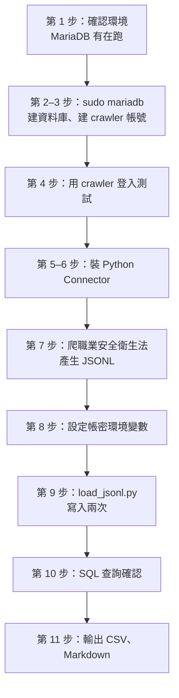

---

## 第 1 步：確認環境

進到 demo repo，確認系統版本，以及 MariaDB 有在執行：

```bash
cd ~/python-web-crawler-demo        # 換成你 clone demo repo 的位置
lsb_release -ds
systemctl is-active mariadb
mariadb --version
```

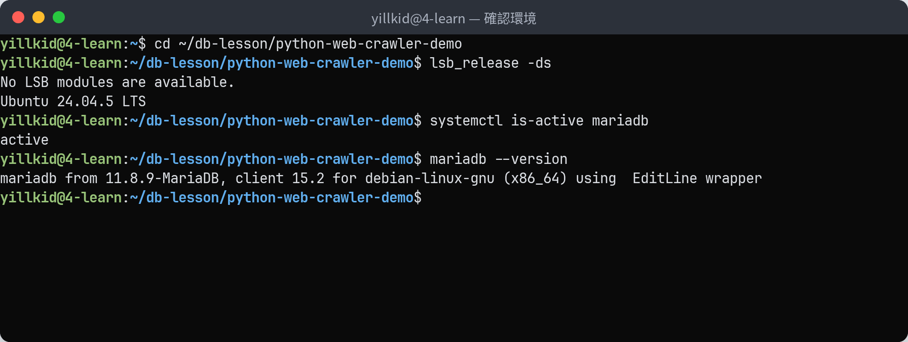

`systemctl is-active mariadb` 要回 `active`。如果是 `inactive`，用 `sudo systemctl start mariadb` 啟動；如果找不到 `mariadb` 指令，代表還沒安裝，回去看 MariaDB 課的安裝講義。

## 第 2 步：用管理員身分登入

```bash
sudo mariadb
```

Ubuntu 上的 MariaDB，`root` 帳號是用 **Linux 的 sudo** 驗證，不用另外輸入資料庫密碼。進去之後提示字元會變成 `MariaDB [(none)]>`，看一下目前有哪些資料庫和帳號：

```sql
SHOW DATABASES;
SELECT user, host FROM mysql.user;
```

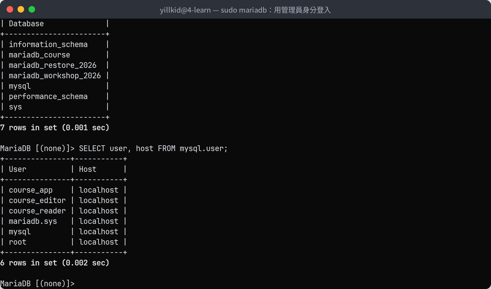

這時還沒有 `crawler_course` 資料庫，也沒有 `crawler` 帳號。

:::info
`MariaDB [(none)]>` 中括號裡是「目前使用的資料庫」，`(none)` 表示還沒選。SQL 指令最後一定要加分號 `;`，按 `Enter` 才會執行。
:::

## 第 3 步：建立資料庫與爬蟲帳號

在 `sudo mariadb` 裡，一行一行貼上：

```sql
CREATE DATABASE IF NOT EXISTS crawler_course CHARACTER SET utf8mb4 COLLATE utf8mb4_unicode_ci;
CREATE USER IF NOT EXISTS 'crawler'@'localhost' IDENTIFIED BY 'crawler-db-2026';
GRANT SELECT, INSERT, UPDATE, CREATE, ALTER ON crawler_course.* TO 'crawler'@'localhost';
SHOW GRANTS FOR 'crawler'@'localhost';
exit
```

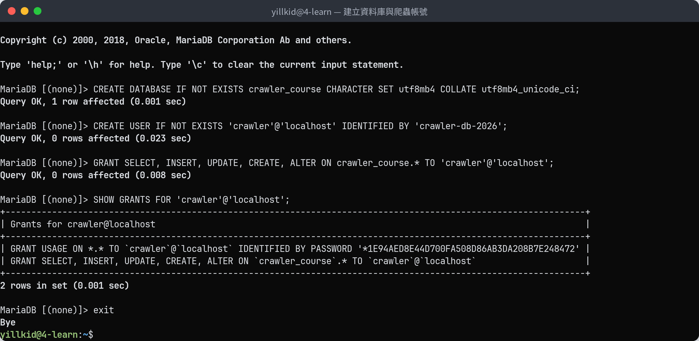

| 指令 | 做什麼 |
|---|---|
| `CREATE DATABASE … utf8mb4` | 建資料庫，用 `utf8mb4` 才能存中文和罕用字 |
| `CREATE USER 'crawler'@'localhost'` | 建一個只能從本機登入的帳號 |
| `GRANT SELECT, INSERT, UPDATE, CREATE, ALTER` | 只給爬蟲需要的權限：讀、新增、修改、建表、補欄位。**不給 `DELETE`、`DROP`** |
| `SHOW GRANTS` | 確認權限有給對；密碼會顯示成一串 `*1E94…` 的雜湊，不是明文 |

每一行都要看到 `Query OK` 才算成功。最後 `exit` 離開管理員身分。

## 第 4 步：用 crawler 帳號登入測試

```bash
mariadb -u crawler -p crawler_course
```

出現 `Enter password:` 時輸入 `crawler-db-2026`（**輸入時畫面不會顯示任何字**，打完按 `Enter`）。進去後：

```sql
SELECT CURRENT_USER(), DATABASE();
SHOW TABLES;
exit
```

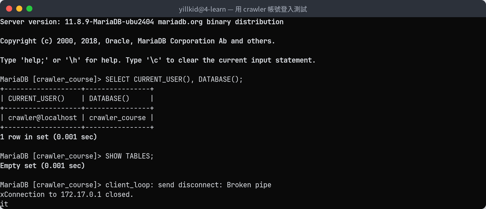

`CURRENT_USER()` 是 `crawler@localhost`、`DATABASE()` 是 `crawler_course`，就是對的。`SHOW TABLES` 是 `Empty set`：資料表還沒建，第 9 步程式會自動建。

| 看到 | 原因 |
|---|---|
| `Access denied for user 'crawler'@'localhost' (using password: YES)` | 密碼打錯 |
| `Access denied for user 'crawler'@'localhost' to database 'crawler_course'` | 第 3 步的 `GRANT` 沒有執行成功 |

## 第 5 步：確認編譯需要的套件

Python 的 `mariadb` 套件在 Linux 上會**現場編譯**，需要三個系統套件：

```bash
dpkg -l libmariadb-dev gcc python3-dev | tail -3
mariadb_config --cc_version
```

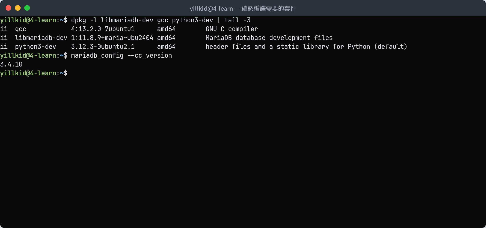

三行開頭都是 `ii` 代表都裝好了。`mariadb_config --cc_version` 要 **3.3.1 以上**（這台是 3.4.10）。缺的話補裝：

```bash
sudo apt install -y libmariadb-dev gcc python3-dev
```

## 第 6 步：安裝 Python Connector

進到 demo repo、啟用虛擬環境，再安裝：

```bash
cd ~/python-web-crawler-demo
source .venv/bin/activate
pip install mariadb==1.1.14
python -c "import mariadb; print(mariadb.__version__)"
```

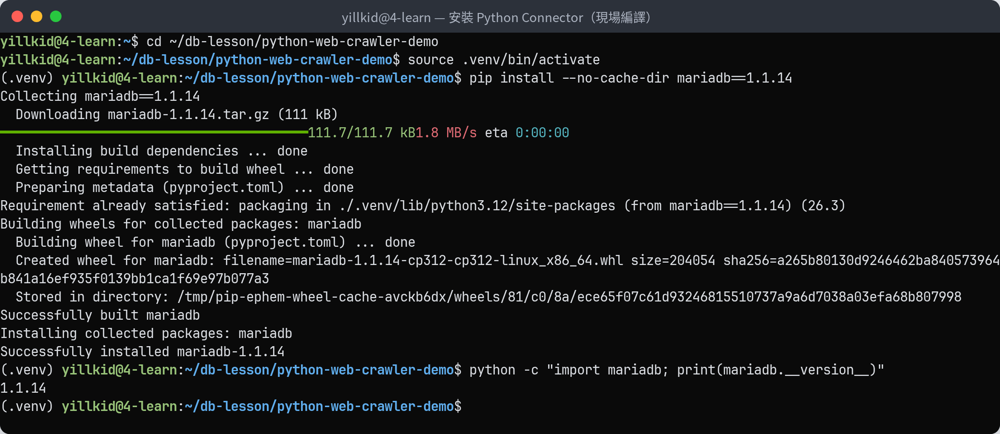

注意 `Building wheel for mariadb … done`：這就是在現場編譯，要等幾秒到十幾秒。最後印出 `1.1.14` 就是裝好了。

| 安裝失敗時看到 | 補裝 |
|---|---|
| `mariadb_config` not found | `libmariadb-dev` |
| `gcc` not found | `gcc` |
| `Python.h: No such file or directory` | `python3-dev` |

## 第 7 步：產生要寫入的 JSONL

用第 05 節的程式爬職業安全衛生法：

```bash
rm -rf output
python 05-pagination/crawl_law.py N0060001
wc -l output/N0060001.jsonl
```

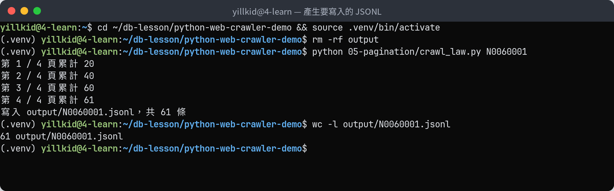

61 條、檔案 61 行。

## 第 8 步：設定帳密環境變數

程式從環境變數讀帳密，**密碼不寫進程式**：

```bash
export DB_USER=crawler DB_PASS='crawler-db-2026' DB_NAME=crawler_course
env | grep ^DB_
```

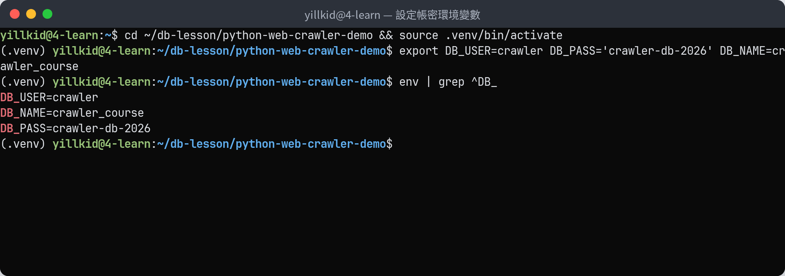

:::info
`export` 只對**這個終端機視窗**有效。開新的終端機，要再 `export` 一次。
:::

## 第 9 步：寫入 MariaDB（執行兩次）

```bash
python 16-mariadb/load_jsonl.py output/N0060001.jsonl
python 16-mariadb/load_jsonl.py output/N0060001.jsonl
```

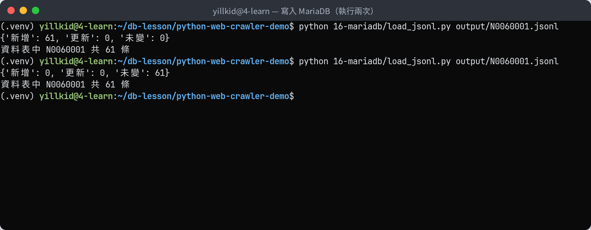

| 第幾次 | 結果 | 意思 |
|---|---|---|
| 第一次 | 新增 61 | 程式自動建了 `law_articles` 資料表，寫入 61 條 |
| 第二次 | 未變 61 | 內容一樣，一筆都沒寫，**資料表還是 61 條，沒有變成 122** |

這就是第 16 節講的「可以重複執行」：排程每天跑，資料也不會重複。

## 第 10 步：用 SQL 查詢確認

```bash
mariadb -u crawler -p crawler_course
```

輸入密碼後：

```sql
SHOW TABLES;
SELECT pcode, COUNT(*), COUNT(DISTINCT slug) FROM law_articles GROUP BY pcode;
SELECT slug, article_no, LEFT(content, 20), fetched_at FROM law_articles ORDER BY id LIMIT 3;
exit
```

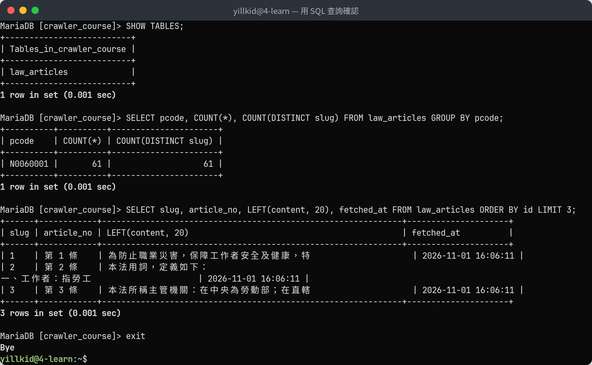

- `COUNT(*)` 和 `COUNT(DISTINCT slug)` 都是 61：沒有重複的條文。
- 第 2 條的內容有換行（「本法用詞，定義如下：」後面換行），所以表格被撐成兩行，這是正常的。
- `fetched_at` 存的是 **UTC 時間**（台灣時間要再加 8 小時），第 16 節第 1 段說明為什麼統一用 UTC。

## 第 11 步：輸出 CSV 與 Markdown

```bash
python 16-mariadb/export.py output/N0060001.jsonl
ls -l output/
head -5 output/N0060001.md
```

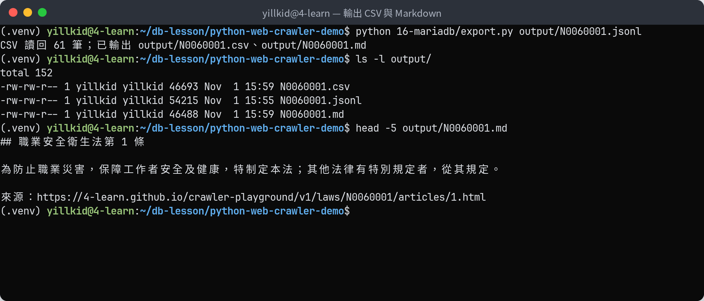

`N0060001.csv` 給 Pandas 用，`N0060001.md` 給 LLM 和人讀，每一條都附上法規名稱、條號和出處。

---

## 補充：爬蟲帳號刪不掉資料

第 3 步沒有給 `DELETE`、`DROP` 權限。試試看：

```sql
DELETE FROM law_articles WHERE slug = '1';
DROP TABLE law_articles;
SELECT COUNT(*) FROM law_articles;
```

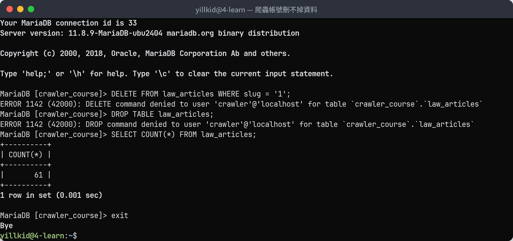

兩個都被擋下來（`command denied`），資料表還是 61 條。程式寫錯時，最多寫壞資料，不會把整張表刪掉。

## 補充：密碼打錯時

```bash
export DB_USER=crawler DB_PASS=wrong-password DB_NAME=crawler_course
python 16-mariadb/load_jsonl.py output/N0060001.jsonl 2>&1 | tail -1
```

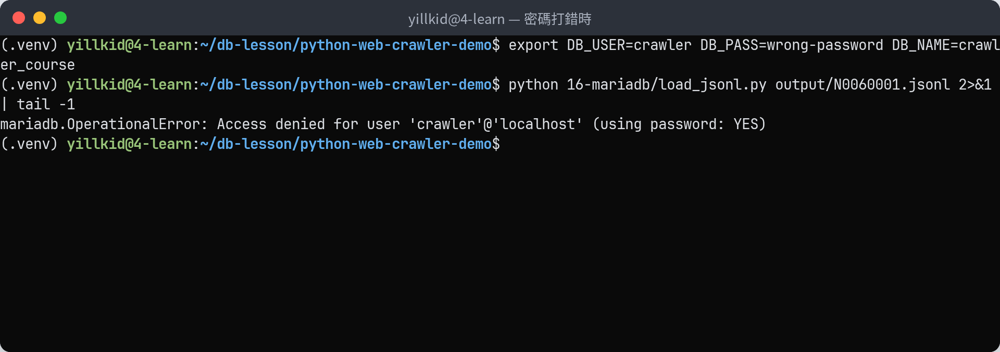

看到 `Access denied … (using password: YES)` 就是密碼不對。`using password: NO` 則是 `DB_PASS` 根本沒設定（忘了 `export`）。

## 常見問題

| 狀況 | 原因 | 處理 |
|---|---|---|
| `sudo mariadb` 要密碼 | 要的是 **Linux 帳號**的密碼，不是資料庫密碼 | 輸入你登入 Ubuntu 的密碼 |
| `Can't connect to local server through socket` | MariaDB 沒有在跑 | `sudo systemctl start mariadb` |
| `Access denied … (using password: YES)` | 密碼打錯 | 重新 `export DB_PASS=…` |
| `Access denied … (using password: NO)` | 沒設定 `DB_PASS` | 第 8 步 |
| `ALTER command denied` | 第 3 步的 `GRANT` 少了 `ALTER` | 用 `sudo mariadb` 補：`GRANT ALTER ON crawler_course.* TO 'crawler'@'localhost';` |
| `Incorrect datetime value: '…+00:00'` | 用了舊版的 `load_jsonl.py`（沒有把時間轉成 UTC） | `git pull` 更新 demo repo |
| `ModuleNotFoundError: No module named 'mariadb'` | 沒啟用虛擬環境，或還沒裝 | `source .venv/bin/activate`，再做第 6 步 |

## 想全部重來

用管理員身分刪掉資料庫和帳號，再從第 3 步開始：

```bash
sudo mariadb -e "DROP DATABASE IF EXISTS crawler_course; DROP USER IF EXISTS 'crawler'@'localhost';"
```

:::warning
`DROP DATABASE` 會把整個資料庫連同資料一起刪掉，**沒有復原**。只在練習用的資料庫這樣做。
:::
