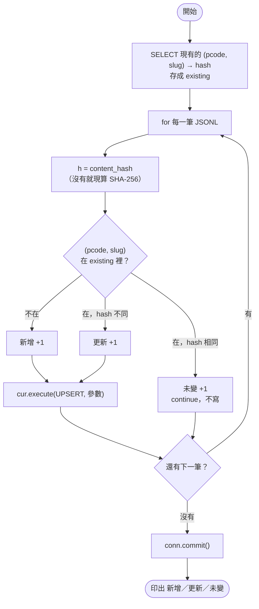
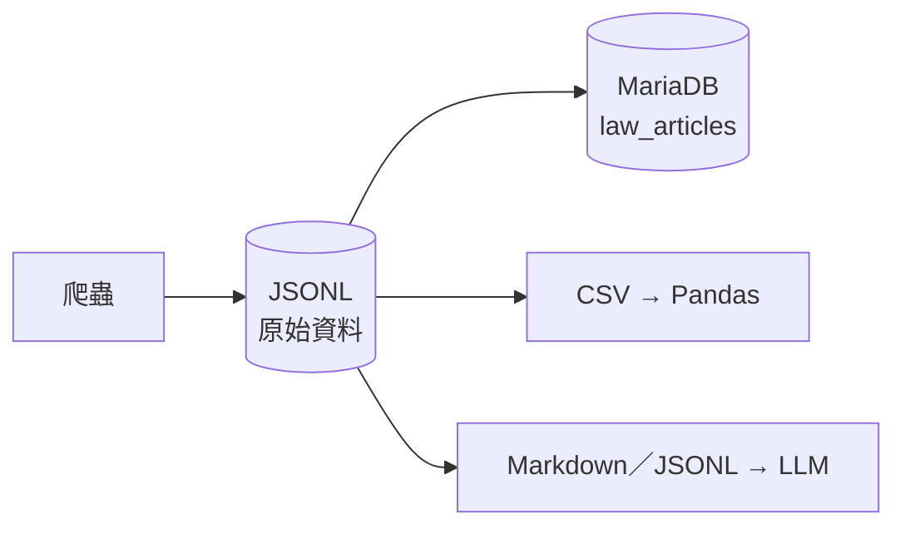

# 16｜交給下游：來源欄位、JSONL 與 MariaDB

> **定位**：讓爬下來的資料能被下游安全使用：每筆帶來源欄位，用參數化查詢與 upsert 寫入 MariaDB，並依用途輸出 CSV、JSONL 或 Markdown。

## 學習目標

完成本節後，你應該能夠：

- 說出 `source_url`、`fetched_at`、`content_hash`、`source_version` 各自回答什麼問題
- 設計有唯一鍵的 `law_articles` 資料表
- 用參數化查詢與 `INSERT ... ON DUPLICATE KEY UPDATE` 寫入 MariaDB，重複執行不會產生重複資料
- 依下游需要，輸出給 Pandas 的 CSV 與給 LLM 的 JSONL／Markdown

## 範例程式碼

demo repo 的 [`16-mariadb/`](https://github.com/4-learn/python-web-crawler-demo/tree/main/16-mariadb) 資料夾，本節用到的程式（都在 **repo 根目錄** `python-web-crawler-demo/` 執行）：

| 檔案 | 講解段落 | 內容 | 執行指令 |
|---|---|---|---|
| [`16-mariadb/schema.sql`](https://github.com/4-learn/python-web-crawler-demo/blob/main/16-mariadb/schema.sql) | 3. 資料表設計 | `law_articles` 資料表（`load_jsonl.py` 會自動建立） | 不用手動執行 |
| [`16-mariadb/load_jsonl.py`](https://github.com/4-learn/python-web-crawler-demo/blob/main/16-mariadb/load_jsonl.py) | 5–7 | 把 JSONL 寫進 MariaDB：參數化查詢、upsert、沒變就不寫 | `python 16-mariadb/load_jsonl.py output/N0060001.jsonl` |
| [`16-mariadb/export.py`](https://github.com/4-learn/python-web-crawler-demo/blob/main/16-mariadb/export.py) | 8–9 | 同一份 JSONL 輸出 CSV（Pandas）與 Markdown（LLM） | `python 16-mariadb/export.py output/N0060001.jsonl` |
| [`16-mariadb/README.md`](https://github.com/4-learn/python-web-crawler-demo/blob/main/16-mariadb/README.md) | 4 | 建資料庫、帳號、安裝 Connector 的指令摘要 | 閱讀 |

- 要寫入的檔案先用第 05 節產生：`python 05-pagination/crawl_law.py N0060001`

---

## 情境

你是 AI 團隊的資料工程師。條文抓得到、驗證過、也能偵測改版了。現在下游的同事來找你：

- 資料分析的同事：「我要用 Pandas 算每部法規有幾章、條文平均多長，給我一份 CSV。」
- 做問答系統的同事：「LLM 回答時要附出處。每一條我都要知道是哪部法規第幾條、網址在哪、什麼時候抓的。」
- 主管：「資料放進公司的 MariaDB。排程每天跑，不准跑一次多一份。」

你在 MariaDB 課學過建表、參數化查詢與 upsert，今天把它們接到爬蟲上。

---

## 講解

### 1. 每筆資料都要回答「從哪來、什麼時候、是哪一版」

問答系統回答「加班費怎麼算」時，引用了勞動基準法第 24 條。使用者問：「這是哪裡來的？是最新的嗎？」你必須答得出來。

| 欄位 | 回答的問題 | 範例 |
|---|---|---|
| `source_url` | 這筆資料從哪裡來？能不能回去核對？ | `.../v1/laws/N0030001/articles/24.html` |
| `fetched_at` | 什麼時候抓的？會不會已經過時？ | `2026-10-05T04:44:12+00:00` |
| `content_hash` | 內容有沒有變？兩筆是不是同一份？ | `sha256` 64 字元 |
| `source_version` | 是網站哪一版的資料？ | `v1`、`v2` |

這四個欄位不是給爬蟲自己用的，是給**下游**用的：

- 分析的人用 `fetched_at` 判斷資料新舊
- 問答系統用 `source_url` 附上出處，讓使用者能點回原文
- 排程用 `content_hash` 判斷要不要更新（第 15 節）
- 網站改版時，`source_version` 讓你知道某筆資料是改版前還是改版後抓的

:::info
`fetched_at` 在 JSONL 裡建議用 ISO 8601 並**帶時區**（例如 `+00:00`）。只寫 `2026-10-05 12:44:12` 的話，日後沒人知道這是台灣時間還是 UTC。

但 MariaDB 的 `DATETIME` 欄位**不收時區**，直接把 `2026-10-05T04:44:12+00:00` 寫進去會報錯：

> `Incorrect datetime value: '2026-10-05T04:44:12+00:00' for column ... fetched_at`

所以寫入資料庫前，要先**統一轉成 UTC、拿掉時區**（第 7 段的 `to_utc()`）。約定好「資料庫裡的時間一律是 UTC」，就不會混淆。
:::

### 2. 為什麼 JSONL 是爬蟲的標準輸出

整個課程我們都輸出 JSONL（一行一個 JSON 物件）。看第 05 節產生的檔案第一行：

```bash
head -n 1 output/N0060001.jsonl
```

<sub>📄 來源：執行 `head -n 1 output/N0060001.jsonl` 的輸出</sub>

```text
{"pcode": "N0060001", "law_name": "職業安全衛生法", "slug": "1", "article_no": "第 1 條", "chapter": "第一章 總則", "content": "為防止職業災害，保障工作者安全及健康，特制定本法；其他法律有特別規定者，從其規定。", "source_url": "https://4-learn.github.io/crawler-playground/v1/laws/N0060001/articles/1.html"}
```

| 特性 | 為什麼對爬蟲有用 |
|---|---|
| 一行一筆 | 爬到一半當掉，前面寫好的行仍然有效；可以邊爬邊寫 |
| 每筆欄位可以不同 | 新增欄位時舊資料不用重做 |
| 保留換行與巢狀結構 | 條文多段以 `\n` 存，不會像 CSV 那樣容易被切壞 |
| `wc -l` 就是筆數 | 第 14 節的筆數對照最簡單 |

JSONL 是「原始資料層」：保留完整資訊，再從它轉出各種下游格式。

### 3. 資料表設計：唯一鍵是重點

demo 的 `schema.sql`：

<sub>📄 來源：[`16-mariadb/schema.sql`](https://github.com/4-learn/python-web-crawler-demo/blob/main/16-mariadb/schema.sql)（省略開頭兩行註解）</sub>

```sql
CREATE TABLE IF NOT EXISTS law_articles (
  id           INT UNSIGNED AUTO_INCREMENT PRIMARY KEY,
  pcode        VARCHAR(16)  NOT NULL,
  law_name     VARCHAR(100) NOT NULL,
  slug         VARCHAR(16)  NOT NULL,
  article_no   VARCHAR(32)  NOT NULL,
  chapter      VARCHAR(200) NOT NULL DEFAULT '',
  content      TEXT         NOT NULL,
  source_url   VARCHAR(500) NOT NULL,
  content_hash CHAR(64)     NOT NULL,
  fetched_at   DATETIME     NOT NULL,
  updated_at   TIMESTAMP    NOT NULL DEFAULT CURRENT_TIMESTAMP ON UPDATE CURRENT_TIMESTAMP,
  UNIQUE KEY uk_article (pcode, slug)
) ENGINE=InnoDB DEFAULT CHARSET=utf8mb4 COLLATE=utf8mb4_unicode_ci;
```

<!-- run-box -->
:::info
**▶ 怎麼執行**　這份 schema 在 [`16-mariadb/schema.sql`](https://github.com/4-learn/python-web-crawler-demo/blob/main/16-mariadb/schema.sql)；`load_jsonl.py` 第一次執行會自動建立資料表，不必手動跑。
:::

幾個設計重點：

- **`UNIQUE KEY (pcode, slug)`**：一部法規的一條條文只能有一列。這是「重複執行不重複」的根本，靠資料庫保證，不靠程式小心。
- **`content_hash CHAR(64)`**：SHA-256 固定 64 字元，用 `CHAR` 剛好。
- **`utf8mb4`**：中文與罕用字都能存，MariaDB 課強調過。
- **`fetched_at` 與 `updated_at` 分開**：前者是「爬到的時間」，後者是「資料庫這一列最後被改的時間」。

:::info
demo 的資料表沒有 `source_version` 欄位。Workshop 你要自己加上，並想想：舊資料表已經存在時，要怎麼補欄位？
:::

### 4. 安裝 MariaDB Connector

> 資料庫不熟的同學，先照〈[16 附錄：MariaDB 一步一步做](https://github.com/4-learn/python-web-crawler-demo/blob/main/docs/16-mariadb-setup.md)〉做一遍，每一步都有實機截圖。

沿用 MariaDB 課的環境。Python 的 `mariadb` 套件在 Linux 上要**現場編譯**，所以需要 C 函式庫、編譯器和 Python 標頭檔：

<!-- fn-table -->
| 函式名稱 | 說明 | 官方文件連結 |
|---|---|---|
| `sudo apt install -y 套件` | 用 Ubuntu 的套件管理員安裝系統套件 | [文件](https://manpages.ubuntu.com/manpages/noble/man8/apt.8.html) |
| `pip install 套件` | 安裝 Python 套件 | [文件](https://pip.pypa.io/en/stable/cli/pip_install/) |

```bash
sudo apt install -y libmariadb-dev gcc python3-dev
pip install mariadb==1.1.14
```

安裝失敗時，看錯誤訊息找原因：

| 錯誤訊息裡出現 | 缺什麼 | 補裝 |
|---|---|---|
| `mariadb_config` not found | MariaDB C 函式庫 | `libmariadb-dev` |
| `x86_64-linux-gnu-gcc` 或 `gcc` not found | C 編譯器 | `gcc` |
| `Python.h: No such file or directory` | Python 標頭檔 | `python3-dev` |
| `MariaDB Connector/Python requires MariaDB Connector/C >= 3.3.1` | C 函式庫太舊 | 升級 Ubuntu 套件，或請老師協助 |

資料庫與帳號（老師或有權限者執行一次）：

```sql
CREATE DATABASE IF NOT EXISTS crawler_course CHARACTER SET utf8mb4 COLLATE utf8mb4_unicode_ci;
CREATE USER IF NOT EXISTS 'crawler'@'localhost' IDENTIFIED BY '請自訂密碼';
GRANT SELECT, INSERT, UPDATE, CREATE, ALTER ON crawler_course.* TO 'crawler'@'localhost';
```

<!-- run-box -->
:::info
**▶ 怎麼執行**　用有建立資料庫權限的帳號登入 MariaDB 用戶端後貼上，例如 `sudo mariadb`（MariaDB 課的環境）。只要做一次。
:::

爬蟲帳號只給需要的權限：`CREATE` 讓程式第一次執行時建表，`ALTER` 讓程式能補欄位（Workshop 延伸題會用到）。**不給 `DROP`、`DELETE`**：程式寫錯時，最多寫壞資料，不會把整張表刪掉。

### 5. 參數化查詢：不要自己拼 SQL

MariaDB 課學過，SQL 一律用 `?` 佔位，值另外傳：

<!-- fn-table -->
| 函式名稱 | 說明 | 官方文件連結 |
|---|---|---|
| `cur.execute(sql, params)` | 執行 SQL；`?` 是佔位符號，值放在 `params` tuple，由 Connector 處理跳脫 | [文件](https://mariadb.com/docs/connectors/mariadb-connector-python/api/cursor#cursor-methods) |

```python
# 錯：條文內容有單引號就壞掉，也可能被 SQL injection
cur.execute(f"SELECT COUNT(*) FROM law_articles WHERE pcode = '{pcode}'")

# 對：值由 Connector 處理
cur.execute("SELECT COUNT(*) FROM law_articles WHERE pcode = ?", (pcode,))
```

<!-- run-box -->
:::info
**▶ 怎麼執行**　這段只是對照，不用執行。
:::

爬蟲的資料來自外部網站，**你無法控制內容裡有什麼字元**。條文裡出現引號、反斜線都很正常。用參數化查詢，這些都不是問題。

實測（2026-11-01，MariaDB 10.11）把 `N0060001' OR '1'='1` 當作 `pcode` 傳入參數化查詢，結果是 `(0,)`：它被當成一個普通字串比對，找不到任何資料，而不是變成 SQL 條件。

### 6. Upsert：有就更新，沒有就新增

每天排程跑一次，第二天的資料大部分和第一天一樣。用 MariaDB 課學過的 `ON DUPLICATE KEY UPDATE`：

<!-- fn-table -->
| 函式名稱 | 說明 | 官方文件連結 |
|---|---|---|
| `INSERT … ON DUPLICATE KEY UPDATE` | （SQL）新增一列；若唯一鍵已存在就改成更新 | [文件](https://mariadb.com/docs/server/reference/sql-statements/data-manipulation/inserting-loading-data/insert-on-duplicate-key-update) |
| `VALUES(欄位)` | （SQL）在 `ON DUPLICATE KEY UPDATE` 裡，指「這次想插入的那個值」 | [文件](https://mariadb.com/docs/server/reference/sql-statements/data-manipulation/inserting-loading-data/insert-on-duplicate-key-update) |

```sql
INSERT INTO law_articles
  (pcode, law_name, slug, article_no, chapter, content, source_url, content_hash, fetched_at)
VALUES (?, ?, ?, ?, ?, ?, ?, ?, ?)
ON DUPLICATE KEY UPDATE
  law_name = VALUES(law_name), article_no = VALUES(article_no), chapter = VALUES(chapter),
  content = VALUES(content), source_url = VALUES(source_url),
  content_hash = VALUES(content_hash), fetched_at = VALUES(fetched_at)
```

這段 SQL 存在 `load_jsonl.py` 的 `UPSERT` 變數裡，完整程式見第 7 段。

插入時如果 `(pcode, slug)` 已經存在，違反唯一鍵，MariaDB 就改成執行 `UPDATE`。不管跑幾次，每條條文都只有一列。

### 7. 結合 content_hash：沒變就不寫

如果每次都 upsert 全部，沒變的條文也會被「更新」，`fetched_at`、`updated_at` 都會變，下游以為全部條文都改過。demo 的 `load_jsonl.py` 先讀出資料庫裡的 hash，**只寫有變的**：

<!-- flow-chart -->
**流程圖**



#### 這段會用到的 Python 語法

| 寫法 | 意思 | 官方文件連結 |
|---|---|---|
| `{(p, s): h for p, s, h in rows}` | **dict comprehension**：一次建一個 dict。鍵是 `(p, s)` 這個 **tuple**（法規代碼＋條號一起當鍵），值是 hash | [文件](https://docs.python.org/3/tutorial/datastructures.html#dictionaries) |
| `for p, s, h in cur.fetchall()` | 每一列有 3 個值，直接拆成 3 個變數 | [文件](https://docs.python.org/3/tutorial/datastructures.html#tuples-and-sequences) |
| `continue` | 跳過這一圈剩下的程式，直接進下一圈 | [文件](https://docs.python.org/3/tutorial/controlflow.html#break-and-continue-statements-and-else-clauses-on-loops) |
| `try:` … `except Exception:` … `finally:` | 出錯時跳到 `except`：`rollback()` 撤銷這次的寫入、再 `raise` 把錯誤往外丟；不管成功失敗，`finally` 都會關閉連線（第 11 節） | [文件](https://docs.python.org/3/tutorial/errors.html#defining-clean-up-actions) |
| `dt.datetime.fromisoformat(s)` | 把 `2026-10-05T04:44:12+00:00` 這種字串轉成時間 | [文件](https://docs.python.org/3/library/datetime.html#datetime.datetime.fromisoformat) |
| `.astimezone(dt.timezone.utc)` | 換算成 UTC | [文件](https://docs.python.org/3/library/datetime.html#datetime.datetime.astimezone) |

<!-- fn-table -->
| 函式名稱 | 說明 | 官方文件連結 |
|---|---|---|
| `cur.execute(sql, params)` | 執行 SQL；`?` 是佔位符號，值放在 `params` tuple，由 Connector 處理跳脫 | [文件](https://mariadb.com/docs/connectors/mariadb-connector-python/api/cursor#cursor-methods) |
| `cur.fetchall()` | 取回查詢結果的所有列（list of tuple） | [文件](https://mariadb.com/docs/connectors/mariadb-connector-python/api/cursor#cursor-methods) |
| `conn.commit()` | 提交交易；沒有 commit，寫入不會生效 | [文件](https://mariadb.com/docs/connectors/mariadb-connector-python/api/connection#connection-methods) |

完整的 `load_jsonl.py`：

```python
import datetime as dt
import hashlib
import json
import os
import sys

import mariadb  # pip install mariadb==1.1.14（需先 sudo apt install libmariadb-dev gcc python3-dev）

UPSERT = """
INSERT INTO law_articles
  (pcode, law_name, slug, article_no, chapter, content, source_url, content_hash, fetched_at)
VALUES (?, ?, ?, ?, ?, ?, ?, ?, ?)
ON DUPLICATE KEY UPDATE
  law_name = VALUES(law_name), article_no = VALUES(article_no), chapter = VALUES(chapter),
  content = VALUES(content), source_url = VALUES(source_url),
  content_hash = VALUES(content_hash), fetched_at = VALUES(fetched_at)
"""


def to_utc(value) -> dt.datetime:
    """JSONL 的 fetched_at 帶時區（ISO 8601）；MariaDB 的 DATETIME 不收時區，統一轉成 UTC 再拿掉時區。"""
    if isinstance(value, str):
        value = dt.datetime.fromisoformat(value)
    if value.tzinfo is not None:
        value = value.astimezone(dt.timezone.utc).replace(tzinfo=None)
    return value.replace(microsecond=0)


def main(path: str) -> None:
    with open(path, encoding="utf-8") as f:
        rows = [json.loads(line) for line in f if line.strip()]
    now = dt.datetime.now(dt.timezone.utc)

    conn = mariadb.connect(host=os.environ.get("DB_HOST", "127.0.0.1"), port=int(os.environ.get("DB_PORT", 3306)),
                           user=os.environ["DB_USER"], password=os.environ["DB_PASS"],
                           database=os.environ.get("DB_NAME", "crawler_course"))
    try:
        cur = conn.cursor()
        with open(os.path.join(os.path.dirname(__file__), "schema.sql"), encoding="utf-8") as f:
            cur.execute(f.read())

        cur.execute("SELECT pcode, slug, content_hash FROM law_articles")
        existing = {(p, s): h for p, s, h in cur.fetchall()}
        stats = {"新增": 0, "更新": 0, "未變": 0}
        for r in rows:
            h = r.get("content_hash") or hashlib.sha256(r["content"].encode("utf-8")).hexdigest()
            key = (r["pcode"], r["slug"])
            if key not in existing:
                stats["新增"] += 1
            elif existing[key] != h:
                stats["更新"] += 1
            else:
                stats["未變"] += 1
                continue  # 沒變就不寫，fetched_at 也不動
            cur.execute(UPSERT, (r["pcode"], r["law_name"], r["slug"], r["article_no"], r.get("chapter", ""),
                                 r["content"], r["source_url"], h, to_utc(r.get("fetched_at", now))))
        conn.commit()
        print(stats)
        cur.execute("SELECT COUNT(*) FROM law_articles WHERE pcode = ?", (rows[0]["pcode"],))
        print("資料表中", rows[0]["pcode"], "共", cur.fetchone()[0], "條")
    except Exception:
        conn.rollback()
        raise
    finally:
        conn.close()


if __name__ == "__main__":
    main(sys.argv[1])
```

<!-- run-box -->
:::info
**▶ 怎麼執行**　程式在 demo repo 的 [`16-mariadb/load_jsonl.py`](https://github.com/4-learn/python-web-crawler-demo/blob/main/16-mariadb/load_jsonl.py)。在 **repo 根目錄**（`python-web-crawler-demo/`）執行，指令見下方（要先設定環境變數）。
:::

重點：

- **`existing`**：先一次查出資料庫裡所有 `(pcode, slug) → hash`，之後每一筆只要查 dict，不用每筆都查資料庫。
- **新增／更新／未變**：不在 `existing` 是新增；在、但 hash 不同是更新；hash 相同就 `continue` 不寫，`fetched_at` 也不會動。
- **`to_utc()`**：寫入前把 `fetched_at` 轉成 UTC、拿掉時區（第 1 段）。
- **`rollback()`**：出錯就整批撤銷，不會寫一半。

這就是第 15 節的變動偵測，換成和資料庫比較。

連線設定從環境變數讀，**密碼不寫進程式**：

<!-- fn-table -->
| 函式名稱 | 說明 | 官方文件連結 |
|---|---|---|
| `export 名稱=值` | （bash）設定環境變數，之後執行的程式都讀得到 | [文件](https://www.gnu.org/software/bash/manual/html_node/Bourne-Shell-Builtins.html#index-export) |

```bash
export DB_USER=crawler DB_PASS='你的密碼' DB_NAME=crawler_course
python 05-pagination/crawl_law.py N0060001     # 先產生 output/N0060001.jsonl
python 16-mariadb/load_jsonl.py output/N0060001.jsonl
python 16-mariadb/load_jsonl.py output/N0060001.jsonl
```

第一次執行：

<sub>📄 來源：執行 [`16-mariadb/load_jsonl.py`](https://github.com/4-learn/python-web-crawler-demo/blob/main/16-mariadb/load_jsonl.py) 的輸出（2026-11-01，MariaDB 10.11）</sub>

```text
{'新增': 61, '更新': 0, '未變': 0}
資料表中 N0060001 共 61 條
```

第二次執行：

<sub>📄 來源：同上，第二次執行</sub>

```text
{'新增': 0, '更新': 0, '未變': 61}
資料表中 N0060001 共 61 條
```

再把其中一條內容改掉一個字後執行：

<sub>📄 來源：把第 1 條的 `content` 多加一個「。」後執行</sub>

```text
{'新增': 0, '更新': 1, '未變': 60}
資料表中 N0060001 共 61 條
```

三次執行，資料表永遠是 61 列。這就是「可以重複執行」的爬蟲：排程重跑、手動補跑都不用擔心。

:::warning
如果第二次執行變成 122 條，代表唯一鍵沒建好（例如只有 `id` 是主鍵）。用 `SHOW CREATE TABLE law_articles;` 檢查。
:::

### 8. 給 Pandas：CSV

Pandas 課會用 `pd.read_csv()` 讀資料。給分析用的 CSV 要注意：

| 要求 | 原因 |
|---|---|
| 欄位固定、有標題列 | 一列一筆，`df["chapter"]` 才能直接用 |
| 只放分析需要的欄位 | 少了雜訊，檔案也小 |
| UTF-8（給 Excel 開用 `utf-8-sig`） | 沒有 BOM 時 Excel 會把中文顯示成亂碼 |
| 用 `csv` 模組寫，不要自己用逗號串 | 條文內容有逗號、換行、引號 |

<!-- fn-table -->
| 函式名稱 | 說明 | 官方文件連結 |
|---|---|---|
| `open(..., newline="", encoding="utf-8-sig")` | 寫 CSV 要加 `newline=""`；`utf-8-sig` 讓 Excel 正確顯示中文 | [文件](https://docs.python.org/3/library/csv.html#csv.DictWriter) |
| `csv.DictWriter(f, fieldnames=, extrasaction=)` | 把 dict 一列一列寫成 CSV；`extrasaction="ignore"` 忽略不在 `fieldnames` 的欄位 | [文件](https://docs.python.org/3/library/csv.html#csv.DictWriter) |
| `w.writeheader()／w.writerows(rows)` | 寫標題列／一次寫入多列 | [文件](https://docs.python.org/3/library/csv.html#csv.DictWriter.writeheader) |

```python
import csv
import json
import sys
from pathlib import Path

src = Path(sys.argv[1] if len(sys.argv) > 1 else "output/N0060001.jsonl")
rows = [json.loads(line) for line in src.open(encoding="utf-8")]

# 給 Pandas：固定欄位、用 csv 模組（條文裡有逗號與換行）；utf-8-sig 讓 Excel 正確顯示中文
with open(f"output/{src.stem}.csv", "w", newline="", encoding="utf-8-sig") as f:
    w = csv.DictWriter(f, fieldnames=["pcode", "slug", "article_no", "chapter", "content", "source_url"],
                       extrasaction="ignore")
    w.writeheader()
    w.writerows(rows)

# 給 LLM：每段自己看得懂——帶法規名稱、條號、出處
with open(f"output/{src.stem}.md", "w", encoding="utf-8") as f:
    for r in rows:
        f.write(f"## {r['law_name']} {r['article_no']}\n\n{r['content']}\n\n來源：{r['source_url']}\n\n")

with open(f"output/{src.stem}.csv", encoding="utf-8-sig") as f:
    print("CSV 讀回", len(list(csv.DictReader(f))), f"筆；已輸出 output/{src.stem}.csv、output/{src.stem}.md")
```

<!-- run-box -->
:::info
**▶ 怎麼執行**　程式在 demo repo 的 [`16-mariadb/export.py`](https://github.com/4-learn/python-web-crawler-demo/blob/main/16-mariadb/export.py)。在 **repo 根目錄**（`python-web-crawler-demo/`）執行，要先跑過第 05 節的 `crawl_law.py N0060001`；輸出在 `output/N0060001.csv`、`output/N0060001.md`：
```bash
python 16-mariadb/export.py output/N0060001.jsonl
```
:::

`output/N0060001.csv` 前幾行：

<sub>📄 來源：`head -c 400 output/N0060001.csv` 的輸出</sub>

```text
pcode,slug,article_no,chapter,content,source_url
N0060001,1,第 1 條,第一章 總則,為防止職業災害，保障工作者安全及健康，特制定本法；其他法律有特別規定者，從其規定。,https://4-learn.github.io/crawler-playground/v1/laws/N0060001/articles/1.html
N0060001,2,第 2 條,第一章 總則,"本法用詞，定義如下：
一、工作者：指勞工、自營...
```

第 2 條有換行，`csv` 模組自動用雙引號包起來；用 `csv.DictReader` 讀回來仍是 61 筆，換行也保留著。自己用 `",".join(...)` 串的話，這一條會被切成好幾列。

### 9. 給 LLM：JSONL 或 Markdown

LLM 課做問答系統時，會把條文切成小段放進檢索系統。每一段被取出來時，**旁邊沒有任何上下文**，所以每一段都要「自己看得懂」：

| 要求 | 原因 |
|---|---|
| 每段帶法規名稱與條號 | 只看到「雇主延長勞工工作時間者…」，模型不知道是哪部法第幾條 |
| 每段帶 `source_url` | 回答時可以附出處，讓人核對 |
| 一條一段，不要把整部法塞成一段 | 檢索才找得到「那一條」 |
| 保留條文原本的分項換行 | 「一、二、三」是條文結構的一部分 |

JSONL 本身已經符合：程式處理用 JSONL。要給人與模型一起讀時，可以轉成 Markdown，就是 `export.py` 的後半段（第 8 段的完整程式）：每一條寫成一個 `##` 標題，加上內容與來源。

`output/N0060001.md` 的開頭：

<sub>📄 來源：`head -5 output/N0060001.md` 的輸出</sub>

```markdown
## 職業安全衛生法 第 1 條

為防止職業災害，保障工作者安全及健康，特制定本法；其他法律有特別規定者，從其規定。

來源：https://4-learn.github.io/crawler-playground/v1/laws/N0060001/articles/1.html
```

### 10. 三種下游格式比較

| | CSV（Pandas） | JSONL（程式／LLM） | Markdown（LLM／人） |
|---|---|---|---|
| 結構 | 表格，欄位固定 | 每行一個物件，可巢狀 | 標題＋內文 |
| 多段內容 | 要靠引號，容易出錯 | `\n` 安全保存 | 自然呈現 |
| 來源欄位 | 一個欄位 | 一個欄位 | 寫在內文裡 |
| 適合 | 統計、畫圖 | 交換資料、程式讀取 | 檢索段落、人工檢查 |

原則：**JSONL 是唯一的原始資料，其他格式都從它轉出來**。不要直接從網頁爬成 CSV 又爬成 Markdown，否則兩份資料不一致時不知道哪份對。



---

## Workshop

### 題目

**課堂題**（用 demo）：

1. 用有權限的帳號建資料庫與 `crawler` 帳號（第 4 段，含 `ALTER`）；裝好 Connector。
2. `export` 帳密環境變數，執行 `python 05-pagination/crawl_law.py N0060001`。
3. 執行 `python 16-mariadb/load_jsonl.py output/N0060001.jsonl` **兩次**，確認第二次是「未變 61」。
4. 執行 `python 16-mariadb/export.py output/N0060001.jsonl`，用 `head` 看 CSV 與 Markdown。
5. 用 `mariadb -u crawler -p crawler_course` 登入，查 `SELECT pcode, COUNT(*) FROM law_articles GROUP BY pcode;`。

**延伸題**：把第 05 節 Workshop 爬下來的勞動基準法 JSONL 寫入 MariaDB 的 `law_articles` 資料表。

6. 先補齊欄位：每筆要有 `source_url`、`fetched_at`（ISO 8601，帶時區）、`content_hash`（`content` 的 SHA-256）、`source_version`（`v1`）。
7. 資料表要有 `source_version` 欄位；如果資料表已經存在（例如上課跑過 demo），要能自動補上欄位（`ALTER TABLE … ADD COLUMN`），不要叫使用者手動刪表。
8. 用參數化查詢與 `ON DUPLICATE KEY UPDATE` 寫入；`fetched_at` 寫入前轉成 UTC。
9. 連續執行兩次，資料筆數不變、沒有重複的 `(pcode, slug)`。
10. 密碼從環境變數讀取，不要寫進程式。

### 預期輸出

課堂題第 5 步：

<sub>📄 來源：課堂題第 3 步之後，用 `mariadb -t` 查詢的輸出</sub>

```text
+----------+----------+
| pcode    | COUNT(*) |
+----------+----------+
| N0060001 |       61 |
+----------+----------+
```

延伸題：勞動基準法共 98 條。執行兩次後，查詢：

```sql
SELECT pcode, COUNT(*), COUNT(DISTINCT slug) FROM law_articles WHERE pcode = 'N0030001' GROUP BY pcode;
```

<!-- run-box -->
:::info
**▶ 怎麼執行**　在 MariaDB 用戶端執行：`mariadb -u crawler -p crawler_course`，輸入密碼後貼上。
:::

```text
+----------+----------+----------------------+
| pcode    | COUNT(*) | COUNT(DISTINCT slug) |
+----------+----------+----------------------+
| N0030001 |       98 |                   98 |
+----------+----------+----------------------+
```

第二次執行的訊息應表示沒有新增資料，例如：

```text
執行前 98 列，執行後 98 列（本次 98 筆）
```

### 解答

- [解答](https://github.com/4-learn/python-web-crawler-workshop/tree/master/2026/16)
