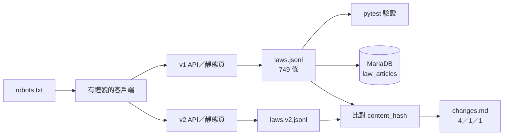

# 17–18｜勞動法規知識蒐集管線

> **定位**：總和 Workshop。把三天學到的東西串成一條完整管線：遵守 robots.txt、依關卡選工具、輸出附來源資訊的資料、寫入 MariaDB、偵測網站改版，並用測試證明結果是對的。

## 範例程式碼

本節是總和 Workshop，沒有新的示範程式。每一項功能都可以從前面的 demo 出發：

| 需要 | 參考 demo | 第幾節 |
|---|---|---|
| 讀 robots.txt、間隔、429 重試 | [`06-polite/polite_get.py`](https://github.com/4-learn/python-web-crawler-demo/blob/main/06-polite/polite_get.py) | 06 |
| 打 API、跟著 `next` 分頁 | [`05-pagination/crawl_law.py`](https://github.com/4-learn/python-web-crawler-demo/blob/main/05-pagination/crawl_law.py) | 03、05 |
| 靜態頁、詳細頁 JSON-LD | [`05-pagination/`](https://github.com/4-learn/python-web-crawler-demo/tree/main/05-pagination) | 04、05 |
| pytest 驗證 | [`14-verify/test_crawler_output.py`](https://github.com/4-learn/python-web-crawler-demo/blob/main/14-verify/test_crawler_output.py) | 14 |
| v1／v2 變動偵測 | [`15-change/detect_changes.py`](https://github.com/4-learn/python-web-crawler-demo/blob/main/15-change/detect_changes.py) | 15 |
| 寫入 MariaDB | [`16-mariadb/load_jsonl.py`](https://github.com/4-learn/python-web-crawler-demo/blob/main/16-mariadb/load_jsonl.py)、[MariaDB 一步一步做](https://github.com/4-learn/python-web-crawler-demo/blob/main/docs/16-mariadb-setup.md) | 16 |
| OpenCode | [OpenCode 安裝與模型設定](https://github.com/4-learn/python-web-crawler-demo/blob/main/docs/opencode-setup.md) | 13 |

- 練習站：<https://4-learn.github.io/crawler-playground/>

---

## 情境

你是 AI 團隊的資料工程師。這三天你已經分別做過：讀 robots.txt、打 API、解析 HTML、用 Playwright 處理動態頁、請 OpenCode 寫爬蟲並驗證、偵測 v2 改版、把 JSONL 寫進 MariaDB。

今天下午，這些零件要組成一條**交得出去的管線**。

---

### 專案背景

團隊的「勞動法規問答系統」下個月要進入測試。問答系統本身由 LLM 小組負責，但它回答得對不對，取決於你交出去的條文資料：

- 少了一條，使用者問到時系統只能亂猜。
- 內容抓錯（例如漏了第二項），系統會引用錯誤的條文。
- 說不出資料從哪裡來、什麼時候抓的，法務不會讓系統上線。
- 法規修正後資料沒更新，系統會一直引用舊條文。

前面各節的程式都是「一次性」的練習。這次要做的是：**任何人拿到你的 repo，照 README 執行，都能得到同樣、可驗證的結果。**

---

### 使用者需求

LLM 小組的組長說：

> 「我們需要練習站上全部 9 部勞動法規的條文，每一條都要能追回原始網址、知道是什麼時候抓的。資料要放進 MariaDB，我們每天會重跑一次，不能越跑越多筆。另外，法規會修正——下次網站改版時，我要一份報告告訴我改了哪幾條，而不是整份重新比一遍。還有，不要再讓網站管理員來信抱怨我們的爬蟲。」

---

### 你的任務

身為資料工程師，你決定開發一個 **勞動法規知識蒐集管線**，目標是：

1. 先讀 robots.txt，全程遵守 `Disallow` 與 `Crawl-delay`。
2. 依關卡選工具：能用 API 的用 API，靜態頁用 requests + bs4，動態頁用 Playwright；並在 README 說明理由。
3. 蒐集練習站 v1 全部 9 部法規、749 條，輸出 `laws.jsonl`。
4. 寫入 MariaDB，重複執行不會產生重複資料。
5. 切換到 `v2/`，產出變動報告 `changes.md`。
6. 用 pytest 證明以上結果正確。

可以使用 OpenCode，但必須附上**規格**、**對話紀錄**（在 OpenCode 輸入 `/export` 匯出），以及**自己寫的驗證測試**（第 13–14 節的規定）。

---

### 技術需求

- **urllib.robotparser**：啟動時讀 robots.txt，每次請求前檢查；間隔依 `Crawl-delay`（第 01、06 節）。
- **requests**：打 JSON API、抓靜態頁；設定 `timeout`、`User-Agent`，遇到 429 依 `Retry-After` 等待（第 03、06 節）。
- **BeautifulSoup**：靜態頁的 CSS selector、分頁、詳細頁 JSON-LD（第 04、05 節）。
- **Playwright**：只在真的需要瀏覽器時使用（第 07–11 節）。
- **hashlib**：`content_hash` = 條文內容的 SHA-256（第 15 節）。
- **MariaDB**：參數化查詢與 upsert，唯一鍵防重複；`fetched_at` 寫入前轉成 UTC（第 16 節）。
- **pytest**：筆數、欄位、抽樣比對、變動報告的自動測試（第 14 節）。

:::warning
課堂上請對**教室版練習站**執行（老師會公布網址，例如 `http://老師IP:8000/`），把網址放在環境變數或設定檔，不要寫死。教室版會記錄碰到 `admin/` 的請求；回家自習才用 GitHub Pages 版，且同樣要遵守 `Crawl-delay: 1`。
:::

---

## 輸入資料格式

練習站的入口與各關卡（詳見前面各節）：

| 來源 | 網址（相對於練習站首頁） | 內容 |
|---|---|---|
| robots.txt | `robots.txt` | `Crawl-delay: 1`；Disallow `v1/admin/`、`v2/admin/` |
| 關卡 1 靜態頁 | `v1/laws/`、`v1/laws/{pcode}/page-N.html`、`v1/laws/{pcode}/articles/{slug}.html` | 列表、每頁 20 條、詳細頁含 JSON-LD |
| 關卡 2 API | `v1/api/laws.json`、`v1/api/laws/{pcode}/page-N.json` | 法規清單與條文，有 `total`、`next` |
| 關卡 3、4 | `v1/dynamic/`、`v1/scroll/` | JavaScript 載入、無限捲動 |
| 關卡 7 v2 | `v2/laws/`、`v2/api/laws.json`、`v2/api/laws/{pcode}/N.json` | 改版後的結構與欄位名稱 |

法規清單 API 回傳的結構（節錄）：

<sub>📄 來源：[`v1/api/laws.json`](https://4-learn.github.io/crawler-playground/v1/api/laws.json) 的結構（節錄，改寫成 Python dict 方便閱讀）</sub>

```python
# v1/api/laws.json
{
    "version": 1,
    "count": 9,
    "laws": [
        {"pcode": "N0030001", "name": "勞動基準法", "modified_date": "...", "article_count": 98},
        ...
    ],
}
```

`laws.jsonl` 每一行是一條條文，**必要欄位**：

| 欄位 | 說明 | 範例 |
|---|---|---|
| `pcode` | 法規代碼 | `N0030001` |
| `law_name` | 法規名稱 | `勞動基準法` |
| `article_no` | 條號 | `第 1 條` |
| `chapter` | 章節（沒有就空字串） | `第一章 總則` |
| `content` | 條文內容，項與項之間以 `\n` 分隔 | `為規定勞動條件最低標準，…` |
| `source_url` | 這條條文的詳細頁網址 | `…/v1/laws/N0030001/articles/1.html` |
| `fetched_at` | 抓取時間（ISO 8601，含時區） | `2026-10-05T04:47:36+00:00` |
| `content_hash` | `content` 以 UTF-8 編碼後的 SHA-256 | `957501de…5aeac` |

可以多加欄位（例如 `slug`、`source_version`），但上面 8 個一個都不能少。

---

## 輸出示例

### 1. `laws.jsonl`

共 749 行，其中一行（排版過，實際是一行）：

<sub>📄 來源：執行參考解答 `collect.py` 產生的 `laws.jsonl` 第一行（換行是為了排版）</sub>

```json
{"pcode": "N0030001", "law_name": "勞動基準法", "slug": "1", "article_no": "第 1 條",
 "chapter": "第一章 總則",
 "content": "為規定勞動條件最低標準，保障勞工權益，加強勞雇關係，促進社會與經濟發展，特制定本法；本法未規定者，適用其他法律之規定。\n雇主與勞工所訂勞動條件，不得低於本法所定之最低標準。",
 "source_url": "https://4-learn.github.io/crawler-playground/v1/laws/N0030001/articles/1.html",
 "fetched_at": "2026-10-05T04:47:36+00:00",
 "content_hash": "957501defbcceb0d1f90248e89399ec52a3ef510303f4d768d672f2b62a5aeac",
 "source_version": "v1"}
```

各法規條數必須與下表完全一致：

<sub>📄 來源：[`v1/api/laws.json`](https://4-learn.github.io/crawler-playground/v1/api/laws.json) 的 `article_count`（2026-11-01 實測）</sub>

```plaintext
pcode     法規                       條數
N0030001  勞動基準法                   98
N0030014  性別平等工作法               50
N0030020  勞工退休金條例               69
N0060001  職業安全衛生法               61
N0090001  就業服務法                   85
N0020007  勞資爭議處理法               67
N0020012  大量解僱勞工保護法           21
N0050031  勞工職業災害保險及保護法    109
N0060014  營造安全衛生設施標準        189
----------------------------------------
共 9 部                              749
```

### 2. MariaDB `law_articles`

第一次與第二次執行寫入程式，資料表筆數都應該是 749：

<sub>📄 來源：執行參考解答 `load_db.py` 兩次的輸出（MariaDB 10.11 實測）</sub>

```plaintext
$ python load_db.py laws.jsonl
讀入 749 筆；資料表 749 列（不重複 749）
$ python load_db.py laws.jsonl
讀入 749 筆；資料表 749 列（不重複 749）
```

（輸出文字不必相同，重點是第二次不會變成 1498。）

:::warning
上課跑過第 16 節的 demo，資料庫裡的 `law_articles` 是**沒有 `source_version` 欄位**的舊表，直接寫入會出現 `Unknown column 'source_version'`。寫入程式要先檢查欄位、沒有就 `ALTER TABLE … ADD COLUMN`（第 16 節延伸題），帳號也要有 `ALTER` 權限。另外，帶時區的 `fetched_at` 要先轉成 UTC，否則會出現 `Incorrect datetime value`。
:::

### 3. `changes.md`（v1 → v2 變動報告）

<sub>📄 來源：執行參考解答 `changes.py` 產生的 `changes.md`</sub>

```markdown
# 練習站 v1 → v2 變動報告

| 類型 | 條數 |
|---|---:|
| 新增 | 1 |
| 刪除 | 1 |
| 修改 | 4 |

## 新增

- 勞動基準法 第 86-1 條（`N0030001#86-1`）

## 刪除

- 大量解僱勞工保護法 第 21 條（`N0020012#21`）

## 修改

- 勞動基準法 第 24 條（`N0030001#24`）
- 勞動基準法 第 38 條（`N0030001#38`）
- 性別平等工作法 第 15 條（`N0030014#15`）
- 職業安全衛生法 第 6 條（`N0060001#6`）
```

格式可以自訂，但三個數字與條號必須正確。v2 的修改是練習站**刻意虛構**的內容，不具法律效力。

### 4. pytest

沒有設定資料庫時（DB 測試 `skip`）：

<sub>📄 來源：在參考解答資料夾執行 `pytest -q`（沒有 `DB_USER`）</sub>

```plaintext
$ pytest -q
.......s                                                                 [100%]
7 passed, 1 skipped in 0.81s
```

設定好 `DB_USER` 等環境變數後應為 `8 passed`。測試的數量與名稱由你決定，但至少要涵蓋下面「你需要實作的功能」第 6 點列出的項目。展示時要在有資料庫的環境跑一次，不能有 `skipped`。

---

## 你需要實作的功能

### 1. 有禮貌的 HTTP 客戶端

- 啟動時讀 robots.txt；讀不到（非 404）時保守地停止，不要當成「全部允許」。
- 每次請求前用 `can_fetch` 檢查，不允許就丟例外，**不送出請求**。
- 兩次請求間隔不小於 `Crawl-delay`；429 時依 `Retry-After` 等待後重試。
- 設定自己的 `User-Agent`（例如 `course-crawler/1.0 (組別名稱)`）。

### 2. 蒐集 v1 全部條文 → `laws.jsonl`

- 法規清單從列表或 API 取得，**不要把 9 個 pcode 寫死**。
- 每部法規抓到的條數要等於清單上的條數，不一致就停止並印出哪一部。
- 至少用**兩種來源**交叉驗證一部法規（例如 API 與靜態頁），證明內容一致。

### 3. 寫入 MariaDB

- 資料表 `law_articles`，以「法規 + 條」為唯一鍵（例如 `pcode` + `slug`）。
- 用參數化查詢與 upsert（`INSERT … ON DUPLICATE KEY UPDATE`），重複執行筆數不變。
- 帳號密碼從環境變數讀取，**不要 commit 進 repo**。

### 4. 偵測 v2 改版 → `changes.md`

- 用同樣的欄位格式蒐集 v2（v2 的頁面結構與 API 欄位名稱都不同，第 15 節已遇過）。
- 以「pcode + 條」對齊兩版，用 `content_hash` 判斷是否修改。
- 輸出新增、刪除、修改的條數與條號。

### 5. README

- 執行步驟（從空資料夾到產出全部檔案）。
- **每一關選用的工具與理由**，包括「沒有使用」的關卡為什麼不用。
- 若使用 OpenCode：附規格與對話紀錄（`/export`），並寫出至少一個你發現 AI 寫錯或沒考慮到的地方。

### 6. pytest 至少要驗證

| 項目 | 怎麼驗 |
|---|---|
| 總筆數 749 | 與練習站 API 清單的 `article_count` 加總比對，不要只寫死 749 |
| 各法規條數 | 9 部逐一比對 |
| 欄位完整、hash 正確 | 8 個必要欄位都在、`content` 不為空、重算 SHA-256 相同 |
| 沒有重複 | 「法規 + 條」不重複 |
| 沒碰 admin | 所有 `source_url` 都不含 `/admin/` |
| 抽樣比對原文 | 隨機抽幾條，打開 `source_url` 的詳細頁，比對 JSON-LD 的內容 |
| 變動報告 | 新增 1、刪除 1、修改 4，且條號正確 |
| DB 不重複 | 連續寫入兩次，筆數相同 |

使用方式（範例）：

<!-- fn-table -->
| 函式名稱 | 說明 | 官方文件連結 |
|---|---|---|
| `export 名稱=值` | （bash）設定環境變數，之後執行的程式都讀得到 | [文件](https://www.gnu.org/software/bash/manual/html_node/Bourne-Shell-Builtins.html#index-export) |
| `pytest -q／-v／--tb=short` | `-q` 精簡輸出、`-v` 列出每個測試、`--tb=short` 失敗訊息簡短 | [文件](https://docs.pytest.org/en/stable/how-to/output.html#verbosity) |

```bash
export PLAYGROUND=http://老師IP:8000/
python collect.py                  # → laws.jsonl
export DB_USER=... DB_PASS=... DB_NAME=crawler_course
python load_db.py laws.jsonl       # 執行兩次，筆數不變
python changes.py                  # → changes.md
pytest -q
```

檔名與拆法可以不同，README 寫清楚即可。

### 提示

1. **先估算請求數**。749 條如果逐條開詳細頁，以 `Crawl-delay: 1` 計至少 12 分鐘；用 API 每頁 20 條，v1 只需要約 50 個請求（實測參考解答 51 個請求、51 秒，v2 約 35 秒）。選工具時把「請求數」也算進理由。
2. **關卡 3、4 背後是什麼？** 回想第 02、09 節在 DevTools 看到的請求。如果動態頁背後就是關卡 2 的 API，開瀏覽器只是更慢、更容易壞。但若你選擇用 Playwright 攔截回應，也可以，README 說得出理由即可。
3. **條號不一定是整數**。練習站有 `86-1`、`1-1` 這類條號，對齊 v1／v2 時不要轉成 `int`。
4. **hash 要算在「內容」上**，而不是整筆資料；否則每次 `fetched_at` 不同，每一條都會被判定為「修改」。
5. **筆數歸零要報警**。v2 換了結構，舊的選擇器會安靜地回傳 0 筆——這正是第 15 節的教訓。
6. 讓 OpenCode 寫程式前，先把本頁的欄位表、條數表、「不能做的事」寫進規格。實測：OpenCode 照規格完成「v1／v2 全站比對」約 15 分鐘（第 15 節），要預留時間；卡住時用 `/models` 換模型。

---

## 分組與展示

- 2–3 人一組，共用一個 repo；commit 紀錄要看得出每個人的貢獻。
- 第 18 節最後 20 分鐘，每組 **3 分鐘** 展示：
  1. 現場執行 `pytest -q`（或展示剛跑完的結果）。
  2. 說明一個「工具選擇」的理由。
  3. 說明一個你們發現並修好的錯誤（可以是 AI 寫錯的）。
- 展示期間老師會同時看教室版練習站的終端機，確認沒有你們組的 `[robots]` 紀錄。

## 評分表

| 項目 | 配分 | 通過標準 |
|---|---:|---|
| README 工具選擇理由 | 20 | 每一關（含不使用的關卡）都有理由；「全部開瀏覽器解析 DOM」但說不出理由者不給分 |
| 筆數與內容正確 | 25 | 749 條、9 部條數與上表一致；至少一部法規以兩種來源交叉驗證 |
| 遵守 robots.txt | 15 | 老師畫面無 `[robots]` 紀錄；`source_url` 不含 `admin/`；間隔符合 `Crawl-delay` |
| 變動報告 4／1／1 | 15 | `changes.md` 數字與條號正確 |
| pytest 全部通過 | 15 | 涵蓋上方 8 個驗證項目，且全部通過 |
| DB 不重複 | 10 | 連續執行兩次，`law_articles` 仍為 749 列 |
| **合計** | **100** | |

:::info
使用 OpenCode 不扣分；但沒有附規格與對話紀錄、或測試是 AI 寫好後原封不動交出（說不出每個測試在驗什麼），「pytest」一項不給分。
:::

---

## 流程說明



---

## 解答

- [解答](https://github.com/4-learn/python-web-crawler-workshop/tree/master/2026/17-18)

主要檔案：
- `README.md` - 執行步驟、各關卡的工具選擇理由、驗收對照
- `collect.py` - 蒐集 v1 全部條文並交叉驗證，輸出 `laws.jsonl`
- `polite.py` - 遵守 robots.txt、`Crawl-delay` 與 `Retry-After` 的共用客戶端
- `load_db.py` - 寫入 MariaDB（upsert）
- `changes.py` - 蒐集 v2 並產出 `changes.md`
- `test_pipeline.py` - pytest 驗證
