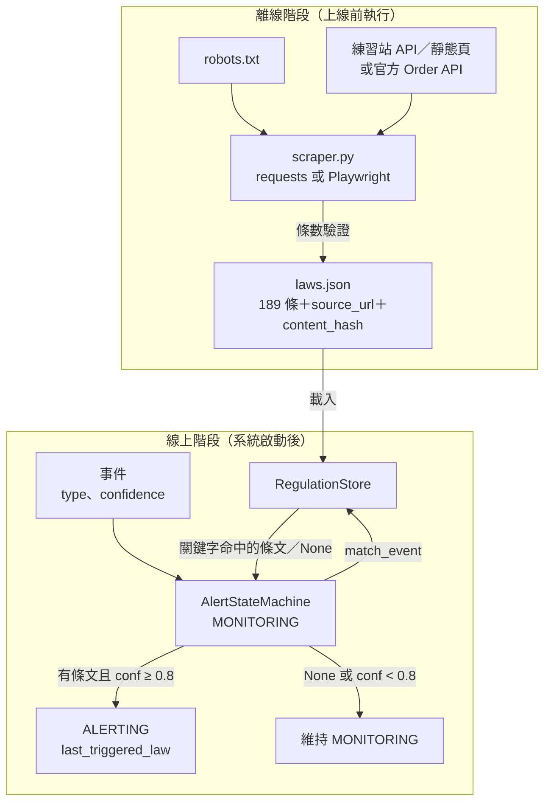
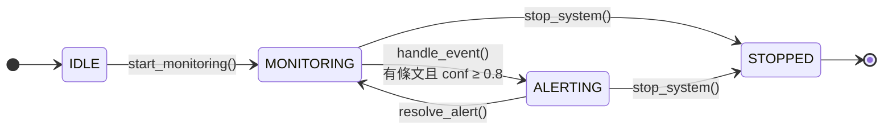

# 事件驅動告警系統 Ch02：法規知識蒐集與載入（改版）

> **承接**：[Ch01 狀態機](https://github.com/4-learn/event-driven-alert-system/tree/ch-01-state-machine)——`AlertStateMachine` 有 `IDLE → MONITORING → ALERTING → STOPPED` 四個狀態，`handle_event` 只認 `intrusion` 且 `confidence >= 0.8` 的事件。目前的 Ch02 分支（[`ch-02-knowledge-collection`](https://github.com/4-learn/event-driven-alert-system/tree/ch-02-knowledge-collection)）加入了 `RegulationStore` 與 `laws.json`。
> **目標**：用本課學到的「先找 API、遵守 robots.txt、可驗證」方式重做 Ch02 的資料蒐集，並讓 `RegulationStore.match_event` 真正依事件內容找出相關條文。`laws.json` 原有的 4 個欄位不變，Ch03 之後的章節照常使用。

---

## 情境

工地裝了攝影機，影像辨識模型（後續章節）會丟出事件：「有人在高處邊緣」「有人在開挖區」。系統收到事件時，要能說出**依據哪一條法規**告警。

這些法規不是事件發生時才去查的。系統上線前，必須先由一個**離線流程**把條文蒐集好、存成 `laws.json`；上線後，狀態機只讀這份已準備好的資料——這正是第 01 節說的「爬蟲是離線資料供應者」。

> 核心概念：離線蒐集條文（laws.json）→ 載入 RegulationStore → Event → match_event 找出條文 → 狀態機 MONITORING → ALERTING

目前的 Ch02 分支已經有這個架構，但有三個問題：

| 目前的做法 | 問題 |
|---|---|
| 用 Selenium 爬 `law.moj.gov.tw` 的網頁 | 該網站 robots.txt 是 `Disallow: /`，與本課第 01 節的規則矛盾；而且官方另有開放資料 API |
| 需要安裝 Chrome 與 `webdriver_manager` | 4GB 的 VM 跑瀏覽器又慢又容易壞；Selenium 4.6 起也不再需要 `webdriver_manager` |
| `match_event` 只要是 `intrusion` 就回傳**第一條** | 第 1 條是「本標準依職業安全衛生法第六條…訂定之」，跟任何事件都無關；告警說不出真正的依據 |

另外，分支 README 的範例輸出寫著「Found 189 rows」卻「Total articles scraped: 174」，接著「Loaded 174 regulations」——少了 15 條也沒有人發現（分支裡實際存的 `laws.json` 又是 188 條）。這就是第 14 節說的：**沒有驗證，就不知道抓錯了。**

---

## 題目

在 **Ch01／Ch02 分支的狀態機** 的基礎上，加入 **合規的條文蒐集、可驗證的 `laws.json`，以及依關鍵字比對的 `match_event`**。

`AlertStateMachine`（`main.py`）沿用 Ch02 分支，**不需要修改**：它在 `MONITORING` 狀態收到事件時，呼叫 `regulation_store.match_event(event)`，有條文且 `confidence >= 0.8` 才進入 `ALERTING`，並把條文記在 `last_triggered_law`。

### 資料格式

**資料來源**（擇一）：

| 來源 | 網址 | 說明 |
|---|---|---|
| 爬蟲練習站（建議） | `https://4-learn.github.io/crawler-playground/v1/api/laws/N0060014/page-N.json`，或靜態頁 `v1/laws/N0060014/` | 「營造安全衛生設施標準」，189 條 |
| 官方 Order API | `https://law.moj.gov.tw/api/Ch/Order/JSON` | ZIP（約 25 MB）內含全部命令的 `ChOrder.json`，從中找出 `N0060014`；條數以當時官方資料為準（2026-11-02 實測也是 189 條） |

**不可以**爬 `law.moj.gov.tw` 的網頁（`LawClass/LawAll.aspx`）。

**`laws.json`**：一個 JSON 陣列，每條條文一個物件。前 4 個欄位與 Ch02 分支**完全相同**，後 2 個是新增的：

```python
# laws.json 的一個元素
law = {
    # ── 原有欄位（不可改名、不可改格式）──
    "chapter": "第一章 總則",
    "article_number": "第 1 條",
    "article_link": "第 1 條",
    "content": "本標準依職業安全衛生法第六條第三項規定訂定之。\n本標準未規定者，適用其他有關職業安全衛生法令之規定。",
    # ── 新增欄位 ──
    "source_url": "https://4-learn.github.io/crawler-playground/v1/laws/N0060014/articles/1.html",
    "content_hash": "cbe085ef60e2c548a7cd8bca78e0574d646ddc75dd8fa076e02101db541085ee",
}
```

| 欄位 | 規則 |
|---|---|
| `chapter` | 章節名稱；沒有章節時用空字串 |
| `article_number` | 格式 `第 N 條`（中間有半形空白），例如 `第 1-1 條` |
| `article_link` | 與 Ch02 分支相同，填條號文字 |
| `content` | 條文內容，項與項之間以 `\n` 分隔 |
| `source_url` | 這條條文可以回查的網址（練習站用詳細頁網址） |
| `content_hash` | `content` 以 UTF-8 編碼後的 SHA-256 十六進位字串 |

**事件**：與 Ch01 相同的字典：

```python
event = {"source": "camera_01", "type": "fall", "confidence": 0.92}
```

### 需要實作

1. **`scraper.py`：蒐集條文 → `laws.json`**
   - 用 requests（API 或 requests + bs4）或 Playwright 其中一種，**不使用 Selenium、不安裝 `webdriver_manager`**。
   - 啟動時讀 robots.txt，遵守 `Disallow` 與 `Crawl-delay: 1`；設定 `timeout` 與自己的 `User-Agent`。
   - 跟著分頁走到最後一頁（API 看 `next`／`total_pages`，靜態頁看 `a.next`），不要把頁數寫死。
   - 條數要與來源公布的總數（API 的 `total`、頁面上的條文數）一致，不一致就報錯，**不要默默存檔**。
   - `json.dump(..., ensure_ascii=False, indent=2)`，中文不可變成 `\uXXXX`。

2. **`regulation_store.py`：`RegulationStore`**
   - 從 `main.py` 拆出來成為獨立模組，`main.py` 改成 `from regulation_store import RegulationStore`（或維持在同一檔，README 說明即可）。
   - 注意：分支裡的 `run_system.py` 已經寫了 `from regulation_store import RegulationStore`，但分支沒有這個檔案，直接執行會 `ModuleNotFoundError`。拆出 `regulation_store.py` 正好解決這個問題。
   - `__init__(laws)`、`list_articles()` 與 Ch02 分支相同。
   - `match_event(event)`：依事件類型對應的**關鍵字**，在條文 `content` 中尋找，回傳一條相關條文（`dict`）；找不到回傳 `None`。
   - 至少支援兩種事件：`fall` → 「墜落」、`excavation` → 「開挖」。對應表放在程式裡（例如一個 dict），新增事件類型時只改這張表。
   - 同一個關鍵字可能出現在很多條（「墜落」15 條、「開挖」26 條）。**選哪一條由你決定**（第一條命中、命中次數最多…），但要在 README 寫出你的策略。

3. **`run_system.py`：示範 4 種事件**
   - 載入 `laws.json`，每個事件建立一台新的狀態機，`start_monitoring()` 後呼叫 `handle_event()`，印出事件類型、信心度、最後狀態、觸發的條文。
   - 4 個事件見下方「預期輸出」。

4. **測試（`test_*.py`，pytest）**，至少包含：
   - `laws.json` 條數等於來源的總數（從 API 取，不要寫死 189）。
   - 每一筆都有 4 個原有欄位，`article_number` 符合 `第 N 條` 格式，`content_hash` 重算後相同。
   - 條號不重複。
   - `fall`、`excavation` 回傳的條文內容各自包含「墜落」「開挖」。
   - `unknown` 事件回傳 `None`；空的 `RegulationStore([])` 回傳 `None`。

5. **README**
   - 資料來源與選擇理由、執行步驟、`match_event` 的比對策略。
   - 若使用 AI 工具：附上對話紀錄（依〈上課須知〉；OpenCode 用 `/export` 匯出）。

### 處理規則

| 狀態／條件 | 行為 |
|---|---|
| 事件 `type` 有對應關鍵字，且有條文的 `content` 包含該關鍵字 | `match_event` 回傳一條條文；**回傳的條文內容須包含關鍵字**（條號不限） |
| 事件 `type` 沒有對應關鍵字（例如 `unknown`） | `match_event` 回傳 `None` |
| `RegulationStore` 是空的 | `match_event` 回傳 `None`，不可丟例外 |
| `match_event` 有結果，且 `confidence >= 0.8` | 狀態機 `MONITORING → ALERTING`，`last_triggered_law` 為該條文 |
| `match_event` 有結果，但 `confidence < 0.8` | 不觸發，維持 `MONITORING` |
| `match_event` 回傳 `None`（不論信心度多高） | 不觸發，維持 `MONITORING` |
| 爬到的條數與來源總數不一致 | `scraper.py` 報錯結束，不覆蓋原本的 `laws.json` |
| robots.txt 不允許的網址 | 不送出請求 |

---

## 預期輸出

### 正常流程

執行爬蟲（使用練習站 API 時，約 10 個請求、10 秒左右）：

<sub>📄 來源：在 Ch02 分支放入參考解答後執行 `python scraper.py` 的輸出（中間省略；實測 12 秒）</sub>

```plaintext
$ python scraper.py
第 1/10 頁，累計 20 條
第 2/10 頁，累計 40 條
...
第 10/10 頁，累計 189 條
已儲存 laws.json，共 189 條
```

執行系統：

<sub>📄 來源：執行參考解答 `python run_system.py` 的輸出</sub>

```plaintext
$ python run_system.py
Loaded 189 regulations
fall       conf=0.92 → ALERTING   第 17 條 雇主對於高度二公尺以上之工作場所，勞工作業有墜落之虞者，應訂…
excavation conf=0.85 → ALERTING   第 64 條 雇主僱用勞工以人工開挖方式從事露天開挖作業，其自由面之傾斜度…
unknown    conf=0.99 → MONITORING （無）
fall       conf=0.50 → MONITORING （無）
```

輸出格式可以不同。前兩行的**條號依你的比對策略而定**，不一定是第 17 條、第 64 條；但印出的條文必須分別包含「墜落」「開挖」。

執行測試：

<sub>📄 來源：在參考解答資料夾執行 `pytest -q` 的輸出</sub>

```plaintext
$ pytest -q
.......                                                                  [100%]
7 passed in 0.27s
```

### 邊界情況

```plaintext
# 1. 未知事件：信心度再高也不告警
unknown    conf=0.99 → MONITORING （無）

# 2. 有相關條文，但信心度不足
fall       conf=0.50 → MONITORING （無）

# 3. 空的知識庫
>>> RegulationStore([]).match_event({"type": "fall"})
None

# 4. 條數不一致（例如漏抓最後一頁）
$ python scraper.py
...
RuntimeError: 只抓到 180 條，來源公布 189 條
```

第 4 種的錯誤訊息文字由你決定，重點是**程式停下來**，而不是存出一份少了 9 條的 `laws.json`。

---

## 解答

- [解答](https://github.com/4-learn/python-web-crawler-workshop/tree/master/2026/homework-ch02)

解答只包含會變動的檔案（`scraper.py`、`regulation_store.py`、`run_system.py`、測試）；`main.py` 沿用 Ch02 分支。

## 繳交

- **GitHub repo 或雲端資料夾**，含 `scraper.py`、`laws.json`、`regulation_store.py`、`run_system.py`、測試與 README。
- 依〈上課須知〉：可以使用 AI 工具，請**附上對話紀錄**（OpenCode 用 `/export` 匯出；ChatGPT 等也可以）。
- 沒做完也要交：交出目前的「屍體」，在 README 寫明**卡在哪裡**、試過什麼、錯誤訊息是什麼。卡住的紀錄本身就有價值。

---

## 延伸思考

1. 關鍵字比對的極限在哪？例如「人員從鋼梁上摔下來」不含「墜落」二字；反過來，含「墜落」的條文也不一定在講人（可能是物體墜落）。後面的 LLM 課會用什麼方法改善？
2. 官方法規修正後，`laws.json` 要怎麼更新？用 `content_hash` 可以怎麼只找出「改了哪幾條」（參考第 15 節）？哪些模組需要重新執行？
3. 告警訊息附上 `source_url` 有什麼好處？如果使用者點進去發現條文與告警內容不同，代表什麼？
4. Ch02 分支的範例輸出「Found 189 rows」卻只存了 174 條。你的 `scraper.py` 能避免這種錯誤嗎？你的哪一個測試會抓到它？
5. 如果事件同時符合多條條文，告警應該只附一條，還是全部？這會影響 Ch03 之後的哪些設計？

---

## 流程說明





`handle_event()` 沒有條文、或信心度不到 0.8 時，狀態**不變**，維持 `MONITORING`（圖上不另外畫箭頭）。
