# OpenCode 安裝與模型設定：big-pickle ＋ NVIDIA build

> **用途**：第 13、14 節要用 OpenCode 讓 AI 寫爬蟲。本篇帶你從安裝開始，接上兩個免費的模型來源，學會隨時換模型，最後在 OpenCode 的聊天視窗裡跑完第 13 節的課程範例。
>
> 以下每一張截圖，都是在 Ubuntu 上實際執行的結果（2026-11-01，OpenCode 1.19.5）。帳號名稱以 `student` 為例。

## 為什麼同時掛兩個模型來源

| 來源 | 要不要金鑰 | 額度 | 本課用法 |
|---|---|---|---|
| **OpenCode 免費模型**（例如 Big Pickle） | 不用 | OpenCode 提供，用完會跳出 `Free limit reached`；全班共用同一個網路時可能比較快用完 | 裝好就能用 |
| **NVIDIA build** | 要，到 build.nvidia.com 免費申請 | 個人帳號各自計算 | 主要使用；Big Pickle 用完時切過來 |

兩邊的額度分開計算，一邊用完就換另一邊。換模型在聊天視窗裡輸入 `/models` 就好（第 6 步）。

---

## 第 1 步：安裝 OpenCode

在終端機執行官方安裝指令：

```bash
curl -fsSL https://opencode.ai/install | bash
```

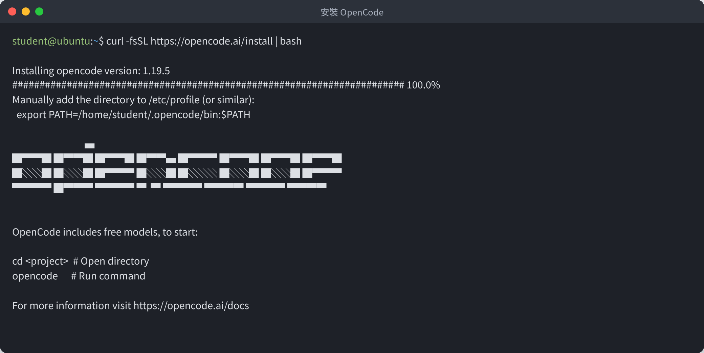

最後看到 OpenCode 的大字標誌就是裝好了。注意中間這行：

```text
Manually add the directory to /etc/profile (or similar):
  export PATH=/home/student/.opencode/bin:$PATH
```

意思是安裝程式**沒有幫你把 `opencode` 加進 PATH**，下一步要自己加。

## 第 2 步：設定 PATH，確認版本

```bash
echo 'export PATH=$HOME/.opencode/bin:$PATH' >> ~/.bashrc
source ~/.bashrc
opencode --version
```

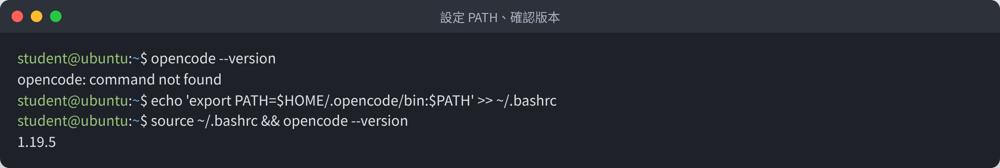

第一行 `opencode: command not found` 是**還沒設 PATH** 的樣子；寫進 `~/.bashrc`、`source` 之後就找得到了。看到版本號（例如 `1.19.5`）就代表安裝完成。

:::info
`~/.bashrc` 是每次開終端機都會執行的設定檔。寫進去之後，之後開新的終端機也找得到 `opencode`。
:::

## 第 3 步：打開 OpenCode，問 Big Pickle 一句話（不需要金鑰）

建一個資料夾，在裡面輸入 `opencode`，就會進入 OpenCode 的**聊天視窗**：

```bash
mkdir ~/oc-test && cd ~/oc-test
opencode
```

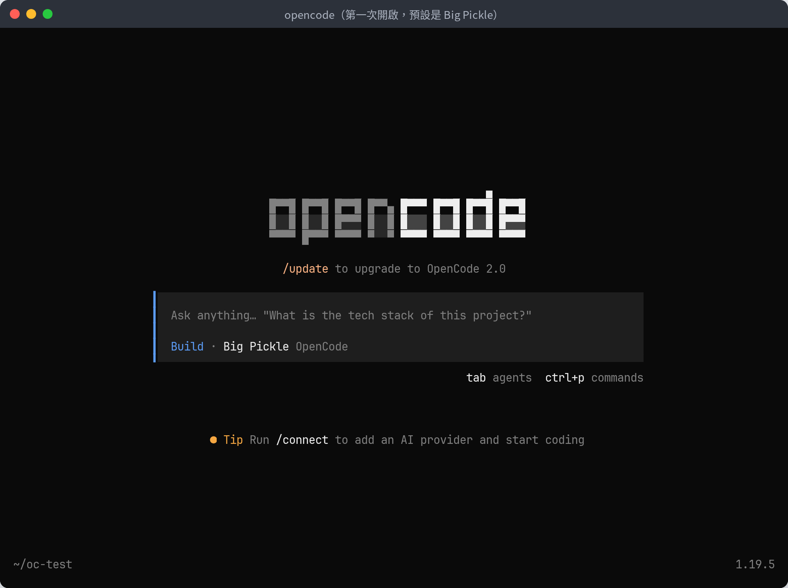

畫面中間是輸入框，下面那行 `Build · Big Pickle OpenCode` 告訴你：

| 位置 | 意思 |
|---|---|
| `Build` | 目前的模式：Build 會真的改檔案、執行指令；按 `Tab` 可以切到 Plan（只提計畫、不改檔案） |
| `Big Pickle` | 目前用的模型 |
| `OpenCode` | 模型的來源（提供者） |

第一次開啟還沒接任何金鑰，預設就是免費的 Big Pickle。在輸入框打一句話，按 `Enter` 送出：

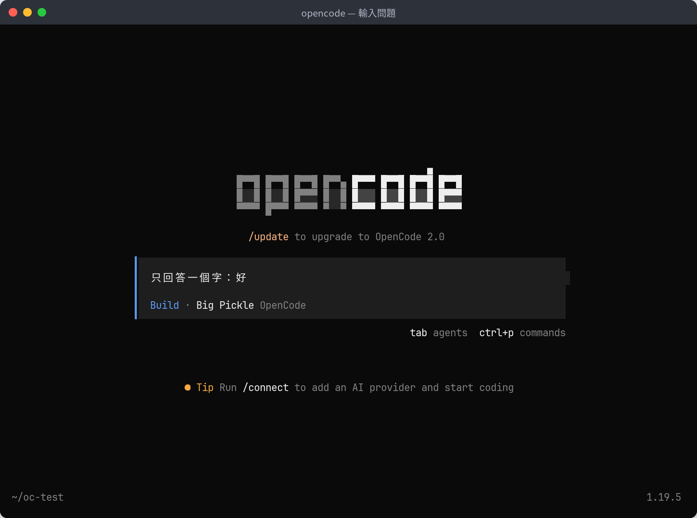

正常的話，AI 會在上方回答，下面出現 `▣ Build · Big Pickle · 幾秒`。

**額度用完時長這樣**：跳出 `Free limit reached`，底部顯示 `Free usage exceeded`：

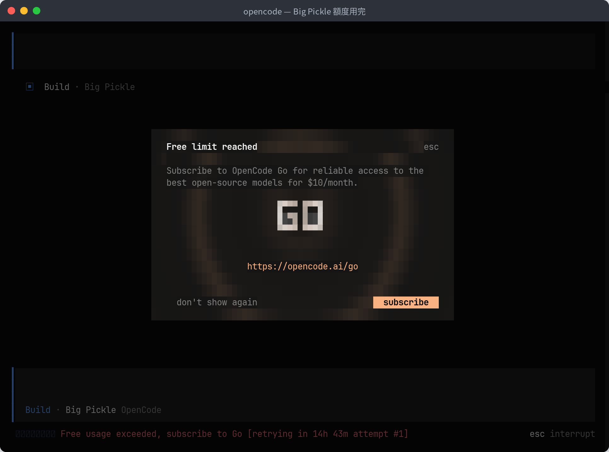

:::warning
這張截圖就是額度用完的實際畫面：撰寫本篇時，這台電腦所在網路的 Big Pickle 免費額度已經用完。**上課時全班共用同一個對外網路，也可能遇到一樣的情況**。這時按 `Esc` 關掉提示，改用下一步的 NVIDIA build，不需要付費訂閱。
:::

## 第 4 步：申請 NVIDIA build 金鑰

1. 打開 <https://build.nvidia.com/>，右上角按 **Login**。

   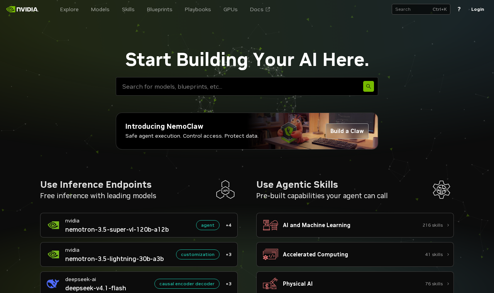

2. 輸入 Email 註冊或登入（免費）。

   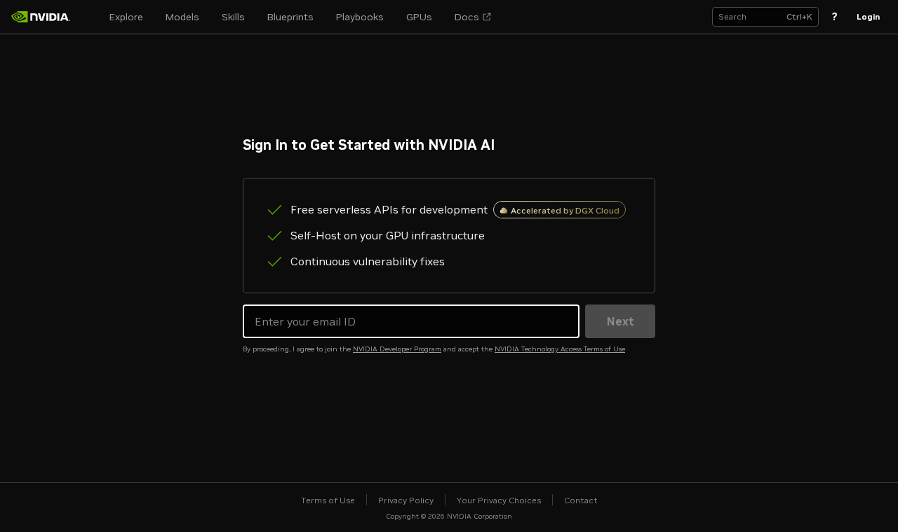

3. 登入後到 **Settings → API Keys**（<https://build.nvidia.com/settings/api-keys>），按 **Generate API Key**，複製產生的金鑰。金鑰以 `nvapi-` 開頭。

:::warning
金鑰等同於密碼：

- 只貼進 OpenCode，不要寫進程式、`SPEC.md`，不要 commit 到 GitHub、不要貼到聊天室。
- 外流了就到同一頁刪掉，再產生一把新的。
:::

## 第 5 步：用 `/connect` 接上 NVIDIA

在 OpenCode 聊天視窗的輸入框打 `/connect`，按 `Enter`，會列出可以接的提供者：

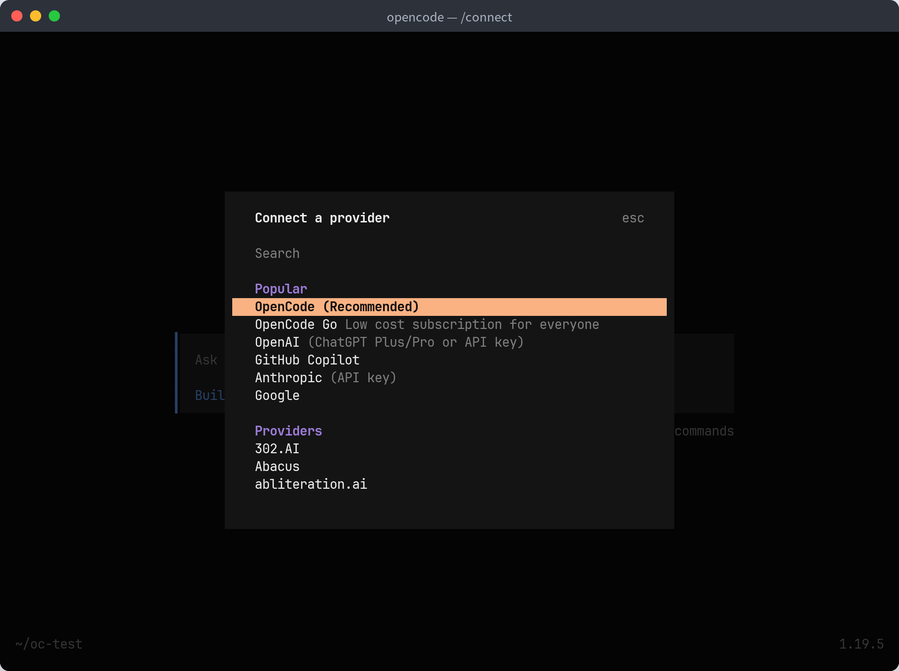

直接打字搜尋 `nvidia`，按 `Enter` 選它：

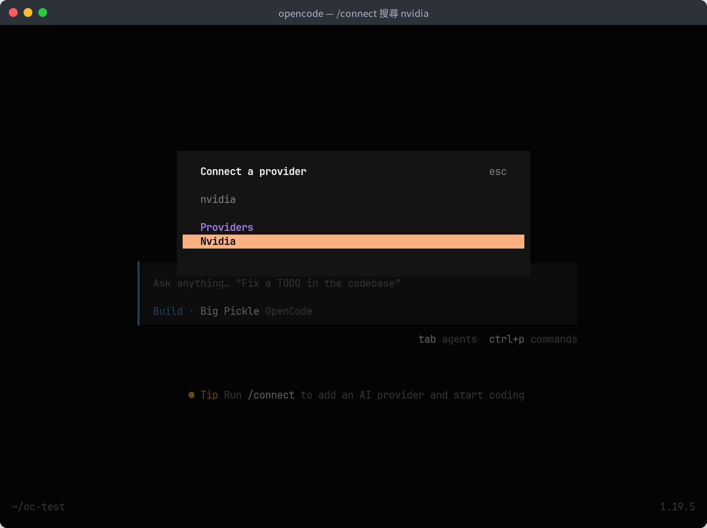

出現 `API key` 輸入框：

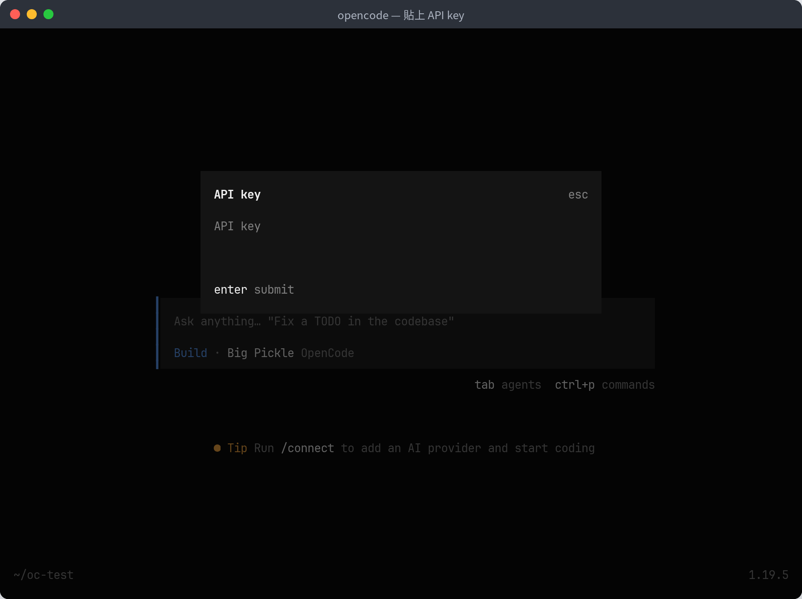

貼上第 4 步複製的金鑰（`Ctrl+Shift+V` 或滑鼠右鍵貼上），按 `Enter`：

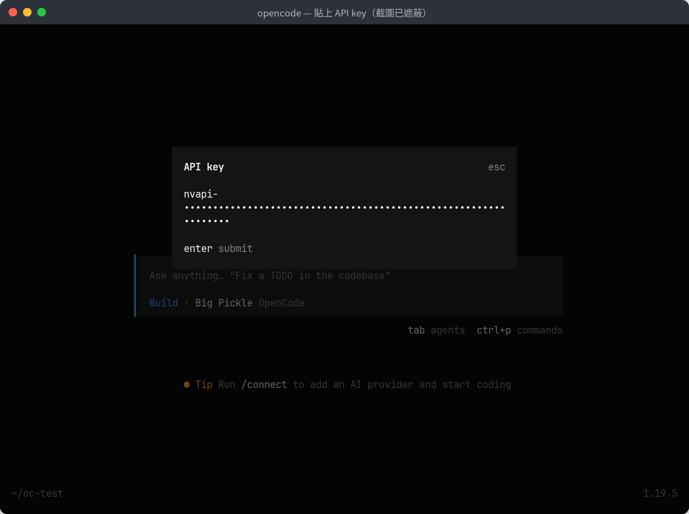

（截圖中的金鑰已經遮蔽；你的畫面會顯示完整的金鑰。）

接上之後，OpenCode 會直接列出 NVIDIA 上可以用的模型，請你選一個：

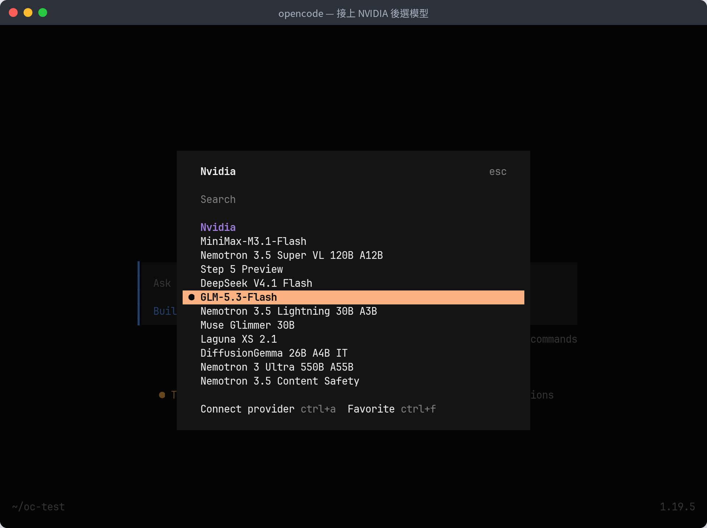

先按 `Esc` 關掉，下一步再教怎麼選。金鑰存在 `~/.local/share/opencode/auth.json`，之後打開 OpenCode 不用再輸入。

## 第 6 步：用 `/models` 換模型

輸入 `/models`，按 `Enter`，會列出**所有已接上的模型**：最上面是 OpenCode 的免費模型，下面是 NVIDIA 的模型。目前使用中的模型前面有 `●`。

直接打字可以搜尋。例如打 `deepseek v4.1`，會出現兩個同名的模型，**右邊標示來源**：

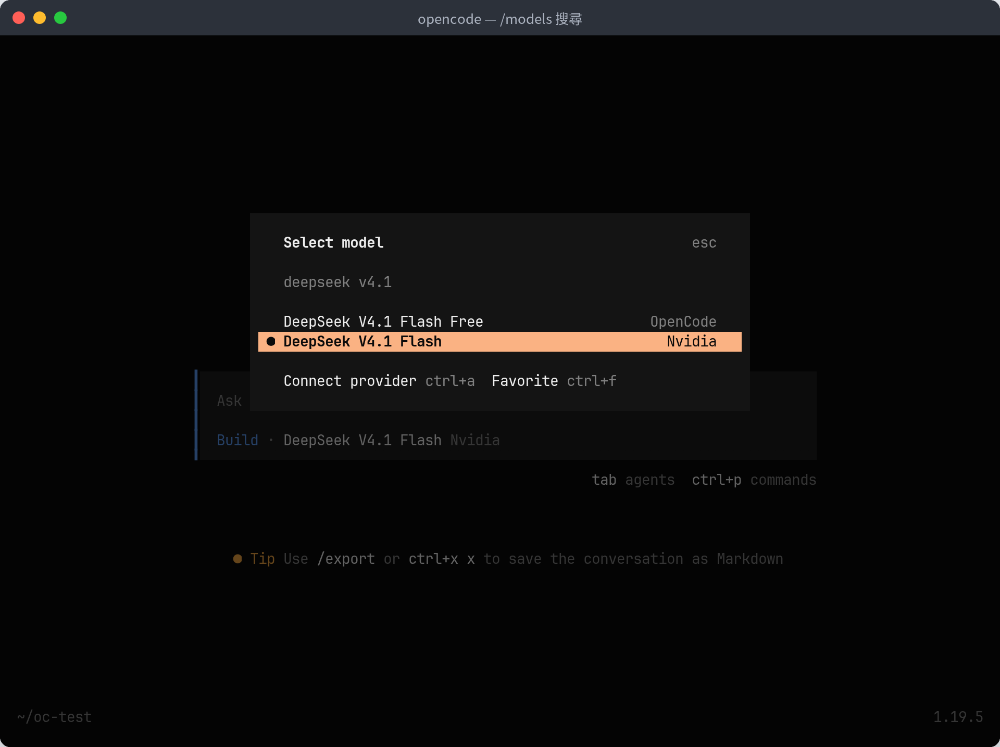

| 右邊顯示 | 來源 | 額度 |
|---|---|---|
| `OpenCode`（名稱有 `Free`） | OpenCode 免費模型 | 共用，可能用完 |
| `Nvidia` | NVIDIA build | 你自己的金鑰 |

用 `↓` 移到 **Nvidia** 那一行，按 `Enter`。有些模型會再問 **variant**（思考的深淺），選 `Default` 按 `Enter` 就好：

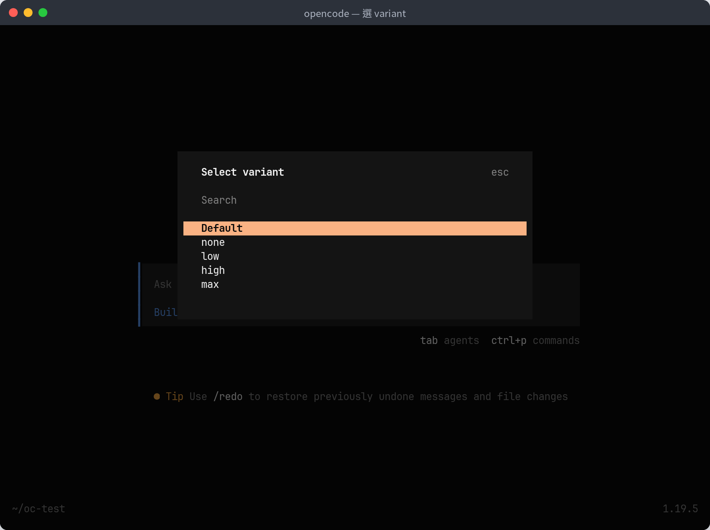

輸入框下面變成 `Build · DeepSeek V4.1 Flash Nvidia`，就是換好了。問一句話試試：

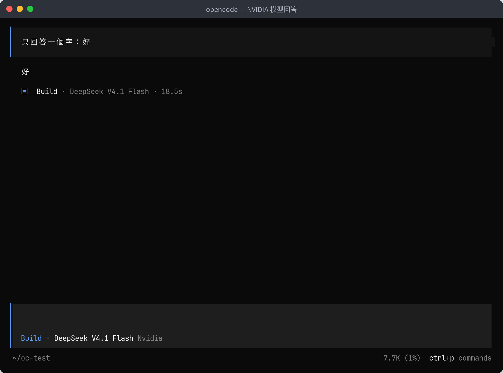

回答下面的 `▣ Build · DeepSeek V4.1 Flash · 18.5s` 代表這次是用 NVIDIA 的模型回答，花了 18.5 秒。

:::warning
NVIDIA 上的模型會更新、也會下架。**上課前以老師公布的模型為準**。選了模型卻一直沒有回應或出現錯誤，就用 `/models` 換一個。
:::

### 設定預設模型（選用）

OpenCode 會記住你上次選的模型。如果想固定一個預設模型，可以寫進設定檔 `~/.config/opencode/opencode.json`：

```bash
mkdir -p ~/.config/opencode
cat > ~/.config/opencode/opencode.json <<'JSON'
{
  "$schema": "https://opencode.ai/config.json",
  "model": "nvidia/deepseek-ai/deepseek-v4.1-flash",
  "small_model": "nvidia/deepseek-ai/deepseek-v4.1-flash"
}
JSON
```

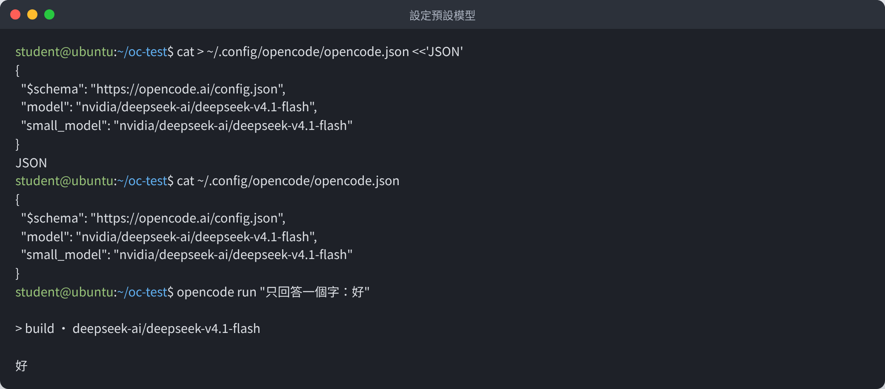

| 欄位 | 用途 |
|---|---|
| `model` | 主要的模型，寫程式、回答問題用 |
| `small_model` | 做小事用的模型，例如幫對話取標題。不設的話 OpenCode 會自己挑一個免費模型，額度用完時會一直出現錯誤訊息 |

模型名稱的格式是 `提供者/模型`，可以用 `opencode models nvidia` 查詢。

---

## 第 7 步：跑第 13 節的課程範例

### 準備資料夾與規格

```bash
cd ~
mkdir lay-off-crawler && cd lay-off-crawler
cp ~/python-web-crawler-demo/13-opencode/SPEC.md .
```

（`~/python-web-crawler-demo` 換成你 clone demo repo 的位置。）

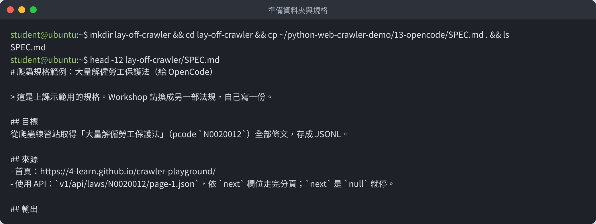

### 打開 OpenCode，貼上請求

在 `lay-off-crawler` 資料夾裡輸入 `opencode`，確認輸入框下面是 NVIDIA 的模型，貼上這段請求，按 `Enter`：

```text
請閱讀 SPEC.md，照規格寫 crawler.py，完成後執行一次並把輸出筆數告訴我。不要修改 SPEC.md。
```

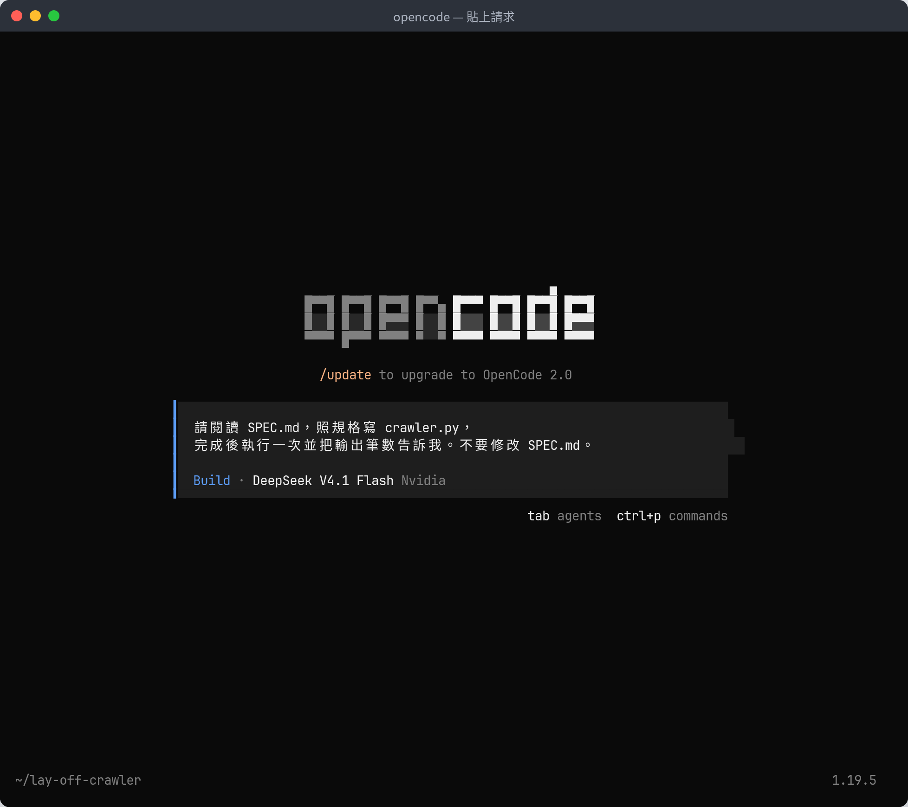

### 看 AI 工作

AI 會一邊思考、一邊讀檔案、上網查資料、寫程式、執行指令。工作中底部會顯示 `esc interrupt`，想中斷就按 `Esc`：

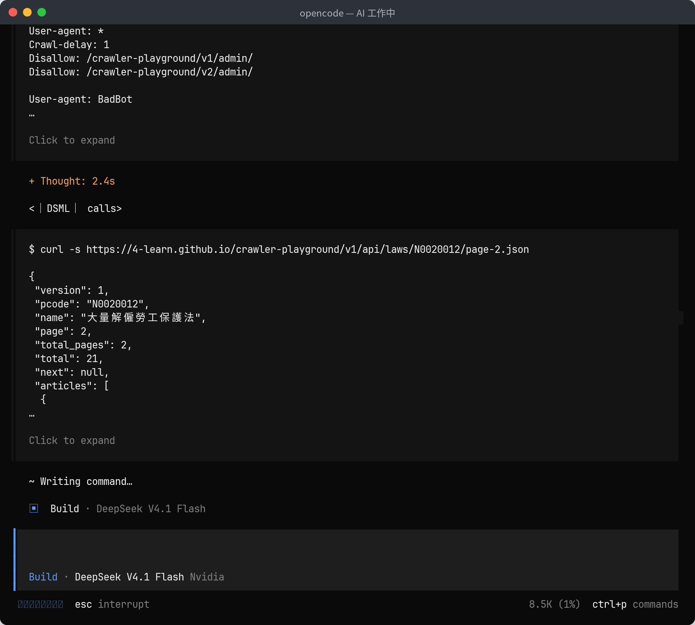

這張截圖裡，AI 正在讀 `robots.txt`、用 `curl` 看 API 的第 2 頁（`"total": 21`、`"next": null`）。畫面上常見的標記：

| 標記 | 意思 |
|---|---|
| `→ Read 檔名` | 讀檔案 |
| `$ 指令` | 在終端機執行指令，下面是輸出 |
| `← Write 檔名`、`← Edit 檔名` | 寫檔案、改檔案 |
| `+ Thought: 幾秒` | AI 思考了多久 |
| `Click to expand` | 內容太長被收起來，用滑鼠點一下可以展開 |

完成時，最下面會出現總結和 `▣ Build · 模型 · 花費時間`：

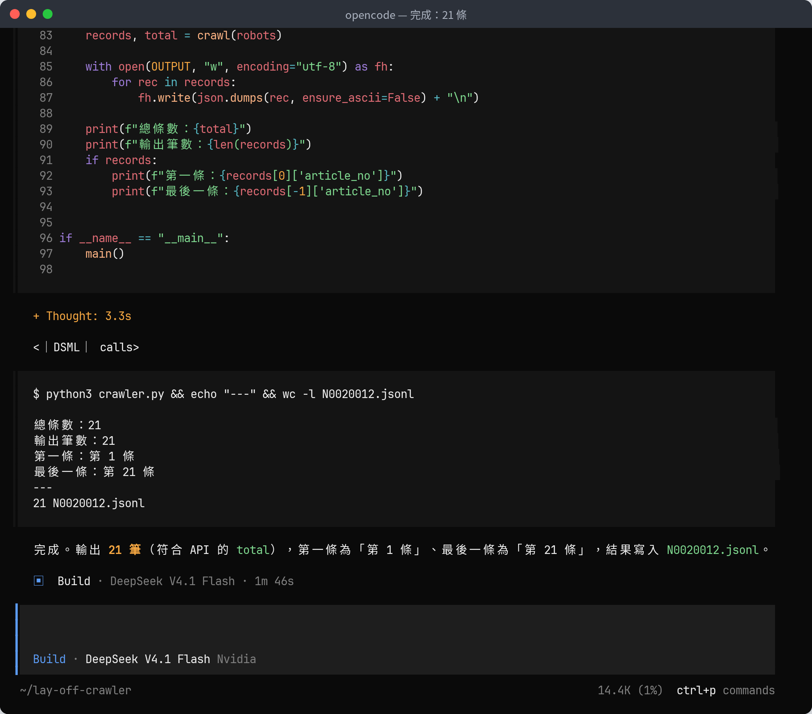

AI 寫好 `crawler.py`、自己執行，得到 **21 條**，第 1 條到第 21 條，`wc -l` 也是 21 行。這次花了 1 分 46 秒。

:::info
畫面上偶爾出現的 `<｜DSML｜ calls>` 是這個模型的內部標記，不影響結果，可以忽略。
:::

### 自己驗收

**AI 說「完成了」不算數，要自己驗收**（第 13 節第 8 段）。開另一個終端機，或按 `Ctrl+C` 離開 OpenCode：

```bash
python3 crawler.py
wc -l N0020012.jsonl
head -n 1 N0020012.jsonl
grep -n 'robots' crawler.py | head -3
grep -n 'sleep' crawler.py
grep -nE '\b21\b|range\(' crawler.py || echo '（沒有寫死 21 或 range）'
```

再打開 `crawler.py` 讀一遍，對照 `SPEC.md` 的「限制」逐條檢查。這次的程式條數、robots.txt、間隔、沒有寫死數字都對，**但 User-Agent 寫成 `course-crawler/1.0 (opencode)`**，SPEC 要求的是 `(你的暱稱)`。

:::info
AI 每次寫出來的程式都不一樣。另一次實測時，AI 用了 `parser.read()` 讀 robots.txt，就是第 06 節教過的陷阱。所以每次都要自己讀程式，不能只看執行結果。
:::

### 在對話裡要求修正

好的修正要求有三個要素：**哪裡錯、違反哪一條、希望怎麼改**。直接在同一個聊天視窗打字：

```text
crawler.py 第 16 行 USER_AGENT 是 course-crawler/1.0 (opencode)，違反 SPEC.md「設定 User-Agent course-crawler/1.0 (你的暱稱)」。請改成 (student)，只改這一行，改完重新執行一次。
```

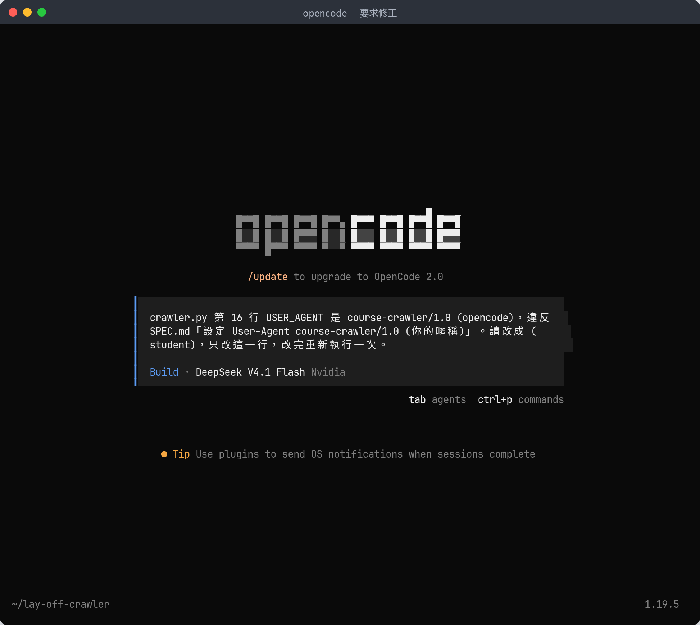

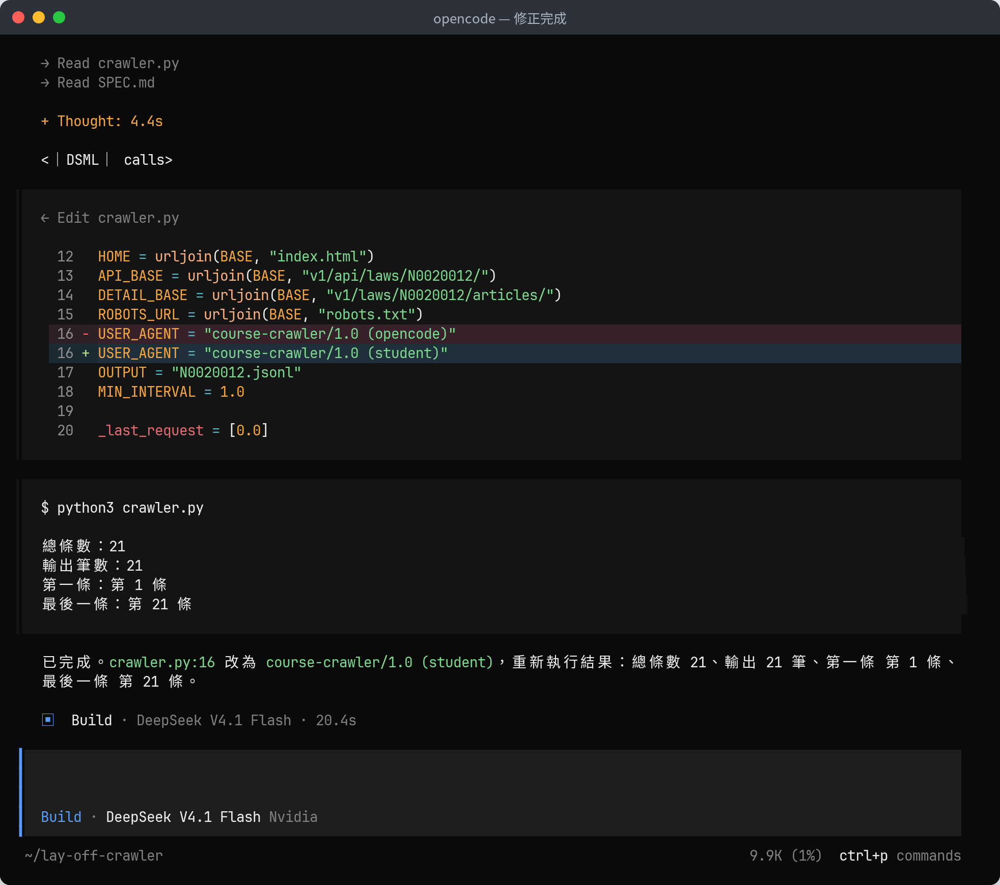

AI 先讀了 `crawler.py` 和 `SPEC.md`，只改了第 16 行（紅色 `-` 是刪掉的、綠色 `+` 是新的），重新執行後一樣是 21 條。

:::info
如果 AI 改壞了，輸入 `/undo` 可以撤銷它剛才的修改；`/redo` 可以再做回來。
:::

### 匯出對話紀錄（交作業用）

第 13 節的作業要交 OpenCode 的對話紀錄。輸入 `/export`，按 `Enter`：

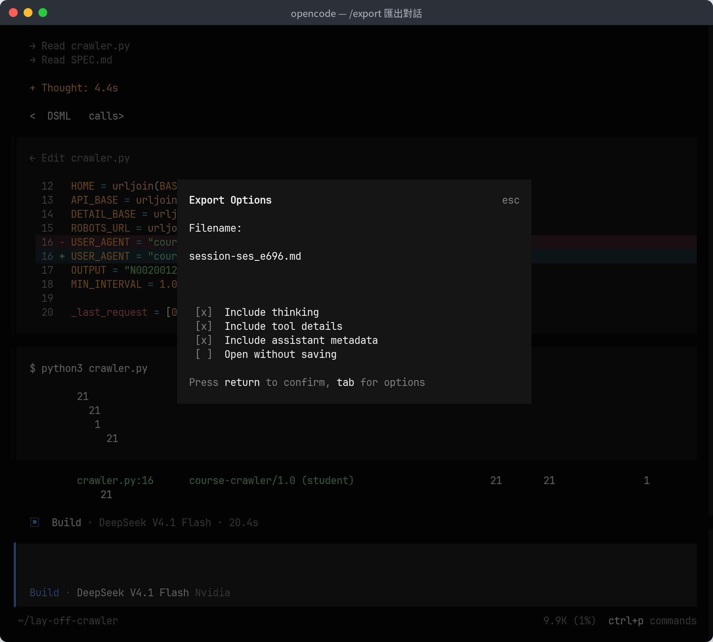

檔名預設是 `session-….md`，直接按 `Enter`，就會在目前的資料夾存成一個 Markdown 檔，裡面有你說的每一句話、AI 的回答、讀了哪些檔案、執行了哪些指令。**交之前打開檢查一遍，確認裡面沒有金鑰。**

:::info
網路上的教學可能會寫 `/share`（產生公開連結）。這個版本的 OpenCode（1.19.5）輸入 `/share` 會顯示 `No matching items`，表示沒有這個指令，本課一律用 `/export` 匯出檔案繳交。
:::

---

## 聊天視窗常用指令

| 指令／按鍵 | 作用 |
|---|---|
| `/connect` | 接上模型提供者（貼金鑰） |
| `/models` | 換模型 |
| `/init` | 讓 OpenCode 分析專案，產生 `AGENTS.md` |
| `/undo`、`/redo` | 撤銷／重做 AI 剛才的修改 |
| `/export` | 把對話存成 Markdown 檔 |
| `Tab` | 切換 Build（會改檔案）／Plan（只提計畫） |
| `Esc` | 中斷 AI、關掉跳出的視窗 |
| `Ctrl+P` | 列出所有指令 |
| `Ctrl+C` | 離開 OpenCode |

## 常見問題

| 狀況 | 原因 | 處理 |
|---|---|---|
| `opencode: command not found` | 沒設 PATH | 第 2 步 |
| 跳出 `Free limit reached` | 免費額度用完 | `Esc` 關掉，`/models` 換成 Nvidia 的模型 |
| 選了模型一直沒回應、出現 `Forbidden` 或 `Authorization failed` | NVIDIA 金鑰錯誤或失效 | 重新產生金鑰，再 `/connect` 一次 |
| `/models` 裡沒有 Nvidia | 還沒接上金鑰 | 第 5 步 |
| AI 一直改不好 | 要求太模糊 | 寫清楚「哪裡錯、違反哪一條、怎麼改」，一次只改一件事 |

## 附錄：不進聊天視窗，一行指令執行

想快速確認某個模型能不能用，可以用 `opencode run`：送出一句話，AI 做完就回到終端機，不會進入聊天視窗。

```bash
opencode run -m nvidia/deepseek-ai/deepseek-v4.1-flash "只回答一個字：好"
opencode run -m nvidia/z-ai/glm-5.3-flash "只回答一個字：好"
```

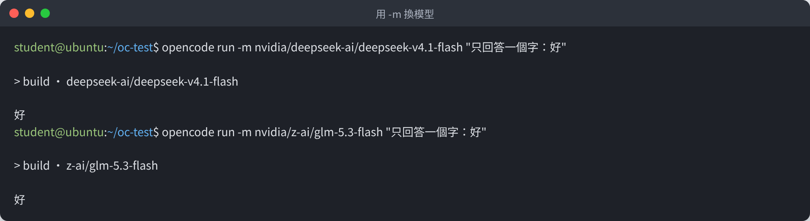

| 用法 | 說明 |
|---|---|
| `-m 提供者/模型` | 這次用哪個模型；不加就用設定檔的 `model` |
| `-c` | 接續上一次的對話 |
| `opencode models nvidia` | 列出 NVIDIA 上的模型名稱 |
| `opencode auth login -p nvidia` | 不進聊天視窗接上金鑰（和 `/connect` 效果一樣） |

上課以聊天視窗為主；`opencode run` 適合寫在腳本裡，或快速測試。
