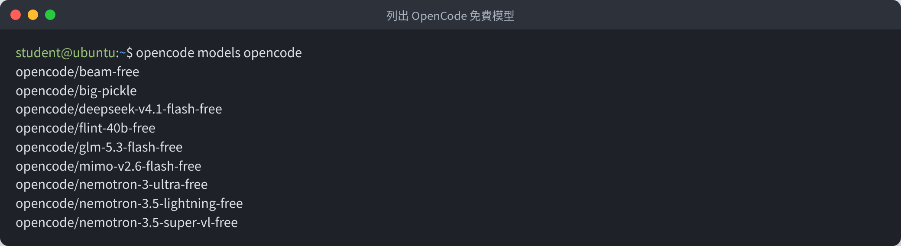
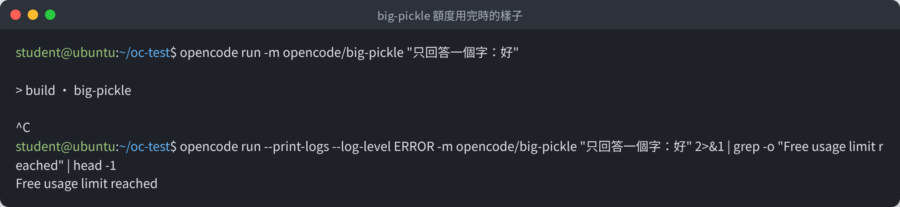
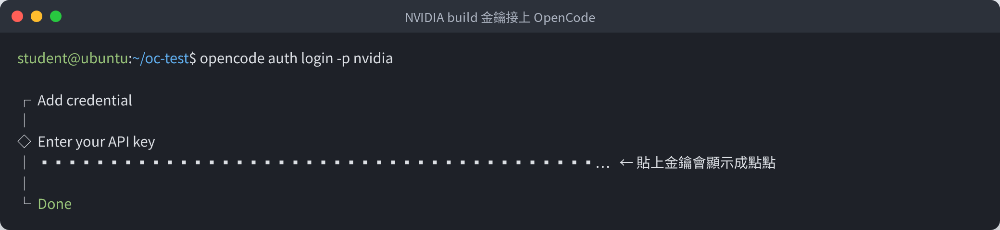
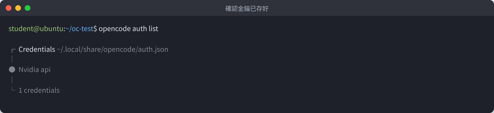
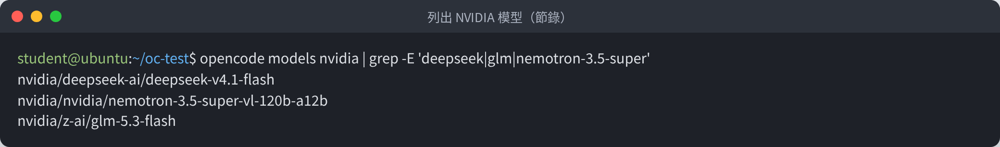
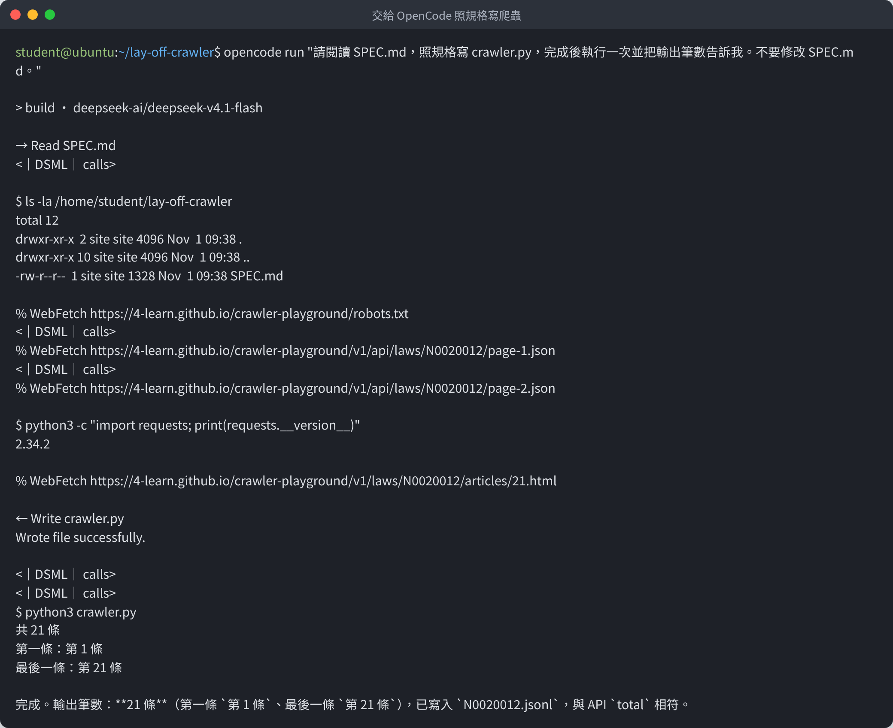
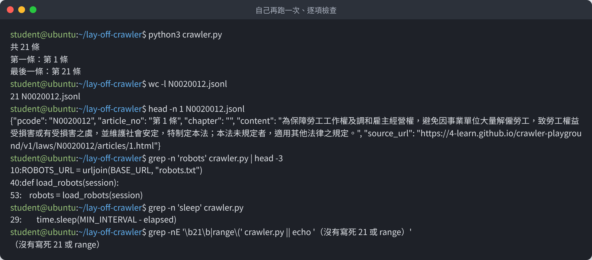
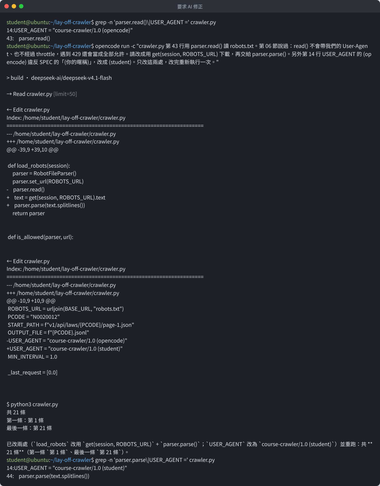

# OpenCode 安裝與模型設定：big-pickle ＋ NVIDIA build

> **用途**：第 13、14 節要用 OpenCode 讓 AI 寫爬蟲。本篇帶你從安裝開始，接上兩個免費的模型來源，學會隨時換模型，最後跑完第 13 節的課程範例。
>
> 以下每一張終端機截圖，都是在 Ubuntu 上實際執行的結果（2026-11-01，OpenCode 1.19.5）。帳號名稱以 `student` 為例。

## 為什麼同時掛兩個模型來源

| 來源 | 要不要金鑰 | 額度 | 本課用法 |
|---|---|---|---|
| **OpenCode 免費模型**（例如 `big-pickle`） | 不用 | OpenCode 提供，用完會出現 `Free usage limit reached`；全班共用同一個網路時可能比較快用完 | 裝好就能用，先拿來測試 |
| **NVIDIA build** | 要，到 build.nvidia.com 免費申請 | 個人帳號各自計算 | 主要使用；`big-pickle` 用完時切過來 |

兩邊的額度分開計算，一邊用完就換另一邊。換模型只要改一個參數（第 4 步）。

---

## 第 1 步：安裝 OpenCode

在終端機執行官方安裝指令：

```bash
curl -fsSL https://opencode.ai/install | bash
```


最後看到 OpenCode 的大字標誌就是裝好了。注意中間這行：

```text
Manually add the directory to /etc/profile (or similar):
  export PATH=/home/student/.opencode/bin:$PATH
```

意思是安裝程式**沒有幫你把 `opencode` 加進 PATH**，下一步要自己加。

## 第 2 步：設定 PATH，確認版本

```bash
echo 'export PATH=$HOME/.opencode/bin:$PATH' >> ~/.bashrc
source ~/.bashrc
opencode --version
```


第一行 `opencode: command not found` 是**還沒設 PATH** 的樣子；寫進 `~/.bashrc`、`source` 之後就找得到了。看到版本號（例如 `1.19.5`）就代表安裝完成。

:::info
`~/.bashrc` 是每次開終端機都會執行的設定檔。寫進去之後，之後開新的終端機也找得到 `opencode`。
:::

## 第 3 步：測試 big-pickle（不需要金鑰）

OpenCode 裝好就內建一批免費模型，名稱前面是 `opencode/`：

```bash
opencode models opencode
```



建一個測試資料夾，用 `big-pickle` 問一句話：

```bash
mkdir ~/oc-test && cd ~/oc-test
opencode run -m opencode/big-pickle "只回答一個字：好"
```

正常的話，畫面會出現 `> build · big-pickle`，接著一行 `好`。

**額度用完時長這樣**：只有 `> build · big-pickle`，之後一直卡住、沒有回答。加上 `--print-logs` 才看得到原因 `Free usage limit reached`：



:::warning
這張截圖就是額度用完的實際畫面：撰寫本篇時，這台電腦所在網路的 `big-pickle` 免費額度已經用完。**上課時全班共用同一個對外網路，也可能遇到一樣的情況**，這時按 `Ctrl+C` 中斷，改用下一步的 NVIDIA build。
:::

## 第 4 步：申請 NVIDIA build 金鑰

1. 打開 <https://build.nvidia.com/>，右上角按 **Login**。

   

2. 輸入 Email 註冊或登入（免費）。

   

3. 登入後到 **Settings → API Keys**（<https://build.nvidia.com/settings/api-keys>），按 **Generate API Key**，複製產生的金鑰。金鑰以 `nvapi-` 開頭。

:::warning
金鑰等同於密碼：

- 只貼進 OpenCode，不要寫進程式、`SPEC.md`，不要 commit 到 GitHub、不要貼到聊天室。
- 外流了就到同一頁刪掉，再產生一把新的。
:::

## 第 5 步：把 NVIDIA 金鑰接上 OpenCode

```bash
opencode auth login -p nvidia
```

出現 `Enter your API key` 時，**貼上金鑰、按 Enter**。為了安全，貼上的金鑰會顯示成一排點點：



看到 `Done` 就完成了。確認一下：

```bash
opencode auth list
```



金鑰存在 `~/.local/share/opencode/auth.json`，之後不用再輸入。

:::info
也可以在 OpenCode 的對話畫面裡輸入 `/connect`、搜尋 NVIDIA、貼上金鑰，效果一樣（[OpenCode 官方說明](https://opencode.ai/docs/providers/)）。本篇用 `opencode auth login`，是因為它在一般終端機就能完成，方便截圖對照。
:::

## 第 6 步：用指令換模型

列出 NVIDIA 上可以用的模型（很多，這裡只篩出幾個）：

```bash
opencode models nvidia | grep -E 'deepseek|glm|nemotron-3.5-super'
```



**換模型只要改 `-m` 後面的名稱**，格式是 `提供者/模型`：

```bash
opencode run -m nvidia/deepseek-ai/deepseek-v4.1-flash "只回答一個字：好"
opencode run -m nvidia/z-ai/glm-5.3-flash "只回答一個字：好"
```


第二行 `> build · 模型名稱` 會告訴你這次用的是哪個模型。

| 想用 | `-m` 後面寫 |
|---|---|
| OpenCode 免費 big-pickle | `opencode/big-pickle` |
| NVIDIA 上的 DeepSeek | `nvidia/deepseek-ai/deepseek-v4.1-flash` |
| NVIDIA 上的 GLM | `nvidia/z-ai/glm-5.3-flash` |

:::warning
NVIDIA 上的模型會更新、也會下架（下架的模型會回 `410 Gone`）。**上課前以老師公布的模型為準**；名稱打錯或模型已下架時，先用 `opencode models nvidia` 查目前有哪些。
:::

### 設定預設模型（不用每次打 `-m`）

把常用的模型寫進 OpenCode 的設定檔 `~/.config/opencode/opencode.json`：

```bash
mkdir -p ~/.config/opencode
cat > ~/.config/opencode/opencode.json <<'JSON'
{
  "$schema": "https://opencode.ai/config.json",
  "model": "nvidia/deepseek-ai/deepseek-v4.1-flash",
  "small_model": "nvidia/deepseek-ai/deepseek-v4.1-flash"
}
JSON
```


之後 `opencode run "..."` 不加 `-m`，就會用這個模型；要臨時換別的，再加 `-m` 就好。在 OpenCode 的對話畫面裡，也可以輸入 `/models` 從清單選。

| 欄位 | 用途 |
|---|---|
| `model` | 主要的模型，寫程式、回答問題用 |
| `small_model` | 做小事用的模型，例如幫對話取標題。不設的話 OpenCode 會自己挑一個免費模型，額度用完時會一直出現錯誤訊息 |

---

## 第 7 步：跑第 13 節的課程範例

### 準備資料夾與規格

```bash
cd ~
mkdir lay-off-crawler && cd lay-off-crawler
cp ~/python-web-crawler-demo/13-opencode/SPEC.md .
```

（`~/python-web-crawler-demo` 換成你 clone demo repo 的位置。）


### 交給 OpenCode

```bash
opencode run "請閱讀 SPEC.md，照規格寫 crawler.py，完成後執行一次並把輸出筆數告訴我。不要修改 SPEC.md。"
```



可以看到 OpenCode 做了這些事：

| 畫面上的符號 | 意思 |
|---|---|
| `→ Read SPEC.md` | 讀檔案 |
| `% WebFetch …` | 去看網站：先讀 `robots.txt`，再看 API 長什麼樣子 |
| `$ python3 …` | 在終端機執行指令 |
| `← Write crawler.py` | 寫檔案 |

最後它自己執行了 `crawler.py`，回報 **21 條**、第 1 條到第 21 條。這次大約花了 3～4 分鐘。

:::info
畫面上偶爾出現的 `<｜DSML｜ calls>` 是這個模型的內部標記，不影響結果，可以忽略。
:::

### 自己再跑一次、逐項檢查

**AI 說「完成了」不算數，要自己驗收**（第 13 節第 8 段）：

```bash
python3 crawler.py
wc -l N0020012.jsonl
head -n 1 N0020012.jsonl
grep -n 'robots' crawler.py | head -3
grep -n 'sleep' crawler.py
grep -nE '\b21\b|range\(' crawler.py || echo '（沒有寫死 21 或 range）'
```



| 檢查 | 結果 |
|---|---|
| 條數 | 21 行，和 API 的 `total` 一致 |
| 欄位 | `pcode`、`article_no`、`chapter`、`content`、`source_url` 都有 |
| 有沒有讀 robots.txt | 有（`load_robots`） |
| 有沒有間隔 | 有（`time.sleep`） |
| 有沒有寫死條數或頁數 | 沒有 |

看起來都對。**但打開 `crawler.py` 仔細看，還有兩個地方不符合要求**：

1. 讀 robots.txt 用的是 `parser.read()`。第 06 節說過：`read()` 不會帶我們的 User-Agent、不經過間隔控制，遇到 429 還會當成「全部允許」。
2. User-Agent 寫成 `course-crawler/1.0 (opencode)`，但 SPEC 要求的是 `(你的暱稱)`。

這兩個錯誤用上面的指令檢查不出來，要自己讀程式才看得到。

### 要求 AI 修正

好的修正要求有三個要素：**哪裡錯、違反哪一條、希望怎麼改**。用 `-c` 接著上一次的對話：

```bash
opencode run -c "crawler.py 第 43 行用 parser.read() 讀 robots.txt。第 06 節說過：read() 不會帶我們的 User-Agent、也不經過 throttle，遇到 429 還會當成全部允許。請改成用 get(session, ROBOTS_URL) 下載，再交給 parser.parse()。另外第 14 行 USER_AGENT 的 (opencode) 違反 SPEC 的「(你的暱稱)」，改成 (student)。只改這兩處，改完重新執行一次。"
```



OpenCode 只改了指定的兩處（畫面上的 `-` 是刪掉的行、`+` 是新加的行），重新執行後一樣是 21 條。最後用 `grep` 確認：`parser.parse` 和 `(student)` 都改好了。

:::info
`opencode run -c` 會接續**上一次的對話**，AI 記得自己剛才寫了什麼。不加 `-c` 就是開一段新對話。
:::

---

## 常見問題

| 狀況 | 原因 | 處理 |
|---|---|---|
| `opencode: command not found` | 沒設 PATH | 第 2 步 |
| 只出現 `> build · big-pickle` 就卡住 | 免費額度用完 | `Ctrl+C`，改用 `-m nvidia/…` |
| `Forbidden`、`Authorization failed`（403） | NVIDIA 金鑰錯誤或失效 | 重新產生金鑰，再跑一次 `opencode auth login -p nvidia` |
| `Gone`（410） | 這個模型已經下架 | `opencode models nvidia` 查目前的模型，換一個 |
| `Unauthorized`、`authorization was missing` | 還沒接上金鑰 | 第 5 步 |
| AI 一直改不好 | 要求太模糊 | 寫清楚「哪裡錯、違反哪一條、怎麼改」，一次只改一件事 |

## 繳交提醒

第 13 節的作業要交 OpenCode 的對話紀錄。在 OpenCode 對話畫面輸入 `/share` 會產生公開連結；或把終端機的輸出複製成文字檔。**交之前先檢查裡面沒有金鑰**。
